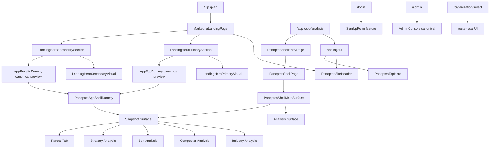

# Frontend Active Graph

更新日: 2026-08-19（Phase PD-3 post-closure sync）

## Definition

Active GraphはSvelteKit route pageと継承layoutからstatic/dynamic literal importで到達するfrontend dependency graphである。Authで保護されるrouteもproduction graphに含め、productionで無効な`/dev/` pageはdev graphへ分離する。

Machine-readable source of truth is [`frontend-component-inventory.csv`](../audit/frontend-component-inventory.csv). It is generated by `npm run audit:frontend-inventory` and verified by `npm run check:frontend-inventory`.

## Baseline

| Scope                            | Count |
| -------------------------------- | ----: |
| Reusable Svelte                  |   124 |
| Production reachable / canonical |   119 |
| Production compatibility wrapper |     0 |
| Dev-only                         |     3 |
| Test-only                        |     0 |
| Product-decision DEFER           |     2 |
| Unclassified unreachable         |     0 |
| Route Svelte files               |    12 |
| Total Svelte files               |   136 |

## Route graph



## Route ownership table

| Route                   | Page/layout ownership                                                                                          |
| ----------------------- | -------------------------------------------------------------------------------------------------------------- |
| `/`, `/lp`, `/plan`     | distinct route entries delegate to one Page-owned Marketing composition                                        |
| `/app`, `/app/analysis` | app layout owns Header/Top Hero; separate route entries delegate to one Shell entry; analysis child layoutなし |
| `/login`                | route owns auth form composition                                                                               |
| `/organization/select`  | route-local markup                                                                                             |
| `/admin`                | route imports canonical AdminConsole directly                                                                  |

Static reachability does not imply conditional render. App layout imports Top Hero for both App routes but renders it only when normalized pathname is`/app`。

## Canonical feature graph

```text
PanoptesShellMainSurface
├─ PanoptesAnalysisOverlay
│  └─ PanoptesAnalysisSurface
└─ PanoptesSnapshotSurface
   ├─ PanoptesIndustryTab → IndustryAnalysisTab → analysis sections → shared views
   ├─ PanoptesCompetitorsTab → CompetitorAnalysisTab
   │  ├─ CardGrid → CompanyCard
   │  ├─ CompareStage → ExpandedCard
   │  └─ ExpandedCard → ExpandedMetrics / EvidenceSections → RadarChart
   ├─ PanoptesSelfTab → SelfAnalysisTab
   │  ├─ OverviewPanel → OverviewSummary / OverviewEvidence → DualRingGauge
   │  ├─ ComparisonPanel
   │  ├─ EvaluationCard
   │  └─ ImprovementCandidateGrid → CandidateCard
   ├─ PanoptesStrategyTab → StrategyAnalysisTab
   │  ├─ ProjectRail → ProjectSidebar → Project/Create Cards
   │  ├─ ProgressOverview → FitGauge
   │  ├─ ImprovementSection → ImprovementMeter
   │  └─ RoadmapSection → PhaseCard → TaskList / StatusActions
   └─ PanoptesPanoaiTab
```

## Wrapper graph

Production `ACTIVE_WRAPPER` is 0. B-3Rで旧Admin/Top/Results aliasを削除し、callerを既存canonicalへ直接接続した。Route Entry WrapperはURL契約なのでcomponent wrapper countに含めない。

## Non-production and deferred graph

```text
/app/dev/ui → PanoptesUiPreviewPage
/dev/analysis-preview → AnalysisLoadingShell → AnalysisLoadingStageContent

StrategyAnalysisPlanRail [DEFER]
└─ StrategyAnalysisPlanRailCard [DEFER]
```

dev-onlyは3件。DEFER 2件はplan selectionとproject selectionのProduct semantics決定まで統合・削除しない。

## Graph invariants

- Production reachable: 119 canonical、compatibility wrapper 0。
- Unresolved local imports: 0。
- Import cycles: 0。
- Unclassified unreachable/Test-only: 0。
- Production componentはdev-only componentに依存しない。
- Route → feature/component → child directionを維持する。
- Rails/BFF/OpenAPI/Auth/Organization contractsは変更していない。

## Post-closure route removal

Phase PD-3でProduct Decision PD-05 Option Aを実装し、temporary starter route `/app/login/settings`をredirectなしで削除した。親App layout、`/app`、`/app/analysis`、reusable component reachabilityは変更していない。将来Settingsが必要な場合は、新しいProduct Discovery/Decisionを経て正式routeを設計する。

## Current follow-up

B-3Sでgraph invariants、canonical import、dependency direction、route/preview taxonomyをFrontend Structure Policyへ正本化した。既存graphは移動せず、new-code-first / touch-and-migrateで段階移行する。

## References

- [Frontend inventory summary](../inventory/frontend-inventory-summary.md)
- [Frontend route ownership](./frontend-route-ownership.md)
- [B-3R analysis](../audit/55-compatibility-wrapper-route-entry-analysis.md)
- [B-3R implementation](../audit/56-phase-b3r-wrapper-consolidation.md)
- [Frontend Structure Policy](./frontend-structure-policy.md)
- [PD-05 removal implementation](../audit/61-pd05-settings-route-removal-implementation.md)
- [B-3S analysis](../audit/57-frontend-structure-policy-analysis.md)
