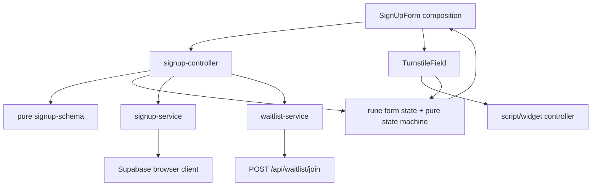
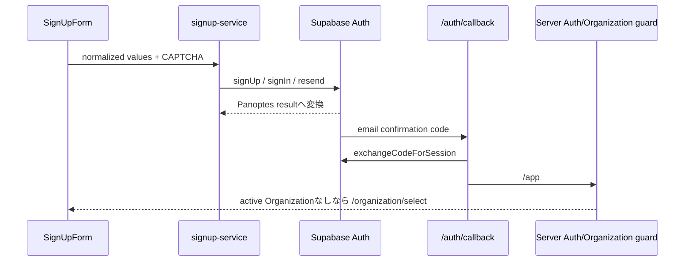

# Signup Feature Map

更新日: 2026-08-07

## Component構成

```text
/login
└─ signup public entry
   └─ ComponentsBase/SignUpForm.svelte        [Feature composition]
      ├─ SignUpFields.svelte                  [Field UI]
      ├─ TurnstileField.svelte                [Security widget lifecycle]
      ├─ TermsAgreement.svelte                [Legal disclosure / consent]
      ├─ SignUpFeedback.svelte                [Error / success / resend]
      └─ SignUpBtn.svelte                     [Primitive]
```

外部利用側は`$lib/features/auth/signup`だけをimportする。内部componentやserviceへのdeep importはfeature外では行わない。

## Stateとservice flow



Statusは`idle`、`validating`、`turnstile_waiting`、`submitting`、`resending`、`awaiting_confirmation`、`success`、`partial_success`、`rate_limited`、`failed`を明示する。`submitting`と`resending`をbusy stateとして、command入口で重複実行を拒否する。

## Auth・callback・Organization



SSR cookie、callback、refresh、logout、Organization guardは既存server実装を正本とし、signup featureから変更しない。service-role keyは参照せず、browser clientはpublic anon境界だけを利用する。

## Signup / waitlist順序

1. pure client validation
2. Supabase signup
3. Supabase成功時のみwaitlist join
4. waitlist失敗はAuth成功を取り消さず`partial_success`
5. Turnstile reset
6. 確認メール待ち／再送feedback

## Dependency direction

`route → public entry → composition → controller → state/pure logic/services → external adapter`

UI componentはSupabase SDK error、waitlist response、timer handle、Turnstile widget IDを扱わない。Auth serviceはUI文言を持たず安定したresult codeを返す。
