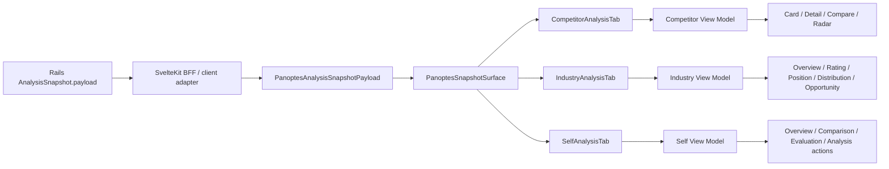

# Snapshot Component Map

更新日: 2026-08-07（Phase B-2）

## Data flow



OpenAPIの`AnalysisSnapshot.payload`はMVPではgeneric objectである。frontend domain typeがsection構造を型付けし、View Modelがdisplay-only valueを生成する。UI componentはfetchや認可を行わない。

## Canonical component graph

### Competitor

```text
PanoptesSnapshotSurface
└─ PanoptesCompetitorsTab
   └─ CompetitorAnalysisTab                    [Feature Container]
      ├─ CompetitorAnalysisSummaryCard         [Composite UI]
      ├─ CompetitorAnalysisCardGrid            [Domain View]
      │  └─ CompetitorAnalysisCompanyCard      [Composite UI]
      ├─ CompetitorAnalysisExpandedCard        [Domain View]
      │  └─ CompetitorAnalysisRadarChart       [Primitive/Chart]
      └─ CompetitorAnalysisCompareStage        [Composite UI]
         └─ CompetitorAnalysisExpandedCard
```

### Industry

```text
PanoptesSnapshotSurface
└─ PanoptesIndustryTab
   └─ IndustryAnalysisTab                      [Feature Container]
      ├─ IndustryAnalysisOverviewSection       [Domain View]
      ├─ IndustryAnalysisRatingSection         [Domain View]
      ├─ IndustryAnalysisPositionSection       [Domain View]
      ├─ IndustryAnalysisDistributionSection   [Domain View]
      └─ IndustryAnalysisOpportunitySection    [Domain View]
         └─ industry/shared/*                  [Composite UI / Primitive]
```

### Self

```text
PanoptesSnapshotSurface
└─ PanoptesSelfTab
   └─ SelfAnalysisTab                          [Feature Container]
      ├─ SelfAnalysisOverviewPanel             [Domain View]
      │  └─ SelfAnalysisDualRingGauge          [Primitive/Chart]
      ├─ SelfAnalysisComparisonPanel           [Domain View]
      ├─ SelfAnalysisEvaluationCard            [Composite UI]
      └─ SelfAnalysisStrategyRecommendationGrid[Composite UI]
         └─ SelfAnalysisStrategyRecommendationCard
```

名称に`StrategyRecommendation`が残るcomponentは、Phase B-2以後はSelf payloadの`actionCards`だけを表示する。承認済みstrategy plan、roadmap、task statusはStrategy tabの責務である。名称変更はdirectory再編を伴うためB-3候補とする。

## Canonical View Models

- Competitor: API/domain cardからdisplay cardへ変換。fallback、score clamp、6軸display radar、URL・insight・action mappingを担当
- Industry: `PanoptesIndustryData`をそのまま正本として渡す。重複shapeは作らない
- Self: score clamp、delta badge、radar、breakdown、evaluation、Self由来action candidateを生成。Strategy payloadには依存しない

## Removed legacy components

- `PanoptesCompetitorCard`
- `PanoptesCompetitorDetailPanel`
- `PanoptesIndustryDistributionPanel`
- `PanoptesIndustryMarketTypeCard`
- `PanoptesIndustryOpportunityPanel`
- `PanoptesIndustryPositionPanel`
- `PanoptesIndustryRatingPanel`
- `PanoptesIndustrySignalPills`
- `PanoptesSelfActionPanel`
- `PanoptesSelfRadarPanel`
- `PanoptesSelfScorePanel`

これらをimportするproduction/dev/test entryはない。必要fieldとinteractionの移植後、Phase B-2で削除した。
