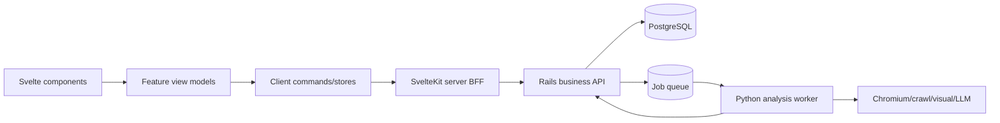

# 推奨ターゲットアーキテクチャ

## 責務分界



- UI: 表示、一時入力、local interaction、optimistic presentation。
- SvelteKit BFF: cookie/session、route guard、SSR、Rails proxy、UI response shaping。
- Rails: Organization/User/Role、業務entity、validation/state transition、transaction、usage/billing/audit。
- Python worker: crawl、screenshot、HTML/visual/LLM分析。DBを任意更新せず、job contract経由で結果を返す。

## 推奨directory

```text
src/lib/
├─ components/
│  ├─ primitives/          # Button, Input, Badge, Spinner
│  ├─ ui/                  # Dialog, Tabs, Panel, FormField
│  ├─ layout/              # AppShell, Header, PageHeader
│  └─ feedback/            # Toast, Empty, Error, Loading
├─ features/
│  ├─ auth/
│  ├─ projects/
│  ├─ analysis/
│  ├─ competitors/
│  ├─ industry/
│  ├─ self-analysis/
│  ├─ strategies/
│  ├─ roadmaps/
│  └─ admin/
├─ domain/
│  ├─ models/
│  ├─ types/
│  └─ constants/
├─ api/
│  ├─ client/
│  ├─ server/
│  └─ contracts/
├─ stores/
├─ utils/
├─ styles/
└─ config/
```

## 配置ルール

- 2 feature以上で使う純粋UIだけを`components`へ。domain名を含むものはfeatureへ。
- page-local componentはroute隣接の`_components/`へ置き、他routeからimportしない。
- componentはDB/Supabase/Rails clientを直接importしない。callbackまたはfeature commandを受ける。
- `api/server`は`$lib/server`相当のserver-only entryとし、client importを禁止。
- generated contractは手編集せず、version/生成元を記録。UIへ直結しない。
- barrel exportはfeature public APIだけ。全component一括barrelは禁止。
- mock/fixtureは`features/*/fixtures`または`dev`へ置き、production entryから静的importしない。

## 段階移行

1. build/checkを正常化し、active/dead graphを固定。
2. auth/org/BFF boundaryを追加。
3. `panoptes` runtimeを`features`と`domain/api`へ移す（挙動変更なし）。
4. duplicate snapshot/domain UIを正本化。
5. primitive + tokenを導入し、Tailwindを段階適用。
6. Rails endpointへmock contract testを通して切替。
7. Python worker job/event contractを固定。

## 用語集

| 正式語 | 避ける曖昧語 | 意味 |
|---|---|---|
| Organization | company / tenant混用 | 契約・認可境界 |
| Project | item / data | 分析対象サイトを持つ業務単位 |
| Competitor | comparison target | 競合対象 |
| AnalysisJob | analysis状態全般 | 1回の非同期分析実行 |
| AnalysisSnapshot | result/data | commit済み不変結果 |
| StrategyPlan | proposal混用 | snapshotから生成された戦略案 |
| PhaseTask | roadmap item | 30/60/90日phaseの実行task |
| Self Analysis | assessment/evaluation混用 | 自社サイト分析domain |
| Industry Analysis | market structure混用 | 業界構造分析domain |
| View Model | API response | UI表示用に変換済みの型 |

