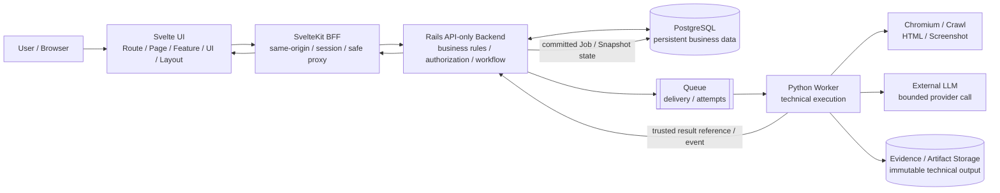
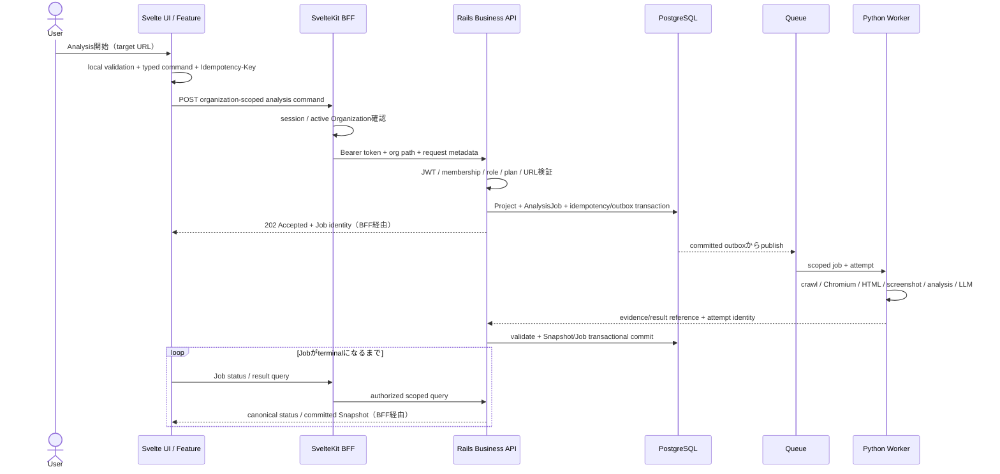

# Module 01 — Panoptes Overall Architecture

Updated: 2026-10-05 — Phase TB-02  
Status: `COMPLETE / READY_FOR_M02`  
Difficulty: `FOUNDATION`  
Prerequisite: none  
Parent: [Panoptes Technical Bootcamp](../panoptes-technical-bootcamp.md)

## 1. 学習目標（Learning goals）

このModuleを終えた学習者は、次の内容を自分の言葉で説明できます。

1. Panoptesの主要Systemと、それぞれが所有する責務。
2. User ActionがFrontend、BFF、Rails、DB、Queue、Workerを通るTarget flow。
3. Business state、persistent data、technical execution、presentation stateのSource of Truthの違い。
4. なぜAnalysisを通常の同期HTTP requestだけで完結させないのか。
5. 現Repositoryの`CURRENT`、承認済みだが未接続の`TARGET`、未実装または後続判断の`DEFERRED`。

M01は全体地図を作るModuleです。SvelteKit、BFF、Rails、AnalysisJob、Queue、Worker、Snapshot、Formulaの詳細は後続Moduleで扱います。

## 用語ガイド

- **Architecture（アーキテクチャ）:** System全体をどの部分に分け、それぞれへ何を任せ、どう接続するかという設計。
- **Layer（層）:** 同じ種類の判断や処理をまとめた単位。単なるfolderの位置ではなく、「どの判断を担当するか」で区別する。
- **Boundary（境界）:** あるLayerが担当する範囲と、別のLayerへ渡す範囲の区切り。
- **Source of Truth（正しい状態を判断する基準となる情報源）:** ある事実について、最終的にどの情報を正しいものとして参照するかを示す。
- **Canonical（正本として採用された）:** 複数の表現や候補があるとき、Panoptesで正式な基準として扱うもの。

> つまり、このModuleでは「どの技術を使うか」だけでなく、「誰が何を決め、その結果をどこへ残すか」を読み解く。

## 2. 一般論 — Architectureをどう読むか

### 2.1 Layerは「置き場所」ではなく「決定権」で分ける

Architectureの境界は、ファイルの拡張子やプログラミング言語だけでは決まりません。重要なのは、「どの層が何を決定してよいか」です。

- **Presentation:** 何をどう見せ、local interactionをどう扱うか。
- **Application orchestration:** User Actionをcommandへ変換し、複数の処理を調整する。
- **Trust boundary:** 誰で、どのOrganizationに属し、何を実行できるかを検証する。
- **Business domain:** Job、Snapshot、Score、Plan等の正式な意味と状態遷移を決める。
- **Persistence:** 正式なstateをtransactionとconstraintで保存する。
- **Technical execution:** crawl、Chromium、screenshot、analysis、LLM等の長時間処理を実行する。

同じ情報が複数layerに一時的に存在しても、正式な決定権を持つSource of Truthは一つにします。Frontend storeにProjectが表示されていても、そのstoreがProjectの正式状態を決めるわけではありません。

### 2.2 Source of Truthとは

Source of Truthは「最新値がたまたま入っている場所」ではありません。値が食い違ったときに、どの値を正式なものと判断するか、その基準を示します。

- UI stateのSource of Truthは、その画面を所有するFrontend component/controllerになりうる。
- Business decisionとcanonical state transitionのauthorityはRailsに置く。
- 永続化されたbusiness recordはPostgreSQLが保持する。
- Queueはdeliveryを管理するが、最終Job statusを決めない。
- Workerは技術処理を実行するが、authorizationや正式なbusiness transitionを決めない。

### 2.3 同期処理と非同期処理

**同期処理**ではrequest中に処理が完了し、呼び出した側はresponseを待ちます。短い読み取り、validation、commandの受付に向いています。\
**非同期処理**ではcommandの受付と実際の処理を分け、Job IDなどを先に返します。時間のかかる処理や、外部依存、Retry、並列制御が必要な処理に向いています。

Webサイトの巡回、Chromiumによる描画、screenshotの取得、視覚分析、LLM処理には時間がかかり、失敗要因も多くあります。HTTP接続を維持したまま完了を待つより、RailsがAnalysisJobを正式に作成し、Queue/Workerへ実行を任せ、Frontendが状態を取得する構成の方が、役割と失敗時の対応を管理しやすくなります。

Queue、Retry、冪等性の具体策はM13で扱います。M01では、「要求の受付」「処理の実行」「結果を正式な状態として確定するcommit」が、それぞれ別の責務であることを押さえてください。

## 3. Panoptesでの対応

### 3.1 System Architecture



この図は**Target Architecture**です。現Repositoryに、Queue、Python Worker、Chromiumによる収集、Object Storage、LLM処理、本番用の分析結果の永続化が、すべて実装されているという意味ではありません。

### 3.2 Frontend内部の入口

Target dependency directionは次の通りです。

```text
SvelteKit Route Entry
  -> Page Entry
  -> Feature / View Model / Controller / Command
  -> Client
  -> SvelteKit BFF
```

- **Route / Page:** URL、server loadから得たverified context、page compositionを扱う。
- **Layout / Shell:** persistent navigationやstructural chromeを扱う。
- **Feature:** use-case orchestration、view-model、command、feature stateを扱う。
- **UI / Composite / Primitive:** rendering、local interaction、callbackを扱う。
- **Client:** same-origin BFF path、transport型、timeout/cancellation、安全なerror mappingを扱う。

UI componentがRails URL、raw response、Organization authorization、business formulaを直接所有しないことが重要です。

## 4. Current / Target / Deferred

この分類はM01で最も重要です。

| 領域                | `CURRENT` — Repositoryで確認済み                                                                                           | `TARGET` — 承認済みArchitecture                                            | `DEFERRED` — 未実装または後続判断                                       |
| ------------------- | -------------------------------------------------------------------------------------------------------------------------- | -------------------------------------------------------------------------- | ----------------------------------------------------------------------- |
| Frontend shell      | `/app`と`/app/analysis`が`PanoptesShellEntryPage`へ接続。Feature controller、store、AnalysisJob adapter、polling構造が存在 | Route→Page→Feature→Clientのcanonical dependency                            | target directory migration、legacy `ComponentsBase`縮退                 |
| Auth / Organization | SvelteKit server context、canonical BFF client、read-only BFF endpoints、Rails JWT/membership readが存在                   | BFFとRailsの二重検証、explicit Organization scope                          | business resource単位の実API拡張、staging/production validation         |
| BFF                 | health、current user、organizations、organization、membershipの5 read surfaceが存在                                        | `/api/panoptes/v1`からOrganization-scoped business APIを安全にproxy        | Project、AnalysisJob、Snapshot等のbusiness endpoints                    |
| Rails               | API-only Railsとidentity/Organization read APIを実装                                                                       | Business rule、authorization、Job transition、Snapshot commitのowner       | Project、AnalysisJob、Queue、Worker callback、Score、Strategy、Billing  |
| PostgreSQL          | User、Organization、Membership、SystemRole schemaを実装                                                                    | canonical business data、transaction、constraint、idempotency/outbox/audit | Project、Job、Snapshot、Evidence metadata等のphysical schema            |
| Analysis UI         | typed action/store、polling、adapter、development mock lifecycleが存在                                                     | canonical AnalysisJob responseをadapter経由でUIへ投影                      | production business client接続。canonical modeは現在503でfail closed    |
| Queue / Worker      | production implementationは確認できない                                                                                    | Queueがdelivery、Workerがcrawl/Chromium/analysis/LLM/artifact処理          | provider、runtime、retry、callback、storageの実装と運用判断             |
| Snapshot / Evidence | dummy/mock Snapshotとpresentation surfaceが存在                                                                            | Worker outputをRailsが検証し、immutable Snapshot/Evidence lineageをcommit  | canonical production persistence、schema/version/wire、artifact storage |
| External LLM        | production executionは確認できない                                                                                         | Worker内のbounded technical processing。結果はRails validation後に正式化   | provider選定、prompt/output contract、privacy、cost、retry、audit       |

`documented`は`implemented`と同義ではありません。たとえばAnalysisJob state machineとAPI boundaryはTarget contractを説明するが、Rails R-1はidentity/Organization read onlyです。

## 5. Representative Directory / Code / Contract

Repo-wideに読む必要はありません。M01では次の入口だけを地図として使います。

| Path                                                                           | Layer / role                  | M01で見る点                                                                 |
| ------------------------------------------------------------------------------ | ----------------------------- | --------------------------------------------------------------------------- |
| `src/routes/app/+page.svelte`                                                  | Route/Page Entry              | verified `activeOrganizationId`をShellへ渡す薄いentry                       |
| `src/routes/app/analysis/+page.svelte`                                         | Route/Page Entry              | 現時点では同じShell entryへ接続するroute                                    |
| `src/lib/components/ComponentsBase/PanoptesShellEntryPage.svelte`              | compatibility Page Entry      | fallback SnapshotとOrganization IDをShellへ渡す                             |
| `src/lib/components/ComponentsBase/Panoptes/PanoptesShellPage.svelte`          | Feature Orchestrator          | Shell lifecycleとfeature compositionの現行owner                             |
| `src/lib/features/panoptes-shell/`                                             | Feature boundary              | controller、view-model、presentation surfaceの分離                          |
| `src/lib/panoptes/actions/analysis.ts`                                         | Feature command/action        | URL validation、idempotency key、API invocation、polling/store coordination |
| `src/lib/panoptes/api/client.ts`                                               | runtime client selection      | dev opt-inだけmock。それ以外はunavailable canonical client                  |
| `src/lib/panoptes/api/unavailable-canonical-business-client.ts`                | explicit unavailable boundary | 未実装Rails business APIをlegacy pathへfallbackせず503にする                |
| `src/lib/panoptes/api/canonical-bff-client.ts`                                 | CURRENT canonical read client | same-origin BFF、response validation、timeout/error mapping                 |
| `src/routes/api/panoptes/v1/`                                                  | SvelteKit BFF                 | CURRENTの5 read-only proxy surface                                          |
| `rails/config/routes.rb`                                                       | Rails API entry               | CURRENTの5 read-only Rails operations                                       |
| `rails/app/controllers/concerns/authentication.rb`                             | Rails authentication          | Bearer JWTをRailsで独立検証する入口                                         |
| `rails/app/controllers/concerns/organization_authorization.rb`                 | Rails authorization           | DB membership/roleでOrganization scopeを再検証                              |
| `rails/db/migrate/20260807000000_create_identity_and_organization_boundary.rb` | PostgreSQL schema             | CURRENT identity/Organization persistent boundary                           |
| `docs/architecture/api-boundary.md`                                            | Target contract               | BFF、Rails、DB、Queue、Workerの責務とtrust boundary                         |
| `docs/api/analysis-job-state-machine.md`                                       | Target Job contract           | canonical transitionとSnapshot commit owner                                 |
| `docs/architecture/analysis-job-frontend-boundary.md`                          | Frontend mapping              | canonical response、mock、runtime modelを分離                               |

Fileの存在だけでProduct readinessを判断しません。どのpathがcanonicalで、どのmodeで実行され、backendまで接続しているかを合わせて確認します。

## 6. Responsibility Map

| 層（Layer）                | 担当すること                                                                                | 担当しないこと                                          | 受け取るもの                                     | 返すもの                                               | 正本となる範囲                        | Failure時の責務                                               |
| -------------------------- | ------------------------------------------------------------------------------------------- | ------------------------------------------------------- | ------------------------------------------------ | ------------------------------------------------------ | ------------------------------------- | ------------------------------------------------------------- |
| Frontend Route/Page/Layout | URL entry、verified context伝播、page/shell composition                                     | business rule、membership判定、Job transition           | SvelteKit load data、Feature view model          | rendered page、typed user intent                       | presentation/route stateのみ          | safe stateを表示し、server authorityを捏造しない              |
| Feature / UI               | use-case orchestration、local/feature state、view-model、callback                           | canonical business state、Rails authorization、formula  | user action、client result                       | command input、presentation state                      | local interaction stateのみ           | retryable/error/partialを区別し、last stable viewを保つ       |
| Client                     | BFF path、transport validation、timeout、cancellation、error mapping                        | UI state、business decision、Rails internal URL         | typed command/query                              | typed response/error                                   | No                                    | malformed/timeoutを安全なerrorへし、silent fallbackしない     |
| SvelteKit BFF              | cookie/session、same-origin boundary、token forwarding、active-org gate、safe proxy/shaping | Product rule、final authorization、Job state machine    | browser request、verified auth context           | safe response/error、Rails request                     | No                                    | fail closed、secret/raw upstream errorを漏らさない            |
| Rails API                  | business rule、authorization、workflow、Job/Snapshot transition、transaction                | browser presentation、crawl/LLM実行                     | authenticated command/query、Worker result event | canonical resource/state、accepted/rejected transition | **Canonical business decision owner** | validation/authorization/transactionを確定し、audit可能にする |
| PostgreSQL                 | persistent record、constraint、transaction、lineage metadata                                | long-running crawl/LLM                                  | Rails transaction                                | committed durable data                                 | **Persistent business data store**    | invariantを守り、部分commitを防ぐ                             |
| Queue                      | delivery、attempt metadata、visibility/deadline                                             | final Job state、authorization                          | trusted job message                              | delivery/attempt to Worker                             | delivery stateのみ                    | redeliveryとattemptを管理し、business completionを宣言しない  |
| Python Worker              | URL/SSRF防御、crawl、Chromium、screenshot、technical analysis、LLM call、artifact upload    | membership、billing、final state transition、任意DB更新 | Rails発行のscoped job/attempt                    | evidence/artifact reference、result event              | technical executionのowner            | deadline/cancelを守り、structured failureをRailsへ返す        |
| Evidence / Snapshot        | Evidenceは観測根拠、Snapshotは正式commitされた時点のimmutable result                        | current mutable Project stateとの同一視                 | Worker artifact + Rails metadata/validation      | reproducible historical reference                      | committed Snapshotはhistorical record | incomplete artifactを勝手にcurrentへ昇格しない                |

## 7. One User Action Trace — 「UserがAnalysisを開始する」

### 7.1 Analysis Request Flow



これはTarget flowです。各stepの現在地は次のとおりです。

### 7.2 `CURRENT` flow

1. `/app`または`/app/analysis`がverified `activeOrganizationId`をShellへ渡す。
2. Shell controllerはcurrent BFF/Rails read pathでOrganization boundaryを検証できる。
3. User actionは`createAndStartAnalysis`へ入り、URLを検証し、idempotency keyを生成する。
4. `dev && PUBLIC_USE_MOCK_API === 'true'`なら、browser側development mockがProject、Job、progress、Snapshotを模擬する。
5. それ以外は`unavailableCanonicalBusinessClient`が`503 business_api_unavailable`を返す。
6. したがって、production Analysis commandは現在BFF、Rails、Queue、Workerへ到達しない。mock成功をproduction end-to-end成功と表現してはいけない。

### 7.3 `TARGET` flow

1. Feature commandがexplicit Organization scopeとIdempotency-Keyを持つrequestをsame-origin BFFへ送る。
2. BFFがsession/active Organizationを確認し、Supabase Bearer tokenをRailsへ転送する。
3. RailsがJWT、membership、role、plan、URLを再検証する。
4. RailsがProject、AnalysisJob、idempotency/outboxを同一transactionで保存し、`202 Accepted`を返す。
5. Queueがtrusted jobをWorkerへdeliverする。
6. Workerがcrawl、HTML、Chromium screenshot、internal/visual analysis、必要なLLM processingを実行する。
7. Workerはartifact/evidence参照とattempt identityをRailsへ返す。DBを直接好きな状態へ更新しない。
8. RailsがJob/attempt/Organization整合性を検証し、SnapshotとJobをtransactionでcommitする。
9. Frontendはpolling等でcanonical Job stateを取得し、committed Snapshotを表示する。

### 7.4 `DEFERRED` implementation

- Organization-scoped Project / AnalysisJob / Snapshot BFF endpoints。
- Rails business models、commands、state transition、physical schema。
- Queue/outbox publisher、attempt/retry/cancel implementation。
- Python Worker、Chromium collection、SSRF防御、artifact storage。
- External LLM provider、prompt/output contract、privacy/cost policy。
- canonical Evidence/Snapshot persistenceとversion/lineage wire contract。
- Production observability、deployment、capacity、recovery verification。

## 8. Source of Truth — なぜ分離するのか

### FrontendはBusiness Stateの正本ではない

Browserはreload、複数tab、network delay、stale response、改変の影響を受けます。Storeは高速な表示とinteractionのためのprojection/cacheであり、authorizationや正式なJob completionを決められません。

### BFFはBusiness Logicの正本ではない

BFFは、Browserに近い位置で安全性と通信を調整する層です。Cookie/session、same-origin通信、Rails URLの秘匿、安全な応答形式への変換に適しています。ただし、同じ業務ルールをRailsとBFFの両方へ持たせると、不一致が生じます。BFFで許可しても、Railsが毎回再検証します。

### RailsがCanonical Business Decisionを所有する

Railsはactor、Organization、resource、current stateを揃えてtransactionalに判断できます。Job transition、Snapshot昇格、usage/plan、authorization、idempotencyの正式判断を一か所へ集めます。

### PostgreSQLはPersistent Business Dataを保持する

PostgreSQLは、Railsが決めた業務状態を永続的な記録として保持し、制約やtransactionによって整合性を支えます。Railsが業務上の判断を担当し、PostgreSQLがその結果を保存するという役割の違いがあります。

### WorkerはTechnical Executionを担当する

Workerは、時間がかかりCPUやmemoryを多く使う処理を、他の処理から分離して実行できます。一方、Workerへのmessageは遅延・重複・再試行される可能性があります。Workerが最終的なJob状態やMembershipを決めると、古い試行の結果によって正式な状態が壊れるおそれがあるため、Railsが結果を再検証して確定します。

### Evidence / Snapshotは履歴再現性を支える

Evidenceは「何を観測したか」、Snapshotは「どの契約・versionに基づき、何を正式な結果として確定したか」を残します。Projectの現在の状態だけを上書きすると、過去の結果の解釈・比較・監査や、Retry前後の差分を再現できません。

## 9. なぜこの設計なのか

1. **Security:** BrowserやWorkerをauthorityとして信頼せず、Railsでidentity/resourceを再検証する。
2. **Consistency:** Business transitionとpersistent updateをtransactionへ集める。
3. **Responsiveness:** 長時間分析をHTTP requestから切り離し、UIへJob identityを早く返す。
4. **Recoverability:** failure、timeout、retry、partial resultを明示的なJob stateで扱う。
5. **Traceability:** Organization、Project、Job、attempt、Evidence、Snapshotのlineageを追える。
6. **Replaceability:** Svelte UI、LLM provider、Queue、Worker runtimeを変えてもbusiness authorityを保つ。
7. **Testability:** layer contractごとにunit、contract、integration、E2Eを分けられる。

この分離には、管理する契約やdeploy対象が増え、層をまたぐ監視や、一時的な状態のずれへの対応が必要になるという代償があります。小さな同期処理まで無理にQueueへ送るのではなく、処理時間、障害の影響を分離する必要性、Retry要件に応じて境界を選びます。

## 10. よくある誤解

### 「SvelteKit BFFがbackendならRailsは不要」

BFFはbrowser-facing security/transport adapterであり、canonical business backendではありません。Railsはbusiness rule、authorization、transaction、Job/Snapshot workflowを所有します。

### 「Frontend StoreにデータがあるのでDB代わりになる」

Storeはprocess/tab/lifecycleに依存し、他actorとの競合やconstraintを正式に解決できません。server stateのprojectionとして使います。

### 「Workerが分析したのでWorkerがcompletedを決める」

Workerは結果候補を返すだけです。Railsがattempt、Job、Organization、artifact整合性を検証し、transaction完了後に正式stateを決めます。

### 「SnapshotはCurrent Stateのコピー」

Snapshotはimmutable historical resultであり、生成時のcontract/version/lineageを持つべきresourceです。Current stateは新しいJobやUser Actionで変わる可能性があります。

### 「Target diagramにあるので実装済み」

Target contractは将来の責務を固定する設計であり、実装証拠ではありません。現行Railsはidentity/Organization read onlyで、production Analysis business clientは明示的unavailableです。

### 「Development mockが動けばproduction flowも動く」

MockはFrontend contractとinteractionを検証するadapterです。Queue、Worker、Rails transaction、authorization、external provider、durable persistenceの動作証拠にはなりません。

## 11. Practice Exercises

### 11.1 Code Reading

次のpathをLayerへ分類し、その根拠を一文で書く。

1. `src/routes/app/+page.svelte`
2. `src/lib/features/panoptes-shell/controller/panoptes-shell-controller-adapter.ts`
3. `src/lib/panoptes/api/canonical-bff-client.ts`
4. `src/routes/api/panoptes/v1/organizations/[organization_id]/+server.ts`
5. `rails/app/controllers/concerns/organization_authorization.rb`
6. `rails/db/migrate/20260807000000_create_identity_and_organization_boundary.rb`

追加問題：`src/lib/panoptes/api/mock-backend.ts`が存在することは、production Rails business flowの実装証拠になるか。理由も答えてください。

### 11.2 Tracing

TargetのAnalysis開始flowを正しい順へ並べてください。

- A. WorkerがEvidence/artifact参照を返す。
- B. RailsがSnapshotをtransactional commitする。
- C. UIがtyped commandをBFFへ送る。
- D. Queueがtrusted jobをWorkerへ渡す。
- E. BFFがsessionとactive Organizationを確認する。
- F. RailsがJWT/membership/roleを再検証してJobを作る。
- G. UIがcanonical Job/Snapshotを取得する。

次に、CURRENTで実際に到達できるstepと、TARGET/DEFERREDのstepへ印を付ける。

### 11.3 Knowledge Check

1. Source of Truthとcache/projectionの違いは何か。
2. BFFでOrganizationを確認した後、Railsでも再確認するのはなぜか。
3. Queueがfinal Job stateを所有しないのはなぜか。
4. WorkerからPostgreSQLを任意更新させないのはなぜか。
5. 同期HTTPだけでcrawl/Chromium/LLMを完結させる問題を二つ挙げてください。
6. committed Snapshotとworking artifactの違いは何か。
7. 現在のproduction Analysis commandはどこで停止するか。
8. `documented TARGET`を`CURRENT`と判断する前に何を確認すべきか。

### 11.4 Architecture Explanation

次の問いへ、図を使わず200〜400字程度で答える。

> なぜPanoptes FrontendからPython Workerを直接呼ばないのか。

回答には少なくとも、authentication/authorization、Organization scope、Job identity、retry/stale result、Snapshot commit、secret/provider boundaryを含めます。

## 12. Answer / Explanation Guide

### 12.1 Code Reading回答例

1. Route/Page Entry。URL entryとしてOrganization contextをShellへ渡す。
2. Feature controller adapter。UI lifecycleとuse-case action/client dependencyを接続する。
3. Client/transport boundary。same-origin BFF path、response validation、timeout/errorを扱う。
4. SvelteKit BFF。verified requestをRails organization pathへproxyする。
5. Rails authorization。DB membership/roleによってOrganization accessを再検証する。
6. PostgreSQL schema migration。identity/Organizationのpersistent constraintを定義する。

Mock backendはproduction実装証拠になりません。development opt-inのin-browser adapterであり、BFF、Rails transaction、Queue、Worker、durable Snapshotを通らないためです。

### 12.2 Tracing回答

正順は`C -> E -> F -> D -> A -> B -> G`。

CURRENTではUI action、Organization read boundary、mock/runtime adapter等の部分実装は存在するが、production Analysis commandの`C`以降をend-to-endには実行できません。Canonical modeはbusiness clientで503となります。`E`は既存read-only organization flowで実装済みだが、Analysis mutation BFFはDEFERRED。`F`〜`B`のbusiness backend/queue/worker/snapshot commitもDEFERREDです。

### 12.3 Knowledge Check要点

1. Source of Truthは競合時のauthority、cache/projectionは表示や処理のための複製。
2. Browser/BFFだけをauthorization authorityにせず、resourceを持つRailsがtoken、membership、roleを再検証するため。
3. Queueはdelivery systemであり、business invariantやtransactionを完全には知らないため。
4. stale/duplicate attempt、scope違い、部分更新からcanonical stateを守るため。
5. timeout/resource占有、外部failure、retry/cancel、scale isolationの難しさ等。
6. SnapshotはRailsがcommitしたimmutable historical resource、working artifactは処理途中で非canonical。
7. development mock以外は`unavailableCanonicalBusinessClient`の503で停止する。
8. executable route/client/server/model/schema、runtime mode、integration evidence、verification resultを確認する。

### 12.4 Architecture Explanation回答例

FrontendからWorkerを直接呼ぶと、browserがWorker credentialやprovider境界へ近づき、User・Organization・Roleを正式に再検証するRails transactionを迂回してしまう。また、重複requestや遅延したattemptをどのAnalysisJobへ結び付けるか、どの結果をcurrent Snapshotへ昇格させるかを安全に決められません。FrontendはBFFへintentを送り、RailsがauthorizationとJob identityを確定し、Queue経由でWorkerへ委譲します。Workerは技術処理とEvidence生成に限定し、Railsがresult scopeを再検証してSnapshotをcommitすることで、retry、stale result、secret、履歴整合性を管理できます。

## 13. Completion Criteria

| Criterion                                     | Result |
| --------------------------------------------- | ------ |
| 1. Overall Architecture explained             | `PASS` |
| 2. Major Layer responsibilities explained     | `PASS` |
| 3. Source of Truth explained                  | `PASS` |
| 4. Request/Data Flow explained                | `PASS` |
| 5. Sync/Async distinction explained           | `PASS` |
| 6. Current/Target/Deferred distinguished      | `PASS` |
| 7. Two diagrams included                      | `PASS` |
| 8. Representative repository mapping included | `PASS` |
| 9. Practice exercises included                | `PASS` |
| 10. Answer/explanation section included       | `PASS` |

M01 Authoring DoD: `10 / 10 PASS`  
Module status: `COMPLETE / READY_FOR_M02`

このstatusは教材artifactの完成を示します。Learner個人のassessment合格やTarget Architectureの実装完了を意味しません。

## 14. Handoff to M02

次は`M02 — Svelte / SvelteKit`。M01の全体地図を前提に、component/reactivity、route/layout、SSR/client/server boundary、representative route traceを学びます。M02ではRails/Queue/Workerの詳細へ進まず、SvelteKit上で「どこがbrowserで、どこがserverか」を明確にします。

## References

- [Panoptes Technical Bootcamp](../panoptes-technical-bootcamp.md)
- [Frontend Structure Policy](../../architecture/frontend-structure-policy.md)
- [October Frontend Standardization Plan](../../architecture/frontend-standardization-plan.md)
- [Frontend Inventory Summary](../../inventory/frontend-inventory-summary.md)
- [Product Decision Register](../../product/product-decision-register.md)
- [API Boundary](../../architecture/api-boundary.md)
- [AnalysisJob State Machine](../../api/analysis-job-state-machine.md)
- [AnalysisJob Frontend Boundary](../../architecture/analysis-job-frontend-boundary.md)
- [Organization-scoped Command Flow](../../architecture/organization-scoped-command-flow.md)
- [Rails R-1 Foundation](../../rails/01-foundation.md)
