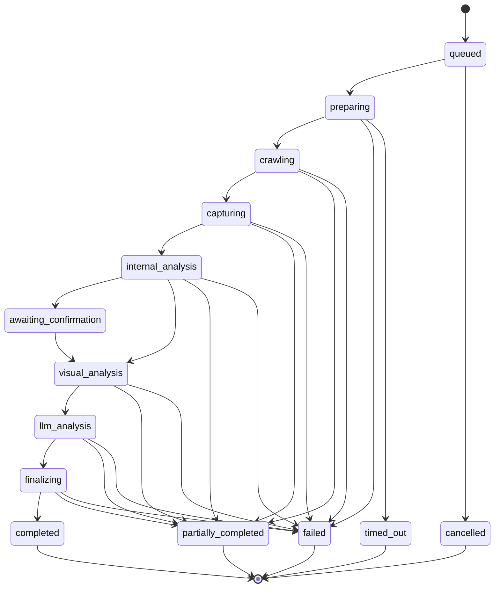
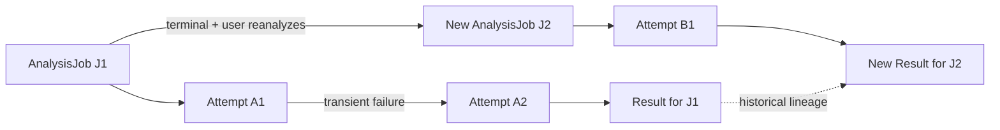

# Module 12 — AnalysisJob Lifecycle

Status: `COMPLETE / READY_FOR_M13`  
Phase: `TB-13`  
Difficulty: `INTERMEDIATE`  
Prerequisites: `M01`–`M11`

## 1. 学習目標（Learning goals）

このModuleを終えた学習者は、次の内容を説明し、判断できます。

1. AnalysisJobがHTTP requestとは別のbusiness/execution identityである理由を説明する。
2. canonical lifecycleとterminal outcomesを順序・意味付きで説明する。
3. Request State、Job State、Worker fact、Product outcomeを区別する。
4. `partially_completed`と`failed`をResult usabilityから判断する。
5. RailsとWorkerのtransition ownershipを区別する。
6. RetryとReanalysisをJob identity/lineageから区別する。
7. terminal outcomeごとのSnapshot eligibilityを判断する。
8. CURRENT frontend boundaryと未実装Production backendを混同しない。

## 用語ガイド

- **AnalysisJob:** 一回の分析要求と、その進行状況・結果を追跡するPanoptesの業務上の単位。
- **Lifecycle（ライフサイクル）:** Jobが作成されてからterminal stateへ到達するまでの状態変化。
- **State transition（状態遷移）:** `queued`から`running`へ進むように、許可された規則に従って状態が変わること。
- **Terminal state（終端状態）:** そのJobとして追加の通常遷移を行わない最終状態。
- **Eligibility（利用可否条件）:** Job結果をSnapshot作成などの次処理へ使えるか判断する条件。

## 2. Job fundamentals

Jobは長時間または非同期で実行される1つのprocessing unitです。

| 概念         | 意味                                                 |
| ------------ | ---------------------------------------------------- |
| Job identity | 1つのbusiness executionを識別するID                  |
| Lifecycle    | 受付からterminal outcomeまでの状態系列               |
| Status       | canonicalな現在状態                                  |
| Input        | 分析対象、Organization/Project、versioned contract等 |
| Output       | validated Result、error、artifact reference等        |
| Attempt      | 同じJob intentをtechnicalに実行する試行              |
| Failure      | stepまたはJob outcomeの不成立。levelを区別する       |
| Retry        | 同じJobのtechnical recovery                          |
| Cancellation | 停止要求とcanonical outcomeを含む協調処理            |

```text
Job != HTTP request
```

HTTP requestは、Job作成やstatus取得のための短い通信です。Jobの実行はrequest終了後もQueue/Worker上で続く可能性があります。`202 Accepted`はJobの受付を示すもので、分析の完了を示すものではありません。

## 3. Why Panoptes needs AnalysisJob

PanoptesのAnalysisは次のような異なる処理を含む。

- target preparation / policy check
- crawl / HTML・resource collection
- Chromium capture / screenshot
- internal structure/content analysis
- inference confirmation
- visual analysis
- LLM analysis
- validation / finalization / persistence

これらを一つのHTTP request内で完了させようとすると、通信のtimeout、Retryによる重複、途中状態、中止、進捗、失敗からの復旧、履歴を安全に扱うことが難しくなります。

```text
User operation
  -> Rails creates canonical AnalysisJob
  -> asynchronous technical execution
  -> Rails accepts facts and transitions state
  -> Client polls/reads canonical state
  -> eligible Result/Snapshot becomes available
```

Queue delivery、attempt、backoff、idempotencyの詳細はM13へhandoffします。

## 4. Canonical AnalysisJob lifecycle

正式に扱うstate set:

```text
queued
-> preparing
-> crawling
-> capturing
-> internal_analysis
-> awaiting_confirmation
-> visual_analysis
-> llm_analysis
-> finalizing
-> completed
```

Terminal alternatives:

```text
completed | partially_completed | failed | cancelled | timed_out
```

`awaiting_confirmation`はterminalではなく、User inputを待つbusiness pauseです。Stateを教材都合で追加・renameしません。

## 5. State meanings

| State                   | 意味                                               | 主な処理の実行主体     | 正式な状態遷移を決定する主体 |
| ----------------------- | -------------------------------------------------- | ---------------------- | ---------------------------- |
| `queued`                | Durableに受付済み、execution待ち                   | Queue waiting          | Rails                        |
| `preparing`             | URL/policy/attempt等の実行準備                     | Worker                 | Rails accepts fact           |
| `crawling`              | HTML/resource取得                                  | Worker                 | Rails accepts fact           |
| `capturing`             | Chromium/screenshot/evidence取得                   | Worker                 | Rails accepts fact           |
| `internal_analysis`     | HTML/DOM/content等の内部分析                       | Worker                 | Rails accepts fact           |
| `awaiting_confirmation` | immutable draft提示後のUser確認待ち                | Rails/User interaction | Rails                        |
| `visual_analysis`       | visual evidence評価                                | Worker                 | Rails accepts fact           |
| `llm_analysis`          | insight/strategy候補等のLLM処理                    | Worker/integration     | Rails accepts fact           |
| `finalizing`            | Result整合性、eligibility、Snapshot準備            | Rails                  | Rails                        |
| `completed`             | required processingとusable validated Resultが成立 | Rails outcome          | Rails                        |

「Primary execution actor」はstate中のtechnical workを示します。Workerがcanonical DB statusを自由に書き換えるという意味ではありません。

## 6. Lifecycle diagram



図は代表的なbranchを示します。Exact transition matrixはcanonical contractに従い、図にないskipを許可したことにはなりません。

## 7. Request State vs Job State vs Product outcome

| 状態の分類         | 例                                    | 管理・決定の責任を持つ主体 | 確認する問い                        |
| ------------------ | ------------------------------------- | -------------------------- | ----------------------------------- |
| HTTP Request State | idle/loading/success/error            | Client/Feature             | status取得requestがどうなったか     |
| Polling State      | stopped/polling/backoff               | Feature polling controller | 次のstatus requestをいつ行うか      |
| AnalysisJob State  | crawling/visual_analysis/finalizing等 | Rails canonical backend    | Analysis executionはどこか          |
| Worker fact        | screenshot uploaded、crawl failed等   | Worker reports             | technical stepで何が起きたか        |
| Product outcome    | completed/partial/failed等            | Rails business decision    | usable validated Resultが成立したか |
| Presentation State | bootstrapping/committing_snapshot等   | Frontend projection        | Userへどう見せるか                  |

例:

```text
GET Job status request = HTTP 200 success
AnalysisJob status     = visual_analysis
Polling state          = polling
UI request state       = idle after response
```

Requestの成功をJobの完了と解釈しません。また、pollingのtimeoutは状態取得の通信上の失敗であり、Job自体が正式な`timed_out`になったとは限りません。

## 8. State transition ownership

State transitionは次で決まります。

```text
current canonical state
+ authenticated event / technical result
+ expected Job / Organization / attempt identity
+ business rule
= accepted next canonical state
```

Railsが所有するもの:

- Job identityとinitial state。
- current stateとvalid transitionの照合。
- stale/duplicate/wrong-attempt eventの拒否。
- Product Result usability/completeness判定。
- terminal outcomeとSnapshot/Usage eligibility。
- transition persistence、audit、authorization。

Workerが所有するもの:

- crawl/capture/analysis等のtechnical execution。
- technical success/failure facts。
- artifact/result reference。
- assigned attempt内のtechnical retry execution。

```text
Worker technical success != Product success
Worker step failure       != automatically failed
```

Workerが`visual analysis failed`を報告しても、Railsが残存Resultとrequired completenessを評価し、`partially_completed`か`failed`かを確定します。

## 9. Valid transition concept

- 通常は定義済みnext stateだけへ進む。
- terminal stateから別stateへ戻さない。
- 同じstateのduplicate eventは、identity/payloadが一致する場合にidempotent no-op候補。
- 古いattempt、別Job、別Organization、過去sequenceのeventはstateを戻さない。
- `queued -> completed`等のskipをUI/Worker都合で行わない。
- Reanalysisはterminal Jobを書き換えずnew Jobで表す。

Phase A-5の状態遷移draftには次の遷移先の具体的な候補がありますが、本番用Railsの状態遷移処理は未実装です。実装時には、PD-04と整合する遷移の契約、request spec、同時実行と冪等性の検証が必要になります。

## 10. Terminal outcomes

| Outcome               | 意味                                                                              | Result usability | Silent rewrite                   |
| --------------------- | --------------------------------------------------------------------------------- | ---------------- | -------------------------------- |
| `completed`           | required processingを満たしusable validated Product Result成立                    | Full result      | terminal                         |
| `partially_completed` | usable validated Resultはあるがrequired processingの一部が未完了、limitations明示 | Limited result   | failed/completedへ暗黙変換しない |
| `failed`              | valid Product Result不成立                                                        | none             | partialへ後付け変更しない        |
| `cancelled`           | cancellation policyにより終了                                                     | baselineなし     | failedへ統合しない               |
| `timed_out`           | defined Job deadline超過                                                          | baselineなし     | failedへ統合しない               |

Terminal outcomeは、単なるUI labelの違いではありません。Snapshot作成の可否、再分析、Usage、監査、問い合わせ時の調査へ影響する業務上の契約です。

## 11. `partially_completed` contract

PD-04で承認されたPartialの必要条件:

1. usable validated Product Resultが存在する。
2. required processingの一部が未完了である。
3. limitationsを明示できる。

Partialかどうかは、成功したstepの数だけでは決めません。Productとして説明でき、利用可能なResultが残っているかを中心に判断します。

```text
partially_completed != failed
partially_completed != completed
```

- Failed: valid Resultがない。
- Completed: required processingを満たす。
- Partial: usable Resultはあるが不完全さを明示する独立outcome。

Observation/Axis/Score/Snapshotの`PARTIAL`ともJob-level `partially_completed`を混同しません。

## 12. Cancellation

Cancellationは少なくとも三段階に分けます。

1. User/systemがcancelをrequestする。
2. Railsがrequestとactor/timeを受理し、Worker/Queueへsignalする。
3. Technical executionが安全なboundaryで停止し、Railsがcanonical `cancelled`を確定する。

Cancel buttonを押しても、BrowserからWorkerまでの処理がその瞬間に一斉停止するとは限りません。Cancel後に遅れて届いたArtifactや結果を、current Snapshotとして確定しません。確定用transactionの開始後にCancelと競合する場合など、詳細なpolicyは未実装です。

## 13. Timeout

| Timeout                      | 意味                                  | Owner/outcome                                   |
| ---------------------------- | ------------------------------------- | ----------------------------------------------- |
| HTTP request timeout         | status API等のresponse待ちが期限超過  | Client/BFF technical error。Job outcomeではない |
| Polling controller timeout   | 1回のpoll request raceがtimeout       | Frontend backoff/continue候補                   |
| Worker step timeout          | crawl/Chromium/LLM等のstep deadline   | Worker fact、retry policy input                 |
| Attempt timeout              | 1 technical attemptのdeadline         | Queue/Worker orchestration input                |
| AnalysisJob business timeout | 全体deadlineを超えたcanonical outcome | Rails `timed_out`                               |

CURRENT polling controllerのdefault request timeoutは30秒で、timeout時はbackoffしpollを続ける。これはJobを`timed_out`へ変更する処理ではありません。

## 14. Retry vs Reanalysis

| Dimension      | Retry                          | Reanalysis               |
| -------------- | ------------------------------ | ------------------------ |
| Intent         | same business analysis intent  | new business analysis    |
| Job identity   | same Job concept               | new AnalysisJob          |
| Attempt        | new/repeated technical attempt | first attempt of new Job |
| Trigger        | transient technical failure    | User/business request    |
| Result/history | existing intentを完遂          | new Result/new lineage   |
| Snapshot       | same Jobのeligible outcome     | eligibleならnew Snapshot |

### Retry vs Reanalysis diagram



Frontend method名`retryAnalysis`はCURRENTで`reanalyzeCurrentProject`へ接続するため、UI label/method名だけでtechnical retryと判断しません。

## 15. Snapshot eligibility

PD-04承認済みbaseline:

| Job outcome           | Snapshot eligibility           | Current/Strategy behavior                                                                              |
| --------------------- | ------------------------------ | ------------------------------------------------------------------------------------------------------ |
| `completed`           | `CAN_CREATE`                   | policy-driven current promotion可。Strategyはvalidation後eligible                                      |
| `partially_completed` | `CONDITIONAL` Limited Snapshot | automatic current promotionなし。v1 Strategy=`EVIDENCE_ONLY`、Formal Sourceへauto/manual promotionなし |
| `failed`              | Formal Snapshot不可            | artifactとProduct Snapshotを分離                                                                       |
| `cancelled`           | Formal Snapshot不可            | currentへcommitしない                                                                                  |
| `timed_out`           | Formal Snapshot不可            | currentへcommitしない                                                                                  |

Partial Snapshotはlimitations、completeness、lineageを保持し、Full Resultと同じbaselineへ見せかけない。Exact threshold/schema/retention/controlled exceptionはDEFERRED。

### Confirmed documentation drift

Phase A-5 `analysis-job-state-machine.md`は`partially_completed`を「committed Snapshot」とし、`completed`をcurrent昇格と直接結び付ける。後発のProduct Owner承認PD-04では、Partial Snapshotは条件付きLimitedで自動昇格なし、Completedの昇格もpolicy-drivenです。本教材はPD-04を優先し、state-machine文書のSnapshot/current記述を同期対象として残します。

## 16. Evidence, artifact, Result, Job, Snapshot

| 概念              | 意味                                                                      | 証明しないこと                                  |
| ----------------- | ------------------------------------------------------------------------- | ----------------------------------------------- |
| Evidence/artifact | HTML、screenshot、extraction、model output等のtechnical/business material | Job completion、Product usability               |
| AnalysisJob       | execution/business processing container                                   | immutable historical Product record             |
| Result            | validated Product output                                                  | automatic Snapshot/current/Strategy eligibility |
| Snapshot          | immutable historical Product record                                       | latest/current/Strategy sourceとの同一性        |

```text
artifact exists != Job completed
artifact exists != Snapshot eligible
Job             != Snapshot
Job             != Result
```

1 Jobが多数artifactを生成しても、required evidence不足やvalidation failureならvalid Resultが成立しない場合があります。

## 17. Progress and error information

Draft AnalysisJob contractには次があります。

- `status` / `phase`
- `progress_percent` 0–100
- `retry_count` / `retryable`
- `sequence`
- `error`
- `committed_snapshot_id`
- timestamps

`progress_percent`は同一attemptで単調非減少にする方向だが、100%という数値だけでbusiness `completed`を確定しません。CURRENT Frontendはprogressをclampし、stale Job/session/step updateを拒否します。

User-facing errorにはsafe code/message、retryability、affected phase等を使える。Provider raw error、internal URL、prompt、stack、secretはFrontendへ出さず、server diagnostics/auditへ分離します。

## 18. Rails vs Worker ownership

| 確認する観点                | Rails                            | Worker                          |
| --------------------------- | -------------------------------- | ------------------------------- |
| Job creation/identity       | Owns                             | Receives assigned identity      |
| Authorization               | Owns                             | Does not decide User permission |
| Canonical lifecycle         | Owns transition acceptance       | Reports technical facts         |
| crawl/capture/analysis      | Orchestrates requirement         | Executes                        |
| Technical retry execution   | Defines accepted policy boundary | Performs attempt                |
| Product Result usability    | Owns                             | Supplies facts/artifacts        |
| Terminal outcome            | Owns                             | Must not self-commit            |
| Snapshot eligibility/commit | Owns                             | Uploads/references artifact     |
| Usage/audit                 | Owns business decision           | Reports measurable facts        |

Railsが管理責任を持つことは、Rails process自体がsiteを巡回するという意味ではありません。同様に、Workerが実行責任を持っていても、DBの正式な業務状態を直接決める権限までは持ちません。

## 19. Usage boundary

PD-04ではUsageをPlan-specific policy + usable-result baselineの方向で承認しています。

```text
Usage entitlement/decision != Stripe charge
```

Failed/cancelled/timed_out/partialのUsage扱いは、technical step数だけでなくProduct policyをRailsが判断します。Exact unit、price、retention、billing/provider integrationはDEFERRED。

## 20. CURRENT / TARGET / DEFERRED

| 領域               | CURRENT                                                        | TARGET                                             | DEFERRED                                     |
| ------------------ | -------------------------------------------------------------- | -------------------------------------------------- | -------------------------------------------- |
| Lifecycle contract | canonical state set、OpenAPI schema、adapter types             | Rails-enforced transition state machine            | exact persistence/concurrency implementation |
| Frontend mapping   | canonical adapter、terminal helper、polling/runtime projection | Canonical BFF response connection                  | legacy migration completion                  |
| Polling            | timer/overlap/timeout/backoff/stop logic                       | Organization/Job/attempt/sequence verified polling | SSE/WebSocket/Realtime decision              |
| Business client    | Organization read works; Analysis client fails closed 503      | Project/AnalysisJob endpoints                      | Production Rails/Queue/Worker                |
| Rails Job          | no model/service/routes                                        | creation、transition、outcome、Snapshot/Usage      | schema/request specs/outbox                  |
| Worker             | no production worker implementation found in scoped check      | crawl/capture/analysis fact producer               | runtime/provider/queue details               |
| Partial            | PD-04 logical contract approved、Frontend recognizes status    | Rails eligibility + Limited Snapshot               | threshold/schema/promotion exception         |
| Retry/Reanalysis   | Frontend reanalysis action/mock behavior                       | same-Job attempt vs new-Job lineage                | Queue retry/idempotency details              |

Approved lifecycle contractはProduction implementation completeを意味しません。

## 21. Representative repository mapping

以下は限定確認した12例であり、repo-wide Job/Worker監査ではありません。

| Source                                                          | 処理の流れでの役割                         | 管理・決定の責任を持つ主体 | 状態の役割                           | 実装状態・PDとの関係                           |
| --------------------------------------------------------------- | ------------------------------------------ | -------------------------- | ------------------------------------ | ---------------------------------------------- |
| `docs/product/product-decision-register.md` PD-04               | Partial/Snapshot/reanalysis/usage contract | Product                    | terminal outcome policy              | `APPROVED`; implementation deferred            |
| `docs/api/analysis-job-state-machine.md`                        | state/transition/progress draft            | Architecture/API           | canonical lifecycle draft            | state input; Snapshot wording needs PD-04 sync |
| `docs/api/openapi-draft.yaml` AnalysisJob schemas               | wire state/Job shape                       | API contract               | 14-state enum                        | `DRAFT / TARGET`                               |
| `docs/architecture/analysis-job-frontend-boundary.md`           | canonical→runtime mapping rules            | Frontend architecture      | adapter/terminal boundary            | `CURRENT boundary`; BFF connection deferred    |
| `src/lib/features/analysis-job/types.ts`                        | canonical/runtime types                    | Frontend Feature           | state set/runtime model              | `CURRENT adapter contract`                     |
| `src/lib/features/analysis-job/mapping/analysis-job-status.ts`  | terminal/status mapping                    | Frontend Feature           | canonical→runtime classification     | `CURRENT`                                      |
| `src/lib/features/analysis-job/adapter/analysis-job-adapter.ts` | response validation/safe mapping           | Frontend Feature           | terminal/partial/failure projection  | `CURRENT`; fail-safe unknown handling          |
| `src/lib/panoptes/polling/analysis-polling-controller.ts`       | polling mechanics                          | Frontend Feature           | timer/overlap/timeout/stop           | `CURRENT`; no business transition              |
| `src/lib/panoptes/actions/analysis.ts`                          | analysis intent/poll coordination          | Frontend Feature           | create/confirm/reanalysis/projection | `CURRENT legacy/mock flow`                     |
| `src/lib/panoptes/domain/runtime-progress.ts`                   | stale/monotonic/runtime projection         | Frontend domain adapter    | terminal reason/store update         | `CURRENT`                                      |
| `src/lib/panoptes/stores/runtime.ts`                            | request/polling presentation projection    | Frontend store             | non-canonical runtime state          | `CURRENT`                                      |
| `src/lib/panoptes/api/unavailable-canonical-business-client.ts` | fail-closed Production boundary            | Frontend Client            | no Job mutation/read                 | `CURRENT 503`; backend `TARGET`                |

Scoped checkではRails AnalysisJob model/service/routeとProduction Worker representationは存在しないため、架空のmappingを追加しません。

## 22. Common misunderstandings

### 「HTTP request state = Job state」

Status requestがsuccessでもJobは`crawling`等で継続中。

### 「Worker status = canonical business outcome」

Workerはfact producer。Railsがidentity、state、Result usabilityを評価して確定します。

### 「Step failure = failed」

残存Resultがusableか、required processingが何かによりPartial候補になり得ます。

### 「Partial = Failed」

Partialにはusable validated Resultがあります。Failedにはvalid Resultがありません。

### 「Partial = Completed」

Partialはrequired processing incompleteとlimitationsを持ちます。

### 「Retry = Reanalysis」

Retryはsame Job technical recovery、Reanalysisはnew Job/new lineage。

### 「Job = Snapshot」

Jobはexecution、Snapshotはimmutable historical Product record。

### 「Artifact generated = Snapshot eligible」

Artifact existenceはResult validation/eligibilityを証明しません。

### 「Cancelled/Timed outはFailedへ統合できる」

原因・UX・usage・auditが異なる独立terminal outcome。

### 「Latest Job = current Strategy source」

latest/current/Snapshot/Strategy sourceは別selection/policyです。

## 23. Decision heuristic — 何の状態か

1. HTTP interactionの状態か。  
   → Request State。
2. Poll scheduling/backoffか。  
   → Frontend Polling State。
3. Analysis executionのcanonical位置か。  
   → AnalysisJob State、Rails owner。
4. crawl/capture等で起きたtechnical factか。  
   → Worker fact。
5. Product Resultがusableか。  
   → Rails Business Outcome。
6. 過去結果のimmutable recordか。  
   → Snapshot。
7. 新しいbusiness analysisか。  
   → Reanalysis/new Job。
8. 同じJobのtemporary failure recoveryか。  
   → Retry/new attempt。

## 24. Practice

### 24.1 Knowledge Check

1. AnalysisJobとHTTP requestの違いは何か。
2. `awaiting_confirmation`がterminalでない理由は何か。
3. Worker factとRails outcomeの違いは何か。
4. Partial成立の三条件は何か。
5. RetryとReanalysisでidentityはどう違うか。

### 24.2 State Ordering

次をcanonical順へ並べてください。

`finalizing`, `queued`, `capturing`, `llm_analysis`, `preparing`, `visual_analysis`, `crawling`, `completed`, `internal_analysis`, `awaiting_confirmation`

### 24.3 Classification

次をRequest State / Job State / Worker Fact / Product Outcome / Snapshot / Retry / Reanalysisへ分類します。

1. Job status GETがloading。
2. `crawling`。
3. Worker step timeout。
4. `partially_completed`。
5. immutable historical result。
6. 同じJobの一時network failure再試行。
7. Userがもう一度分析を開始。

### 24.4 Outcome Exercise

1. 全required processingとvalidationを満たすusable Result。
2. 一部required processingが未完了だが、usable Resultとlimitationsがある。
3. Artifactはあるがvalid Product Resultがない。
4. Cancel requestを受けtechnical stop後に確定。
5. Job全体deadline超過。

各caseをterminal outcomeへ分類します。

### 24.5 Retry vs Reanalysis Exercise

1. LLM providerの一時503で同じattempt intentを再実行。
2. Completed後、Userが最新Web状態でもう一度分析。
3. Queue visibility timeoutで同じJobを別attemptとして再配信。
4. Partial Resultを見たUserが新しいfull analysisを要求。

### 24.6 Snapshot Eligibility Exercise

`completed`, `partially_completed`, `failed`, `cancelled`, `timed_out`について、Full/Limited/不可、current/Strategy promotionを答えてください。

### 24.7 Responsibility Exercise

Rails / Workerへ分類します。

1. Chromium screenshot取得。
2. active Membership確認。
3. technical failure fact送信。
4. `partially_completed`確定。
5. Snapshot eligibility判断。
6. artifact upload。
7. Usage decision。

### 24.8 Design Explanation

「なぜWorkerが`partially_completed`を直接決めないのか」を、identity、Result usability、Snapshot、Usage、auditの観点から説明してください。

## 25. Answers / Explanation Guide

### 25.1 Knowledge Check要点

1. Requestは短いtransport interaction、Jobはrequest後も続くdurable execution/business identity。
2. User confirmation後に`visual_analysis`へ進み得るpauseだから。
3. Workerはtechnical observation、Railsはcanonical state/outcome decision。
4. usable validated Result、required processing incomplete、explicit limitations。
5. Retryはsame Job/new attempt候補、Reanalysisはnew Job/new lineage。

### 25.2 State Ordering回答

`queued -> preparing -> crawling -> capturing -> internal_analysis -> awaiting_confirmation -> visual_analysis -> llm_analysis -> finalizing -> completed`

### 25.3 Classification回答

1. Request State。
2. Job State。
3. Worker Fact。
4. Product Outcome/terminal Job State。
5. Snapshot。
6. Retry。
7. Reanalysis。

### 25.4 Outcome回答

1. `completed`。
2. `partially_completed`。
3. `failed`。
4. `cancelled`。
5. `timed_out`。

### 25.5 Retry vs Reanalysis回答

1. Retry候補。
2. Reanalysis、新Job。
3. Retry/new attempt候補。Idempotency/stale event guardが必要。
4. Reanalysis、新Job。Old partial Result/Snapshotをmutationしない。

### 25.6 Snapshot Eligibility回答

- Completed: Full Snapshot作成可。current promotionはpolicy-driven、Strategyはvalidation後eligible。
- Partial: conditional Limited Snapshot。自動current promotionなし、Strategy v1はEvidence-only。
- Failed/Cancelled/Timed out: Formal Snapshot不可。

### 25.7 Responsibility回答

1. Worker。
2. Rails。
3. Worker。
4. Rails。
5. Rails。
6. Worker。ただしreference acceptanceはRails。
7. Rails。

### 25.8 Design Explanation回答例

Workerは1 attemptのtechnical factsとartifactsを知るが、actor/Organization authorization、全required evidence、Product Result usability、Snapshot/current/Strategy policy、Usage policy、prior/parallel attempt、audit contextをcanonicalに所有しません。RailsがJob/attempt identityとcurrent stateを検証し、accepted factsをtransactional business outcomeへ変換するため、WorkerがPartialを直接commitしてはいけません。

## 26. Completion Criteria

| Criterion                                                | Result |
| -------------------------------------------------------- | ------ |
| 1. Job fundamentals explained                            | `PASS` |
| 2. canonical AnalysisJob lifecycle explained             | `PASS` |
| 3. request/job/product state distinction explained       | `PASS` |
| 4. terminal outcomes explained                           | `PASS` |
| 5. partially_completed explained                         | `PASS` |
| 6. Rails/Worker transition ownership explained           | `PASS` |
| 7. retry/reanalysis distinction explained                | `PASS` |
| 8. Snapshot eligibility explained                        | `PASS` |
| 9. representative repository mapping + diagrams included | `PASS` |
| 10. exercises + answers included                         | `PASS` |

Authoring DoD: `10 / 10 PASS`。

これは教材artifactの完成を示します。Learner assessment合格、Rails/Queue/Worker/Job persistence実装、lifecycle contract validation、Production Readinessを意味しません。

## 27. Handoff to M13

Recommended next phase: `TB-14 — Module 13: Async Job / Queue / Retry / Idempotency`。

M13ではdelivery semantics、attempt、backoff、deduplication、stale result、outbox、timeout/cancellation、poison jobを扱います。本Moduleではbusiness Job identity、canonical lifecycle、terminal outcome、Retry/Reanalysis境界までを確定します。

## References

- [Panoptes Technical Bootcamp](../panoptes-technical-bootcamp.md)
- [M06 State / Controller / Command](./06-state-controller-command.md)
- [M08 Rails Business Backend](./08-rails-business-backend.md)
- [M09 PostgreSQL / Source of Truth](./09-postgresql-source-of-truth.md)
- [M11 API / OpenAPI](./11-api-openapi.md)
- [Product Decision Register](../../product/product-decision-register.md)
- [AnalysisJob State Machine](../../api/analysis-job-state-machine.md)
- [AnalysisJob Frontend Boundary](../../architecture/analysis-job-frontend-boundary.md)
- [OpenAPI draft](../../api/openapi-draft.yaml)
- [AnalysisJob adapter](../../../src/lib/features/analysis-job/adapter/analysis-job-adapter.ts)
