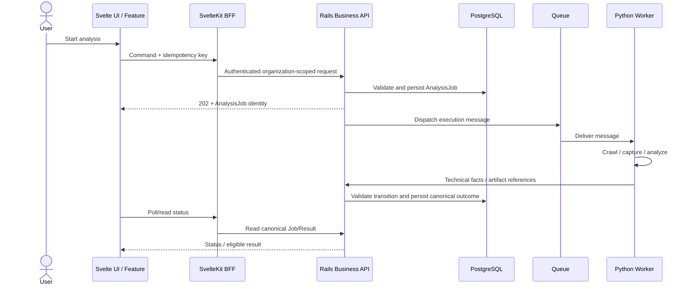
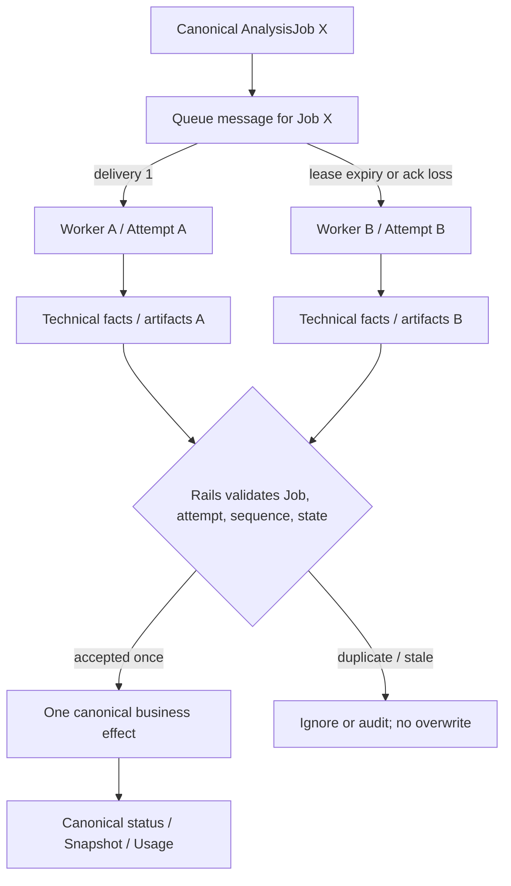

# Module 13 — Async Job / Queue / Retry / Idempotency

Status: `COMPLETE / READY_FOR_M14`  
Phase: `TB-14`  
Difficulty: `ADVANCED`  
Prerequisites: `M01`–`M12`

## 1. Learning goals

このModuleを終えたLearnerは、次を説明・判断できる。

1. 長時間処理をHTTP lifecycleから分離する理由と、AsyncがParallelを意味しないことを説明する。
2. Queue、Producer、Consumer、acknowledgement、lease/visibilityを説明する。
3. AnalysisJob、Queue Message、Attemptを別のidentityとして扱う。
4. Retry対象と非対象を分類し、RetryとReanalysisを区別する。
5. Idempotencyを「一度だけ実行」ではなく「business effectを重複させない性質」と説明する。
6. duplicate delivery、timeout、cancellation、DLQ、heartbeatを責務境界付きで説明する。
7. Rails、Queue、Workerのownerを区別する。
8. CURRENT、TARGET、DEFERREDを混同せず、安全な非同期設計を評価する。

## 2. Sync vs Async

### 2.1 General model

```text
Synchronous:  request -> processing -> response
Asynchronous: request -> accepted/job identity -> background processing -> later status/result read
```

同期処理ではcallerが処理完了まで接続を待つ。非同期処理では受付と実行完了を分離し、callerはJob identityを使って後から状態を読む。

Panoptesのcrawl、Chromium capture、HTML extraction、internal/visual analysis、LLM processingは、外部依存・実行時間・失敗点が多い。これらを1回のHTTP lifecycleへ閉じ込めると、HTTP timeout後に処理が継続しているか、再送で二重実行されたか、途中経過や取消をどう扱うかが不明確になる。

> **Async != Parallel.** Asyncはcallerとcompletionの時間的分離であり、複数処理の同時実行を保証しない。1 Consumerで逐次処理しても非同期であり得る。

## 3. Queue fundamentals

Queueは「処理すべき仕事をProducerからConsumerへ引き渡すdelivery mechanism」である。

| Term | Meaning |
| --- | --- |
| Producer | 実行依頼をmessageとしてenqueueする側 |
| Message | Consumerへ渡すexecution delivery unit |
| Enqueue / Dequeue | Queueへの投入 / 取得 |
| Consumer | messageを受け取りtechnical executionを行う側 |
| Acknowledgement | 処理済みとしてdeliveryを完了させる通知 |
| Visibility / lease | 処理中messageを一時的に他Consumerから隠す、または所有する概念 |
| Redelivery | ack欠落やlease expiry等により同じmessageを再配送すること |
| DLQ | 通常retryで回復しないmessageを隔離する場所 |

Queueはbuffering、delivery、redeliveryを助ける。しかし、AnalysisJobのcanonical status、Organization authorization、usage、Result/Snapshot lineageを決めるBusiness Databaseではない。

## 4. Producer / Consumer and dispatch

PanoptesのTarget責務は次の通りである。

- Rails: User intentを検証し、canonical AnalysisJobを永続化し、実行依頼をdispatchするProducer
- Queue: execution deliveryを仲介する仕組み
- Worker: messageを受け、crawl/capture/analysis等を実行するConsumer



DB persist前にQueue送信だけ成功すると、messageはあるのにcanonical Jobがない状態になり得る。逆にDB commit後のdispatchが失敗すると、Jobはあるのに実行されない。既存Target文書はtransaction + outboxを整合性候補として示すが、Production実装済みではない。本Moduleでは新しい方式やQueue製品を決定しない。

## 5. AnalysisJob, Queue Message, Attempt

```text
AnalysisJob != Queue Message != Attempt
```

| Identity | Purpose | Lifetime / multiplicity | Source of Truth |
| --- | --- | --- | --- |
| AnalysisJob | 1つのbusiness executionとcanonical lifecycle | Reanalysisごとに新規。1 Jobに複数delivery/attempt可 | Rails/PostgreSQL |
| Queue Message | technical executionを届ける単位 | redeliveryで同一内容が複数回届き得る | Queue delivery metadata。Business SoTではない |
| Attempt | 同じJobをtechnicalに実行する1試行 | Retryごとに増え得る | TARGET concept。Production model未実装 |
| Idempotency key | 同一operation requestの重複business effectを防ぐ相関キー | operation scope内で再送に利用 | server-side enforcementが必要 |

`1 Job -> Attempt 1 -> Attempt 2 -> Attempt 3`はあり得る。Retryはsame Jobのtechnical recoveryであり、Reanalysisはnew Job/new lineageのbusiness executionである。Queue retryが新しいAnalysisJobを勝手に作ってはならない。

## 6. Delivery semantics

| Model | Property | Risk / note |
| --- | --- | --- |
| at-most-once | 重複を抑えるが、失敗時に失われ得る | 未処理messageの喪失を許容できるかが重要 |
| at-least-once | 処理されるまで再配送し得る | duplicate deliveryを前提にConsumerを安全化する |
| exactly-once | 観測上1回の効果を目指す | 分散境界全体の物理的一回実行は現実的に難しく、idempotent effect等で構成する |

Panoptesの特定delivery guaranteeは未決定である。ただし、どの製品を選んでもtimeout、network partition、ack lossは起こり得るため、「duplicate deliveryは起きない」を正しさの前提にしない。

## 7. Retry model

Retryは一時的なtechnical failureからsame AnalysisJobを回復させる再試行である。

| Candidate | Default classification | Reason |
| --- | --- | --- |
| temporary network timeout | Retry candidate | 一過性で回復し得る |
| upstream 429 / temporary 5xx | Retry candidate | backoff後に回復し得る。ただし契約・期限を考慮 |
| temporary browser crash | Retry candidate | 新しいtechnical attemptで回復し得る |
| recoverable infrastructure failure | Retry candidate | 一過性なら再実行可能 |
| invalid URL/input | Do not retry | 同じinputでは決定的に失敗する |
| authorization denied | Do not retry | Business/security decisionでありtechnical retryでは解決しない |
| permanently unsupported target | Do not retry | capability/policy判断が必要 |
| malformed persisted payload | Do not blindly retry | poison messageの可能性。隔離・修復・調査が必要 |

一般的なpolicy要素はmax attempts、exponential backoff、jitter、retryable classification、whole-job deadlineである。無限retryはcapacity、cost、failure visibilityを損なう。具体値は本Phaseでは決めず、既存契約の設計値もProduction設定済みとは扱わない。

LLM retryはさらにcost、rate limit、nondeterminism、model/prompt/version lineageを伴う。同じpromptを再送しても同じoutputとは限らず、通常のHTTP GET retryと同一視しない。

## 8. Idempotency model

Idempotencyは、同じoperationが複数回試行されてもcanonicalなbusiness effectを重複させない性質である。

> **Idempotency != physical execution exactly once.** Worker codeが2回動いても、承認されるSnapshot、Usage、billing effect、canonical transitionは1つに保てる設計を目指す。

Panoptesで守る対象:

- duplicate Snapshot/current selectionを作らない
- technical attemptごとにBusiness Usageを重複消費しない
- billing effectを重複させない
- stale/duplicate lifecycle updateでterminal stateを上書きしない
- artifactをJob/attempt/versionと関連付け、canonical selectionを曖昧にしない

Frontendのidempotency key生成だけでは不十分である。Serverがscope、payload signature、保存済みresponse/effectを検証して初めてbusiness idempotencyになる。CURRENT mockは同一endpoint + key + payloadなら既存Project/Jobを返し、同じkeyで異なるpayloadなら409にするが、これはProduction enforcementの証拠ではない。

## 9. Duplicate delivery and atomic claim



Scenario: Worker AがJob Xを受信し、ack前にtimeoutする。lease expiry後にWorker Bへredeliveryされる。Aが遅れて結果を返す可能性もある。

防御候補:

- canonical Job/stateを実行前に確認する
- conditional update/lock等によるatomic claim
- lease/attempt ownershipを検証する
- Job/attempt/sequenceでstale eventを拒否する
- artifact naming/commitをidempotentまたはversionedにする
- terminal stateやcurrent Snapshotを無条件上書きしない

ここでいうclaimはtechnical execution ownershipである。M12のcanonical state setへ`processing`等の新stateは追加しない。exact lock/lease/schemaはDEFERREDである。

Queue arrival orderも常に保証されない。Attempt Aの古いresultがAttempt B成功後に届いても、Railsはidentity、sequence、現在state、Organizationを検証し、canonical stateを逆行させない。

## 10. Timeout and cancellation

### 10.1 Timeout levels

| Timeout | What expired | Canonical `timed_out`との関係 |
| --- | --- | --- |
| HTTP timeout | client/BFF/Rails request wait | Requestが切れただけでJob終了とは限らない |
| Queue visibility/lease expiry | delivery ownership window | redelivery契機になり得る。Job outcomeではない |
| Worker step timeout | crawl/capture/LLM等の1 step | Retryable factかもしれない |
| Whole Job timeout | Job全体の許容時間 | Railsがfacts/policyを評価し`timed_out`を確定する候補 |

Technical timeoutが発生しただけでWorker/Queueが即座にbusiness `timed_out`を決めない。canonical outcome ownerはRailsである。

### 10.2 Cooperative cancellation

Target flow:

```text
User cancel intent
-> Rails authenticates, authorizes, and records canonical cancellation decision/intent
-> Worker observes cancellation at checkpoints/flag/abort boundary
-> Worker stops when safe and reports technical fact
-> Rails finalizes cancelled outcome
```

Cancel clickはinstant process killではない。cooperative cancellationはartifact/transaction境界を安全に終えやすい一方、checkpointまで遅延する。強制killは速いが、中間artifact、lease、外部request、整合性cleanupを残す危険がある。Production propagation mechanismは未実装である。

## 11. DLQ, poison message, heartbeat, and progress

DLQはmax retryを超えた、またはpoisonと判断されたmessageを通常deliveryから隔離し、調査・修復・controlled replayするためのoperations mechanismである。

Poison messageの例:

- malformed payload
- unsupported message schema
- deterministic parser crash
- 修復されない参照不整合

`DLQ != failed AnalysisJob list`である。DLQはdelivery failureの隔離先で、Business outcomeはRails/PostgreSQLへ残す。DLQ messageを無検証で再投入したり、`completed`へ変えたりしない。

| Signal | Answers | Must not be confused with |
| --- | --- | --- |
| Heartbeat / last activity | Worker/attemptが活動中か | 進捗率、business success |
| Progress checkpoint | technical stepがどこまで進んだか | canonical lifecycleの決定権 |
| Job state | canonical lifecycleは何か | process healthそのもの |

Heartbeat欠落はstuck/crashの疑いを示すが、それだけで`failed`や`timed_out`を確定しない。exact interval、threshold、schemaはDEFERREDである。

## 12. Rails / Queue / Worker boundary

| Layer | Owns | Does not own | Failure responsibility |
| --- | --- | --- | --- |
| Rails | Job creation、authorization、canonical lifecycle、retry eligibility/business policy、cancellation decision、terminal outcome、Usage/Audit | crawl/Chromiumの実行、delivery transport | factを検証し、canonical persistenceとresponseを整合させる |
| Queue | delivery、buffering、redelivery、supported retry scheduling、lease/visibility metadata | Business authorization、canonical outcome、Snapshot/Usage truth | delivery failureを観測可能にし、exhausted messageを隔離可能にする |
| Worker | technical attempt、crawl/capture/analysis、heartbeat/progress facts、artifact production、technical error classification | Business statusの無条件確定、Usage/billing decision、Organization authorization policy | retry-safeに実行し、identity付きfactsをRailsへ報告する |
| PostgreSQL | durable Job、business status、lineage、accepted Result/Snapshot、Usage/Audit | execution delivery | transaction/constraintによりcanonical effectを保護する |

Queueからmessageが消えてもAnalysisJob historyは残らなければならない。QueueはDurable Business Databaseではない。Worker successも、validation・eligibility・persistenceを経たProduct successと同義ではない。

## 13. Artifact and Usage boundaries

Screenshot、HTML、extraction、analysis outputはRetryで複数生成され得る。必要な設計観点はdeterministic identity、versioned artifact、attempt association、canonical selectionである。exact object key/schemaはM14以降のWorker/lineage教材へhandoffする。

同様に、`Attempt count != Usage count`である。technical retryのたびにBusiness Usageを加算すると、system failureをUserへ重複請求する危険がある。何をusageとして確定するかはRails business policyであり、Billing Moduleへhandoffする。

## 14. CURRENT / TARGET / DEFERRED

| Classification | Confirmed scope |
| --- | --- |
| CURRENT | FrontendがAnalysis command用idempotency keyを生成する。mock clientがkey/payload signatureを保持し、same request replay/different payload conflictを模擬する。polling controllerはone in-flight、timeout/backoff、stop decisionを扱う。adapter/runtime projectionはterminal/stale updateを防御する。Production business clientは未接続時503でfail closedする。 |
| TARGET | Railsがcanonical Job/business decisionを所有し、Queueがdelivery、Workerがtechnical executionを担当する。Job/attempt/sequence検証、idempotent commit、outbox等でdispatch/persistence consistencyを保護する方向が文書化されている。 |
| DEFERRED | Production Queue製品/guarantee、Worker orchestration、Attempt persistence、claim/lease方式、retry具体値、DLQ、heartbeat、cancellation propagation、artifact identity、production server-side idempotency enforcement。 |

承認済み設計原則はProduction実装完了を意味しない。特にCURRENTのtimer pollingやmock runtime progressionはQueue/Worker実装ではない。

## 15. Representative repository mapping

| Representative source | Role | Job / Attempt / Queue relation | Idempotency relevance | Status |
| --- | --- | --- | --- | --- |
| [M12 AnalysisJob Lifecycle](./12-analysis-job-lifecycle.md) | canonical lifecycle教材 | JobとRetry/Reanalysisを定義 | terminal/state overwrite防止の前提 | Approved learning contract |
| [AnalysisJob State Machine](../../api/analysis-job-state-machine.md) | lifecycle/event設計 | attempt/sequence、stale eventの概念 | duplicate same-state no-op、old event reject | Target design;後続PD-04差分あり |
| [API Boundary](../../architecture/api-boundary.md) | system responsibility | Rails→Queue→Worker、outbox候補 | Rails validation/transaction boundary | Target design |
| [Panoptes API v1](../../api/panoptes-api-v1.md) | HTTP/API contract | create/read/cancel/reanalyze境界 | Idempotency-Key replay/conflict draft | Target draft |
| `src/lib/panoptes/utils/idempotency.ts` | client identity helper | Queue/Attemptは扱わない | UUID-based keyを生成するだけ | CURRENT frontend |
| `src/lib/panoptes/actions/analysis.ts` | Feature command orchestration | create/reanalyze、pollingを起動 | operationごとにkeyを付与 | CURRENT frontend |
| `src/lib/panoptes/polling/analysis-polling-controller.ts` | HTTP status polling | Queue consumerではない | one in-flight、timeout/backoffを制御 | CURRENT frontend |
| `src/lib/panoptes/actions/network.ts` | reconnect UX | delivery retryではなくclient connectivity | Queue retryと区別する例 | CURRENT frontend |
| `src/lib/features/analysis-job/adapter/analysis-job-adapter.ts` | canonical response projection | terminal stopをpresentationへ写像 | unknown/status不整合をfail safe | CURRENT frontend |
| `src/lib/panoptes/domain/runtime-progress.ts` | runtime update guard | sequence-like monotonic projection | stale/terminal overwriteを抑止 | CURRENT frontend |
| `src/lib/panoptes/api/mock-backend.ts` / `mock/state.ts` | browser-local mock | time-based Job模擬。Queue/Attemptではない | key + payload signature replay/conflictを模擬 | CURRENT mock only |
| `src/lib/panoptes/api/unavailable-canonical-business-client.ts` | fail-closed boundary | Production async backend未接続を明示 | mockへのsilent fallbackを防止 | CURRENT frontend |

## 16. Common misunderstandings

| Misunderstanding | Correction |
| --- | --- |
| Async = Parallel | 受付と完了の分離。並列性は別軸 |
| Job = Queue Message | Jobはbusiness identity、messageはdelivery unit |
| Job = Attempt | 1 Jobに複数technical attemptsがあり得る |
| Retry = Reanalysis | Retryはsame Job recovery、Reanalysisはnew Job/lineage |
| Retryならeffectも繰り返す | effectはidempotently一度に保護する |
| Idempotency = codeが一度しか動かない | 複数実行されてもbusiness effectを重複させない |
| Queue = Source of Truth | canonical Job/history/resultはRails/PostgreSQL |
| DLQ = failed Job一覧 | delivery failureの隔離でありbusiness outcome storeではない |
| Technical timeout = 即`timed_out` | Railsがfacts/policyからcanonical outcomeを決める |
| Cancel = instant kill | authorizationとcooperative stop/finalizationを伴う |
| Heartbeat = Progress | activity signalとcompletion progressは別 |
| Worker success = Product success | Rails validation/persistence/eligibility後にProduct outcomeとなる |

## 17. Decision heuristic

1. Business execution identityか → AnalysisJob / Rails
2. Execution deliveryか → Queue
3. Technical executionか → Worker
4. Same Jobの一時障害回復か → Retry / Attempt
5. 新しいbusiness executionか → Reanalysis / new Job
6. Duplicate business effect防止か → Idempotency
7. Exhausted technical deliveryか → DLQ / operations
8. Canonical outcomeか → Rails

## 18. Practice

### A. Knowledge check

1. Panoptes AnalysisをHTTP requestから分離する理由を2つ挙げよ。
2. AsyncとParallelの違いを説明せよ。
3. Queue acknowledgementとlease/visibilityは何を守るか。

### B. Classification

次を`Business identity`、`Delivery`、`Technical execution`、`Recovery`、`Operations signal`、`Canonical outcome`へ分類せよ。

`AnalysisJob` / `Queue Message` / `Attempt` / `Retry` / `Reanalysis` / `DLQ` / `heartbeat` / `completed`

### C. Duplicate delivery

同じJob XがWorker A/Bへ届いた。Snapshot、Usage、artifact、status transitionについて守るべき条件を説明せよ。

### D. Retryability

`network timeout` / `invalid URL` / `429` / `authorization denied` / `browser crash` / `malformed persisted payload`をRetry候補か分類し、理由を述べよ。

### E. Timeout and cancellation

HTTP timeout、Worker step timeout、whole Job timeoutを区別せよ。またCancel requestからWorker停止、canonical outcome確定までowner順に並べよ。

### F. Violation detection

各設計の問題を説明せよ。

1. Queue messageをcanonical Jobとして扱う。
2. RetryのたびにUsageを加算する。
3. duplicate Workerが両方current Snapshotを更新する。
4. Workerがauthorizationを見ずbusiness `failed`を確定する。
5. retry上限を設けない。
6. DLQ messageを検証せず`completed`へ戻す。

### G. Architecture explanation

「なぜat-least-once delivery環境ではidempotencyが重要なのか」を、Job/Message/Attemptを使って説明せよ。

## 19. Answers and explanation guide

### A. Knowledge check

1. request timeoutから長時間処理を分離でき、progress/retry/cancellation/historyをcanonical Jobとして追跡できる。外部障害からの回復もrequest再送と切り離せる。
2. Asyncはcallerがcompletionを同期的に待たない構造、Parallelは複数executionが同時進行する構造である。
3. acknowledgementはdelivery完了を示す。lease/visibilityは処理中の一時所有を表すが、expiry/ack lossでredeliveryされ得るためidempotencyも必要である。

### B. Classification

- Business identity: AnalysisJob、Reanalysis（new Jobを作るbusiness action）
- Delivery: Queue Message
- Technical execution: Attempt
- Recovery: Retry
- Operations signal: DLQ、heartbeat
- Canonical outcome: completed

### C. Duplicate delivery

RailsはJob/attempt/sequence/current stateを検証し、accepted Snapshot/current pointer、Usage、terminal transitionを一度だけcommitする。artifactはattempt/versionへ関連付け、両方生成されてもcanonical selectionを一意にする。古い/重複resultはignoreまたはauditする。

### D. Retryability

- Retry candidate: network timeout、429（backoff/contract条件付き）、temporary browser crash
- Do not retry: invalid URL、authorization denied
- Blind retry禁止: malformed persisted payload。poison/schema defectとして隔離・調査する

### E. Timeout and cancellation

HTTP timeoutはrequest wait、step timeoutはtechnical subtask、whole Job timeoutはbusiness deadline評価対象である。Cancellationは`User -> Rails auth/authorization + decision -> Worker observes/checkpoints -> safe stop/fact report -> Rails canonical cancelled outcome`の順で考える。

### F. Violation detection

1. delivery metadata消失でbusiness historyを失う。
2. infrastructure failureをUserへ重複計上する。
3. lineage/current pointerが競合し再現性を失う。
4. Workerがbusiness authorityを越境する。
5. poison messageがcapacity/costを無限消費する。
6. technical isolationをbusiness successへ無検証変換している。

### G. Architecture explanation

at-least-once deliveryではack lossやlease expiryにより同じJobのmessageが複数回届き、複数Attemptが動き得る。したがって「実行が1回」と仮定せず、Rails/PostgreSQL側でidentity、state、attempt/sequence、transactionを検証し、Snapshot、Usage、status等のcanonical business effectを一度に保護する必要がある。

## 20. Completion criteria

| # | Criterion | Result |
| ---: | --- | --- |
| 1 | Sync/Async distinction explained | `PASS` |
| 2 | Queue fundamentals explained | `PASS` |
| 3 | Job/Message/Attempt distinction explained | `PASS` |
| 4 | Retry model explained | `PASS` |
| 5 | Idempotency explained | `PASS` |
| 6 | Duplicate delivery explained | `PASS` |
| 7 | Timeout/cancellation explained | `PASS` |
| 8 | DLQ/heartbeat concepts explained | `PASS` |
| 9 | Rails/Queue/Worker mapping + two diagrams included | `PASS` |
| 10 | Exercises + answers included | `PASS` |

M13 authoring result: `10 / 10 PASS`。これは教材完成の判定であり、Production Queue/Worker、retry、DLQ、heartbeat、cancellation/idempotency実装の完成判定ではない。

## 21. M14 handoff

Recommended next phase: `TB-15 — Module 14: Python Worker / Chromium / Collection`。

M14ではWorker process、Chromium lifecycle、crawl/capture/collection、artifact production、resource/time limits、safe execution boundaryを扱う。Queue製品選定、Production実装、artifact/lineageの未決定事項は、そのModuleでも確認済みcontractを超えて確定しない。
