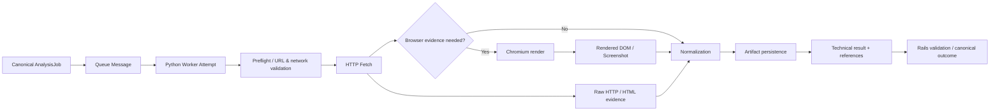
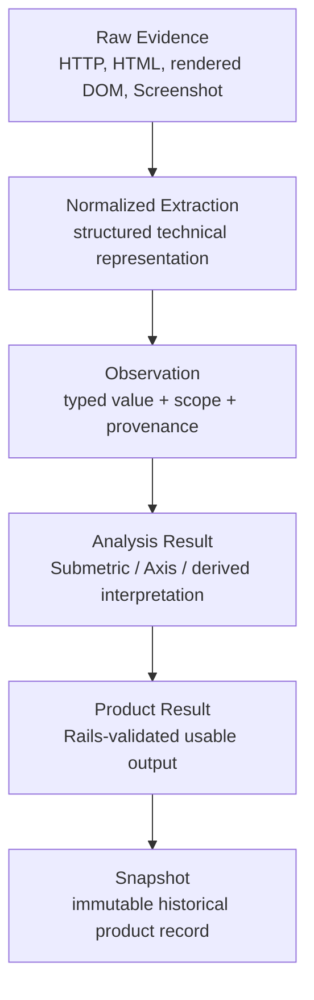

# Module 14 — Python Worker / Chromium / Collection

Status: `COMPLETE / READY_FOR_M15`  
Phase: `TB-15`  
Difficulty: `ADVANCED`  
Prerequisites: `M01`–`M13`

## 1. 学習目標（Learning goals）

このModuleを終えた学習者は、次の内容を説明し、判断できます。

1. Workerをbackground technical executorとして説明し、Business Decision Ownerと区別する。
2. HTTP fetchとBrowser executionを目的・cost・failure modeから使い分ける。
3. Target URLからEvidence、Artifact、technical resultまでのCollection Pipelineを追跡する。
4. raw HTML、rendered DOM、Screenshot、normalized Observation、Analysis Result、Product Resultを区別する。
5. ArtifactとSnapshotを区別し、retry時のidentity/lineage論点を説明する。
6. technical failureとretryabilityを分類し、partial technical successをRailsへ報告する。
7. Rails、Queue、Worker、Artifact Storeの責務を区別する。
8. untrusted web content、resource cleanup、limitsをProduction Workerの必須論点として説明する。
9. CURRENT、TARGET、DEFERREDを混同しない。

## 用語ガイド

- **Worker:** Queueなどからtechnical taskを受け取り、HTTP request-responseの外で実行するprocess。
- **Chromium:** JavaScript実行や描画後のDOM、screenshotが必要な収集で使うBrowser engine。
- **Collection:** 対象siteからHTML、screenshot、metadataなどの分析材料を取得する処理。
- **Artifact:** 収集・処理によって生成されたfileやdata。保存場所と業務上の意味は分けて扱う。
- **Provenance（由来情報）:** そのdataを、いつ、どの対象から、どの方法で取得したかを追跡する情報。

## 2. Worker fundamentals

WorkerはQueue/Job等からtechnical taskを受け取り、request-response lifecycleの外で処理を実行するexecutorです。

| 入力                                                                                  | Execution                                                                 | 出力                                                                             |
| ------------------------------------------------------------------------------------- | ------------------------------------------------------------------------- | -------------------------------------------------------------------------------- |
| Job/attempt identity、Railsが確定したOrganization/Project、target、versioned contract | fetch、browser rendering、capture、extraction、technical analysis、upload | artifacts、technical facts、progress、diagnostics、retryable/non-retryable error |

Workerが扱うのは、「何を取得・生成できたか」という技術上の事実です。「ユーザーに権限があるか」「結果をProductとして利用できるか」「Snapshotをcurrentとして採用するか」は、Railsが業務上の規則に基づいて判断します。

```text
Worker != Business Backend
Worker success != Product success
```

## 3. Panoptes Worker responsibility

### May own

- public website retrievalとHTTP metadata収集
- URL/redirect/DNS等のtechnical validationとSSRF防御
- Chromium/browser execution
- raw HTML、rendered DOM、Screenshot capture
- deterministic extraction、normalization、technical analysis execution
- artifact生成・uploadとprovenance候補の出力
- progress、heartbeat、warning、technical failureの報告
- cancellation checkpointとresource cleanup

### Must not own

- User/Organization authorization truth
- plan eligibility、Usage、billing decision
- canonical AnalysisJob transition/terminal outcome
- Result/Snapshot eligibility、current Snapshot昇格
- Product strategyの正本化
- Rails/PostgreSQLへの任意business state更新

Workerが式計算engineを担当する承認済み方向があっても、Railsはcanonical orchestration、registry、validation、persistenceを所有します。計算の実行主体とbusiness authorityを混同しません。

## 4. HTTP Fetch vs Browser Execution

| Aspect        | HTTP Fetch                                                      | Browser Execution                                                                  |
| ------------- | --------------------------------------------------------------- | ---------------------------------------------------------------------------------- |
| Typical tool  | HTTP client（Python libraryは未選定）                           | Chromium automation（libraryは未選定）                                             |
| Best suited   | raw response、static HTML、status/header/content type、軽量取得 | JavaScript-rendered DOM、visual state、interaction-dependent rendering、Screenshot |
| Cost          | 比較的低い                                                      | CPU/memory/process costが高い                                                      |
| Main failures | DNS、connect、TLS、status、redirect、size、timeout              | navigation、script、render wait、browser crash、resource leak、timeout             |
| Evidence      | raw bytes/HTMLとHTTP metadata                                   | rendered DOM、viewport-specific visual evidence                                    |

すべてにChromiumを使うと、costや攻撃を受け得る範囲が増え、CPUやmemoryの取り合いが起きやすくなります。一方、HTTP clientだけでは、client-sideで描画した結果や視覚的な状態を観測できません。必要なEvidenceの契約に応じて選びます。

CURRENT RepositoryにはPython HTTP client、BeautifulSoup、Selenium、Playwright、Chromium launcherのProduction実装・依存manifestは確認できませんでした。したがって特定libraryを正本化しません。

## 5. Collection pipeline



Target flow:

1. Railsがauthorizationとbusiness inputを検証し、AnalysisJobを作成する。
2. Queueがtrusted execution messageをWorkerへ届ける。
3. Workerがtargetとnetwork destinationを再検証する。
4. HTTP response、redirect、content metadataを取得する。
5. JavaScript/visual evidenceが必要な場合だけBrowser executionを行う。
6. raw HTML、rendered DOM、Screenshot等をEvidenceとしてcaptureする。
7. extraction/normalizationによりObservation候補を作る。
8. Artifact Storeへ保存し、identity/provenance付きreferenceを作る。
9. Workerがtechnical factsとartifact referencesをRailsへ返す。
10. RailsがJob/attempt/Organization、contract、eligibilityを検証しcanonical outcomeを決める。

これは承認済み論理境界を用いたTarget traceであり、Production orchestration実装の存在を示さない。

## 6. Preflight and URL/network validation

Workerは外部URLを扱うため、入力文字列の形式確認だけでは足りません。最低限の論点は次の通りです。

- URL syntaxと許可scheme
- redirect回数・destinationの再検証
- DNS failure、DNS rebinding、private/link-local/metadata address
- connection/TLS/navigation timeout
- content typeとresponse/artifact size
- final URLとredirect chain

Requested URLとFinal URLは異なり得ます。Workerは観測factとして両者とredirect contextを報告できるが、Product上のsite/competitor identityを独断で統合しません。

SSRF hardeningやallow/deny policyの具体化はSecurity Moduleへhandoffします。robots.txt、利用規約、collection policyも法務・Product判断を必要とし、本Moduleで新規決定しません。

## 7. HTTP collection

HTTP collectionで得られる代表的technical facts:

- requested/final URLとredirect information
- status code
- response headers/content type
- raw bytes/raw HTML
- timing、size、encoding等のtechnical metadata

`HTTP 200 != usable Product Evidence`です。200でも、ログイン要求、bot対策、空の画面枠、未対応のmedia、error messageが返る場合があります。一方、一部のHTTP errorでも調査用のEvidenceは残せます。Workerは事実を報告し、Railsが必要なEvidenceの充足とProductとしての利用可否を判断します。

## 8. Chromium lifecycle

Chromiumは、実際のBrowser環境でpageを描画し、実行時の状態や視覚的なEvidenceを取得する実行環境です。巡回・収集の仕組み全体を指すものではありません。

概念的lifecycle:

```text
launch/reuse browser process
-> isolated context
-> page
-> navigate
-> stabilization/checkpoints
-> rendered DOM / Screenshot capture
-> close page/context
-> recycle/close browser
-> cleanup temporary resources
```

Stabilizationへ影響するもの:

- document/page load
- asynchronous network requests
- client rendering/hydration
- lazy loadingとscroll
- fonts/images
- animations/transitions
- consent/dialog/overlay

`networkidle`など、一つのsignalだけで「必要な画面の描画が終わった」と一般化しません。常時通信するsite、遅れて表示されるComponent、analyticsなどによって、この条件が成立しない場合があります。具体的な待機方法は、Evidenceの契約、siteの動作、許容する待ち時間に基づいて、後続実装で決めます。

## 9. HTML, DOM, and Screenshot evidence

| Evidence     | 意味                                             | What it is not                              |
| ------------ | ------------------------------------------------ | ------------------------------------------- |
| Raw HTML     | HTTP responseとして得た原本HTML                  | JavaScript実行後のDOM、Analysis Result      |
| Rendered DOM | Browser execution後の現在のdocument structure    | original response、pixel appearanceそのもの |
| Screenshot   | 特定viewport・時刻・render stateのpixel evidence | DOM構造、Visual Analysis Result             |

Visual evidenceにはviewport、pixel ratio等のcapture contextが影響します。full-page captureとscoped captureは目的が異なります。どちらかを無条件の正本にしません。

Collection viewportは再現可能なEvidence取得条件であり、FS-07のResponsive Acceptance ViewportはUI品質確認条件です。値が一致する可能性はあるが目的は別で、CURRENT collection viewportは未決定です。

## 10. Evidence hierarchy



| 層（Layer）     | 例                                                                | 担当する主体・境界                                        |
| --------------- | ----------------------------------------------------------------- | --------------------------------------------------------- |
| Raw Evidence    | HTML、DOM、Screenshot、HTTP metadata                              | Worker captures; Artifact Store persists candidate        |
| Normalized      | heading/link/section representation等                             | Worker processing candidate                               |
| Observation     | approved typed value、layer、scope、Evidence/provenance reference | Worker outputs candidate; Rails validates/persists        |
| Analysis Result | Observationからのderived classification/score                     | Worker calculation candidate + Rails canonical validation |
| Product Result  | usableと認定されたresult                                          | Rails                                                     |
| Snapshot        | immutable historical aggregate/reference                          | Rails/PostgreSQL                                          |

`Raw != Normalized != Derived`、`Artifact != Snapshot`です。Raw保持はparser/model変更後の再現・調査に有用だが、保存対象、retention、privacy/costは未決定です。

## 11. Observation Output Contract connection

承認済みObservation Output Contract v1は、次の論理境界を持ちます。

- `observationId` instanceと`observationType` definitionを分離
- Evidence reference、typed value、measurement mode、Internal/Visual layer、scope/sourceを保持
- Job/source artifact/`capturedAt`/pipelineをprovenance coreとする
- DOM/HTML/Screenshot/viewport/bounding box等はtype-conditional
- completeness、coverage availability、version lineageを保持
- Workerはcandidate/provenanceを出力し、Railsはownership/validation/registry/persistenceを担当

Contractは`APPROVED`だがimplementationは`NOT_IMPLEMENTED`です。Exact JSON、DB/OpenAPI、dedup algorithm、Worker/Rails topologyを教材から発明しません。

## 12. Artifact model and identity

ArtifactはWorker executionから生成される保存可能なtechnical outputです。

例:

- raw HTML/response material
- rendered DOM representation
- Screenshot
- extracted/normalized JSON
- technical diagnostics/log bundle
- model/analysis output

Retry時には同じJobから複数artifactが生まれ得る。必要なidentity/provenance論点はAnalysisJob、attempt/run、target/final URL、artifact type、version、capture/generation time、pipeline/tool versionです。ただしexact storage keyやschemaは未決定です。

安全な原則:

- upload成功だけでcanonical selectionにしない
- partial/temp artifactをcurrent Snapshotへ直接昇格しない
- late/stale attemptのartifactをcurrent resultへ無条件採用しない
- RailsがJob/attempt/Organization/reference整合性を検証する
- Object StorageへのaccessはRails認可後の短期URL等をTargetとし、Organizationを跨いで共有しない

## 13. Determinism and provenance

Web上の収集は、同じ設定で繰り返しても、完全に同じ結果になるとは限りません。

- time/date dependent content
- ads、A/B test、personalization
- cookies/session/consent
- geolocation/language
- dynamic data、animation、random order
- network timing、font/image availability
- browser/tool version

そのためEvidenceには、「何を」だけでなく、「いつ、どの対象URL・最終URLから、どのJob/runで、どの取得条件・処理経路を使って得たか」を追跡できる情報が重要です。設定を固定すれば変動は減らせますが、外部Webの状態を完全に再現できる保証にはなりません。

## 14. Failure and retry model

| Failure                                 | Technical category    | Retry direction                           |
| --------------------------------------- | --------------------- | ----------------------------------------- |
| DNS/connect/TLS transient failure       | retrieval             | transientなら候補                         |
| HTTP 429 / temporary 5xx                | upstream              | `Retry-After`/backoff等の契約条件付き候補 |
| permanent HTTP/content rejection        | retrieval/policy      | 原因次第。盲目的retry不可                 |
| Worker/Browser crash                    | execution             | cleanup後のnew attempt候補                |
| navigation/render timeout               | browser               | site behaviorとdeadlineから分類           |
| blocked content/bot challenge           | access                | repeated retryで解決しない場合あり        |
| unsupported content type/scheme         | capability/input      | 原則non-retryable                         |
| deterministic extraction/schema failure | processing/contract   | poison/code defect候補。隔離・修復        |
| Screenshot failure                      | capture               | HTML/DOM成功とは別factとして報告          |
| Artifact Store transient failure        | persistence transport | idempotent upload/commit前提で候補        |

Workerは`HTML success / Screenshot failure / extraction success`のようにstepごとのtechnical factを保持します。Railsはrequired evidence、Observation completeness、Product usabilityに基づき`completed`、`partially_completed`、`failed`等を決めます。Workerがtechnical errorを直接business `failed`へ変換しません。

Retryはsame AnalysisJobのtechnical recoveryであり、new Reanalysisではありません。browser crashやstorage timeoutだけでnew Jobを作りません。

## 15. Progress, cancellation, and cleanup

Workerが報告できるのはcurrent technical step、progress checkpoint、heartbeat、artifact produced、warning/errorです。これらはcanonical Job stateと同一ではなく、Railsがaccepted eventとして状態遷移を検証します。

Cooperative cancellationでは、Workerがfetch/browser/extraction/upload間のcheckpointでcancel intentを確認し、安全な境界で停止します。中途半端なartifactをcanonical commitせず、page/context/process/temp files等をcleanupします。

長時間稼働Workerで重要なcleanup:

- page/context close
- browser process recycle/termination
- open connection/file handleの解放
- temporary file removal
- unfinished upload/partial artifactの扱い
- memory/process leakの検知

Cancelを要求しても、processが即座に強制終了するわけではありません。強制終了が必要な場合も、leaseの期限切れ、取り残されたprocess、不完全なArtifact、遅れて届くcallbackへ対処する運用設計が必要です。

## 16. Resource and security boundaries

### Resource controls

- CPU/memory limit
- attempt/step/whole-job timeout
- concurrent browser/page数
- response/page/artifact size
- temporary storage
- outbound request、redirect、page/resource数
- Queue backpressureとcapacity

具体値はInfrastructure/Performance Moduleへhandoffします。無制限Chromium process生成はhost exhaustionを引き起こす。

### Security controls

Workerはuntrusted external websiteのHTML/JavaScript/resourceを処理するtrust boundaryです。

- private/link-local/metadata networkへのaccess防止
- browser/process/container isolation
- least-privilege filesystem/network権限
- secretをpage/context/logへ露出しない
- download/file scheme、browser permission、popup等の制限
- raw content/logのsensitive data取り扱い
- callback/message identityとartifact accessの検証

本Moduleは概念境界のみを扱います。sandbox方式、network policy、secret delivery等のhardeningはSecurity/Infrastructure Moduleで決めます。

## 17. Rails / Queue / Worker / Artifact Store boundary

| 層（Layer）    | 担当すること                                                                                                                 | 受け取るもの・返すもの                                              | 担当してはいけないこと                              |
| -------------- | ---------------------------------------------------------------------------------------------------------------------------- | ------------------------------------------------------------------- | --------------------------------------------------- |
| Rails          | authorization、Job creation、canonical lifecycle、Result/Snapshot eligibility、Usage、audit、registry/validation/persistence | User intent、Worker technical facts/artifact refs / canonical state | crawl/Chromium execution                            |
| Queue          | execution delivery、attempt/lease metadata                                                                                   | trusted message / delivery status                                   | authorization、final outcome、artifact truth        |
| Worker         | retrieval、Chromium、capture、extraction、technical analysis、diagnostics、artifact upload                                   | trusted Job/attempt contract / facts and refs                       | business outcome、Usage/billing、Snapshot promotion |
| Artifact Store | generated artifact durabilityとlookup                                                                                        | object bytes+metadata / immutable reference candidate               | authorization decision、current Snapshot selection  |
| PostgreSQL     | Job、accepted metadata/Observation/Result/Snapshot/lineageのcanonical persistence                                            | validated Rails transaction / durable record                        | long-running external execution                     |

## 18. CURRENT / TARGET / DEFERRED

| 分類     | Confirmed scope                                                                                                                                                                                                                                                                                                                              |
| -------- | -------------------------------------------------------------------------------------------------------------------------------------------------------------------------------------------------------------------------------------------------------------------------------------------------------------------------------------------- |
| CURRENT  | FrontendにAnalysisJob/Snapshot presentation types、polling/adapter、browser-local mock Snapshot generationがある。RailsにはOrganization read APIがあるが、AnalysisJob/Artifact/Worker production modelはない。root/repo/rails/scriptsの限定確認でProduction Python、Playwright/Selenium/BeautifulSoup/Chromium実装・manifestは確認できない。 |
| TARGET   | Rails→Queue→Python Worker→Object Storage→Rails commit、WorkerによるSSRF検証/fetch/Chromium/Screenshot/analysis/upload、Observation Output Contract v1のcandidate/provenance出力という論理境界が文書化・承認されている。                                                                                                                      |
| DEFERRED | Worker runtime/topology、Python framework/library、Queue integration、HTTP/browser strategy、wait/viewport、Artifact Store製品/key/retention、resource limits、retry具体値、cancellation propagation、security hardening、exact Observation JSON/DB/OpenAPI。                                                                                |

旧prototypeや文書candidateが見つかっても、Production canonical implementationへ自動昇格させません。今回は実Web access、crawler/Chromium実行、Repo-wide Python監査を行っていない。

## 19. Representative repository mapping

| Representative source                                                                    | 責務                                     | 入力                           | Output / evidence                    | Failure behavior                   | 状態                                         |
| ---------------------------------------------------------------------------------------- | ---------------------------------------- | ------------------------------ | ------------------------------------ | ---------------------------------- | -------------------------------------------- |
| [M12 AnalysisJob Lifecycle](./12-analysis-job-lifecycle.md)                              | Job/business lifecycle                   | User command/facts             | canonical state/Snapshot eligibility | Rails determines outcome           | Approved learning contract                   |
| [M13 Async Job / Queue / Retry / Idempotency](./13-async-job-queue-retry-idempotency.md) | delivery/attempt reliability             | Job message                    | technical attempt/facts              | retry/idempotency/DLQ concepts     | Approved learning contract                   |
| [API Boundary](../../architecture/api-boundary.md)                                       | system trust boundary                    | Rails-confirmed IDs/target     | artifact ref/result submission       | Worker reports; Rails validates    | Target design draft                          |
| [AnalysisJob State Machine](../../api/analysis-job-state-machine.md)                     | crawl/capture phases                     | accepted Worker events         | canonical transitions                | stale/duplicate rejection          | Canonical draft; PD-04 sync caveat           |
| [Product Decision Register](../../product/product-decision-register.md) PD-33            | Observation contract authority           | Evidence/provenance candidates | typed Observation contract           | completeness/coverage preserved    | Approved contract; not implemented           |
| [Score / Axis Data Dictionary](../../product/score-axis-data-dictionary.md)              | Evidence/Observation/Formula boundary    | public site evidence           | Observation/derived lineage          | unknown/missing not fabricated     | Approved decisions + deferred implementation |
| `src/lib/panoptes/types.ts`                                                              | Frontend Job/Snapshot presentation types | API/mock payload               | aggregate view                       | no raw Evidence/Artifact model     | CURRENT frontend, partial                    |
| `src/lib/panoptes/api/mock-backend.ts`                                                   | browser-local lifecycle/Snapshot mock    | target/draft/seed              | direct mock Snapshot                 | simulated failure only             | CURRENT mock; not Worker                     |
| `src/lib/panoptes/api/mock/state.ts`                                                     | mock persistence                         | StoredJob/Snapshot             | local state                          | no Queue/Artifact Store            | CURRENT mock only                            |
| [OpenAPI draft](../../api/openapi-draft.yaml)                                            | Target transport draft                   | Job/Snapshot requests          | untyped Snapshot payload             | no Worker callback/Artifact schema | Target draft, incomplete                     |
| `rails/app` scoped check                                                                 | CURRENT Rails backend                    | Organization-scoped reads      | Organization views                   | no AnalysisJob/Worker path found   | CURRENT absence evidence                     |
| `repo/` notes-only directory                                                             | historical documentation container       | architecture/tech-debt notes   | no executable Python Worker          | cannot evidence runtime behavior   | Legacy/docs only                             |

## 20. Collection trace

代表URL 1件のconceptual trace:

1. User intentをRailsがauthorizationしAnalysisJobを永続化する。
2. Queue MessageがJob/attempt/Organization/Project identityをWorkerへ運ぶ。
3. WorkerがURL syntax、scheme、DNS/destination、redirect等をpreflightする。
4. HTTP fetchからstatus、final URL、headers、raw HTMLを取得する。
5. Evidence requirementに応じてChromiumを起動し、rendered DOM/Screenshotをcaptureする。
6. raw evidenceをnormalized extraction/Observation candidateへ変換する。
7. artifactsを保存し、identity/provenance付きreferencesを得る。
8. Workerがstep success/failure、diagnostics、referencesをRailsへ報告する。
9. RailsがJob/attempt/Organization、schema、required evidence、eligibilityを検証する。
10. Railsがcanonical outcomeとeligible Product Result/Snapshotをtransactionalに確定する。

## 21. Common misunderstandings

| Misunderstanding                    | Correction                                                      |
| ----------------------------------- | --------------------------------------------------------------- |
| Worker = Business Backend           | Workerはtechnical executor、Railsがbusiness authority           |
| Chromium = Crawler全体              | Browser renderingはCollection Pipelineの一手段                  |
| HTTP 200 = usable evidence          | content/coverage/contract validationが別途必要                  |
| HTML = DOM                          | raw responseとrendered documentは異なる                         |
| Screenshot = Visual Analysis        | Screenshotはraw visual evidence                                 |
| Artifact = Snapshot                 | Artifactはtechnical output、Snapshotはimmutable product history |
| Technical success = Product success | Rails validation/eligibility/commitが必要                       |
| Retryable failure = new Job         | same Job/new Attemptが基本                                      |
| Browser crash = 即business failed   | retryabilityと残存EvidenceをRailsが評価する                     |
| Raw = Normalized = Derived          | transformation levelとlineageを分離する                         |
| Queue Message = Worker Result       | delivery inputとexecution outputは別contract                    |

## 22. Decision heuristic

1. External Web retrievalか → Worker
2. Browser renderingか → Chromium / Worker
3. Raw HTML/Screenshotか → Evidence / Artifact
4. Normalization/extractionか → Worker processing
5. Business outcome/eligibilityか → Rails
6. Historical Product recordか → Snapshot
7. Execution deliveryか → Queue
8. Durable business identityか → AnalysisJob

## 23. Practice

### A. Knowledge check

1. WorkerがBusiness Decision Ownerでない理由を説明してください。
2. ChromiumがCrawler全体ではない理由を説明してください。
3. `HTTP 200`だけでusable evidenceと判断できない例を2つ挙げてください。

### B. Classification

`raw HTML` / `rendered DOM` / `Screenshot` / `normalized extraction` / `typed Observation` / `Visual Analysis` / `Product Result` / `Snapshot`をEvidence、Normalized、Observation、Derived Analysis、Business Result、Historical Recordへ分類してください。

### C. HTTP vs Chromium

1. server-rendered static pageのstatus/header/HTML確認
2. JavaScriptで後から表示されるpricing tableのDOM確認
3. Heroのvisual hierarchyをpixelで確認
4. sitemap XMLの収集

各caseでHTTP fetch、Chromium、または両方を選び理由を説明してください。

### D. Collection trace

URL inputからRailsのcanonical outcomeまでを、Preflight、HTTP、Chromium、Evidence、Artifact、technical resultを含めて並べよ。

### E. Partial failure

HTML成功、Screenshot失敗、deterministic extraction成功の場合、Workerは何を報告し、誰が`partially_completed`等を決めるべきか。

### F. Artifact/idempotency

RetryによりScreenshotが2枚生成された。どのidentity/contextを追跡し、canonical selectionをどこで行うべきか。

### G. Violation detection

1. WorkerがUsageを確定する。
2. Screenshot objectをそのままSnapshotと呼ぶ。
3. Browser crash callbackがJobを直接`failed`へ更新する。
4. Raw HTMLを常に即破棄しderived値だけを残す。
5. requestごとに上限なくChromium processを生成する。
6. Queue messageだけにOrganization/Jobのbusiness truthを依存する。

### H. Architecture explanation

「なぜRails web processではなくWorkerがChromiumを実行するのか」を、latency、resource、failure isolation、business boundaryから説明してください。

## 24. Answers and explanation guide

### A. Knowledge check

1. Workerは1 attemptのtechnical factsしか持たず、actor権限、Organization、plan、全Evidence、Product eligibility、Usage、historyをcanonicalに所有しないため。
2. Crawlerにはtarget selection、HTTP、redirect、policy、extraction、artifact/reporting等があり、Chromiumはrender/captureを担うexecution environmentだから。
3. bot challengeやlogin wallの200、empty client shellの200、unsupported contentを包んだ200等。

### B. Classification

- Evidence: raw HTML、rendered DOM、Screenshot
- Normalized: normalized extraction
- Observation: typed Observation
- Derived Analysis: Visual Analysis
- Business Result: Product Result
- Historical Record: Snapshot

### C. HTTP vs Chromium

1. HTTP fetch。2. HTTP原本 + Chromium rendered DOM。3. Chromium Screenshot。4. HTTP fetch。必要Evidenceを最小costで得るのが原則である。

### D. Collection trace

`Rails Job -> Queue -> Worker -> Preflight -> HTTP Fetch -> optional Chromium -> raw Evidence -> normalization/Observation candidate -> Artifact Store -> technical result -> Rails validation/outcome`。

### E. Partial failure

WorkerはHTML/extraction success、Screenshot failure、error classification、artifact refsを別factsとして報告します。required evidenceとusable Product Resultを評価し`completed/partially_completed/failed`を決めるのはRailsです。

### F. Artifact/idempotency

Job、attempt/run、artifact type、target/final URL、capture context/time、pipeline/tool versionを関連付ける。両objectの存在を許容しても、Railsがaccepted attemptとeligibilityを検証しcanonical Result/Snapshot referenceを一意にします。

### G. Violation detection

1. Business Usage authorityの越境。2. technical artifactとhistorical product recordの混同。3. technical factがcanonical outcomeを越権確定。4. reproducibilityを失う可能性がありretention policyによる判断が必要。5. resource exhaustion/leak。6. Queueをbusiness SoTにしておりdurability/authorization/historyが崩れる。

### H. Architecture explanation

Chromiumは高latency・高CPU/memoryで、crashやuntrusted pageを伴う。短いRails request/transactionから分離すればtimeoutとresource contentionを隔離し、Queueによるcapacity control/retryを行える。Workerはtechnical factsを返し、Railsはauthorization、canonical lifecycle、Result eligibilityを一貫して所有できます。

## 25. Completion criteria

|   # | Criterion                                      | Result |
| --: | ---------------------------------------------- | ------ |
|   1 | Worker fundamentals explained                  | `PASS` |
|   2 | HTTP vs Browser execution explained            | `PASS` |
|   3 | Collection pipeline explained                  | `PASS` |
|   4 | HTML/DOM/Screenshot evidence explained         | `PASS` |
|   5 | Evidence/Artifact/Result distinction explained | `PASS` |
|   6 | Failure/retry boundary explained               | `PASS` |
|   7 | Rails/Worker boundary explained                | `PASS` |
|   8 | Resource/security considerations explained     | `PASS` |
|   9 | Repository mapping + two diagrams included     | `PASS` |
|  10 | Exercises + answers included                   | `PASS` |

M14 authoring result: `10 / 10 PASS`。これは教材完成の判定であり、Production Python Worker、Chromium、Queue、Artifact Store、Observation persistence、security hardeningの完成判定ではありません。

## 26. M15 handoff

Recommended next phase: `TB-16 — Module 15: Snapshot / History / Lineage`。

M15ではArtifact/ResultとSnapshotの境界、immutable history、AnalysisJob relationship、current/stable Snapshot、version/provenance、historical compatibility/restorationを扱います。Worker/Artifact Storeの未決定実装を前提化しません。
