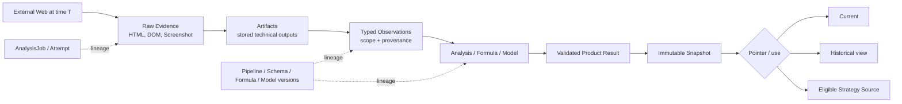
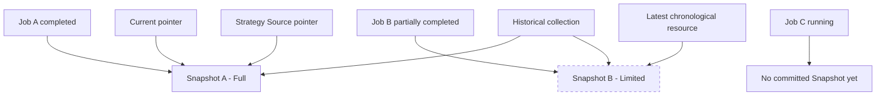

# Module 15 — Snapshot / History / Lineage

Status: `COMPLETE / READY_FOR_M16`  
Phase: `TB-16`  
Difficulty: `ADVANCED`  
Prerequisites: `M01`–`M14`

## 1. Learning goals

このModuleを終えたLearnerは、次を説明・判断できる。

1. Snapshotを特定時点のimmutable historical product recordとして説明する。
2. `latest`、`current`、`strategy source`、`historical Snapshot`を別のpointer/意味として扱う。
3. Evidence、Artifact、Observation、Result、Snapshotを変換段階とauthorityから区別する。
4. Snapshotをsilent overwriteしない理由をaudit/reproducibility/comparisonから説明する。
5. outputからJob、Evidence、processing/versionへ遡るlineageを説明する。
6. generation-time semanticsとhistorical compatibilityを守る判断ができる。
7. PD-04のLimited Snapshotと`EVIDENCE_ONLY`境界を適用する。
8. PD-01のdeep-link/current resolutionとauthorization境界を説明する。
9. CURRENT frontend/mock、承認済みcontract、未実装persistenceを混同しない。

## 2. History fundamentals

Current Stateは現在の操作・参照対象であり、Historical Stateは過去時点の固定記録である。

current recordだけを上書きし続けると、次が失われる。

- 過去と現在の比較
- 「その時点で何が表示されたか」のaudit
- 障害・分析差分のdebugging
- Evidence、formula、modelが変わった場合の再現性
- Userが参照・共有したresourceの安定性

Historyは単なるbackupではない。Productが過去の判断根拠を説明するためのdomain resourceである。

## 3. Snapshot fundamentals

Panoptes Snapshotは、あるvalidated Analysis Resultを特定時点で固定したimmutable historical product recordである。

```text
Snapshot != Screenshot
```

- Screenshot: 特定viewport・render stateのvisual Evidence Artifact
- Snapshot: Product-level result/historyと、その意味・lineageを固定するresource

1 Snapshotは多数のHTML、DOM、Screenshot、Observation、derived Resultへのlineageを持ち得る。Artifact Store上のobject identityとSnapshot identityは別である。

## 4. Current, latest, strategy source, and historical

Canonical invariant:

```text
latest != current != strategy source != historical Snapshot
```

| Concept             | Meaning                                              | Mutability / authority                |
| ------------------- | ---------------------------------------------------- | ------------------------------------- |
| Latest              | 時間的に最も新しく生成・受付されたresource           | chronological fact。採用を意味しない  |
| Current             | Productが現在採用・表示するserver-authorized pointer | mutable relationship。Rails authority |
| Strategy Source     | Formal Strategy generationが参照する承認済みsource   | eligibility/promotion policyに従う    |
| Historical Snapshot | 過去時点のimmutable product record                   | contentをsilent overwriteしない       |

これらが同じSnapshotを指す場合はあるが、それはidentityが同じなのではなく、別の意味を持つpointerが偶然同じtargetを参照している状態である。

### Why latest is not automatically current

```text
Analysis A -> Full Snapshot A -> current
Analysis B -> newer Limited Snapshot B

latest = B
current = A  (policy/eligibilityにより維持可能)
strategy source = A
historical = A and B
```

Bがpartial、未承認、incompatible、またはStrategy非eligibleなら、新しいだけでcurrentへ昇格させるとstable Product stateを壊す。Currentはchronological queryではなくserver-authorized canonical pointerである。

## 5. Snapshot immutability

Snapshot作成後、そのgeneration-time content/semanticsをsilent overwriteしない。変更が必要なら原則として次を作る。

```text
new AnalysisJob -> new Evidence/Result -> eligible new Snapshot -> explicit pointer update
```

Immutabilityが必要な理由:

- audit: 当時の表示・判断根拠を保持する
- reproducibility: 当時のinput/version/output関係を追える
- comparison: resource identityを固定して差分を取れる
- trust: bookmark/shareしたresourceの意味を変えない
- lineage: ResultとEvidence chainを後から書き換えない

Immutabilityは「関連するすべてが永遠に変更不能」という意味ではない。Current pointer、Strategy selection、task execution state等のmutable relationship/resourceはあり得る。しかし、それらをSnapshot payload内で更新するか分離するかは明示的contractが必要である。

CURRENT mock/domainはSnapshot aggregate内の`strategyPlans.isSelected`や`phaseTasks`を更新する。これはbrowser-local mock/presentation behaviorであり、承認済みProduction immutable Snapshot persistenceの証拠ではない。Target contractとの整合方法は未実装・DEFERREDであり、本Moduleでschemaを再設計しない。

## 6. Result, Artifact, and Snapshot

| Concept     | Definition                                         | Example                                           | Canonical decision                                   |
| ----------- | -------------------------------------------------- | ------------------------------------------------- | ---------------------------------------------------- |
| Evidence    | 外部対象から観測した原本fact                       | HTML、rendered DOM、Screenshot                    | Worker captures; Rails validates references          |
| Artifact    | 保存可能なtechnical output                         | HTML object、Screenshot object、extracted JSON    | Store persists; not Product history by itself        |
| Observation | Evidenceから構造化されたtyped interpretation       | CTA presence、heading relation、visual prominence | Approved contract; Worker candidate/Rails validation |
| Result      | AnalysisJobから得たvalidated Product output        | analysis sections、scores、limitations            | Rails validates usability                            |
| Snapshot    | eligible Resultを固定したhistorical Product record | committed analysis snapshot                       | Rails creates/commits                                |

`artifact exists != Result valid != Snapshot eligible`である。すべてのResultが自動的にSnapshotになるわけではなく、Snapshot eligibilityはJob outcomeとPD-04 policyに従う。

## 7. Evidence-to-Snapshot lineage



Lineageは「このoutputが、どのinput、processing、versionから作られたか」を追跡するrelationである。

最低限の概念:

- Project/Organization/AnalysisJob
- attempt/run where relevant
- source URLとcapture context
- Evidence/Artifact identity
- Observation/extraction identity
- pipeline/Observation schema/Axis/formula version
- model/prompt version where semantic/LLM processingに関係する場合
- validated Result
- Snapshot
- SnapshotからStrategy Source等へのexplicit relationship

Exact DB schemaやID formatは未決定である。存在しないfieldをCURRENT contractとして扱わない。

## 8. Why lineage matters

Scoreが去年70、今年60になったとしても、Web品質が10低下したとは直ちに言えない。

変化候補:

- website content/layoutが変わった
- collection coverage/viewportが変わった
- extraction/pipelineが変わった
- Observation schemaが変わった
- formula/parameterが変わった
- model/promptが変わった
- missing/partial handlingが変わった

Lineageがあれば、input変化とcalculation変化を分離してdebug、audit、historical interpretation、comparison可否判定を行える。Lineageがなければ数字は同じscaleでもsemanticに比較不能かもしれない。

## 9. Versioning and historical interpretation

Panoptesで承認・検討済みのversion/provenance対象には次がある。

- Axis Contract Version
- Analysis Pipeline Version
- Observation Schema Version
- Formula Versionとsubordinate profile revision
- collection/extraction/tool version候補
- model/prompt/classifier version（該当Observationでconditional）

CURRENT Snapshot frontend typeは`versionLabel`を持つが、これは上記すべてを一意解決するcanonical lineage implementationではない。OpenAPI draftはinteger `version`とgeneric `payload`を持つが、Production persistence/API完成を意味しない。

### Generation-time semantics

Formula v1で作ったSnapshotを、Formula v2導入後にsilent再計算・再解釈しない。

安全な選択肢:

- original version indication付きview-only表示
- compatibilityが明示できる場合だけversion-aware comparison
- explicit reanalysisでnew Job/new Snapshotを生成
- unsupported historical stateとして明示

Old Snapshotへcurrent labels/formulaを無条件適用すると、当時存在しなかった意味を過去recordへ注入することになる。

## 10. Reanalysis and Evidence reuse

Reanalysisはold Snapshotの更新ではない。

```text
Old Snapshot remains immutable
-> new AnalysisJob
-> new Evidence by default
-> new Result
-> eligible new Snapshot
-> explicit current/source decision
```

PD-04はnew identities + immutable lineage、recollection default、versioned Explicit Reuse Profile、silent reuse禁止を承認している。

Evidence reuseを明示する必要がある理由:

- Evidenceがstaleかもしれない
- URL/content/contextが変わっているかもしれない
- collection/pipeline versionが変わっているかもしれない
- Partial/coverage conditionを引き継ぐ必要がある

Exact Reuse Profile schemaやpolicy条件はDEFERREDである。

## 11. Snapshot eligibility and Partial Snapshot

PD-04 baseline:

| AnalysisJob terminal outcome | Snapshot eligibility     | Meaning                                        |
| ---------------------------- | ------------------------ | ---------------------------------------------- |
| `completed`                  | `CAN_CREATE`             | validation後のFull Snapshot候補                |
| `partially_completed`        | `CONDITIONAL`            | limitations付きS-B Limited Snapshot            |
| `failed`                     | `CANNOT_CREATE` baseline | valid Product Result不成立                     |
| `cancelled`                  | `CANNOT_CREATE` baseline | terminal reasonをpartialへsilent rewriteしない |
| `timed_out`                  | `CANNOT_CREATE` baseline | intermediate artifactとFormal Snapshotを分離   |

Limited Snapshotには少なくともlimitations、incomplete processing、partial provenanceが必要で、Full Snapshotと同じ意味で扱わない。

Observation `PARTIAL`、Axis/Score partial、Job `partially_completed`、Limited Snapshotは別conceptである。一つを他へ自動変換しない。

## 12. Strategy Source boundary

Strategy SourceはFormal Strategy generationが参照するProduct sourceである。

```text
Strategy Source != latest Snapshot
Strategy Source != current pointer
```

PD-04 v1:

- Completed Result/Snapshot: validation後にeligibleになり得る
- Partial Result/Limited Snapshot: `EVIDENCE_ONLY`
- PartialはFormal Strategy Sourceへauto/manual promotionしない

将来のcontrolled exceptionが示唆されても、v1でmanual promotion ruleを新設してはならない。Current表示とStrategy入力は別decisionである。

## 13. Current/latest/source pointer model



この例ではBがAより新しいためlatestだが、Limitedでauto-promotion不可なのでcurrent/Strategy SourceはAを維持できる。Cはさらに新しいJobでもcommitted Snapshotがないため、Snapshot latestとは別である。

## 14. Deep-link and historical access

PD-01BはModel C — Hybrid Current Pointer + Explicit Historical Resourceを承認している。

- identity-less `/app/analysis`: active Organizationのserver-authorized currentを解決
- currentがなければAnalysis Entry / empty state
- explicit Job identity: process/outcome selector
- explicit Snapshot identity: immutable historical result selector
- URL resource ID: selectorでありauthorization proofではない
- Rails: Organization/resource ownershipを毎回認可

Missing/forbidden/unavailable/unsupported historical resourceをcurrent、latest、別Organizationへsilent fallbackしない。意図が変わるためである。Failureを区別して明示する。

CURRENT routesはexplicit Snapshot selection/state restorationを実装していない。承認済みLogical ContractとProduction implementationを混同しない。

## 15. Historical compatibility and comparison

Snapshot比較では値の型や表示scaleが同じだけでなく、semantic contractが比較可能か確認する。

確認対象候補:

- Axis set/identity/definition/order version
- Formula/profile/parameter version
- Observation schemaとmeasurement mode
- collection coverageとEvidence scope
- Missing/Partial treatment
- model/prompt/classifier version

Compatibilityが不明またはhigh riskなら、simple numeric deltaだけを表示しない。view-only、version indication、comparison unavailable等のexplicit stateが必要になり得る。Exact comparison algorithmは本Moduleで決めない。

## 16. Audit vs Lineage

| Concept | Question               | Example                                                         |
| ------- | ---------------------- | --------------------------------------------------------------- |
| Audit   | 誰が、いつ、何をしたか | User AがT時点でreanalysisを要求した                             |
| Lineage | 何から何が作られたか   | Snapshot SはResult R、Job J、Evidence E、Formula v1から作られた |

Audit recordだけではoutput derivationを再現できず、lineageだけではactor/action authorizationを説明できない。両者は関連しても代替ではない。

## 17. Retention and deletion

Snapshot、Evidence、Artifactの保持期間、legal hold、User deletion、storage tier、cascade behaviorは未決定である。

Immutabilityは「永久保存」を意味しない。Retention/deletion policyによりresource自体が削除される可能性はあるが、silent mutationやunrelated currentへのfallbackとは別問題である。本Moduleでは保持期間や削除規則を新設しない。

## 18. CURRENT / TARGET / DEFERRED

| Classification | Confirmed scope                                                                                                                                                                                                                                                                                |
| -------------- | ---------------------------------------------------------------------------------------------------------------------------------------------------------------------------------------------------------------------------------------------------------------------------------------------- |
| CURRENT        | Frontend typeに`analysisSnapshotId`、`versionLabel`、aggregate payloadがあり、Projectに`currentSnapshotId`、storeに`currentSnapshot`/`lastStableSnapshot`がある。selectorはactive reanalysis中にlast stable Snapshotを保持する。mockはcompleted時にSnapshotを生成しcurrent pointerを更新する。 |
| CURRENT caveat | explicit historical route/restorationは未実装。mock/domainはSnapshot aggregate内のstrategy selection/taskを更新するため、Production immutability実装の証拠ではない。Frontend payloadにfull Evidence/Artifact/formula/model lineageはない。                                                     |
| TARGET         | Rails/PostgreSQLがimmutable committed Snapshot、current pointer、authorization、lineage、Strategy Source eligibilityをcanonicalに保持する。PD-01 Model CとPD-04 Limited Snapshot/Evidence-only/new lineageを適用する。                                                                         |
| DEFERRED       | Rails schema/persistence、exact Result ID、explicit Snapshot URL/API、history UI、artifact linkage、full lineage graph、compatibility resolution、Strategy Source persistence、retention/deletion、reuse profile、migration from mutable mock aggregate。                                      |

Approved Product DecisionはProduction persistence完成を意味しない。

## 19. Representative repository mapping

| Representative source                                                          | Role                            | Current/history meaning                          | Lineage role                            | Status                                                                  |
| ------------------------------------------------------------------------------ | ------------------------------- | ------------------------------------------------ | --------------------------------------- | ----------------------------------------------------------------------- |
| [Product Decision Register](../../product/product-decision-register.md) PD-01B | deep-link/current contract      | Model C、explicit historical、no silent fallback | Job/Snapshot identity semantics         | Approved; implementation deferred                                       |
| [Product Decision Register](../../product/product-decision-register.md) PD-04  | partial workflow                | Limited Snapshot、current/source separation      | new Job/new identity/reuse contract     | Approved; implementation deferred                                       |
| [M12 AnalysisJob Lifecycle](./12-analysis-job-lifecycle.md)                    | Job/result eligibility          | terminal outcomeとstable Snapshot                | Job→Result/Snapshot owner               | Approved learning contract                                              |
| [M14 Worker / Collection](./14-python-worker-chromium-collection.md)           | Evidence/Artifact boundary      | Product Snapshot以前のtechnical outputs          | collection/provenance inputs            | Approved learning contract                                              |
| [AnalysisJob State Machine](../../api/analysis-job-state-machine.md)           | commit/transition design        | committed/stable/workingを分離                   | attempt/job/artifact validation         | Target draft; PD-04 caveat                                              |
| [API v1 Contract](../../api/panoptes-api-v1.md)                                | Snapshot API semantics          | committed/latest endpoint draft                  | Job `committed_snapshot_id`             | Target draft; `latest` endpoint predates current contract clarification |
| [OpenAPI draft](../../api/openapi-draft.yaml)                                  | wire schema draft               | Snapshot ID/version/committed_at/generic payload | AnalysisJob ID association              | Target draft, incomplete lineage                                        |
| [Snapshot Component Map](../../architecture/snapshot-component-map.md)         | Frontend render graph           | aggregate payload→tabs/view models               | no persistence lineage                  | CURRENT architecture mapping                                            |
| `src/lib/panoptes/types.ts`                                                    | frontend domain types           | current Snapshot aggregate、Job IDs              | limited IDs/versionLabel only           | CURRENT frontend, partial                                               |
| `src/lib/panoptes/selectors/presentation.ts` / `domain/project-sync.ts`        | stable display projection       | current/lastStable rendering                     | no historical collection                | CURRENT frontend                                                        |
| `src/lib/panoptes/api/mock/runtime-ticker.ts` / `mock-backend.ts`              | browser-local mock persistence  | completed→Snapshot/current update                | Job→mock Snapshot only                  | CURRENT mock; not canonical backend                                     |
| `src/lib/panoptes/domain/strategy-snapshot.ts`                                 | client strategy/task projection | aggregate payloadをcopy-update                   | exposes immutability implementation gap | CURRENT presentation/mock behavior                                      |

`GET .../analysis-snapshots/latest`というTarget draft endpoint名はchronological latestを表し得るが、PD-01/PD-04のserver-authorized currentやStrategy Sourceと同義ではない。後続contract実装時に意味を明示する必要がある。

## 20. Common misunderstandings

| Misunderstanding                            | Correction                                                         |
| ------------------------------------------- | ------------------------------------------------------------------ |
| Snapshot = Screenshot                       | Snapshotはhistorical Product record、ScreenshotはEvidence Artifact |
| Snapshot = Current State                    | Snapshotはimmutable resource、Currentはmutable pointer             |
| Latest = Current                            | chronological newestとadopted pointerは別                          |
| Latest = Strategy Source                    | formal eligibility/promotionが必要                                 |
| Result = Snapshot                           | Resultはvalidation output、Snapshot化にはeligibility/commitが必要  |
| Artifact = Snapshot                         | technical objectとProduct historyは別                              |
| Historical Snapshotを上書きしてよい         | new Job/new Snapshotで履歴を追加する                               |
| Reanalysis = Snapshot update                | new identitiesとlineageを作る                                      |
| Lineage = Audit Log                         | derivation relationとactor/action recordは別                       |
| Old Snapshotをcurrent logicで表示すればよい | generation-time semantics/compatibilityを守る                      |
| Partial Snapshot = Full Snapshot            | limitations付きLimited Snapshot                                    |
| URL ID = Authorization proof                | Railsがresource ownershipを認可する                                |

## 21. Decision heuristic

1. Raw captured factか → Evidence
2. Stored technical outputか → Artifact
3. Structured interpretationか → Observation
4. Validated Product outputか → Result
5. Immutable historical recordか → Snapshot
6. Current active relationshipか → Current pointer
7. Chronologically newestか → Latest
8. Formal Strategy inputか → Strategy Source
9. Output derivationを問うか → Lineage
10. Actor/actionを問うか → Audit

## 22. Practice

### A. Knowledge check

1. SnapshotとScreenshotの違いを説明せよ。
2. Current pointerがchronological latestでない理由を説明せよ。
3. Immutabilityと永久保存が同義でない理由を説明せよ。

### B. Classification

`Screenshot` / `HTML` / `Analysis Result` / `Historical Snapshot` / `Current pointer` / `Strategy Source` / `Audit record` / `Lineage edge`を分類せよ。

### C. Pointer exercise

Snapshot Aはcompleted/fullでcurrent/Strategy Source。後からSnapshot Bがpartially_completed/Limitedで作成された。さらにJob CがrunningでSnapshot未生成である。Snapshot chronological latest、Job latest、current、Strategy Source、historical collectionを答えよ。

### D. Eligibility exercise

`completed`、`partially_completed`、`failed`、`cancelled`、`timed_out`ごとのSnapshot eligibilityとStrategy Source eligibilityを説明せよ。

### E. Lineage trace

Snapshotのscoreが変化した原因を調べる際、Snapshotからどのresource/versionへ遡るべきか順序を示せ。

### F. Historical compatibility

Formula v1 SnapshotをFormula v2 UIで表示・比較する場合、何を確認し、何を避けるべきか。

### G. Violation detection

1. latest Snapshotを無条件にcurrentへ設定する。
2. old Snapshot payloadを新formulaで上書きする。
3. Partial SnapshotをFormal Strategy Sourceへ昇格する。
4. unavailable historical linkをcurrentへredirectする。
5. Screenshot object IDをSnapshot IDとして扱う。
6. Reanalysis完了時にold Snapshot rowを書き換える。

### H. Architecture explanation

「なぜPanoptesではSnapshotをimmutableにするのか」を、audit、reproducibility、comparison、lineage、User trustを使って説明せよ。

## 23. Answers and explanation guide

### A. Knowledge check

1. Screenshotはpixel Evidence Artifact、Snapshotはvalidated Product Resultを固定したhistorical resourceである。
2. newer resourceがPartial、incompatible、未承認等でもstableなcurrentを維持する必要があるため。CurrentはRails-authorized pointerである。
3. immutableは存在中のcontentをsilent mutationしない性質、retentionはresourceをいつまで保持するかという別policyだから。

### B. Classification

- Evidence: Screenshot、HTML
- Result: Analysis Result
- Snapshot: Historical Snapshot
- Relationship/pointer: Current pointer、Strategy Source
- Audit: Audit record
- Lineage: Lineage edge

### C. Pointer exercise

- Snapshot latest: B
- Job latest: C
- Current: A
- Strategy Source: A
- Historical collection: AとB

BはLimitedでv1 auto-promotion不可、CはまだSnapshotを持たない。

### D. Eligibility exercise

- completed: Snapshot `CAN_CREATE`、validation後Strategy eligible候補
- partially_completed: Snapshot `CONDITIONAL` Limited、Strategyは`EVIDENCE_ONLY`
- failed/cancelled/timed_out: Formal Snapshot `CANNOT_CREATE` baseline、Strategy source不可

### E. Lineage trace

`Snapshot -> validated Result -> AnalysisJob/attempt -> Observation -> Evidence/Artifact -> source/capture context`へ遡り、並行してFormula/Profile、Axis Contract、Pipeline、Observation Schema、model/prompt等のgeneration-time versionを確認する。

### F. Historical compatibility

Formula identity/profile、Axis/Observation schema、coverage、Missing/Partial、model/prompt等を確認する。互換性不明ならsimple deltaやsilent v2 recalculationを避け、version indication、view-only、comparison unavailable、explicit reanalysisを選ぶ。

### G. Violation detection

1. chronological orderをadoption policyへ誤変換。2. generation-time historyを破壊。3. PD-04 `EVIDENCE_ONLY`違反。4. explicit user intentとfailure semanticsを破壊。5. technical objectとProduct resourceのidentity混同。6. Reanalysis/new lineageを失う。

### H. Architecture explanation

Snapshotをimmutableにすると、当時のProduct Resultと意味を固定でき、誰が見たrecordかをauditし、同じEvidence/version chainを追跡し、compatibleなhistoryだけを比較できる。bookmark/shareの意味も変わらず、new analysisはnew Snapshotとして差分を残せるためUser trustを守れる。

## 24. Completion criteria

|   # | Criterion                                      | Result |
| --: | ---------------------------------------------- | ------ |
|   1 | Snapshot fundamentals explained                | `PASS` |
|   2 | current/latest/history distinction explained   | `PASS` |
|   3 | Result/Artifact/Snapshot distinction explained | `PASS` |
|   4 | Immutability explained                         | `PASS` |
|   5 | Lineage explained                              | `PASS` |
|   6 | Version/historical interpretation explained    | `PASS` |
|   7 | Partial Snapshot explained                     | `PASS` |
|   8 | Strategy Source/deep-link explained            | `PASS` |
|   9 | Repository mapping + two diagrams included     | `PASS` |
|  10 | Exercises + answers included                   | `PASS` |

M15 authoring result: `10 / 10 PASS`。これは教材完成の判定であり、Production Snapshot persistence、history UI、lineage graph、compatibility engine、retention policyの完成判定ではない。

## 25. M16 handoff

Recommended next phase: `TB-17 — Module 16: Common 6 Axis`。

M16では6つのCanonical Axisについてidentity、label、definition、order、Axis Contract Versionを学ぶ。Snapshotのgeneration-time axis/version lineageを前提にするが、FormulaやMissing/Partial policyを再設計しない。
