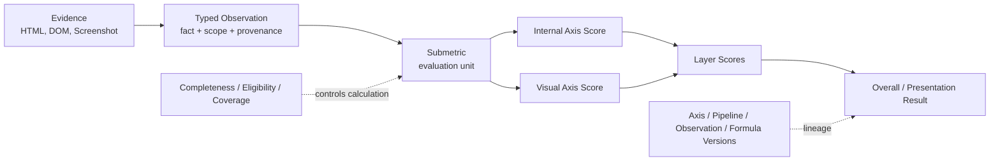
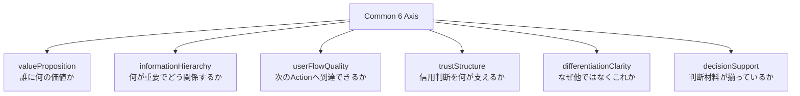

# Module 16 — Common 6 Axis

Status: `COMPLETE / READY_FOR_M17`  
Phase: `TB-17`  
Difficulty: `INTERMEDIATE`  
Prerequisites: `M01`–`M15`

## 1. 学習目標（Learning goals）

このModuleを終えた学習者は、次の内容を説明し、判断できます。

1. Common 6 Axisを複数siteの観測・比較に共通のsemantic frameとして説明する。
2. 6つのCanonical ID、Label、Definition、Orderを正確に示す。
3. Axis、Evidence、Observation、Submetric、Scoreを区別する。
4. 似たEvidenceをAxisごとの問いに分け、cross-axis boundaryを説明する。
5. Internal/Visual layerを代替関係ではなく別Evidence/Observation系統として扱う。
6. Missing、N/A、Unknown、Partial、有効な0を区別する。
7. Axis definitionとFormula/Weight/Calibrationを分離する。
8. comparison/gapとStrategy decisionを区別する。
9. CURRENT fixture/UIとAxis Contract v1、未実装Worker/Rails contractを混同しない。

## 用語ガイド

- **Common 6 Axis:** 異なる対象の分析結果を共通の観点で比較するための、Panoptesの6つの正式な評価軸。
- **Axis:** 分析で答えたい大きな問い。画面上のlabelだけでなく、ID、定義、順序を含むcontractを持つ。
- **Evidence:** Observationの根拠となる、取得済みのHTML、screenshot、factなど。
- **Observation:** Evidenceから確認できた事実を、解釈可能な形で記録したもの。
- **Cross-axis boundary:** 一つのEvidenceを使えても、各Axisが答える問いと評価理由を混同しないための区切り。

## 2. Why Common Axis

複数のWebサイトを比較するには、それぞれを同じ問いで評価する必要があります。siteごとに観点を変えると、scoreの数字が同じでも、表している意味がそろいません。

PanoptesのCommon 6 Axisは、自社・競合・業界を次の共通観点で観測するためのProduct semantic contractです。

- 何の価値を誰へ伝えているか
- 情報をどう構成しているか
- 次のActionへ進めるか
- 信用判断を支える根拠があるか
- 他との違い・選ぶ理由が明確か
- 比較・問い合わせ・契約判断に必要な材料があるか

Axisは「評価結果」ではなく「何を評価するかを固定する観点」です。

## 3. Axis, Observation, Submetric, and Score

```text
Axis != Observation != Submetric != Score
```

| 概念        | 確認する問い                          | 例                                        |
| ----------- | ------------------------------------- | ----------------------------------------- |
| Evidence    | 何を直接観測したか                    | Hero HTML、CTA DOM、Screenshot            |
| Observation | Evidenceからどんな構造化factを得たか  | target audienceと具体便益が明示されている |
| Submetric   | Observationをどの評価単位へ整理するか | benefit specificity、offer visibility     |
| Axis        | 何の意味を評価しているか              | `valueProposition`                        |
| Score       | Formula/profileでどう数値評価したか   | Axis score 0–100 presentation value等     |

Observationが存在してもscoreが自動的に決まるわけではありません。Axis definitionは意味を定め、Formulaは測り方を定める。

## 4. Canonical 6 Axis contract

Axis Contract v1は`ACTIVE`で、次のID、Label、Definition、Canonical Orderが承認済みです。

| Order | Canonical ID             | Canonical Label | Formal definition                                                                                                          | Main question              |
| ----: | ------------------------ | --------------- | -------------------------------------------------------------------------------------------------------------------------- | -------------------------- |
|     1 | `valueProposition`       | 価値訴求        | Product / Serviceが誰にどのような価値を提供し、どの課題・便益に応えるものかが、主要messageから明確に伝わる度合い           | 誰に、何の価値があるか     |
|     2 | `informationHierarchy`   | 情報階層        | 情報の重要度と関係性を把握しやすいよう、適切な順序・階層・groupで構成されている度合い                                      | 何が重要で、どう関係するか |
|     3 | `userFlowQuality`        | 導線強度        | 次に取るべきActionを識別でき、CTA・link・navigation・page transitionで主要目的地点までの経路が途切れず接続されている度合い | 次のActionへ到達できるか   |
|     4 | `trustStructure`         | 信頼構造        | Product / Serviceまたは提供主体を信頼する根拠・証拠・権威性・透明性が十分かつ適切に提示・構成されている度合い              | 信用判断を何が支えるか     |
|     5 | `differentiationClarity` | 差別化明確性    | 競合・他選択肢と比較した固有の違い・独自性・選ぶ理由が明確に伝わる度合い                                                   | なぜ他ではなくこれか       |
|     6 | `decisionSupport`        | 意思決定支援    | 比較・選択・問い合わせ・契約等の判断に必要な情報が十分かつ明確に提示されている度合い                                       | 判断材料が揃っているか     |

Canonical Orderは、Product領域で概念を並べる際の標準順序です。重要度、weight、順位、因果関係、UIの強制表示順、処理・収集順、Backendの配列位置を意味しません。Feature UIは、理由を記録したうえで、明示的に異なる順序を使う場合があります。

## 5. Axis 1 — `valueProposition`

### Includes

- target audience/problem
- offered value/benefit/outcome promise
- offer/product-service relationship
- first-viewやmajor messagingでのclarity
- specific value communication

### Excludes

- Productそのものの実価値やactual customer outcome
- actual comprehension/conversion
- competitorとの差そのもの
- proof/credentialそのもの
- CTA path continuity

このAxisはcopyの美しさだけを評価しません。「誰に」「どんな課題へ」「何を提供し」「何が得られるか」がpublic site上で伝達されているかを問う。

## 6. Axis 2 — `informationHierarchy`

### Includes

- heading hierarchy
- section sequence/order
- content grouping/chunking
- primary/secondary informationのpriority
- related informationのproximity
- navigation taxonomy

### Excludes

- next Actionまでのpath continuity
- decision materialの十分性そのもの
- proofのcredibility quality
- actual comprehension/interaction

情報量が多いこと自体は悪くない。重要なのは量ではなく、重要度・関係・groupが理解できる構造になっているかです。

## 7. Axis 3 — `userFlowQuality`

### Includes

- CTA/action discoverability
- CTA destinationとpage transition
- navigation/link reachability
- path continuityとdead-end
- major pathのstructural completeness
- decision materialへの到達と、その後のnext action

### Excludes

- actual click/conversion behavior
- off-site/full customer journey
- value messageの意味
- decision informationの十分性
- visual beautyだけの評価

Canonical Labelは「導線強度」だがCanonical IDは`userFlowQuality`です。legacy `funnelStrength`は`NOT_CANONICAL / LEGACY_MIGRATION_SOURCE`で、canonical aliasではありません。

## 8. Axis 4 — `trustStructure`

### Includes

- case/testimonial/logo
- credential/certification/authority
- company identity/transparency
- security/guarantee/assurance
- credibility-oriented FAQ
- observable proofの配置・coverage

### Excludes

- 実際の顧客満足・reputation・reliability
- 有名そう、派手、権威がありそうというunsupported impression
- generic benefit/pricing
- pure option comparison
- CTA path

Trust Structureは、企業やserviceが実際に信頼できるかを測るものではありません。公開site上に、信用を判断する根拠となるEvidenceがどのように整理されているかを評価します。

## 9. Axis 5 — `differentiationClarity`

### Includes

- unique claim、distinctive feature
- positioning、specialization、category distinction
- proprietary approach/mechanism
- reason-to-choose
- observable and supportable implicit uniqueness
- explicit comparison where present

### Excludes

- feature countだけ
- generic benefit
- proofの存在だけ
- pricing completeness
- actual market superiorityやunsupported superiority

明示的competitor comparisonは必須ではありません。しかし「高品質」「簡単」等のgeneric adjectiveだけでは、誰と比べて何が固有かを説明しにくい。

## 10. Axis 6 — `decisionSupport`

### Includes

- pricing/quote context
- plan/option comparison
- scope/specification/condition/eligibility
- process、implementation、onboarding
- constraint/risk disclosure
- choice/contract-oriented FAQ
- inquiry/purchase next-step information

### Excludes

- CTA destination/navigationそのもの
- pure credibility proof
- generic value proposition
- actual purchase/conversion
- off-site sales interaction

Non-public pricingを自動的に低評価しません。quote process、scope、eligibility、plan structure等、business contextに応じた判断材料の十分性を問う。

## 11. Cross-axis boundaries

| Shared evidence/theme | Axis A asks                                     | Axis B asks                                     |
| --------------------- | ----------------------------------------------- | ----------------------------------------------- |
| Value message         | `valueProposition`: 何の価値か                  | `differentiationClarity`: なぜ他ではなくこれか  |
| Navigation            | `informationHierarchy`: 情報分類・階層は明確か  | `userFlowQuality`: destinationへ到達できるか    |
| Pricing section       | `informationHierarchy`: 配置・groupは理解可能か | `decisionSupport`: 判断情報は十分か             |
| Case study            | `trustStructure`: credibilityを支えるか         | `decisionSupport`: 選択条件・risk判断を助けるか |
| CTA                   | `userFlowQuality`: next action/pathは明確か     | `decisionSupport`: CTA前後に判断材料があるか    |
| Claim + proof         | `valueProposition`: benefitが伝わるか           | `trustStructure`: claimを支えるEvidenceがあるか |

同じEvidenceを複数のAxisで使うことはできますが、何を評価する根拠として使うかを分けます。Evidenceの再利用が許されても、Formula上で同じ寄与を重複計上してよいとは限りません。重複の除外、寄与の上限、集計規則はM17で扱います。

FAQはUI形式ではなくcontent purposeで分類します。Security/credibility FAQはTrust、pricing/choice FAQはDecision Support、navigationへの寄与はFlowとして別Observationになり得ます。

## 12. Internal and Visual evidence

| 層（Layer） | 代表的なEvidence                                              | 根拠として使える判断                                       |
| ----------- | ------------------------------------------------------------- | ---------------------------------------------------------- |
| `INTERNAL`  | HTML、DOM、heading、link、CTA、structured text、metadata      | presence、structure、relation、destination、typed content  |
| `VISUAL`    | Screenshot、spatial hierarchy、prominence、grouping、emphasis | visibility、visual priority、proximity、perceived grouping |

VisualはInternalの代替ではなく、InternalもVisualの代替ではありません。

例えば、DOMにprimary CTAが存在していても、Screenshotではoverlayに隠れている場合があります。このとき、Internalで確認した存在とVisualで確認した目立ちやすさは別のObservationです。同じEvidence groupへ関連付けても、二つのLayerを一つにまとめません。

## 13. Observable evidence boundary

Axis Contractは公開site上のcontent、messaging、structure、Evidence、relationship、presentation contextを対象とします。

Evidenceなしに推定しないもの:

- actual traffic、CTR、CVR
- sales/revenue/business performance
- demographic/customer attributes
- actual customer trust/satisfaction
- actual comprehension
- actual market superiority
- unsupported off-site outcome

「LLMがそう思った」だけではObservationとして不十分です。Observationは承認済みの論理契約に従い、Evidenceへの参照、取得元・対象範囲、型付きの値、測定方法・Layer、由来、充足状況、必要に応じた確信度・versionを持ちます。

## 14. Evidence-to-Axis flow



例:

```text
Evidence: Heroに「最短3日で導入」と対象業種が表示される
Observation: targetと具体的な導入速度benefitがmajor messageに存在
Submetric candidate: benefit specificity / target clarity
Axis: valueProposition
Score: approved Formula/Profileがある場合だけ計算
```

## 15. Six Axis map



## 16. Cross-axis Hero example

同じHeroでもAxisごとに問いが異なります。

| Axis                     | Heroで見る問い                                               |
| ------------------------ | ------------------------------------------------------------ |
| `valueProposition`       | target、problem、benefit、offerが明確か                      |
| `informationHierarchy`   | headline、supporting copy、CTA、proofの優先度とgroupが明確か |
| `userFlowQuality`        | primary CTAとdestination、次のpathが発見・到達可能か         |
| `trustStructure`         | claimを支えるproof/credential等が見える・到達可能か          |
| `differentiationClarity` | 固有のmechanism・specialization・reason-to-chooseが伝わるか  |
| `decisionSupport`        | CTAを押す前後にscope、price/process等の判断材料へ進めるか    |

Heroが同一でも、同じfactを6回数えるのではなく、各semantic questionへ対応するObservationを分離します。

## 17. Missing, Partial, and eligibility

承認済みPD-02D Treatment Model Bでは次を分離します。

| 概念          | Values / meaning                                                |
| ------------- | --------------------------------------------------------------- |
| Completeness  | `PRESENT / MISSING / NOT_APPLICABLE / UNKNOWN / PARTIAL`        |
| Eligibility   | `ELIGIBLE / INELIGIBLE / CONDITIONALLY_ELIGIBLE / UNDETERMINED` |
| Score State   | `CALCULATED / NON_CALCULATED`                                   |
| Evidence Role | `REQUIRED / OPTIONAL / CONDITIONAL / NOT_APPLICABLE`            |

重要な規則:

- valid `value=0`は計算された値でありMissingの代用品ではない
- `MISSING`は観測範囲内でのmeaningful absence候補だが、自動0/penaltyではない
- `UNKNOWN`/technical failureをnegative Evidenceや0へ変換しない
- `NOT_APPLICABLE`は0ではなくeligible denominatorから除外する
- `PARTIAL`はreason + coverage + lineageを伴い、direct numeric penaltyを課さない
- Non-calculated scoreへ0、neutral、last-known valueをsilent代入しない
- Partial scoreはcomplete scoreと無標識で同じ表示にしない

例: Pricing pageを取得できなかった場合、「pricingが存在しない」とは断定できません。coverage/destination failureなら`UNKNOWN`または`PARTIAL`候補であり、十分なscopeでabsenceを確認できた場合にだけ`MISSING`を検討します。

Exact thresholds、required sets、per-Submetric treatment、physical schemaは未決定です。

## 18. Axis Score and Formula boundary

Axis definitionはmeaningであり、Formulaはmeasurement/calculationです。

承認済みlogical direction:

```text
Raw Observation
-> Normalized Submetric Score
-> Internal / Visual Axis Score
-> Internal / Visual Layer Score
-> Overall Score
-> Presentation Value
```

承認済みなのはFormula Architecture、version/parameter policy、logical wire、Missing/Partial treatmentです。次は未決定または未完了です。

- exact weight/ratio/normalization parameter/threshold/rounding
- calibration datasetと実測calibration
- confidence calibration
- exact dedup/double-count rule
- physical JSON/DB/OpenAPI
- Worker/Rails/Frontend implementation

Canonical Orderからweightやpriorityを推定してはなりません。0–100はapproved presentation boundaryだが、「80なら絶対に良い」という意味ではありません。Formula version、coverage、completeness、comparison contextが必要です。

## 19. Comparison, industry, and Strategy boundary

同じAxis Contractを使うことでOwn Site、Competitor、Industry patternをsemanticに揃えられる。

ただし比較には次の整合が必要です。

- Axis Contract/version
- Formula/profile/version
- Evidence scope/coverage/completeness
- Internal/Visual layer availability
- Missing/Partial treatment
- generation time/context

Formulaのversionや観測範囲の違いを無視して、数値だけを単純比較するのは危険です。

自社・競合・業界のObservationやscoreの差から、課題、強み、弱み、機会の候補を見いだせます。ただし、その差だけでStrategyが決まるわけではありません。Strategyは、Productの状況、risk、優先度、実現可能性などを含めて判断する別の層であり、Axis scoreだけで機械的に確定しません。

## 20. CURRENT / TARGET / DEFERRED

| 分類           | Confirmed scope                                                                                                                                                                                                                          |
| -------------- | ---------------------------------------------------------------------------------------------------------------------------------------------------------------------------------------------------------------------------------------- |
| CURRENT        | Frontend fixture/view modelに6 label/radar/0–100 presentationがある。Self/Competitor UIはscoreを表示し比較する。mock Snapshotにradar/scoreがある。                                                                                       |
| CURRENT caveat | fixture/UIはlegacy `funnelStrength`、非Canonical順、short label差、label-only arrays、missing→0 fallback、synthetic competitor radarを含む。Canonical Observation type、completeness/eligibility、formula provenanceは実装されていない。 |
| TARGET         | Axis Contract v1、Observation Contract v1、Formula Architecture/Version logical contract、Treatment Model Bに従い、Workerがcandidateを計算しRailsがvalidate/persistし、Frontendがvalidated resultを表示する。                            |
| DEFERRED       | exact parameters/weights/fusion ratio/threshold/rounding、calibration、dedup、physical schema/API、Worker/Rails/Frontend implementation、legacy `funnelStrength` migration、canonical presentation normalization。                       |

Product Decision Completeはcalibration/implementation completeを意味しません。

## 21. Representative repository mapping

| Representative source                                                         | Axis role                       | Observation relation                    | 状態                       | Formula dependency                     |
| ----------------------------------------------------------------------------- | ------------------------------- | --------------------------------------- | -------------------------- | -------------------------------------- |
| [Score / Axis Data Dictionary](../../product/score-axis-data-dictionary.md)   | Axis Contract v1の詳細正本      | Observation/Formula/Missing chain       | Approved Product contract  | exact parameters deferred              |
| [Product Decision Register](../../product/product-decision-register.md) PD-02 | approval/status summary         | Contract chain/closure                  | `DECIDED / COMPLETE`       | calibration/implementation incomplete  |
| [M14 Worker / Collection](./14-python-worker-chromium-collection.md)          | Evidence acquisition boundary   | Worker candidate/provenance             | Approved learning contract | no formula execution evidence          |
| [M15 Snapshot / Lineage](./15-snapshot-history-lineage.md)                    | versioned historical meaning    | Score→Evidence lineage                  | Approved learning contract | version-aware comparison required      |
| `src/lib/db/dummy/panoptes_dummy_ui.ts`                                       | fixture labels/keys/order       | no atomic Observation                   | CURRENT fixture            | legacy `funnelStrength`; not canonical |
| `self-analysis-overview-presentation.ts`                                      | Self axis presentation list     | no provenance/completeness              | CURRENT UI data            | legacy key/noncanonical order          |
| `self-analysis-view-model.ts`                                                 | radar/delta/metric mapping      | missing source may fall back/synthesize | CURRENT presentation       | not business formula                   |
| `competitor-card-presentation.ts`                                             | Competitor radar labels/values  | derives six values from three scores    | CURRENT presentation/mock  | synthetic, not canonical formula       |
| `src/lib/panoptes/types.ts`                                                   | generic radar/breakdown payload | no Observation/completeness contract    | CURRENT frontend, partial  | label/value arrays only                |
| `src/lib/panoptes/api/mock/snapshot-factory.ts`                               | mock scores/radar               | direct final Snapshot generation        | CURRENT mock only          | deterministic fixture values           |
| [OpenAPI draft](../../api/openapi-draft.yaml)                                 | generic Snapshot transport      | no typed Observation/Axis result        | Target draft               | physical wire incomplete               |
| [Snapshot Component Map](../../architecture/snapshot-component-map.md)        | UI consumption graph            | View Models consume aggregate payload   | CURRENT mapping            | rendering only                         |

## 22. Common misunderstandings

| Misunderstanding                    | Correction                                             |
| ----------------------------------- | ------------------------------------------------------ |
| Axis = Score                        | Axisはsemantic evaluation viewpoint                    |
| Observation = Score                 | ObservationはEvidenceから得たtyped fact                |
| Missing = 0                         | 0はvalid value、Missing/Unknown/N/A/Partialは別state   |
| Visualだけで全Axisを決める          | Internal/Visualは別Layerで相互補完                     |
| Internalだけで全Axisを決める        | prominence/grouping等はVisual Evidenceが必要になり得る |
| CTA = Decision Supportだけ          | pathはFlow、周辺判断材料はDecision Support等に分かれる |
| 多情報 = Hierarchy不良              | quantityではなくpriority/relation/groupingを評価       |
| Trust Structure = actual trust      | 公開site上のcredibility Evidence構造                   |
| Differentiation = feature count     | observableな固有性とreason-to-chooseのclarity          |
| Score差 = Strategy                  | diagnosis inputでありStrategy decisionではない         |
| Canonical Order = Weight            | conceptual listingで、weight/importanceではない        |
| Formula versionを無視して比較できる | semantic/calculation compatibility確認が必要           |

## 23. Decision heuristic

1. What value / for whom? → `valueProposition`
2. What information is prioritized and related? → `informationHierarchy`
3. Can the user reach the next action? → `userFlowQuality`
4. What supports credibility? → `trustStructure`
5. Why choose this instead of others? → `differentiationClarity`
6. Is there enough information to decide? → `decisionSupport`

複数に該当する場合はEvidenceを1 Axisへ無理に押し込まず、semantic aspectごとのObservationを分離します。

## 24. Practice

### A. Knowledge check

1. Canonical 6 AxisをIDとLabelで順に挙げてください。
2. Canonical Orderが意味しないものを3つ挙げてください。
3. Axis、Observation、Scoreの違いを説明してください。

### B. Axis classification

次のObservationを主Axisへ分類し、隣接Axisがあれば説明してください。

1. Heroにtarget、problem、specific benefitがある。
2. pricing、contract period、plan limitが比較可能である。
3. primary CTAからpricing pageへ到達できない。
4. case studyに具体的成果とcustomer identityがある。
5. proprietary processと一般手法との差が説明される。
6. heading levelとsection groupingが一貫している。

### C. Boundary exercise

「料金表がHero直下にあり、primary CTAが料金表へscrollする」をHierarchy、Flow、Decision Supportの3観点で分析してください。

### D. Evidence exercise

HeroのHTML/DOM/Screenshotから得られるInternal ObservationとVisual Observationを分けて挙げてください。

### E. Missing exercise

1. 十分なcrawlでpricing情報が存在しない。
2. pricing page navigationがtimeoutした。
3. Enterprise siteでpublic priceがないがquote processは明確。
4. Screenshotの一部だけ取得できた。

`MISSING / UNKNOWN / NOT_APPLICABLE候補 / PARTIAL`を判断し、自動0にしない理由を説明してください。

### F. Cross-company exercise

Own siteとCompetitorで、同じ`decisionSupport` Observation scope/versionが揃っている場合に差を言語化してください。Strategyは作りません。

### G. Violation detection

1. EvidenceなしでTrustを高評価する。
2. Missing Axisを0点にする。
3. Formula weightをAxis definitionへ埋め込む。
4. 推定SEO trafficをAxis Evidenceへ混ぜる。
5. score差だけでStrategyを確定する。
6. Screenshotだけでbusiness performanceを推定する。
7. `funnelStrength`を`userFlowQuality`と無条件に同一視する。

### H. Architecture explanation

「なぜPanoptesでは自社・競合・業界を共通6軸で見るのか」を、semantic consistency、comparison、lineage、Strategy boundaryから説明してください。

## 25. Answers and explanation guide

### A. Knowledge check

1. `valueProposition`/価値訴求、`informationHierarchy`/情報階層、`userFlowQuality`/導線強度、`trustStructure`/信頼構造、`differentiationClarity`/差別化明確性、`decisionSupport`/意思決定支援。
2. importance、weight、ranking、causal dependency、mandatory UI order、processing order等。
3. Axisは意味の観点、ObservationはEvidence由来のtyped fact、ScoreはFormula/Profileによる計算結果。

### B. Axis classification

1. `valueProposition`。他との固有差もあればDifferentiationを別Observation化。
2. `decisionSupport`。配置構造はHierarchy。
3. `userFlowQuality`。
4. `trustStructure`。choice/risk判断への使われ方はDecision Supportにもなり得る。
5. `differentiationClarity`。
6. `informationHierarchy`。

### C. Boundary exercise

- Hierarchy: 料金表のpriority/groupingとHeroとの関係が理解可能か
- Flow: CTAから料金表へ正しく到達できるか
- Decision Support: price/plan/scope/conditionが判断に十分か

### D. Evidence exercise

- Internal: headline/CTA text、DOM order、destination、semantic heading、target/benefit terms
- Visual: headline prominence、CTA visibility、grouping/proximity、contrast、first-view placement

### E. Missing exercise

1. `MISSING`候補。ただしrequired scope確認が必要。2. `UNKNOWN`候補。3. contextにより`NOT_APPLICABLE`またはPRESENTなquote supportでありautomatic lowではない。4. `PARTIAL`。いずれも自動0にしない。

### F. Cross-company exercise

「Own siteはplan/condition/process ObservationがPRESENT、CompetitorはprocessがPARTIAL」のように、Axis labelだけでなくObservation、coverage、completeness、versionを伴って差を記述します。改善Strategyは別layerへhandoffします。

### G. Violation detection

1. Evidence/provenance欠落。2. valid 0と欠損を混同。3. semantic contractとcalculation policyを混同。4. observable boundary違反。5. diagnosisとdecisionを混同。6. unsupported inference。7. legacy migration mappingとcanonical identityを混同。

### H. Architecture explanation

共通6軸はsiteごとに変わらないsemantic questionsを提供し、自社・競合・業界のObservation/Scoreを同じ意味で比較する基盤になります。version/lineageとcompletenessを揃えることで差分の解釈可能性を保ち、得られたgapをStrategyのinputにはしても、scoreだけで行動を自動決定しない境界を守れる。

## 26. Completion criteria

|   # | Criterion                                       | Result |
| --: | ----------------------------------------------- | ------ |
|   1 | Six Axis purpose explained                      | `PASS` |
|   2 | All six canonical Axis explained                | `PASS` |
|   3 | Axis boundaries explained                       | `PASS` |
|   4 | Evidence/Observation/Axis distinction explained | `PASS` |
|   5 | Internal/Visual relation explained              | `PASS` |
|   6 | Missing/Partial handling explained              | `PASS` |
|   7 | Score/Formula boundary explained                | `PASS` |
|   8 | Comparison/Strategy boundary explained          | `PASS` |
|   9 | Repository mapping + two diagrams included      | `PASS` |
|  10 | Exercises + answers included                    | `PASS` |

M16 authoring result: `10 / 10 PASS`。これは教材完成の判定であり、Formula parameter確定、calibration、legacy migration、Worker/Rails/Frontend implementationの完成判定ではありません。

## 27. M17 handoff

Recommended next phase: `TB-18 — Module 17: Observation → Submetric → Formula`。

M17ではObservation Contract、Submetric normalization、Internal/Visual Axis、Layer Score、Overall late fusion、Formula Version/Parameter Policyの承認済みlogical architectureを学びます。Exact parameter/weight/thresholdを新規決定しません。
