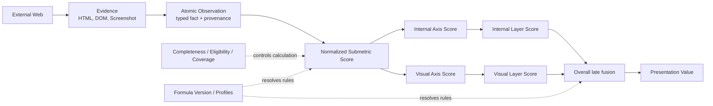
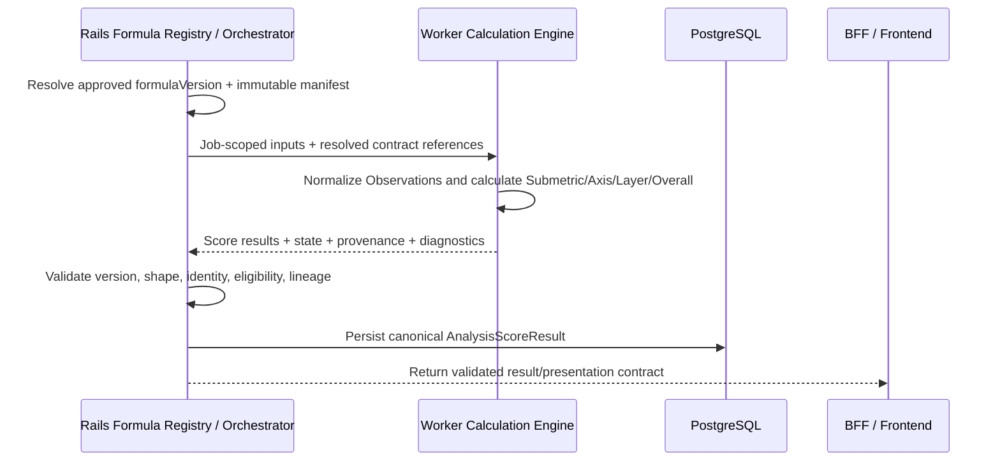

# Module 17 — Observation → Submetric → Formula

Status: `COMPLETE / READY_FOR_M18`  
Phase: `TB-18`  
Difficulty: `ADVANCED`  
Prerequisites: `M01`–`M16`

## 1. 学習目標（Learning goals）

このModuleを終えた学習者は、次の内容を説明し、判断できます。

1. EvidenceからObservation、Submetric、Axis/Layer/Overall Scoreへ進むmeasurement pipelineを説明する。
2. Observation Output Contract v1のidentity、typed value、provenance、completenessを説明する。
3. SubmetricをAxis内の具体的measurement dimensionとして区別する。
4. FormulaをAxis definitionではなく、versioned・traceableなcalculation ruleとして扱う。
5. Missing、N/A、Unknown、Partial、有効な0をscore valueから分離する。
6. Completeness、Eligibility、Score Stateの関係を説明する。
7. Formula Versionをhistorical lineageとcomparisonへ適用する。
8. Worker calculation engineとRails registry/validation/persistenceを区別する。
9. Formula、Calibration、Strategyを別layerとして扱う。
10. CURRENT、TARGET、DEFERREDを混同しない。

## 用語ガイド

- **Observation:** Evidenceから読み取った事実を、型、出典、完全性とともに表した出力。
- **Submetric:** Axisを構成する、より小さく検証可能な評価項目。
- **Formula:** ObservationやSubmetricをAxis Scoreへまとめる計算規則。
- **Formula Version:** どの計算規則でscoreを算出したか再現するためのversion識別子。
- **Registry:** 利用可能なFormulaと、そのactive/approved versionをRails側で管理する登録簿。
- **Completeness（完全性）:** 必要な観測がどの程度そろっているか。scoreの高低とは別の情報。

## 2. Measurement pipeline

Canonical conceptual flow:

```text
External Web
-> Evidence
-> Atomic Observation
-> Normalized Submetric Score
-> Internal / Visual Axis Score
-> Internal / Visual Layer Score
-> Overall Score
-> Presentation Value
-> Comparison / Diagnosis
```

各Layerでは、扱う情報の意味と決定権が異なります。Evidenceから直接scoreを決めず、型付きのObservation、SubmetricのProfile、計算可否の条件、Formulaのversionに従って段階的に処理します。



## 3. Observation fundamentals

ObservationはEvidenceから抽出・構造化された観測factです。

```text
Evidence: Hero regionのDOMにprimary CTA buttonが存在する
Observation: Primary CTA is present in the hero region
Opinion: This hero is good
```

前二者は取得元へ遡れますが、「良い」は評価基準が示されていない感想です。意味の解釈を伴うSemantic Observationも許可されますが、Evidence、分類器・Model、version、確信度・判断理由など、条件に応じたmetadataで、何を根拠にどこまで解釈したかを明示します。

Observationは少なくとも次の性質を目指す。

- evidence-backed
- typed/structured
- source/scopeが明示される
- provenance/versionへtraceable
- completeness/availabilityが明示される
- interpretation boundaryが説明可能

## 4. Observation Output Contract v1

承認済みlogical contract:

| Group                  | Approved contract                                                                                  |
| ---------------------- | -------------------------------------------------------------------------------------------------- |
| Identity               | `observationId` instance identityと`observationType` stable definition identityを分離              |
| Semantic mapping       | Canonical Axis、versioned Submetric、semantic aspect、Evidenceを個別参照                           |
| Value                  | BOOLEAN、COUNT、NUMBER、RATIO、ENUM、TEXT、SEMANTIC_CLASSIFICATION、bounded STRUCTURED             |
| Measurement            | `DETERMINISTIC / SEMANTIC`。HYBRIDは別Observationへ分解                                            |
| Layer                  | `INTERNAL / VISUAL`を別Observationとして保持                                                       |
| Scope                  | SITE、PAGE、SECTION、COMPONENT、ELEMENT、LINK_GRAPH、PATH、SCREENSHOT                              |
| Provenance core        | AnalysisJob、source artifact、`capturedAt`、pipeline/version                                       |
| Conditional provenance | run/page/DOM/HTML/Screenshot/viewport/bounding box/evidence span/component lineage                 |
| Completeness           | `PRESENT / MISSING / NOT_APPLICABLE / UNKNOWN / PARTIAL`                                           |
| Coverage               | availabilityを明示。unknown denominatorを0にしない                                                 |
| Confidence             | Deterministicでは原則不要。Semanticではsource/classifier/version/rationale等をconditional required |
| Version lineage        | Axis Contract、Analysis Pipeline、Observation Schema。Formula VersionはScore側                     |

ObservationとEvidenceは、別の識別対象です。同じEvidenceからでも、Axis、Submetric、着目する意味の側面が異なるObservationを作る場合があります。Evidenceを再利用することと、Formulaで寄与を重複計上することは別の問題です。

Exact JSON property、DB/OpenAPI schema、physical ID formatは未実装・DEFERREDです。

## 5. Submetric fundamentals

Submetricは、Axisが示す大きな評価の問いを、より具体的に測るための評価項目です。

```text
Axis: valueProposition
Possible documented candidate dimensions:
  target clarity
  problem-solution alignment
  benefit specificity
  offer visibility
```

これらはData Dictionaryのevidence/formula discovery候補を説明に使ったものであり、本Moduleが新しいcanonical registryやexact Formulaを制定するものではありません。

### Axis vs Submetric

| Axis                            | Submetric                                                              |
| ------------------------------- | ---------------------------------------------------------------------- |
| Product meaningを固定する       | Axisを測る具体的dimension                                              |
| Axis Contractでversioned        | Formula/Profileから参照されるversioned identity                        |
| Weightやnormalizationを含まない | normalization/aggregation/weight/applicability ruleへ接続し得る        |
| 例: `decisionSupport`           | 例候補: option comparison support、scope clarity、process transparency |

1 ObservationだけでAxis Scoreを決めるとは限りません。複数Observation、scope、coverage、required roleをSubmetric boundaryで整理します。

## 6. Observation → Submetric

この変換で考慮するもの:

- Observation type/value
- Axis/Submetric/semantic aspect mapping
- measurement modeとLayer
- Evidence role（required/optional/conditional/N/A）
- completeness、coverage、eligibility
- semantic confidence/quality where applicable
- normalization method/profile/version

承認済みArchitectureでは、value type/Submetric別のtyped normalizationを使います。BOOLEAN、COUNT、RATIO、semantic classificationへ同じ変換を一律適用しません。

Exact bounds、cap、slope、midpoint、percentile、weightは未決定です。Dataの更新だけでpublished parameterをsilent変更しません。

## 7. Formula fundamentals

FormulaはObservation/Submetricを再現可能なcalculation ruleによってScoreへ変換する仕組みです。

Formulaに求める性質:

- versioned: どの意味・parameter setか特定できる
- deterministic where possible: 同じversion/inputから同じ計算を再現可能
- testable: input/outputとedge caseを検証できる
- traceable: ScoreからSubmetric/Observation/Evidenceへ遡れる
- immutable once published: historical meaningをsilent mutationしない
- explicit fallback: 未承認parameterへ黙って置換しない

```text
Formula != Axis definition
Formula != UI formatting
Formula != Strategy rule
```

## 8. Approved Formula Architecture

承認済みCandidate Cは`Layer-first Common Core + Axis-specific Versioned Profiles`です。

### Common Core

- eligibility hook
- typed value handling
- normalization/aggregation framework
- Internal/Visual Layer preservation
- provenance/version/explainability

### Axis-specific Profile

- Submetric set/reference
- normalization/aggregation method
- weight/applicability references
- completeness/eligibility rule references

### Hierarchy

```text
Atomic Observation
-> Normalized Submetric
-> Layer-specific Axis Score
-> Internal / Visual Layer Score
-> Overall late fusion
```

InternalとVisualはAxisまで別系統で保持し、それぞれのLayer Scoreを計算した後で統合します。この後段での統合がlate fusionです。具体的な統合比率は未決定で、旧候補`0.55/0.45`は`UNAPPROVED CANDIDATE`です。教材や実装で正式値として使いません。

Confidenceはv1ではSeparate Quality Indicator、Crawl Coverageはquality/completeness metadataであり、Product Scoreへsilent modifierとして混ぜません。

## 9. Formula input and output

### Logical input

- typed Observationsとreferences
- Submetric/Profile identity
- Internal/Visual Layer
- completeness/coverage/quality
- eligibility rule references
- Axis Contract / Pipeline / Observation Schema lineage
- selected immutable Formula Manifest

Frontendのclamped score、radar座標、percentage表示等をFormula inputの正本にしません。

### Logical output

承認済みBackend Wire Logical Contractのrootは`AnalysisScoreResult`です。

保持可能なlogical information:

- result identity (`scoreResultId` logical root)
- Organization-scoped AnalysisJob、optional Snapshot
- `formulaVersion`とresolved lineage
- Submetric、Internal/Visual Axis、Layer、Overall result
- Score State/value
- completeness、eligibility、coverage、quality
- input/provenance references
- `calculatedAt`

Exact casing、nesting、physical ID、JSON、table、OpenAPIは未決定です。Score valueだけでは、計算できたか・どのversionか・coverageが十分かを説明できません。

## 10. Missing, N/A, Unknown, Partial, and valid zero

| State                    | 意味                                   | 通知せず変換してはいけないもの |
| ------------------------ | -------------------------------------- | ------------------------------ |
| `PRESENT` with value `0` | 観測・計算が成立し、結果が0            | Missing/Unknownの代替          |
| `MISSING`                | 十分な観測scopeでmeaningful absence    | generic 0/penalty              |
| `NOT_APPLICABLE`         | 対象にmeasurement自体が適用されない    | 0、Missing                     |
| `UNKNOWN`                | 観測・technical/semantic理由で確定不能 | negative Evidence、0           |
| `PARTIAL`                | 必要input/coverageの一部だけ有効       | completeと無標識の同一score    |

例:

- pageを正常取得しCTA countが0 → valid zero候補
- required範囲を確認しCTAがない → `MISSING`候補
- navigation timeoutでpageを確認できない → `UNKNOWN`候補
- business context上public pricingが適用されない → `NOT_APPLICABLE`候補
- 10ページ中4ページだけ観測 → `PARTIAL`候補

原因・scope・profile ruleなしにstateを決めません。

## 11. Eligibility and Score State

Eligibilityは「このinput/conditionでScoreを正式に計算可能か」を表します。

- `ELIGIBLE`
- `INELIGIBLE`
- `CONDITIONALLY_ELIGIBLE`
- `UNDETERMINED`

Score State:

- `CALCULATED`
- `NON_CALCULATED`

Completenessは入力がどれだけそろったか、Eligibilityは正式に計算してよいか、Score Stateは計算が成立したかを表します。品質・確信度の情報も含め、それぞれ別の観点として保持します。

例: `PARTIAL`でもProfileがlimited calculationを許しrequired conditionを満たせば`CALCULATED`になり得ます。ただしreason/coverage/limitationsを伴い、complete scoreと同じ表示にしません。逆に`PRESENT`なObservationがあってもrequired input不足ならAxis scoreは`NON_CALCULATED`になり得ます。

Exact threshold、required set、per-Submetric treatmentは未決定です。Non-calculatedへ0、neutral、last-known valueを代入しません。

## 12. Aggregation, Weight, Normalization, and Fusion

一般的なaggregationにはweighted average、normalized sum、rule-based aggregation等があります。しかしPanoptesのexact method/parameterは未決定です。

承認済みPolicy:

- Equal/eligibility-awareは`UNCALIBRATED CALIBRATION BASELINE`で、optimal/equal importance claimではない
- non-equal weightはrepresentative calibrationとversioned approval後だけcandidate
- normalizationはvalue type/Submetric別。one-size normalizationを使わない
- v1 fusionはnon-dynamic fixed directionだがexact ratioは未決定
- Canonical Axis Orderはweight/importance/priorityではない
- unknown/unapproved parameterへsilent fallbackしない
- v1はGlobal baseline。Industry-specific profileはDEFERRED

Presentation clamp、ring geometry、percentage formattingはBusiness Formulaではありません。

## 13. Formula Version and Registry

`formulaVersion`はpublished immutable positive integerのCanonical Formula Identityとして承認されています。

Formula Versionからimmutable Manifestを通じて一意に解決するもの:

- Architecture
- Axis Contract
- immutable Axis/Profile revisions
- Submetrics
- normalization/aggregation/weight/fusion/eligibility references
- calibration lineage
- compatibility、approval、effective metadata

Version change対象:

- weight/normalization/aggregation
- eligibility/confidence handling
- score threshold/business rounding
- Layer fusion
- Axis/Profile behavior

Version change対象外:

- CSS
- display-only formatting/layout
- presentation safety clamp

Rails-owned logical `FormulaDefinition` Registryがactive/approved version selectionとManifest resolutionのcanonical ownerです。Worker hardcodeだけをFormula Source of Truthにしません。Profile revisionはsubordinate identityで、第二のhistorical comparison SoTではありません。

## 14. Formula ownership and calculation flow



### Worker owns

- given Formula Contractとinputによるtechnical calculation
- normalization/aggregation execution
- diagnostics/technical failure reporting
- calculation provenance output

### Rails owns

- business-active/approved Formula selection
- Formula Registry/Manifest resolution
- Organization/Job ownership
- output shape/version/identity validation
- canonical eligibility/business policy coordination
- persistence、Snapshot lineage、API publication

BFFはOrganization-scoped transport、Frontendはvalidated result consumption/explanation/presentationを担当し、Formula Business Logicを持ちません。

## 15. Persistence and lineage

M15のlineageへ次のchainを接続します。

```text
Snapshot
-> AnalysisScoreResult
-> Formula Version / Manifest
-> Axis / Layer / Submetric result
-> Observation
-> Evidence / Artifact
-> AnalysisJob / capture context
```

Snapshotはgeneration-time Formula、Axis、Observation、Pipeline、completeness、Score Result lineageを保持する方向で、Current Formulaによるsilent reinterpretを禁止します。

Formula versionが異なるScoreは、明示compatibility/calibration metadataがなければ自動比較可能と推測しません。0–100 presentation scaleが同じだけではsemantic compatibilityを証明しません。

Explainability（説明可能性）の中心は、scoreから根拠となるSubmetric、Observation、Evidence、version、入力の充足状況、各Layerの寄与へ遡れることです。LLMが説明文を生成するだけでは、この追跡可能性を代替できません。

## 16. Calibration boundary

Formulaは計算規則です。Calibrationは、その規則やparameterが評価の意図に合っているかを検証し、調整する過程です。

承認済みCalibration Policyの方向:

- representative datasetとprovenance
- industry/site/business type/size、page volume、Layer/crawl availability等のstratification
- leakage controlとheld-out evaluation
- observable-site rubric
- multi-reviewer + blind pairwise
- expert adjudicationはsupporting
- CTR/CVR/revenue等external outcomeはsecondary validation
- sensitivity、false positive/negative、stabilityの確認

Calibrationは`NOT_PERFORMED`、exact parameterは`NOT_DECIDED`です。Product Ownerの好みだけでproduction weight/ratioを決めません。

## 17. Formula vs Strategy

Formula/ScoreはEvidence-based diagnosisです。StrategyはProduct context、goal、constraint、risk、priority、feasibilityを踏まえたaction/recommendationです。

```text
Axis Score 30 -> 必ず施策X
```

のような直結ruleを本Moduleで作りません。Score、limitations、EvidenceをStrategy layerのinputにできても、Strategy Source/decisionは別contractです。

## 18. Worked conceptual example

この例はflow説明用で、Submetric registry、weight、parameterを正式化しません。

```text
Evidence E1: Hero DOMにprimary CTAが存在
Evidence E2: ScreenshotでCTAのvisual prominenceを確認

Observation O1:
  INTERNAL / DETERMINISTIC / PRESENT
  "primary CTA exists in hero"

Observation O2:
  VISUAL / SEMANTIC / PARTIAL
  "CTA prominence could be evaluated on captured viewport"
  + coverage/limitation

Illustrative Submetric X:
  "CTA discoverability"（教材用。canonical registry entryではない）

Formula version F:
  Registryがresolveしたimmutable Manifestを使用
  Exact normalization/weightは本教材では未指定

Result:
  Profileのrequired conditionを満たす場合だけCALCULATED
  PARTIALならreason/coverage/limitationを保持
  満たさない場合はNON_CALCULATED。0で代替しない

Axis relation:
  userFlowQualityへのcontribution candidate
```

## 19. CURRENT / TARGET / DEFERRED

| 分類           | Confirmed scope                                                                                                                                                                                                                               |
| -------------- | --------------------------------------------------------------------------------------------------------------------------------------------------------------------------------------------------------------------------------------------- |
| CURRENT        | Frontendにoverall/internal/visual score、radar、delta等のpresentation types/view modelsとmock valuesがある。Product docsにはObservation、Formula Architecture/Policy/Version/Wire、Missing/Partial Contractがある。                           |
| CURRENT caveat | TypeScript/OpenAPIにcanonical Observation、Submetric result、`AnalysisScoreResult`、`formulaVersion`、eligibility/completeness provenanceは実装されていない。mockはfinal scoreを直接生成し、presentation mapperはfallback/synthetic値を作る。 |
| TARGET         | Worker calculation engineがRails-resolved Formula Manifestとtyped ObservationsからSubmetric/Axis/Layer/Overallを計算し、Railsがvalidate/persistしてversioned resultをAPI/UIへ提供する。                                                       |
| DEFERRED       | exact weight/ratio/normalization parameter/threshold/rounding、calibration dataset/execution、confidence calibration、dedup/double-count、physical JSON/DB/OpenAPI、Worker/Rails/Frontend implementation。                                    |

Decision CompleteはExact Parameter、Calibration、Production implementation完了を意味しません。

## 20. Representative repository mapping

| Representative source                                                            | Pipeline layer         | 責務                                         | 状態                       | Version relation                  |
| -------------------------------------------------------------------------------- | ---------------------- | -------------------------------------------- | -------------------------- | --------------------------------- |
| [Score / Axis Data Dictionary](../../product/score-axis-data-dictionary.md)      | Full contract chain    | Formula/Observation/Missing detail SoT       | Approved logical contracts | Axis/Observation/Formula versions |
| [Product Decision Register](../../product/product-decision-register.md) PD-02C/D | Decision summary       | approval/status/handoff                      | Decision complete          | exact parameter deferred          |
| [M15 Snapshot / Lineage](./15-snapshot-history-lineage.md)                       | Historical output      | generation-time lineage                      | Approved learning contract | no silent reinterpretation        |
| [M16 Common 6 Axis](./16-common-six-axis.md)                                     | Axis semantics         | ID/definition/boundary                       | Approved learning contract | Axis Contract v1                  |
| `src/lib/panoptes/types.ts`                                                      | Presentation result    | overall/internal/visual/radar shapes         | CURRENT frontend, partial  | no formula lineage                |
| `src/lib/components/ComponentsBase/Self/data/self-analysis-view-model.ts`        | Presentation mapping   | clamp/fallback/delta rows                    | CURRENT UI                 | not business formula              |
| `competitor-card-presentation.ts`                                                | Synthetic presentation | three scores→six radar values                | CURRENT UI/mock            | not canonical aggregation         |
| `src/lib/panoptes/api/mock/snapshot-factory.ts`                                  | Mock result generation | seeded final score/radar                     | CURRENT mock only          | no Observation/Formula contract   |
| `src/lib/db/dummy/panoptes_dummy_ui.ts`                                          | Fixture mapping        | final presentation snapshot                  | CURRENT fixture            | legacy keys/order                 |
| [OpenAPI draft](../../api/openapi-draft.yaml)                                    | Target transport draft | generic Snapshot payload                     | incomplete                 | no `AnalysisScoreResult` schema   |
| [AnalysisJob State Machine](../../api/analysis-job-state-machine.md)             | Job lifecycle          | finalization/Snapshot commit                 | Target draft               | result accepted by Rails          |
| [API Boundary](../../architecture/api-boundary.md)                               | Ownership              | Worker execution/Rails canonical persistence | Target design draft        | future registry/result boundary   |

## 21. Common misunderstandings

| Misunderstanding                 | Correction                               |
| -------------------------------- | ---------------------------------------- |
| Observation = Score              | ObservationはEvidence-backed typed fact  |
| Submetric = Axis                 | SubmetricはAxis内のmeasurement dimension |
| Formula = Axis Definition        | Formulaは測り方、Axisは意味              |
| Missing = 0                      | Missingとvalid zeroは別                  |
| N/A = Missing                    | applicableでないこととabsenceは別        |
| Unknown = Negative               | 判定不能をnegative Evidenceにしない      |
| Valid zero = Missing             | measurement成立後の0は有効値             |
| Canonical Order = Weight         | conceptual orderからweightを推定しない   |
| Worker = Formula Business Owner  | Workerはgiven contractを実行するengine   |
| Formula Versionなしで比較可能    | generation-time semanticsが不明になる    |
| Score = Strategy                 | diagnosisとaction decisionは別           |
| LLM explanation = Explainability | lineage/evidence/version traceが必要     |

## 22. Decision heuristic

1. Captured factか → Evidence
2. Structured observed factか → Observation
3. Measurement dimensionか → Submetric
4. Calculation ruleか → Formula/Profile
5. Measurement resultか → Score Result
6. Scoreを作れるか → Eligibility
7. どのcalculation semanticsか → Formula Version
8. Formulaの妥当性調整か → Calibration
9. なぜこのScoreか → Lineage / Explainability

## 23. Practice

### A. Knowledge check

1. Evidence、Observation、Submetric、Formula、Axis Scoreの違いを説明してください。
2. Observation identityとEvidence identityを分ける理由を説明してください。
3. FormulaとCalibrationの違いを説明してください。

### B. Classification

`Screenshot` / `CTA detected` / `CTA prominence measurement` / `formula rule` / `Axis Score` / `formulaVersion` / `Eligibility` / `calibration evaluation`をlayerへ分類してください。

### C. Pipeline ordering

EvidenceからPresentation Valueまでを、Internal/Visual separationを含めて並べよ。

### D. Missing exercise

1. 正常観測でCTA count=0
2. required scope内にCTAがない
3. page timeoutで確認不能
4. public priceが対象business modelでは適用されない
5. Screenshotの一部だけ評価可能

Valid Zero / Missing / Unknown / N/A / Partialへ分類してください。

### E. Eligibility exercise

ObservationがPRESENTでもrequired Visual inputがUNKNOWNです。Axis scoreを出せるかを、exact thresholdを発明せず説明してください。

### F. Version exercise

Formula v1/v2で作られた0–100 Snapshot scoreを比較する前に何を確認するか。

### G. Ownership exercise

Active Formula selection、calculation execution、output validation、canonical persistence、business eligibility、UI formattingをRails/Worker/Frontendへ分類してください。

### H. Violation detection

1. Missingを0点化する。
2. Worker hardcodeだけをFormula SoTにする。
3. Formula VersionなしでSnapshotを保存する。
4. Canonical Orderからweightを推測する。
5. Partial inputをFullとして表示する。
6. ScoreだけからStrategyを自動確定する。

### I. Architecture explanation

「なぜFormula VersionをSnapshot lineageへ残す必要があるのか」を説明してください。

## 24. Answers and explanation guide

### A. Knowledge check

1. Evidenceは原観測、Observationはtyped fact、SubmetricはAxis内measurement dimension、Formulaは計算rule、Axis Scoreはそのversioned result。
2. 同じEvidenceから異なるsemantic aspect/Layer/AxisのObservationを作れ、Evidence reuseとderived meaningをtraceするため。
3. Formulaは計算rule、Calibrationはdataset/evaluationを使いrule/parameterの妥当性を検証・調整するprocess。

### B. Classification

- Evidence: Screenshot
- Observation: CTA detected
- Submetric input/result候補: CTA prominence measurement
- Formula: formula rule
- Score: Axis Score
- Formula identity: formulaVersion
- Calculation permission/state: Eligibility
- Calibration: calibration evaluation

### C. Pipeline ordering

`Evidence -> Atomic Observation -> Normalized Submetric -> Internal/Visual Axis -> Internal/Visual Layer -> Overall late fusion -> Presentation Value`。

### D. Missing exercise

1. Valid Zero。2. Missing候補。3. Unknown。4. N/A候補。5. Partial。scope/profile reasonを保持し、すべて自動0へ変換しない。

### E. Eligibility exercise

ProfileのEvidence Roleとrequired conditionが必要で、情報だけでは確定できません。Visualがrequiredなら`INELIGIBLE`/`UNDETERMINED`で`NON_CALCULATED`候補、conditionalならlimited `CALCULATED + PARTIAL`候補。未決定thresholdを補わない。

### F. Version exercise

Formula Manifest、Axis/Profile/Submetric、normalization/weight/fusion/eligibility、calibration/compatibility metadata、coverage/completenessを確認します。explicit compatibilityがなければscale一致だけで比較しません。

### G. Ownership exercise

- Rails: active Formula selection、output validation、canonical persistence、business eligibility coordination
- Worker: calculation execution、technical diagnostics/provenance
- Frontend: validated presentation、display formatting

### H. Violation detection

1. availabilityとvalueの混同。2. canonical registry/approval/historyを失う。3. historical reconstruction不能。4. semantic orderとcalculation policyの混同。5. limitations/coverageを隠す。6. diagnosisとaction decisionを混同。

### I. Architecture explanation

Formula Versionがあれば、当時使ったSubmetric、normalization、weight、fusion、eligibility、calibration/approval metadataを一意に解決できます。Snapshot scoreを現在のFormulaでsilent reinterpretせず再現・debug・comparison可否判定できるため、generation-time lineageへ必要です。

## 25. Completion criteria

|   # | Criterion                                              | Result |
| --: | ------------------------------------------------------ | ------ |
|   1 | Measurement pipeline explained                         | `PASS` |
|   2 | Observation contract explained                         | `PASS` |
|   3 | Submetric explained                                    | `PASS` |
|   4 | Formula role explained                                 | `PASS` |
|   5 | Missing/N/A/Unknown/Partial/Zero distinction explained | `PASS` |
|   6 | Eligibility explained                                  | `PASS` |
|   7 | Formula Version / lineage explained                    | `PASS` |
|   8 | Rails/Worker formula ownership explained               | `PASS` |
|   9 | Repository mapping + two diagrams included             | `PASS` |
|  10 | Exercises + answers included                           | `PASS` |

M17 authoring result: `10 / 10 PASS`。これは教材完成の判定であり、Exact Formula Parameter、Calibration、physical schema、Worker/Rails/Frontend implementationの完成判定ではありません。

## 26. M18 handoff

Recommended next phase: `TB-19 — Module 18: Missing / Partial / Eligibility`。

M18ではPD-02DとPD-04を接続し、Observation/Submetric/Axis/Layer/Overall、AnalysisJob、Limited Snapshot、UI/API stateのedge casesを詳しく扱います。Exact thresholdやfallbackを新規決定しません。
