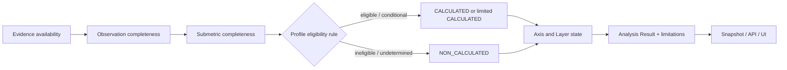
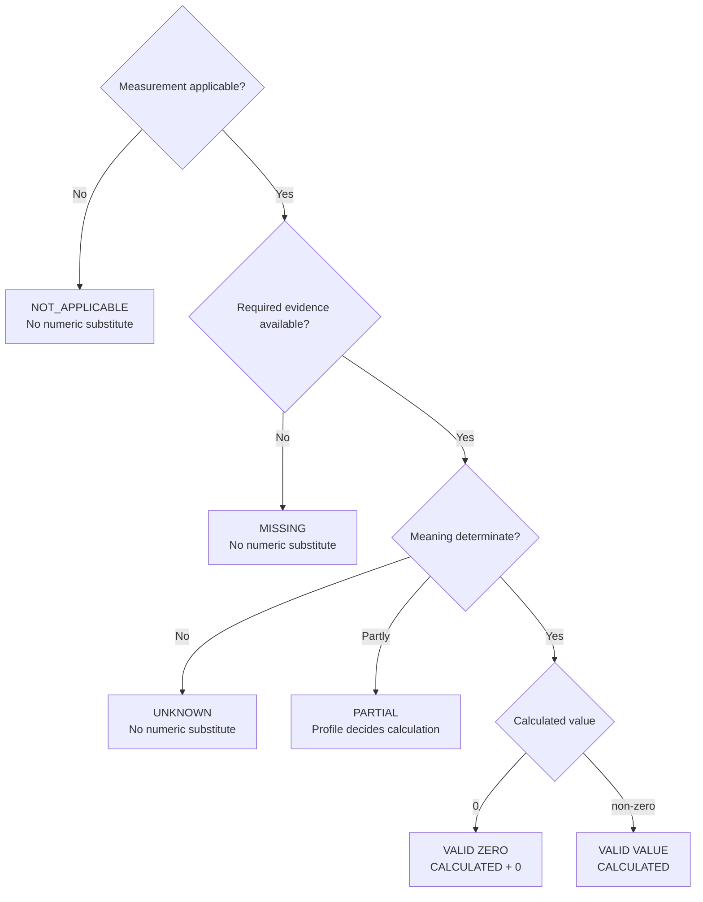

# Module 18: Missing / Partial / Eligibility

Status: `COMPLETE / READY_FOR_M19`  
Phase: `TB-19`  
Difficulty: `ADVANCED`  
Prerequisites: `M01`–`M17`

## 1. Learning goals

このModuleを終えたLearnerは、次を説明・判断できる。

1. Missing、N/A、Unknown、Partial、Valid Zeroを区別する。
2. Completeness、Eligibility、Score State、Score valueを別の概念として扱う。
3. Observation、Submetric、Axis、Layer、Overallで状態がどう伝播するか説明する。
4. `partially_completed` Jobとpartial Axisを混同しない。
5. Limited Snapshot、comparison、Strategy、API/UIで不完全さを隠さない。
6. 未決定のthreshold、required set、fallback、fusion parameterを発明せず判断する。

本教材はPD-02D Treatment Model Bを説明する。新しいProduct Contractを決定するものではない。

## 2. なぜMissing処理が重要か

欠損を安易に0へ変換すると、取得失敗したsiteが最低評価に見え、比較・ranking・Strategyが歪む。逆に、正常に観測して0だった事実を欠損扱いすると、意味のあるnegative evidenceを失う。

```text
measurement availability != product quality
measurement completeness != score
score value             != eligibility
```

Missing treatmentは表示上の都合ではなくmeasurement semanticsである。UIが`0`、`—`、空欄のどれを描くかより前に、何が観測され、適用可能で、計算可能だったかを保持しなければならない。

## 3. Canonical state set

PD-02Dが接続する主要な状態集合は次のとおりである。

| Dimension    | Approved values                                                 | Answers                            |
| ------------ | --------------------------------------------------------------- | ---------------------------------- |
| Completeness | `PRESENT / MISSING / NOT_APPLICABLE / UNKNOWN / PARTIAL`        | input/resultがどの程度成立したか   |
| Eligibility  | `ELIGIBLE / INELIGIBLE / CONDITIONALLY_ELIGIBLE / UNDETERMINED` | Profile rule上、正式計算してよいか |
| Score State  | `CALCULATED / NON_CALCULATED`                                   | 数値結果が正式に計算されたか       |
| Score value  | valid number or absent                                          | 計算結果はいくつか                 |

この直交性がTreatment Model Bの中心である。`PARTIAL + CALCULATED`も、`PRESENT + NON_CALCULATED`もcontract次第で成立し得る。

## 4. Missing

`MISSING`は、required scopeで必要なEvidenceまたはObservationが存在しない、あるいは取得できなかった状態である。

例:

- required screenshotが保存されていない。
- 対象sectionの取得に失敗した。
- required visual evidenceが欠落した。

ただし「CTAが存在しないことを正常に観測した」はMissingではなく、Observationが`PRESENT`で値が0になり得る。

```text
MISSING != negative evidence
MISSING != score 0
MISSING != automatic penalty
```

Product absenceをsemanticにnegativeへ写像できるのは、明示されたSubmetric/Profile ruleがある場合だけである。generic missing penaltyは採用しない。

## 5. N/A (`NOT_APPLICABLE`)

N/Aは、そのmeasurementが対象に適用されない状態である。失敗でも、negativeでも、neutralでもない。

例:

- quote-based businessでpublic priceの有無をrequired measurementにしない。
- 対象に存在しないcomponent type専用のObservation。
- Contract上、そのsite classでは評価対象外のSubmetric。

N/Aはeligible expected denominatorから除外する。0やneutral valueへ置換しない。適用可否はData Dictionary/Profile Contractから決まり、UIの都合で決めない。

## 6. Unknown

`UNKNOWN`はEvidenceが存在しても、意味を確定できない状態である。

例:

- screenshotはあるが遮蔽されCTA prominenceを判断できない。
- semantic classifierのconfidenceがrequired ruleを満たさない。
- DOMとvisual evidenceが矛盾し、解決できない。
- parser未対応により値の意味が不明である。

```text
UNKNOWN != MISSING
UNKNOWN != negative
UNKNOWN != false
```

required inputがUnknownなら`NON_CALCULATED`候補になるが、exact ruleはFormula Profileに従う。

## 7. Partial

`PARTIAL`は、必要なinputやcoverageの一部だけが有効な状態である。

例:

- Internal evidenceは有効だがVisual evidenceが欠ける。
- 複数required pageの一部だけ取得できた。
- 複数Submetricの一部だけがeligible/calculatedである。
- screenshotの一部領域だけ評価可能である。

PartialはMissingやFullと同じではない。PD-02Dでは`PARTIAL + reason + coverage + lineage`で表し、直接numeric penaltyを加えない。

Profileのrequired条件を満たせば、限定されたscoreを次のように持てる。

```text
scoreState   = CALCULATED
completeness = PARTIAL
value        = valid number
limitations  = explicit
```

この結果をFull Scoreと無標識で同じ表示にしてはならない。

## 8. Valid Zero

Valid Zeroはmeasurementが正常に成立し、その結果が数値0だった状態である。

例:

- required scopeを正常走査し、CTA countが0だった。
- applicableな割合を正しく計算し、ratioが0だった。

```text
scoreState   = CALCULATED
completeness = PRESENT
value        = 0
```

Valid ZeroはEvidence-backed resultである。Missingを便宜的に0へ変換したものとは、API、persistence、UIのすべてで区別する。

## 9. State comparison

| State      | Evidence exists   | Applicable  | Determinate         | Full coverage       | Numeric 0 allowed?       |
| ---------- | ----------------- | ----------- | ------------------- | ------------------- | ------------------------ |
| Missing    | no / insufficient | usually yes | no                  | no                  | no substitute            |
| N/A        | irrelevant        | no          | yes: not applicable | not counted         | no substitute            |
| Unknown    | yes or partial    | yes         | no                  | varies              | no substitute            |
| Partial    | some              | yes         | partly              | no                  | only if contract permits |
| Valid Zero | yes               | yes         | yes                 | contract-sufficient | yes, actual value        |

この表は判定補助である。Exact field semanticsとrequired scopeは承認済みContract/Profileを優先する。

## 10. Completeness

Completenessは、必要なEvidence/Observation/Inputがどれだけ揃ったかを表す。Product qualityそのものではない。

```text
high score != high completeness
low score  != low completeness
```

低いscoreでも完全に観測できる。高そうな一部結果が得られてもcoverageがPartialならcompletenessはPartialである。

CompletenessはObservation、Submetric、Axis、Layer、Analysis Resultの各levelに存在し得る。上位状態は単純な最悪値コピーや平均で決めない。required/eligible/calculated counts、coverage、Profile ruleを使い、exact aggregationは既存Contractが定める範囲に限る。

## 11. Eligibility

Eligibilityは「このSubmetric/Axis/Layer/Overall Resultを、Contract上正式に計算してよいか」という判断である。

判断材料:

- applicableなexpected input
- Evidence Role: `REQUIRED / OPTIONAL / CONDITIONAL / NOT_APPLICABLE`
- input completeness/coverage
- Formula/Profile rule
- versioned required conditions

```text
ELIGIBILITY != SCORE
ELIGIBILITY != COMPLETENESS
```

`ELIGIBLE`は高得点を意味しない。`INELIGIBLE`は0点を意味しない。`UNDETERMINED`は判定材料やrule resolutionが不足している状態である。

### Eligible with Partial

Profileがlimited calculationを許しrequired conditionを満たす場合は、`CALCULATED + PARTIAL`を組み合わせられる。ただしreason、coverage、limitationsを保持しFullと区別する。

### Ineligible

required evidence不足等で正式計算できない場合は`NON_CALCULATED`とし、valueを持たせない。0、neutral、last-known valueで穴埋めしない。

## 12. Score State and numeric value

| Case                       | Score State      | Value  | Interpretation                     |
| -------------------------- | ---------------- | ------ | ---------------------------------- |
| 正常計算して0              | `CALCULATED`     | `0`    | valid zero                         |
| PartialだがProfile上計算可 | `CALCULATED`     | number | limited result + limitations       |
| required input不足         | `NON_CALCULATED` | absent | missing/ineligible reason required |
| applicableか未判定         | `NON_CALCULATED` | absent | undetermined reason required       |

`null`、missing field、0、status enumを同じ意味にしない。Physical JSON/OpenAPIはdeferredだが、logical distinctionは承認済みである。

## 13. Formula interaction

- Missing inputを0として投入しない。
- N/Aをeligible expected denominatorから除外する。
- Unknownをfalse/negativeへ変換しない。
- PartialをFull coverageとして扱わない。
- Valid Zeroはeligible calculated contributorになり得る。
- meaningful absenceのnegative mappingはexplicit Profile ruleに限る。

Treatment Model Bでは、applicableなeligible expected setをcoverage母数とし、Profileが許すcalculated contributorsをnumeric aggregationへ使うHybrid Denominatorを採る。Observed-only denominatorで欠損を隠さない。

## 14. Axis, Layer, and late fusion

AxisごとにFull、Partial、Non-calculatedが混在し得る。6 Axisすべてが同一coverageである必要はない。Axis stateとAnalysis Result全体のstateを分離する。

Internal/Visualの両Layerがeligible/calculatedならapproved Fusion Profileでlate fusionする。片Layerが無効な場合に、残ったLayerへ勝手にweightを再配分しない。one-layer Overall、weight redistribution、available Layer fallbackは明示Profileと新しいformulaVersionなしには生成しない。Exact fusion parameterはDEFERREDである。

## 15. AnalysisJob vs Axis/Score state

`AnalysisJob outcome = partially_completed`と`Axis completeness = PARTIAL`は別概念である。

| Concept               | Level                | Meaning                                                          | Owner                            |
| --------------------- | -------------------- | ---------------------------------------------------------------- | -------------------------------- |
| `partially_completed` | Job/Product outcome  | usable validated Resultはあるがrequired processingの一部が未完了 | Rails                            |
| Axis `PARTIAL`        | Measurement coverage | そのAxisのinput/coverageが一部のみ有効                           | Formula/Profile evaluation       |
| `CALCULATED`          | Score result         | score valueが正式に計算された                                    | Formula result, Rails validation |

Completed Jobでも全Axisが必ずFullとは限らず、Partial Jobでもusableな一部AxisがFullの場合はあり得る。Job outcomeから各Axis stateを推測しない。

## 16. Snapshot boundary

PD-04では`partially_completed`からLimited Snapshotを条件付きで作成できる。

- automatic current promotionはしない。
- v1 Strategyは`EVIDENCE_ONLY`。
- Formal Strategy Sourceへauto/manual promotionしない。
- limitations、completeness、formula version、lineageを保持する。
- Snapshot内のPartial/Unknown/MissingをFullへ書き換えない。

Job outcomeが`completed`でもcurrent promotionはpolicy-drivenであり自動同一視しない。

## 17. Comparison and Strategy boundary

Full coverageのCompetitor AとPartial coverageのCompetitor Bをscoreだけでrankingすると、Bの欠損を性能差と誤解する危険がある。比較前にAxis/Formula version compatibility、completeness/coverage、Eligibility/Score State、Layer availability、limitations、lineageを確認する。

Missing/PartialなScoreから確定的Strategyを生成しない。Partial Snapshot v1は`EVIDENCE_ONLY`であり、Strategy layerはuncertaintyと制限を認識する。

## 18. Provenance and reasons

Missing/Partial判定自体もlineage対象である。fetch failure、screenshot absence、unsupported parser、unknown classification、required scope未取得などの理由をJob、Artifact、Observation、Profile、Versionへtraceできる必要がある。ここで例示したreasonは新しいcanonical enumを制定するものではない。

## 19. API, persistence, and UI

Logical Resultは必要に応じてidentity/level、Score State/value、Completeness/reason、Eligibility/rule reference、counts、coverage/quality/limitations、input lineage、formulaVersion/Profile、calculatedAtを保持する。

Frontendは`undefined -> 0`や`null -> neutral`を行わない。UIではMissing、Partial、Unknown、N/A、Valid Zeroを意味の違いが分かる形で表示し、色だけに依存しない。Exact copyとphysical schemaは既存UI/API Contractを優先し、本Moduleでは決めない。

## 20. Measurement state flow



## 21. Zero vs Missing diagram



## 22. Worked example

| Submetric | Observation                       | State                 | Treatment                |
| --------- | --------------------------------- | --------------------- | ------------------------ |
| A         | required scopeを正常走査しcount=0 | `PRESENT`, valid zero | eligible contributor候補 |
| B         | required screenshotが取得不能     | `MISSING`             | 0へ変換しない            |
| C         | DOM evidenceから正常計算          | `PRESENT`, available  | eligible contributor候補 |

AとCだけを単純平均しBを隠すとobserved-only denominatorになりcoverageを過大表示する。Versioned ProfileがBをrequired/optional/conditionalのどれと定義するか確認し、Eligibilityを判定する。Bがrequiredなら`NON_CALCULATED`候補、conditionalでlimited calculation可なら`CALCULATED + PARTIAL`候補である。Exact thresholdや数値はこの情報だけでは決められない。

## 23. CURRENT / TARGET / DEFERRED

| Classification | Confirmed scope                                                                                                                                                                        |
| -------------- | -------------------------------------------------------------------------------------------------------------------------------------------------------------------------------------- |
| CURRENT        | Frontendにscore types、radar/chart projection、fixture/mock、一部fallbackがある。Product docsにPD-02D Treatment Model Bとlogical state contractがある。                                |
| CURRENT caveat | Canonical stateのfull API propagation、Rails persistence、Worker calculationは実装確認できない。現行fallbackにはmissing→0やsynthetic valueがあり、Product contractの実装証拠ではない。 |
| TARGET         | Workerがtyped inputとtechnical reasonsを出力し、versioned Profileでcalculationし、RailsがEligibility/Resultをvalidate・persistし、BFF/API/UIがstateとlimitationsを欠落なく伝える。     |
| DEFERRED       | exact threshold、required set、minimum Observation count、fusion fallback、calibration parameter、physical JSON/DB/OpenAPI、Production implementation、exact UI copy。                 |

Decision CompleteはImplementation CompleteやProduction Readyを意味しない。

## 24. Representative repository mapping

以下は限定確認した12例であり、repo-wide score監査ではない。

| Source                                                                              | State meaning / layer         | CURRENT / TARGET                      | Eligibility relation                      |
| ----------------------------------------------------------------------------------- | ----------------------------- | ------------------------------------- | ----------------------------------------- |
| [Score / Axis Data Dictionary](../../product/score-axis-data-dictionary.md) PD-02D  | Canonical states              | Approved contract                     | Primary logical contract                  |
| [Product Decision Register](../../product/product-decision-register.md) PD-02D      | Approval/status               | `DECISION_COMPLETE`                   | Model B approved                          |
| [M17 Observation / Formula](./17-observation-submetric-formula.md)                  | Formula input/result states   | Approved learning contract            | Profile evaluates eligibility             |
| [M12 AnalysisJob Lifecycle](./12-analysis-job-lifecycle.md)                         | Job-level partial outcome     | Current contract / target enforcement | Snapshot eligibility                      |
| [M15 Snapshot / History / Lineage](./15-snapshot-history-lineage.md)                | Limited Snapshot semantics    | Approved learning contract            | preserves limitations                     |
| [M16 Common 6 Axis](./16-common-six-axis.md)                                        | Per-Axis completeness         | Approved learning contract            | Axis states may differ                    |
| `src/lib/panoptes/types.ts`                                                         | aggregate score/radar payload | CURRENT partial                       | canonical state fields incomplete         |
| `src/lib/features/analysis-job/mapping/analysis-job-status.ts`                      | Job status/outcome adaptation | CURRENT frontend                      | not Axis eligibility                      |
| `src/lib/panoptes/api/mock/snapshot-factory.ts`                                     | mock Snapshot scores          | CURRENT mock                          | not canonical formula                     |
| `src/lib/components/ComponentsBase/Self/data/self-analysis-view-model.ts`           | score/radar presentation      | CURRENT UI                            | fallback may hide missing                 |
| `src/lib/components/ComponentsBase/Competitor/data/competitor-card-presentation.ts` | competitor projection         | CURRENT mock/UI                       | synthetic values not eligibility evidence |
| `docs/api/openapi-draft.yaml`                                                       | Snapshot transport draft      | TARGET draft                          | physical state schema incomplete          |

## 25. Common misunderstandings

| Misunderstanding                                    | Correction                                         |
| --------------------------------------------------- | -------------------------------------------------- |
| Missing = 0                                         | Missingには正式なnumeric valueがない               |
| Unknown = Missing                                   | evidence absenceとmeaning uncertaintyは別          |
| N/A = Missing                                       | not applicableとrequired absenceは別               |
| Partial = Full                                      | limitations/coverageを伴う独立状態                 |
| Valid Zero = Missing                                | 正常計算した0は有効値                              |
| Completeness = Score                                | 観測充足度とProduct qualityは別                    |
| Eligibility = Score                                 | 計算許可と結果値は別                               |
| Partial Job = Partial Axis                          | Product outcomeとmeasurement stateは別             |
| completed Job = all axes Full                       | Job outcomeだけからAxis stateを推測しない          |
| null = missing field = zero                         | API semanticを分離する                             |
| Partial competitorをFull competitorと単純比較できる | version/coverage/limitations確認が必要             |
| Missingから確定Strategyを作れる                     | uncertaintyを保ち、Limited SnapshotはEvidence-only |

## 26. Decision heuristic

1. Measurementが適用されるか。NoならN/A。
2. required Evidenceがあるか。NoならMissing候補。
3. Evidenceの意味を確定できるか。NoならUnknown候補。
4. 必要なinput/coverageの一部だけか。YesならPartial候補。
5. Measurementが成立し値が0か。YesならValid Zero。
6. Scoreを計算できるか。Versioned Eligibility/Profile Contractで判断する。
7. 上位Resultへ進めるか。Axis、Layer、Overall、Job、Snapshotのcontractを別に確認する。

## 27. Practice

### A. Knowledge check

1. Completeness、Eligibility、Score State、Score valueの違いを説明せよ。
2. なぜMissingを0にしてはいけないか。
3. `PARTIAL + CALCULATED`が成立する条件を説明せよ。

### B. Classification

1. required screenshotの保存に失敗した。
2. quote-based businessでpublic price measurementが契約上対象外。
3. screenshotはあるがoverlayでCTA prominenceを判定不能。
4. 10 required pagesのうち6 pagesだけ取得成功。
5. 全required pagesを正常走査しCTA count=0。

Missing / N/A / Unknown / Partial / Valid Zeroへ分類せよ。

### C. Zero vs Missing

`value=0, scoreState=CALCULATED`と`value absent, scoreState=NON_CALCULATED`の違いを説明せよ。

### D. Eligibility exercise

Internal inputはPRESENT、Visual inputはMISSINGである。Axis/Overall scoreを出せるか。未決定thresholdやfallbackを発明せず答えよ。

### E. Axis vs Job Partial

`AnalysisJob=partially_completed`、Axis A=PRESENT、Axis B=PARTIAL、Axis C=NON_CALCULATEDというcaseを説明せよ。

### F. Comparison exercise

Full coverageのCompetitor Aが72、Partial coverageのCompetitor Bが78である。Bを上位と結論する前に何を確認するか。

### G. API exercise

Valid Zero、Missing、N/Aを区別するlogical情報を、Exact JSON schemaを作らず答えよ。

### H. Violation detection

1. Missingを0へ変換する。
2. Partial scoreをbadgeなしでFullとして表示する。
3. N/Aをnegative evidenceにする。
4. completed Jobなら全Axis availableとする。
5. unavailable competitorをranking最下位にする。
6. Unknownをfalseへ変換する。
7. UI mapperがstate metadataを捨てる。

### I. Architecture explanation

「なぜMissingを0として扱ってはいけないのか」をmeasurement semantics、comparison、Strategy、history/lineageの観点から説明せよ。

## 28. Answers / explanation guide

### A. Knowledge check

Completenessはinput充足、Eligibilityは計算可否、Score Stateは計算成立、valueは結果数値である。Missingの0化はabsence/failureをnegative qualityに変え、比較とStrategyを歪める。`PARTIAL + CALCULATED`はVersioned Profileがlimited calculationを許しrequired条件を満たし、reason/coverage/limitationsを保持する場合に成立する。

### B. Classification

1. Missing。2. N/A。3. Unknown。4. Partial。5. Valid Zero。

### C. Zero vs Missing

前者はEvidence-backedな正式結果で数値0を保存・表示できる。後者は値を持たず、Completeness/Eligibility/reasonを伝える。

### D. Eligibility exercise

ProfileのEvidence Roleとrequired conditionが必要で、情報だけでは確定できない。Visual requiredならAxisは`NON_CALCULATED`候補、conditionalでlimited calculation可なら`CALCULATED + PARTIAL`候補。Overallのone-layer fallbackやweight再配分は明示Profile/new formulaVersionなしに行わない。

### E. Axis vs Job Partial

Jobの`partially_completed`はusable validated Product Resultとlimitationsを持つterminal outcome。各Axis stateはmeasurement coverage/calculationを表し、互いに同値ではない。Railsは両方を保持しLimited Snapshot可否を別contractで判断する。

### F. Comparison exercise

Formula/Axis version compatibility、Completeness、Eligibility、Layer availability、coverage、limitations、lineageを確認する。Bの78がlimited calculationなら数値だけでrankingしない。

### G. API exercise

Score State/value、Completeness/reason、Eligibility/rule reference、coverage/limitations、formulaVersion/Profile、lineageが必要。Exact field name/schemaはOpenAPI phaseへ残す。

### H. Violation detection

順に、availability/value混同、limitation隠蔽、applicability/quality混同、Job/Axis state混同、missingのperformance化、uncertainty/negative混同、end-to-end contract破壊である。

### I. Architecture explanation

Missingは「低品質」ではなく「必要なmeasurementが成立していない」を示す。0へ変換すると取得失敗を最低評価と誤認し、比較、ranking、Strategyを歪める。さらにSnapshotから当時のcoverageとfailure reasonを再現できずhistorical meaningが失われる。value、state、reason、coverage、lineageを分離して保存・伝達する必要がある。

## 29. Completion criteria

|   # | Criterion                                  | Result |
| --: | ------------------------------------------ | ------ |
|   1 | Missing explained                          | `PASS` |
|   2 | N/A explained                              | `PASS` |
|   3 | Unknown explained                          | `PASS` |
|   4 | Partial explained                          | `PASS` |
|   5 | Valid Zero explained                       | `PASS` |
|   6 | Completeness explained                     | `PASS` |
|   7 | Eligibility explained                      | `PASS` |
|   8 | Job/Axis/Score distinctions explained      | `PASS` |
|   9 | Repository mapping + two diagrams included | `PASS` |
|  10 | Exercises + answers included               | `PASS` |

M18 authoring result: `10 / 10 PASS`。教材完成はExact Threshold、Required Set、Calibration、physical schema、Production implementationの完成を意味しない。

## 30. M19 handoff

Recommended next phase: `TB-20 — Module 19: Design Token`。

M19ではFS-05の承認済みDesign Token Foundationを教材化し、raw/semantic token、Source of Truth、application boundary、exception/migrationを扱う。`tokens.css`実装やTailwind接続は教材作成と混同しない。
