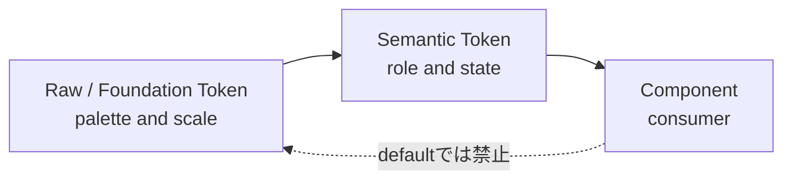
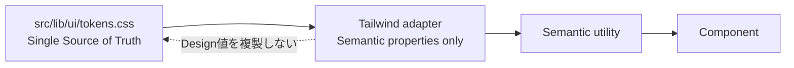

# Module 19: Design Token

Status: `COMPLETE / READY_FOR_M20`  
Phase: `TB-20`  
Difficulty: `FOUNDATION`  
Prerequisites: `M01`–`M18`（curriculum上の直接前提はM03–M05）

## 1. Learning goals

このModuleを終えたLearnerは、次を説明・判断できる。

1. Design Tokenを単なるCSS variableではなく、名前付きDesign Decisionとして説明する。
2. Raw/Foundation TokenとSemantic Tokenを区別する。
3. `Raw -> Semantic -> Component`の依存方向を守る。
4. PanoptesのCanonical Token Categoryと命名規則を使って分類する。
5. Token、Tailwind、Responsive、Motion、Product Contractの責務を分離する。
6. hardcoded/arbitrary valueの例外と段階migrationを判断する。
7. Target DesignとCURRENT implementationを混同しない。

## 2. Design Tokenとは何か

Design Tokenは、UI Design Decisionを再利用可能な名前付き値として表現する仕組みである。

```text
Design meaning -> named contract -> implementation value
```

Color、Typography、Spacing、Radiusなどの値を、画面ごとの偶然な数値ではなく、共有できる意味として扱う。

```text
Design Token != CSS Custom Property
```

CSS Custom PropertyはTokenを実装する仕組みの一つである。変数名を付けただけで、意味、owner、依存方向、変更規則がなければ、良いToken Contractとは限らない。

## 3. Hardcoded valueの問題

Componentへ`#564aff`、`16px`、`999px`、`0.18s`等を直接書くこと自体が常に誤りではない。しかし意味のある値が各所へ複製されると、次が起きる。

- 同じ意味なのに異なる見た目になる。
- 値が同じだけで意味の異なるものが誤って結合される。
- redesign/theme変更の影響箇所を追えない。
- component固有のmagic numberが増える。
- arbitrary valueが新しい非公式standardになる。
- visual/accessibility検証の範囲が曖昧になる。

Tokenは「意味」と「現在値」を分離する。

## 4. Raw / Foundation Token

Raw Tokenはpaletteやscaleなどの基礎値である。「何色か」「どのscale stepか」というvalue identityを持つが、UI上の用途は持たない。

Canonical naming:

```text
--p-raw-{category}-{scale-key}
```

説明用例:

```css
--p-raw-color-brand-500: #564aff;
--p-raw-color-neutral-900: #2d2d2d;
--p-raw-spacing-4: 1rem;
--p-raw-motion-duration-fast: 180ms;
```

これらは構造説明用であり、実装済みToken値の提示ではない。Raw TokenはToken declaration内でSemantic Tokenを構成するために使い、Componentのpublic contractにはしない。

## 5. Semantic Token

Semantic Tokenは「何色か」ではなく「何のための値か」を表す。

Canonical naming:

```text
--p-{category}-{role}-{variant?}-{state?}
```

FS-05で示されたrole例:

```text
--p-color-text-primary
--p-color-surface-default
--p-color-border-subtle
--p-color-action-primary
--p-color-focus-ring
--p-color-status-error
--p-space-component-md
--p-size-control-md
--p-radius-control-full
--p-shadow-surface-elevated
--p-z-toast
--p-motion-duration-interaction
```

Semantic TokenはShared UI/Primitiveが利用するpublic contractである。Componentが知るべきなのは「brand-500」ではなく「primary action」や「primary text」のようなroleである。

Stateは独立paletteではなく、必要に応じて`hover / active / focus / disabled / selected / success / warning / error`等を該当roleのvariantとして表現する。

## 6. Canonical dependency



ComponentがRawへ直接依存すると、design meaningと現在値が密結合する。Raw値の調整がどのUI roleへ影響するか分からなくなり、Componentごとの解釈差も生まれる。

## 7. なぜSemantic Layerが必要か

Primary textをneutral-900からneutral-800へ変更するとする。

Raw直参照の場合:

```css
.title {
	color: var(--p-raw-color-neutral-900);
}
.body {
	color: var(--p-raw-color-neutral-900);
}
```

Component側が「この値はprimary text」という意味を持たないため、変更対象の探索が必要になる。

Semantic経由の場合:

```css
:root {
	--p-color-text-primary: var(--p-raw-color-neutral-900);
}

.title {
	color: var(--p-color-text-primary);
}
```

Semantic mappingをneutral-800へ変更すれば、roleを維持したまま値を更新できる。変更にはvisual/contrast validationが必要であり、Token化は無検証変更を許可する仕組みではない。

## 8. Canonical categories

FS-05で承認済みのCategoryは次の10種である。指示文中の「9 Category」という記載より、Primary Standardの列挙とContractを優先する。

| Category   | Owns                                                            | Important boundary                        |
| ---------- | --------------------------------------------------------------- | ----------------------------------------- |
| Color      | brand/neutral foundation、text、surface、border、action、status | HexをProduct meaningにしない              |
| Typography | family、size、weight、line-height、letter-spacing               | DOM heading levelとvisual roleを分離      |
| Spacing    | margin、padding、gapのrhythm                                    | Sizingと混同しない                        |
| Sizing     | control/icon/avatar/container/max-size                          | 全px値やintrinsic geometryをToken化しない |
| Radius     | control、surface、pill/fullのshape role                         | 値ではなく用途で命名                      |
| Border     | width、style、semantic border color                             | focus/stateと責務を分離                   |
| Shadow     | elevation、focus/interaction補助                                | art direction固有effectは例外可           |
| Z-index    | named layer                                                     | 任意数値競争を作らない                    |
| Breakpoint | responsive adaptation threshold                                 | device categoryではない                   |
| Motion     | common duration/easing、reduced-motion relation                 | 固有timelineを無理に共通化しない          |

必要なcontractだけをToken化する。「値が存在する」ことと「Token Categoryへ登録すべき」ことは同義ではない。

## 9. Color Token

Semantic roleは少なくともtext、surface、border、interactive/action、statusを区別する。Component内のHex乱用を避ける理由は、色の値ではなく用途を共有するためである。

`status-error`はvisual roleであり、何をerrorと判定するかはProduct/Feature Contractが決める。TokenはBusiness Decisionを所有しない。

## 10. Typography Token

Typographyはfont-sizeだけではない。

- font family
- size
- weight
- line-height
- letter-spacing

heading、body、label、caption等のvisual roleとして扱う。`h1`というToken名はDOM semanticsとstyleを結合するためdefaultにしない。見出しのsemantic levelはHTML構造が、visual styleはTypography Tokenが担う。

## 11. Spacing and Sizing

Spacingは要素間・内部のrhythmを表す。

- margin
- padding
- gap

Sizingはcomponentやcontainerの寸法contractを表す。

- control height
- icon/avatar size
- shell/container max-size
- minimum usable size

```text
Spacing != Sizing
```

`gap: 16px`と`button height: 48px`は、どちらも長さだが意味が違う。Layout固有compositionやasset intrinsic sizeまで同じscaleへ押し込まない。

## 12. Radius, Border, and Shadow

- Radiusはcomponent shapeのrole。
- Borderは領域・状態・control境界の分離。
- Shadowはelevationまたはinteraction補助。

似ている見た目を毎回別値で作らない。一方、Landing Hero固有の複合shadowなど、art directionに強く依存するeffectはlocal exception候補として評価する。

## 13. Z-index Token

Z-indexは数字の大きさではなくlayering meaningを表す。base、dropdown/popover、sticky、overlay、modal、toast等のnamed layerが候補になる。

```css
/* anti-pattern */
z-index: 999999;
```

巨大値はstacking context問題を解決せず、局所的な数値競争を作る。Exact hierarchy/valueは承認済みContractなしに本教材で発明しない。

## 14. Breakpoint Token

FS-07で承認されたBreakpoint Contract:

| Name  |    Value | Semantic use                                |
| ----- | -------: | ------------------------------------------- |
| Base  | `<640px` | base/mobile-first behavior                  |
| `sm`  |  `640px` | compact spacing/control/grid enhancement    |
| `md`  |  `768px` | medium composition、form/modal、1→2 columns |
| `lg`  | `1024px` | navigation、sidebar、major region split     |
| `xl`  | `1280px` | wide grid、dense analysis、desktop spacing  |
| `2xl` | `1536px` | wide analytics density only                 |

Breakpointはmobile/tablet/desktopという端末分類ではなく、layoutが適応を必要とするthresholdである。既存`720px`等をclosest Tokenへ機械変換しない。

CSS Custom Propertyは通常のmedia query conditionへ直接使えない。このため、`tokens.css`を正本にしつつCSS/Tailwindへどう投影するかは実装時のadapter責務になる。値を手書きで別正本化しない。

## 15. Motion Token

Motion Tokenはcommon duration、easing、transition relationを扱う。Motionはfeedback、hierarchy、transitionの理解を助ける場合に使う。

- decorative motionを操作理解より優先しない。
- `prefers-reduced-motion`でnonessential motionを停止・短縮する。
- state/feedbackを静的にも理解可能にする。
- Hero/GSAP/SVG固有timelineを汎用Tokenへ無理に含めない。

Tokenがあるだけでreduced-motion対応が完了するわけではなく、Component behaviorの確認が必要である。

## 16. Component usage boundary

| Owner                    | Default usage                                                                                 |
| ------------------------ | --------------------------------------------------------------------------------------------- |
| Shared UI / Primitive    | Semantic Tokenをdefaultとする。Raw direct useは記録された例外のみ                             |
| Composite                | Semantic appearance + composition styling                                                     |
| Feature UI               | Semantic Token + feature-local composition。Product stateをpresentation mapping後にroleへ接続 |
| Layout / Page            | surface、spacing、container、named layer、Breakpoint Contract                                 |
| Preview                  | Productionと同じsemantic contract。独自paletteを正本化しない                                  |
| Data visualization / SVG | text/surface/statusはSemantic。algorithmic geometryや固有gradientはlocal exception可          |

Feature固有のvisual needでも、まずSemantic Tokenで表現できるか確認する。Product固有意味をgeneric Tokenへ混ぜない。

## 17. Design Token vs Product meaning

```text
warning color                         = Design Token
partially_completedのBusiness meaning = Product Contract
```

Tokenはvisual design contractである。`PARTIAL`をどう判定するか、Strategyへ利用できるか、Organization accessを許可するかはTokenで決めない。Feature/Backendがcanonical stateを決め、presentation mappingが承認済みsemantic roleへ接続する。

## 18. Source of Truth

Target runtime Source of Truth:

```text
src/lib/ui/tokens.css
```

RawとSemantic declarationを単一のCSS Custom Properties fileで管理する。Tailwind config、Component-local style、手書きTypeScript objectを別の正本にしない。

重要: これは承認済みTarget pathであり、CURRENT repositoryに実装済みという意味ではない。FS-05/06時点で`tokens.css`は未実装である。

JavaScript/SVGでToken referenceが必要なら、CSS Custom Property参照または明示adapterを使う。手書きTS mirrorへ同じ値を複製しない。Generatorはmulti-platform等の実需要が生じるまで導入しない。

## 19. Tailwind boundary



```text
Tailwind != Design Token Source of Truth
```

TailwindはTokenを使うStyling Consumer / Utility Layerである。adapterはSemantic CSS Custom Propertyを参照し、Hex、px、shadow等をTailwind側へ複製しない。Raw/default palette direct useや、反復する`[var(--p-...)]`でadapterを代替しない。

Tailwindのutility、arbitrary value、CSS coexistence、migration詳細はM20へhandoffする。

## 20. Responsive and fluid values

Responsive adaptationでもSemantic spacing/sizing/typographyを優先し、Breakpointごとにmagic numberを乱立させない。`clamp()`等のfluid valueにはminimum、maximum、意図を持たせ、Semantic Token Contractへ接続する。

Componentごとに異なるfluid formulaを無秩序に埋め込まない。Exact fluid scaleは承認済みでないため、本教材では新設しない。

## 21. Accessibility boundary

Color Tokenを選ぶ時はcontrastとnot-color-onlyを考慮する。Focus Tokenがあっても、focus indicatorが表示されなければaccessibleではない。

```text
Token present != accessibility verified
```

Actual contrast、keyboard/focus、reduced-motion、target size、screen reader behaviorはSource変更時のbrowser/accessibility verificationで確認する。

## 22. Exception model

FS-05/06が許容する主な例外:

- asset intrinsic size
- algorithmic/generated value
- browser/framework constraint
- approved one-off visual/art direction
- temporary migration debt
- complex local animationやgeometry

例外は少なくとも`reason / owner / scope / exact value / review trigger or removal condition`を追跡可能にする。Raw/hardcoded値を使う場合は、なぜSemantic Tokenで表現できないか説明する。

反復する例外はToken/custom utility/shared component候補として再審査する。ただし「2箇所で同じ値」だけで同じ意味とは断定しない。

## 23. Token evolution and compatibility

| Change class              | Meaning                     | Required handling                            |
| ------------------------- | --------------------------- | -------------------------------------------- |
| Additive                  | 新role/scaleを追加          | naming/owner/reuse needを確認                |
| Raw value change          | foundation値変更            | affected Semantic rolesとvisual impactを検証 |
| Semantic reference change | roleは維持して参照Rawを変更 | owner approval、visual/contrast validation   |
| Semantic rename/removal   | public contract変更         | consumer migration、期限付きalias、削除条件  |
| Semantic meaning change   | role自体が変化              | 既存Tokenを再利用せず新Token + migration     |

Contract versionは文書metadataで追跡し、Token名へ`v1`を埋め込まない。Exact deprecation toolingは未決定のため新設しない。

## 24. Migration strategy

承認済み順序:

1. Contractを正本化する（FS-05完了）。
2. 現行visual baselineと等価なminimal `tokens.css`を実装する。
3. new/touched codeからSemantic Tokenへ寄せる。
4. Shared UI / Layoutを段階移行する。
5. touched Feature UIをowner単位で移行する。
6. hardcoded/arbitrary/legacy CSS debtを縮退する。
7. Tailwind adapterをToken consumerとして接続する。

Implementation handoff上はToken実装後にTailwind接続を行う。既存画面の一括変換、全px値のToken化、Token導入とvisual redesignの同時実施は禁止する。

## 25. Worked example

次は構造説明用であり、正式なPanoptes Token値を新設するものではない。

Before:

```css
.example-card {
	color: #2d2d2d;
	background: #ffffff;
	padding: 16px;
	border-radius: 16px;
}
```

Target direction:

```css
:root {
	/* illustrative Raw layer */
	--p-raw-color-neutral-900: #2d2d2d;
	--p-raw-color-neutral-0: #ffffff;
	--p-raw-spacing-4: 16px;
	--p-raw-radius-4: 16px;

	/* illustrative Semantic layer */
	--p-color-text-primary: var(--p-raw-color-neutral-900);
	--p-color-surface-default: var(--p-raw-color-neutral-0);
	--p-space-component-md: var(--p-raw-spacing-4);
	--p-radius-surface-md: var(--p-raw-radius-4);
}

.example-card {
	color: var(--p-color-text-primary);
	background: var(--p-color-surface-default);
	padding: var(--p-space-component-md);
	border-radius: var(--p-radius-surface-md);
}
```

同じ16pxでもSpacingとRadiusは別category・別meaningである。値が同じという理由で一つのTokenへ統合しない。

## 26. CURRENT / TARGET / DEFERRED

| Classification | Confirmed scope                                                                                                                                                          |
| -------------- | ------------------------------------------------------------------------------------------------------------------------------------------------------------------------ |
| CURRENT        | `src/app.css`、Svelte `<style>`、component-local CSS、hardcoded Hex/px/shadow/z-index/transition、既存media queryがある。                                                |
| CURRENT caveat | `src/lib/ui/tokens.css`は未実装。Tailwind dependency/configも未導入。既存CSS variableや反復値があってもCanonical Token Contract実装済みとは言えない。                    |
| TARGET         | `src/lib/ui/tokens.css`を単一runtime SoTとし、Raw→Semantic→Componentを適用。TailwindはSemantic Token adapter/consumerとする。                                            |
| DEFERRED       | minimal Token値実装、full migration、legacy cleanup、Tailwind connection、visual regression/accessibility verification、exact TS adapter/generator/deprecation tooling。 |

Target SoTはImplementation Completeを意味しない。

## 27. Representative repository mapping

全CSS監査ではなく、FS-05で限定確認済みの10 examplesを教材上で再利用した。

| Current source                       | Current styling evidence                                 | Token / exception interpretation                  | Migration status                         |
| ------------------------------------ | -------------------------------------------------------- | ------------------------------------------------- | ---------------------------------------- |
| `src/app.css`                        | page background、global font                             | surface/font Semantic candidate                   | CURRENT hardcoded; TARGET token consumer |
| `PanoptesSiteHeader.svelte`          | brand gradient、surface、pill、transition、z-index       | color/radius/motion/layer candidates              | touch-and-migrate                        |
| `LandingHeroPrimarySection.svelte`   | surface、16px radius、complex shadow                     | surface/radius candidate; shadow exception review | no redesign                              |
| `LandingHeroSecondarySection.svelte` | repeated surface/radius/shadow                           | repeated Semantic candidate                       | validate parity first                    |
| `PanoptesShellMainSurface.svelte`    | gap、minimum height                                      | spacing candidate + feature sizing exception      | owner review                             |
| `SignUpBtn.svelte`                   | gradient、control height、pill、hover shadow、transition | action/control/type/motion candidates             | Shared UI priority after SoT             |
| `SignUpFields.svelte`                | input height、radius、text、focus ring                   | form/state Semantic candidates                    | Shared UI priority after SoT             |
| `PanoptesToastStack.svelte`          | status border/surface/shadow、z-index 120                | status/elevation/named layer candidates           | owner review                             |
| `src/routes/app/+layout.svelte`      | z-index 79、gap、720px media query                       | layer/spacing/breakpoint migration evidence       | do not mechanically map 720px            |
| `AppLogo.svelte`                     | intrinsic/responsive `min()` sizing                      | asset/component sizing exception candidate        | may remain local                         |

このsampleはToken Foundationが適用可能であることを示すが、全repositoryの準拠や値の頻度分布を証明しない。

## 28. Common misunderstandings

| Misunderstanding                   | Correction                                     |
| ---------------------------------- | ---------------------------------------------- |
| Token = CSS Variable               | TokenはDesign Contract、CSS variableは実装手段 |
| Raw = Semantic                     | Rawは値のfoundation、SemanticはUI role         |
| ComponentはRawを使う               | defaultはSemantic consumer                     |
| Tailwind = Token SoT               | Tailwindはconsumer/adapter layer               |
| hardcoded valueは常に禁止          | 記録された例外を許容                           |
| Breakpointはdevice名               | layout adaptation threshold                    |
| Product stateはColor Tokenが決める | Business meaningはProduct/Feature Contract     |
| TokenがあればAccessibility完了     | actual verificationが必要                      |
| 2箇所で同じ値ならToken             | 意味と安定したreuse contractが必要             |
| Target `tokens.css`は実装済み      | 承認済みpathだがCURRENTでは未実装              |

## 29. Decision heuristic

1. 基礎palette/scale valueか → Raw Token。
2. UI上のrole/stateか → Semantic Token。
3. Local algorithmic/intrinsic valueか → Exception candidate。
4. Product/business meaningか → Product Contract。
5. Responsive thresholdか → Breakpoint Token。
6. Common duration/easingか → Motion Token。
7. Component stylingか → Semantic Token consumer。
8. 同じ値が反復するか → 意味、owner、変更単位を確認してからToken候補。

## 30. Practice

### A. Knowledge check

1. Design TokenとCSS Custom Propertyの違いを説明せよ。
2. RawとSemanticを分ける理由を説明せよ。
3. ComponentがRawへ直接依存するriskを説明せよ。

### B. Raw vs Semantic

次を分類せよ: `brand-500`、`text-primary`、`spacing-4`、`surface-elevated`、`status-error`、`duration-fast`。

### C. Refactoring exercise

`color: #2d2d2d; padding: 16px; border-radius: 16px;`をRaw / Semantic / Componentへ分離せよ。同じ16pxを一つのTokenにしてよいか説明せよ。

### D. Category exercise

font weight、button height、card gap、modal layer、focus border、Hero shadow、layout threshold、interaction durationを10 Categoryへ分類せよ。

### E. Exception exercise

次が例外として妥当か判断せよ。

1. Logo assetのintrinsic ratio。
2. 全buttonで使うbrand Hexのhardcode。
3. SVG pathから計算する座標。
4. 一時migration中のlegacy value。
5. 3画面で別々に使う`z-index: 999999`。

### F. Tailwind boundary

Token value、semantic mapping、utility projection、Component class、Product status判定を`tokens.css / Tailwind adapter / Component / Feature or Backend`へ分類せよ。

### G. Violation detection

1. Tailwind configを別Token SoTにする。
2. Componentから大量にRaw Tokenを参照する。
3. Product Statusの意味をcolor tokenだけで表す。
4. Breakpointごとにmagic numberを追加する。
5. `z-index: 999999`を重ねる。
6. `tokens.css`未実装なのにmigration完了とする。

### H. Architecture explanation

「なぜRaw TokenとSemantic Tokenを分けるのか」を、変更影響、Component contract、theme/redesign、accessibility validationの観点から説明せよ。

## 31. Answers / explanation guide

### A. Knowledge check

Tokenは名前、意味、owner、変更規則を持つDesign Decisionで、CSS Custom Propertyはruntime実装手段である。RawとSemanticを分けると値変更とrole meaningを切り離せる。ComponentのRaw直参照は現在値とUI meaningを密結合し、変更影響と例外を追いにくくする。

### B. Raw vs Semantic

- Raw: `brand-500`、`spacing-4`、`duration-fast`。
- Semantic: `text-primary`、`surface-elevated`、`status-error`。

### C. Refactoring exercise

Color/spacing/radiusのRaw scaleを別々に置き、それぞれtext、component spacing、surface radiusのSemantic roleへmappingし、ComponentはSemanticだけを参照する。同じ16pxでもmeaningが違うため一Tokenへ統合しない。

### D. Category exercise

Typography、Sizing、Spacing、Z-index、Border/Color state、Shadow、Breakpoint、Motionの順。Hero shadowはCategory上Shadowだがlocal exceptionになり得る。

### E. Exception exercise

1と3は妥当候補。4はowner/removal condition付きtemporary debt。2はSemantic Token candidateで例外にしない。5はnamed layer/stacking contextを設計し直す。

### F. Tailwind boundary

- `tokens.css`: Raw valueとSemantic mappingのSoT。
- Tailwind adapter: Semantic utility projection。
- Component: utility/Semantic Token consumer。
- Feature/Backend: Product status判定。

### G. Violation detection

順に、二重正本、dependency inversion、Product/visual meaning混同、Breakpoint contract違反、layer数値競争、Target/CURRENT混同である。

### H. Architecture explanation

Rawはpalette/scaleを安定して管理し、SemanticはUI roleをpublic contractにする。ComponentがSemanticへ依存すれば、roleを維持した値変更やtheme/redesignをmapping側で吸収できる。同時に、変更対象となるroleを特定でき、contrastやvisual regressionの検証範囲も明確になる。

## 32. Completion criteria

|   # | Criterion                                  | Result |
| --: | ------------------------------------------ | ------ |
|   1 | Design Token purpose explained             | `PASS` |
|   2 | Raw Token explained                        | `PASS` |
|   3 | Semantic Token explained                   | `PASS` |
|   4 | Raw→Semantic→Component explained           | `PASS` |
|   5 | Canonical categories explained             | `PASS` |
|   6 | Tailwind boundary explained                | `PASS` |
|   7 | Responsive/Motion relation explained       | `PASS` |
|   8 | Exception/migration model explained        | `PASS` |
|   9 | Repository mapping + two diagrams included | `PASS` |
|  10 | Exercises + answers included               | `PASS` |

M19 authoring result: `10 / 10 PASS`。これは教材完成の判定であり、`tokens.css`、Tailwind、Source migration、visual/accessibility verificationの完成判定ではない。

## 33. M20 handoff

Recommended next phase: `TB-21 — Module 20: Tailwind`。

M20ではFS-06の承認済みStandardを教材化し、TailwindをSemantic Token consumerとして扱う方法、utility convention、arbitrary value、CSS coexistence、class extraction、段階migrationを説明する。Tailwindのinstall/configやSource rewriteは教材作成と分離する。

## References

- [Frontend Structure Policy](../../architecture/frontend-structure-policy.md)
- [October Frontend Standardization Plan](../../architecture/frontend-standardization-plan.md)
- [FS-05 Design Token Foundation](../../audit/125-fs05-design-token-foundation.md)
- [FS-06 Tailwind Standard](../../audit/126-fs06-tailwind-standard.md)
- [FS-07 Responsive Standard](../../audit/127-fs07-responsive-standard.md)
- [FS-08 UI Regulation](../../audit/128-fs08-ui-regulation.md)
- [Module 18: Missing / Partial / Eligibility](./18-missing-partial-eligibility.md)
