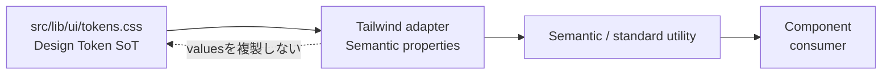
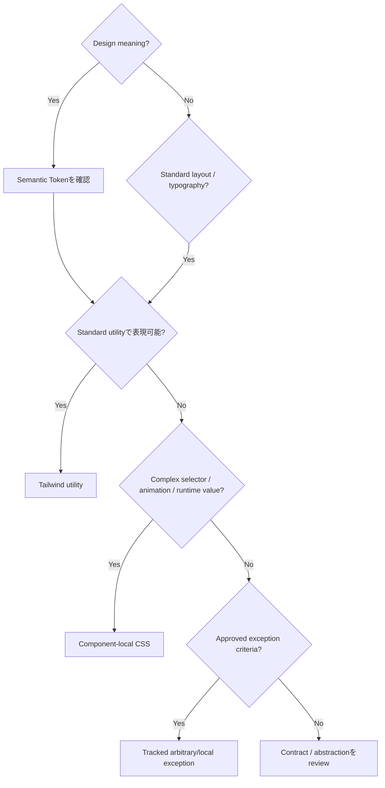

# Module 20: Tailwind

Status: `COMPLETE / READY_FOR_M21`  
Phase: `TB-21`  
Difficulty: `INTERMEDIATE`  
Prerequisites: `M01`–`M19`（direct curriculum dependency: `M19`）

## 1. Learning goals

このModuleを終えたLearnerは、次を説明・判断できる。

1. Tailwindとutility-first CSSの役割・利点・riskを説明する。
2. TailwindをDesign Token Source of TruthではなくStyling Consumerとして扱う。
3. Layout、Spacing/Sizing、Typography、Semantic Appearance、State、Responsive、One-off Compositionを分類する。
4. Tailwind utility、Component-local CSS、Global CSS、approved exceptionを使い分ける。
5. arbitrary valueをdefaultにせず、許容条件と追跡情報を判断する。
6. Mobile-first responsive utilityとUI/programmatic stateの境界を守る。
7. visual parityを維持しながら段階migrationを計画する。
8. Target StandardとCURRENT implementationを混同しない。

## 2. Tailwind fundamentals

Tailwindは、小さなUtility Classを組み合わせてUI stylingを構成するCSS frameworkである。

- Utility Class: 一つまたは小さな責務のstyleを表す。
- Responsive Variant: named breakpoint以降の差分を表す。
- State Variant: hover、focus、disabled等のvisual stateを表す。
- Composition: Utilityの組合せでComponent appearance/layoutを作る。
- Build-time generation: Source内で検出されたclass等から必要なCSSを生成する。

```text
Tailwind != Design System
Tailwind != Product Contract
Tailwind != Design Token Source of Truth
```

Tailwindは、承認済みDesign Decisionを使いやすく投影する道具である。

## 3. Utility-first model

Utility-firstでは、markup近傍に小さなstyle primitiveを組み合わせる。

利点:

- stylingの適用箇所を追いやすい。
- responsive/state差分を同じ文脈で読める。
- component固有class名の命名costを減らせる。
- 制約されたToken/utility scaleへ接続できる。
- unused global selectorやcascadeの影響を減らせる。

Risk:

- class listが責務を隠すほど肥大化する。
- arbitrary valueでTokenを迂回する。
- Semantic meaningのない組合せが増える。
- 同じUI contractが各Componentへ複製される。
- Business conditionがclass expressionへ埋め込まれる。

Utility-firstは「すべてをclassにする」という規則ではない。

## 4. PanoptesでのTailwindの役割

FS-06 Canonical Role:

```text
Tailwind = Styling Consumer / Utility Layer
```

Tailwindが担当するもの:

- Semantic TokenをUtilityとして利用可能にする。
- layout、spacing、typographyを表現する。
- responsive variantを提供する。
- presentation stateのappearanceを表現する。

Tailwindが担当しないもの:

- Design値のSource of Truth。
- Product stateやauthorizationの判定。
- Feature/Layout ownershipの決定。
- accessibilityの自動保証。
- redesignの承認。

## 5. Token / Tailwind boundary



Canonical flow:

```text
tokens.css -> Tailwind adapter -> semantic utility -> Component
```

禁止する二重正本:

```text
tokens.css -> Design values A
Tailwind config -> independent Design values B
```

AdapterはSemantic CSS Custom Propertyを参照し、Hex、px、shadow literalを複製しない。Raw TokenやTailwind default paletteへの直接依存をPanoptes standardにしない。

## 6. Tailwind adapter

AdapterはSemantic TokenをUtilityとして利用可能にするprojection layerである。

Conceptual example:

```text
--p-color-text-primary
  -> semantic text utility
  -> Component
```

正式Utility名やconfig syntaxは、採用するTailwind major versionとSvelteKit integrationが決まるImplementation Phaseで確定する。本教材の`text-primary`等は説明用であり、実装済みclassではない。

反復する`bg-[var(--p-...)]`等でadapter実装を代替しない。反復するsemantic roleはnamed projection候補にする。

## 7. Utility categories

| Category            | Purpose                                           | Good use                               | Misuse                                 |
| ------------------- | ------------------------------------------------- | -------------------------------------- | -------------------------------------- |
| Layout              | display、position、grid/flex、alignment、overflow | ownerが決めたstructureを表現           | classでComponent ownershipを決める     |
| Spacing / Sizing    | gap、padding、margin、control/icon/container size | Token scaleへ接続                      | arbitrary pxの乱発、spacing/sizing混同 |
| Typography          | size、weight、line-height、alignment、wrapping    | Semantic typographyを投影              | `text-[13px]`を新standard化            |
| Semantic Appearance | text、surface、border、shadow、action/status      | Semantic Tokenを使用                   | Hex/default palette直参照              |
| State               | hover、focus、active、selected、disabled          | programmatic stateと同期したappearance | CSSだけでdisabled等を偽装              |
| Responsive          | named breakpointで差分適用                        | Mobile-first adaptation                | device名として固定設計                 |
| One-off Composition | Page/Feature固有の局所composition                 | reuse不要な明示的配置                  | 反復contractを永久に複製               |

## 8. Layout utilities

Flex、grid、block、position、alignment、overflow等は構造の表現に適する。しかしutilityが責務ownerを決めるわけではない。

- Component: internal wrap/stack/local overflow。
- Page: section order/content priority。
- Layout: major columns/max-width/navigation/shell。

Tailwind classが書けるからといって、UI Componentがglobal shell responsibilityを持ってよいわけではない。

## 9. Spacing and sizing utilities

Gap、padding、margin、width、heightは、M19のSpacing/Sizing Tokenへ接続する。

```text
Spacing = rhythm and separation
Sizing  = control/icon/container dimensions
```

標準scaleで表現できる値を`mt-[13px]`や`h-[47px]`へしない。Asset intrinsic sizeやalgorithmic geometryは例外候補になり得る。

## 10. Typography utilities

Typography utilityはsize、weight、line-height、alignment、wrappingを扱う。Shared UIではSemantic typography roleへ接続し、単なるfont-sizeの集合にしない。

DOM heading levelとvisual typography roleは別である。Utility選択だけでHTML semanticsを決めない。

## 11. Semantic appearance

Text、surface、border、action、status等はSemantic Tokenに接続したUtilityを優先する。

説明用concept:

```text
text-primary
surface-default
border-subtle
action-primary
status-error
```

これらはTarget directionであり、現時点の実装済みclass名ではない。Product stateを何と判定するかはRails/Feature、受け取ったstateをどのsemantic appearanceで表すかはpresentation responsibilityである。

## 12. State utilities

代表的なvisual state:

- hover
- focus
- active/pressed
- selected/current
- disabled
- loading

State stylingはprogrammatic/semantic stateと一致させる。

```text
disabled appearance + still clickable = violation
selected color without aria/state semantics = incomplete
```

CSS classだけでBusiness eligibilityやauthorizationを決めない。Business decisionはRails/Feature、visual stateはUI/Tailwindが担当する。

Conditional classはcomplete literalまたはstatic mapをdefaultとし、build-time scannerが検出できない文字列連結へ依存しない。

## 13. Responsive utilities

FS-07 Canonical Breakpoints:

| Variant | Threshold | Meaning                       |
| ------- | --------: | ----------------------------- |
| base    |  `<640px` | base/mobile-first behavior    |
| `sm:`   |   `640px` | compact enhancement           |
| `md:`   |   `768px` | medium composition            |
| `lg:`   |  `1024px` | major region/navigation split |
| `xl:`   |  `1280px` | wide grid/desktop spacing     |
| `2xl:`  |  `1536px` | wide analytics density only   |

Mobile-firstではbaseを定義し、必要なthresholdから差分を追加する。

```text
base -> sm: -> md: -> lg: -> xl: -> 2xl:
```

Breakpointはdevice名ではなくlayout adaptation thresholdである。既存`720px`等をclosest named breakpointへ機械変換しない。

## 14. Hidden content and overflow

`hidden`はresponsive designそのものではない。Meaningful/critical contentを安易に消さず、hide、collapse、wrap、reorder、scroll、truncateをcontent priorityから選ぶ。

Navigation linkをhideするなら、同じdestinationへの代替navigationを用意する。

Root horizontal scrollは禁止する。Table、Chart、Tabs、dense UIのlocal horizontal scrollは条件付きで許容するが、keyboard/touch reachability、overflow cue、focus visibilityを保持する。Rootへ`overflow-x-auto`を付けてlayout defectを隠さない。

## 15. Tailwind and Component-local CSS

Svelte `<style>`は許容される。

Component-local CSSに適するもの:

- complex selector
- pseudo-element
- keyframes/complex animation
- runtime CSS Custom Propertyとの連携
- algorithmic/intrinsic geometry
- Tailwind化で責務や可読性が悪化するstyle
- migration中のlegacy CSS

Tailwind導入はCSS禁止を意味しない。同じproperty/stateをUtilityとlocal CSSで競合所有しないよう、Component単位でownerを決める。

## 16. Global CSS boundary

Global CSSに適するもの:

- reset/base
- Design Token declarations
- global font/body foundation
- truly global rules
- global asset/cursor behavior

Component-specific ruleを無秩序にGlobal CSSへ置かない。Tailwind/Preflight相当を接続する時は、現行reset/baseとの二重適用を避け、一つのownerとimport orderを決める。

## 17. Animation, pseudo selectors, runtime values

Complex animationやGSAP連携を大量Utilityへ無理に変換しない。Motion Token、cleanup、route transition、reduced-motionを維持し、Component-local CSSまたは適切なCSS layerを使える。

`::before`、`::after`も可読性と責務に応じてCSSを使う。

Runtime algorithmic valueは次のような境界を使える。

```text
runtime calculation -> CSS Custom Property -> local CSS / compatible utility
```

Dynamic geometryを固定Design Tokenへ昇格させない。

## 18. Arbitrary value model

`w-[37px]`や`mt-[13px]`のようなarbitrary valueはdefaultにしない。

Approved exception candidates:

- asset intrinsic size
- algorithmic/generated value
- browser/framework constraint
- approved one-off composition/art direction
- temporary migration debt

例外には`reason / owner / scope / exact value / risk / review or removal condition`を持たせる。反復する値はToken/custom utility/Component候補として再審査する。

```text
Arbitrary != prohibited
Arbitrary != standard default
```

## 19. One-off composition and reuse

Feature/Page固有の一度きりのcompositionを、すべてShared TokenやShared Componentへ昇格させる必要はない。Feature-local defaultを維持する。

同じclass combinationが2回現れても、即Shared Componentやcustom utilityにはしない。次を確認する。

- 同じsemantic purposeか。
- 同じstate/accessibility contractか。
- 同じownerと変更単位か。
- stable props/variant contractが成立するか。

## 20. Class list and extraction

Class listが長いだけでは問題ではない。問題はsemantic duplication、unreadability、repeated contract、responsibility mixingである。

抽出候補:

- stable semantic patternが反復する。
- state/accessibility contractがmarkupから読めない。
- shared Componentとしてprops/variantが成立する。
- class群がComponent responsibilityを隠す。

抽出先は、Reusable UI Component、feature-local Component、限定Custom Utilityの順に責務で判断する。

`@apply`等は採用versionで利用可能かつ可読性を改善する局所用途に限る。Tailwindをtraditional semantic CSSへ戻すためのdefaultにはしない。Exact policyはImplementation Phaseで決める。

## 21. Accessibility boundary

Tailwindはfocus visibility、responsive visibility、target size、contrast-related Semantic Utilityを支援できる。しかし、Semantic HTML、keyboard interaction、accessible name、ARIA/state同期、live feedbackは別途必要である。

```text
Tailwind used != accessible
```

Utility名やColor Tokenが正しくても、実ブラウザーでfocus、contrast、reduced-motion、target size、reading orderを検証する必要がある。

## 22. Component responsibility

| Owner          | Tailwind usage boundary                                |
| -------------- | ------------------------------------------------------ |
| UI / Primitive | Semantic appearance、control-local layout/state        |
| Composite      | presentation composition                               |
| Feature        | feature-specific placement/state mapping後のappearance |
| Layout         | persistent structural styling、major region adaptation |
| Page           | section order、content priority、page composition      |

Tailwind class placementもM04のFeature/UI/Layout boundaryとimport/state ownershipを壊さない。

## 23. Styling decision flow



## 24. Worked example

次はTarget directionを説明する概念例であり、正式なPanoptes Utility/Token名ではない。

Before:

```css
.example-button {
	display: inline-flex;
	padding: 12px 20px;
	color: #fff;
	background: #564aff;
}
.example-button:hover {
	opacity: 0.9;
}
@media (min-width: 768px) {
	.example-button {
		padding-inline: 24px;
	}
}
```

Target separation:

```text
Token:
  action color、control spacing、focus role

Tailwind utility:
  inline-flex、alignment、semantic action、hover/focus、md差分

Component-local CSS:
  complex pseudo/animationが必要な場合だけ

Feature/Backend:
  disabled/eligible等のBusiness stateを判定
```

Migrationではまずvisual baselineを記録し、Token/Utility接続後に同じ見た目とbehaviorを検証する。同時Redesignは別Decisionにする。

## 25. Migration strategy

承認済み順序:

1. `src/lib/ui/tokens.css`を現行visualと等価な値で実装する。
2. Tailwind version/SvelteKit integrationを決め、Semantic adapterとreset/base ownerを接続する。
3. new codeへstandardを適用する。
4. Shared UI / PrimitiveとLayoutを小さな検証単位で移行する。
5. touched Feature UIをowner単位で移行する。
6. legacy CSSをComponent単位で`keep / migrate / exception`判定する。
7. hardcoded/arbitrary debtを段階的に縮退する。

Touch-and-migrateにより一括変換せず、変更対象からDebtを減らす。

## 26. Visual parity

```text
Migration != Redesign
```

Legacy CSSからTailwindへ移す時は、機能だけでなく次を確認する。

- layout/spacing/sizing
- typography/color/border/shadow
- hover/focus/disabled/selected
- responsive thresholdsとoverflow
- animation/reduced-motion
- browser renderingとaccessibility

意図的Visual変更はmigrationへ混ぜず、Design/Product Decisionとvalidationを別に持つ。

## 27. CURRENT / TARGET / DEFERRED

| Classification  | Confirmed scope                                                                                                                                        |
| --------------- | ------------------------------------------------------------------------------------------------------------------------------------------------------ |
| CURRENT         | Svelte/local/global CSS、hardcoded values、media queries、inline/class stylingがある。SvelteKit/Viteを使用する。                                       |
| CURRENT tooling | `package.json`にTailwind dependencyはなく、Tailwind config/PostCSS integrationも確認できない。`src/lib/ui/tokens.css`も未実装。                        |
| TARGET          | `tokens.css -> Tailwind adapter -> Semantic Utility -> Component`。Mobile-first named breakpointとresponsibility別Utilityを利用する。                  |
| DEFERRED        | Tailwind install/version/config、Token実装、adapter/reset connection、bulk migration、legacy cleanup、full browser/visual/accessibility verification。 |

Target Standardの承認はTooling/Source実装済みを意味しない。最新Tailwindの特定syntaxをCURRENTへ仮定しない。

## 28. Representative repository mapping

全CSS/class監査ではなく、FS-06で限定確認済みの10 examplesとtooling manifestを教材上で照合した。

| Source                                             | Current styling method                                  | Tailwind applicability / Token relation                 | Migration status         |
| -------------------------------------------------- | ------------------------------------------------------- | ------------------------------------------------------- | ------------------------ |
| `package.json` / Vite config                       | SvelteKit/Vite、Tailwind dependencyなし                 | adapter/toolingはTARGET                                 | NOT IMPLEMENTED          |
| `src/app.css`                                      | global body typography/surface/reset-related rule       | Semantic Token接続可、global base継続                   | Token後にreview          |
| `PanoptesSiteHeader.svelte`                        | local flex/gap/radius/state + pseudo gradient/animation | simple utility適合、effectはlocal CSS候補               | touch-and-migrate        |
| `LandingHeroPrimarySection.svelte`                 | positioning/surface/radius/complex shadow               | basic utility + local art-direction exception           | no redesign              |
| `LandingHeroSecondarySection.svelte`               | Primaryと共通するbasic style/effect                     | common utility候補、effect保持可                        | visual parity required   |
| `PanoptesShellMainSurface.svelte`                  | grid/gap + `min-height`                                 | layout utility、feature sizing exception review         | owner review             |
| `SignUpBtn.svelte`                                 | control/action/state/gradient/transition                | Token後utility適合、gradientはlocal候補                 | Shared UI priority       |
| `SignUpFields.svelte`                              | input layout/focus/disabled/pseudo                      | utility + accessibility contract、pseudoはCSS可         | Shared UI priority       |
| `PanoptesToastStack.svelte`                        | grid/spacing/status/layer/backdrop/compound width       | semantic utility + local/arbitrary review               | owner review             |
| `src/routes/app/+layout.svelte` / `AppLogo.svelte` | structural CSS、720px query、intrinsic `min()`          | Layout utility + breakpoint migration / asset exception | no mechanical conversion |

このsampleはutility適合箇所とCSS継続箇所の両方を示すが、Tailwind適用率や全class数を示さない。

## 29. Common misunderstandings

| Misunderstanding                            | Correction                                                  |
| ------------------------------------------- | ----------------------------------------------------------- |
| Tailwind = Design System                    | Styling framework/consumerでありDesign Decision全体ではない |
| Tailwind = Token SoT                        | `tokens.css`がTarget SoT                                    |
| Tailwind導入 = CSS禁止                      | Global/local CSSとの共存を許容                              |
| Utility classが多い = 必ず悪い              | 責務・可読性・反復contractで判断                            |
| Arbitrary valueは常用可能                   | 限定例外でありdefaultではない                               |
| Responsive utilityでComponentが全責務を持つ | Page/Layout/Component ownerを維持                           |
| `hidden` = responsive design                | content priorityと代替導線が必要                            |
| Tailwind使用 = accessibility完了            | HTML/keyboard/ARIA/実測が必要                               |
| 同じclass = Shared Component                | semantic reuse contractが必要                               |
| Migration = Redesign                        | visual parityをdefaultとする                                |
| Target Tailwind = 導入済み                  | dependency/configともCURRENT未実装                          |

## 30. Decision heuristic

1. Design meaningか → Semantic Token。
2. Standard Layout/Spacing/Typographyか → Tailwind Utility。
3. Responsive adaptationか → Named breakpoint utility。
4. State appearanceか → State variant + semantic/programmatic state。
5. Complex selector/animationか → Component-local CSS candidate。
6. Runtime algorithmic valueか → CSS variable / tracked exception。
7. Repeated stable UI contractか → Component abstractionを検討。
8. One-off compositionか → Local composition。
9. Business decisionか → Rails/Feature。classで決めない。

## 31. Practice

### A. Knowledge check

1. TailwindとDesign Systemの違いを説明せよ。
2. Utility-firstの利点とriskを二つずつ挙げよ。
3. なぜTailwindをToken SoTにしないのか。

### B. Token vs Tailwind

Hex value、Semantic color role、Utility projection、Component class、Product eligibility判定を`tokens.css / adapter / Component / Rails or Feature`へ分類せよ。

### C. Utility classification

`flex`、`gap-*`、font weight、surface color、`hover:*`、`md:*`をLayout / Spacing / Typography / Appearance / State / Responsiveへ分類せよ。

### D. Styling decision

次をToken / Tailwind / Component CSS / Exceptionへ分類せよ。

1. Shared primary text color。
2. Grid alignment。
3. Complex Hero pseudo animation。
4. SVG計算座標。
5. Standard focus appearance。

### E. Responsive exercise

Baseではstack、`md`以上で2 columns、local table scrollを持つUIについて、ownerとMobile-first styling順序を説明せよ。

### F. Arbitrary value exercise

Logo intrinsic width、全button共通の37px height、一時legacy offset、chart runtime座標についてarbitrary value可否を説明せよ。

### G. Migration exercise

Local CSSを持つShared Buttonを、visual parityを保ちながら段階移行する順序を示せ。

### H. Violation detection

1. Tailwind configへ独立color paletteを定義する。
2. arbitrary pixelを常用する。
3. rootへ`overflow-x-auto`を付ける。
4. important navigationをhideし代替を置かない。
5. Business statusをclass conditionだけで決める。
6. 全CSSを一括変換する。
7. Tailwind導入と同時にRedesignする。

### I. Architecture explanation

「なぜPanoptesではTailwindをToken Source of Truthにしないのか」を、ownership、CSS coexistence、migration、将来のconsumerの観点から説明せよ。

## 32. Answers / explanation guide

### A. Knowledge check

TailwindはStyling Utility framework、Design SystemはToken、Component、interaction、accessibility等を含む広いcontractである。Utility-firstは適用箇所・variantが明確になる一方、class肥大・arbitrary乱用のriskがある。SoTを`tokens.css`へ置くことでTailwind以外のCSS/SVG等も同じDesign Decisionを使え、framework configへのlock-inと二重正本を避けられる。

### B. Token vs Tailwind

- `tokens.css`: Raw valueとSemantic role mapping。
- adapter: Semantic Utility projection。
- Component: Utility consumer。
- Rails/Feature: Product eligibility判定。

### C. Utility classification

順にLayout、Spacing、Typography、Semantic Appearance、State、Responsive。

### D. Styling decision

1. Semantic Token。2. Tailwind Layout Utility。3. Component-local CSS。4. runtime CSS variable/algorithmic exception。5. Semantic Token + State Utility。

### E. Responsive exercise

Page/Layoutがmajor 1→2 column compositionを所有し、Componentはtable local overflowを所有する。Base stackを先に書き、`md`差分でcolumnsを追加する。Root overflowを作らずtable containerにreachability/cueを持たせる。

### F. Arbitrary value exercise

Logo intrinsic widthとchart座標は例外候補。一時offsetはowner/removal condition付きdebt。全button共通heightはSizing Token/standard Utility候補でarbitrary defaultにしない。

### G. Migration exercise

Visual/state/responsive baseline取得 → Token implementation確認 → Semantic adapter接続 → simple layout/appearance utility移行 → pseudo/animation等のCSS継続判断 → viewport/state/accessibility/visual parity検証 → legacy debt記録/削除。

### H. Violation detection

順に二重正本、Token bypass、layout defect隠蔽、content priority違反、Business/UI責務混同、Big Bang violation、Migration/Redesign混同である。

### I. Architecture explanation

Token SoTをframework外の`tokens.css`へ置けば、Tailwind Utility、Svelte local CSS、Global CSS、SVG等が同じSemantic Contractを消費できる。Tailwind version/config変更でもDesign meaningを維持でき、既存CSSと段階共存しながら二重正本なしでmigrationできる。

## 33. Completion criteria

|   # | Criterion                                  | Result |
| --: | ------------------------------------------ | ------ |
|   1 | Tailwind fundamentals explained            | `PASS` |
|   2 | Utility-first model explained              | `PASS` |
|   3 | Token/Tailwind boundary explained          | `PASS` |
|   4 | Utility categories explained               | `PASS` |
|   5 | Responsive/state utility explained         | `PASS` |
|   6 | CSS coexistence explained                  | `PASS` |
|   7 | Arbitrary value rule explained             | `PASS` |
|   8 | Migration/visual parity explained          | `PASS` |
|   9 | Repository mapping + two diagrams included | `PASS` |
|  10 | Exercises + answers included               | `PASS` |

M20 authoring result: `10 / 10 PASS`。教材完成はTailwind dependency/config、Token implementation、CSS migration、visual/accessibility verificationの完成を意味しない。

## 34. M21 handoff

Recommended next phase: `TB-22 — Module 21: Responsive`。

M21ではFS-07 Responsive Contract v1を教材化し、Breakpoint、Mobile-first、Layout/Page/Component adaptation、content priority、dense UI、overflow、acceptance viewportを扱う。Responsive Source変更やbrowser E2Eは教材作成と分離する。

## References

- [Module 19: Design Token](./19-design-token.md)
- [Frontend Structure Policy](../../architecture/frontend-structure-policy.md)
- [October Frontend Standardization Plan](../../architecture/frontend-standardization-plan.md)
- [FS-05 Design Token Foundation](../../audit/125-fs05-design-token-foundation.md)
- [FS-06 Tailwind Standard](../../audit/126-fs06-tailwind-standard.md)
- [FS-07 Responsive Standard](../../audit/127-fs07-responsive-standard.md)
- [FS-08 UI Regulation](../../audit/128-fs08-ui-regulation.md)
