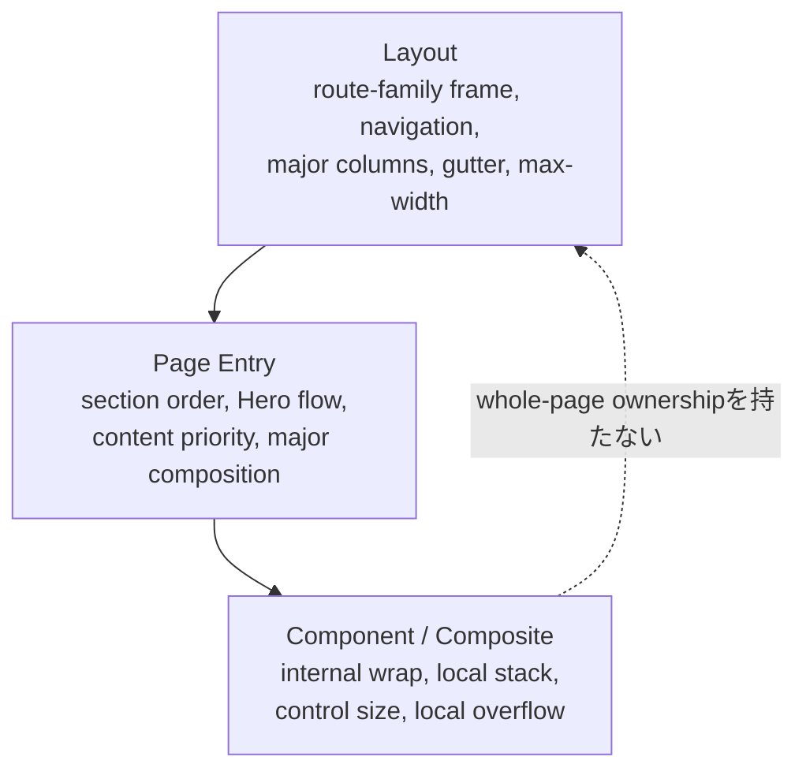
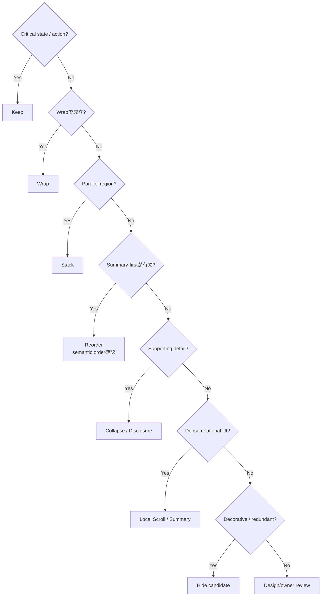

# Module 21: Responsive

Status: `COMPLETE / READY_FOR_M22`  
Phase: `TB-22`  
Difficulty: `INTERMEDIATE`  
Prerequisites: `M01`–`M20`（direct curriculum dependencies: `M04`, `M19`, `M20`）

## 1. 学習目標（Learning goals）

このModuleを終えた学習者は、次の内容を説明し、判断できます。

1. Responsive DesignとMobile-firstの意味を説明する。
2. Breakpointをdevice名ではなくlayout adaptation thresholdとして使う。
3. Layout、Page、Componentのresponsive responsibilityを分類する。
4. Content Priorityからwrap、stack、collapse、reorder、scroll、truncate、hideを選ぶ。
5. Table、Chart、Card、Analysis Panel、Strategy、Tabs等のdense UIを判断する。
6. Root overflowとintentional local overflowを区別する。
7. BreakpointとAcceptance Viewportを区別して検証計画を作る。
8. CURRENT implementation、TARGET Standard、DEFERRED remediationを混同しない。

## 用語ガイド

- **Responsive:** viewport幅や利用可能な領域に応じて、情報の配置と操作方法を適応させる設計。
- **Mobile-first:** 狭い画面を基本styleとし、必要な幅から段階的にlayoutを拡張する方法。
- **Breakpoint:** layoutを切り替える必要が生じる幅のしきい値。特定device名そのものではない。
- **Content priority:** 狭い領域で、何を残し、折り返し、並べ替え、局所scrollへするかを重要度で判断すること。
- **Local overflow:** page全体ではなく、tableやchartなど必要なcontainer内だけをscroll可能にする処理。

## 2. Responsive fundamentals

Responsive Designは、viewportやcontainerの利用可能な領域に合わせて、UIの構造・配置・表示方法を調整する設計です。

```text
Responsive != wide designを単純に縮小
Responsive != smartphone専用対応
Responsive != breakpoint classを追加するだけ
```

情報の意味、操作、priorityを保ちながら、利用可能なspaceへ構造を適応させる。

## 3. Mobile-first model

PanoptesではMobile-firstをdefaultとします。

```text
Base -> sm -> md -> lg -> xl -> 2xl
```

Baseでは、狭いviewportでも内容を読め、必要な操作へ進める順序を定義します。領域が広くなったときに、その基本構成を拡張します。

- Baseは劣化版ではなく、minimum usable compositionである。
- Wide layoutはBaseの意味を維持した拡張である。
- Desktop ruleを打ち消す大量overrideを作らない。
- 既存desktop-first CSSはBig Bangで反転せず、touch-and-migrateとvisual parityで移行する。

Mobile-firstは「Mobile Productを最優先にする」というProduct priority宣言ではありません。CSS/layoutの組立方向です。

## 4. Breakpoint Contract

| Name  |        値 | Intended semantic use                        |
| ----- | --------: | -------------------------------------------- |
| Base  | `0–639px` | narrow viewportで成立するdefault composition |
| `sm`  |   `640px` | compact spacing/control/grid enhancement     |
| `md`  |   `768px` | medium composition、form/modal、1→2 columns  |
| `lg`  |  `1024px` | navigation、sidebar、major region split      |
| `xl`  |  `1280px` | wide grid、dense analysis、desktop spacing   |
| `2xl` |  `1536px` | wide analytics density only                  |

Breakpointは「スマホ」「タブレット」「PC」というdevice categoryではありません。Content/layoutが変化を必要とするthresholdです。

## 5. Why device labels are risky

Device名へ依存すると、次で前提が崩れます。

- browser windowのresize
- split view / browser sidebar
- portrait / landscape
- foldable device
- high-density small window
- 将来のscreen form factor

幅だけから、pointerの種類、hoverの有無、画面の向き、入力方法を推測しません。`md`はtabletという端末名ではなく、768px以上で適用するlayoutの差分です。

## 6. Responsive responsibility map



同じ`md:`を使っていても、何をadaptしているかでownerが変わります。

## 7. Layout responsibility

Layoutが所有するもの:

- content max-width
- responsive page gutter
- persistent navigation/chrome
- sidebar/drawer
- major columns
- shell structure
- safe areaとfixed header offset
- route-family adaptation

Childのintrinsic widthでrootを押し広げないよう、`100%`、`minmax(0, 1fr)`、flex wrapping等を用いる。ComponentがApp全体のcolumnsやpersistent navigationを決めません。

## 8. Marketing vs App Layout

MarketingとAppはresponsive目的が違う。

| Surface   | Primary responsive concerns                                                      |
| --------- | -------------------------------------------------------------------------------- |
| Marketing | story/section flow、Hero composition、CTA visibility、marketing navigation       |
| App       | workspace density、persistent context、navigation、tool panels、analysis surface |

Marketing HeaderはPage Entry側、App HeaderはApp Layout側が所有します。Exact UIはrepositoryと承認済みownershipを優先します。

## 9. Page responsibility

Pageが所有するもの:

- section ordering
- page-level content priority
- major content composition
- Hero flow
- section collapse/reorder

Pageは、Component内部のfont、Buttonの間隔、chartの図形配置を個別に上書きしません。Pageは「何を先に見せるか」を決め、Componentは「その領域内で内容や操作をどう成立させるか」を決めます。

## 10. Component responsibility

Componentが所有するもの:

- internal wrap
- local stack direction
- local spacing
- control sizing
- label visibility（意味を失わない範囲）
- internal presentation adaptation
- component-local overflow

再利用Componentは親route名を見てbehaviorを変えない。異なるcontainerで使われる場合は、viewport breakpointだけでなくcontainer availabilityや明示variantを検討します。

## 11. Responsibility comparison

| 管理・決定の責任を持つ主体 | 確認する問い                        | 例                                  |
| -------------------------- | ----------------------------------- | ----------------------------------- |
| Layout                     | Route family全体のframeをどう保つか | sidebar collapse、global gutter     |
| Page                       | この画面で何をどの順に見せるか      | Hero/section reorder、summary-first |
| Component                  | 自分の内部をどう読める状態にするか  | card stack、tab scroll、label wrap  |

Responsive utilityは実装手段であり、ownershipの根拠ではありません。

## 12. Content priority

狭いspaceでは次のpriorityを維持します。

1. Current state、Error/Warning、Primary Decision/Action
2. Summary、Score/Context、Navigation/Orientation
3. Supporting Evidence、Secondary Action、Detail
4. Decorative/Redundant Visual

Loading、Error、Partial、Result limitation等のstateは、狭いviewportでも消しません。装飾より操作と状態を優先します。

## 13. Adaptation choices

| Choice       | Use when                                         | Constraint                                      |
| ------------ | ------------------------------------------------ | ----------------------------------------------- |
| Wrap         | inline itemが自然に改行できる                    | label/action relationを壊さない                 |
| Stack        | parallel columnsがminimum readable widthを下回る | logical/DOM orderを維持                         |
| Collapse     | secondary detailを任意に開ける                   | accessible trigger/state/nameを持つ             |
| Reorder      | summary-firstで理解が改善する                    | visual orderとfocus/reading orderを乖離させない |
| Local scroll | table/chart/tabsの関係を保つ                     | container単位、reachable、cueあり               |
| Truncate     | full valueへ別手段で到達できる                   | primary message/error/actionには使わない        |
| Hide         | decorativeまたは完全にredundant                  | 唯一の情報/navigation/actionを隠さない          |

Hideは最後の選択肢であり、「入りきらないから消す」では不十分です。

## 14. Content adaptation decision



## 15. Dense UI standard

PanoptesのTable、Chart、Radar、Competitor Card、Analysis Panel、Strategy、Tabsは、単純な全縦積みや縮小だけでは意味・比較可能性・操作性を失う。

### Table

- Semantic tableを維持する。
- Container-local horizontal scrollをdefault候補にする。
- Column priorityはFeature ownerが決める。
- Card transformationで関係性が失われるなら採用しない。
- Summary-firstや重要列固定はpurposeに応じて判断する。

### Chart / Radar / Ring

- Minimum readable plot/label sizeを守る。
- 読めないほど縮小しない。
- Local scroll、summary-first、accessible data summary/tableを検討する。
- Responsive都合でformulaやgeometryの意味を変えない。

### Competitor Card Grid

- Available containerに応じてcolumnsを減らす。
- Minimum usable card widthを守る。
- Device名よりcontent fitを基準にする。
- Container-aware compositionも検討する。

### Analysis Panel

- Primary result/state/actionを先に残す。
- Detailはstackまたはprogressive disclosureを使う。
- 全panelを狭幅で常時並列表示する必要はない。

### Strategy UI

- Summary、phase/order、action、rationaleのpriorityを保つ。
- Narrowではvertical stackまたはintentional local scrollを選ぶ。
- PD-03 Plan RailのProduct意味をResponsive判断で変更しない。

### Tabs

- Wrap、local scroll、approved compact selectorを検討する。
- Active tabと全optionへの到達性を保つ。
- Scrollを使うならoverflow cueとkeyboard accessを持つ。

## 16. Navigation adaptation

### Marketing Header

Marketing Page Entryが所有します。Base/compactではmenu triggerとprimary actionを優先し、`lg`以上でexpanded navigationをdefault候補とします。

### App Header

App Layoutが所有します。Current location、global navigation、primary workspace action、persistent contextを狭幅でも保ちます。

Navigation linkを非表示にする場合は、同じ移動先へ到達できる代替menuやnavigationが必須です。CSSの`hidden`で消すだけでは、狭い画面に対応したことにはなりません。

## 17. Typography and spacing adaptation

Typography/SpacingはSemantic Tokenを使い、Breakpointごとのarbitrary valueを増やしません。

- Baseでreading orderとcontrol usabilityを成立させる。
- Wide variantはdensityやmeasureの理由がある場合だけ追加する。
- Heading styleとDOM heading levelを分離する。
- Narrowを理由にsemantic levelを変更しない。
- Tap/click targetとlabel可読性をspacing縮小より優先する。

Gutter、section gap、component gapはadaptできるが、各Componentが独自scaleを作りません。

## 18. Fluid values

`clamp()`等はBreakpoint間の滑らかなadaptationに利用できます。ただしminimum、maximum、意図を持つSemantic Token Contractへ接続します。

Hero等で既存の固定大文字サイズがあっても、それをCanonical fluid scaleと推測しません。各Componentへ異なるformulaを乱立させない。

## 19. Overflow fundamentals

```text
Root/page accidental horizontal scroll = prohibited
Intentional local horizontal scroll     = conditionally allowed
```

Root overflowはlayout defect、mobile usability、navigation、focus visibilityを悪化させる。`body { overflow-x: hidden; }`で原因を隠しません。

Local overflowの許容条件:

- Table、Chart、Tabs、dense rail/workspace等で関係性維持に必要。
- Container単位で閉じる。
- Keyboard/touchで到達できる。
- Scrollbarまたはoverflow cueを隠さない。
- Content purposeを維持する。
- Nested two-axis scrollをdefaultにしない。

## 20. Truncation

Ellipsisやline clampは、full valueを別手段で取得できるrepeated label等で使用できます。Primary message、Error、Action、Result limitationを読めなくしません。

必要に応じてexpand、detail view、accessible full label等を提供します。Hover-only tooltipを唯一の取得手段にしません。

## 21. Acceptance Viewports

| 呼称                      | viewport      | 目的                                     |
| ------------------------- | ------------- | ---------------------------------------- |
| Narrow mobile             | `320 × 568`   | minimum width、overflow、critical action |
| Standard mobile           | `390 × 844`   | primary mobile composition               |
| Tablet portrait           | `768 × 1024`  | medium composition、portrait behavior    |
| Laptop / tablet landscape | `1024 × 768`  | major split、landscape behavior          |
| Desktop                   | `1440 × 900`  | standard desktop composition             |
| Wide desktop              | `1920 × 1080` | max-width、density、wide behavior        |

これらはsupported device一覧ではなく、representative validation pointsです。

### Breakpoint vs Acceptance Viewport

- Breakpoint: Style/layout adaptationを発火するthreshold。
- Acceptance Viewport: UI全体のbehaviorを確認する代表サイズ。

Breakpointを定義しても、その幅でUIが正しく表示・操作できる保証にはなりません。Breakpointを使う箇所では、しきい値の1px手前と、しきい値ちょうどの幅も確認します。

## 22. Orientation

`768 × 1024`と`1024 × 768`は、同じ「tablet」というdevice labelでも利用可能widthとheightが異なります。Navigation、columns、fixed region、viewport height依存UIは異なる挙動になり得ます。

Widthだけでorientationやinput methodを断定しません。Height-sensitive behaviorは別途確認します。

## 23. Responsive and accessibility

Responsive変更でも次を守ります。

- focus order
- DOM/reading order
- keyboard reachability
- accessible name/label
- hidden content semantics
- target size
- local scroll reachability
- reduced-motion

CSSで見た目の順序を変える場合も、DOMの順序と食い違わないようにします。見た目ではsummaryが先でも、keyboardやScreen readerで辿る順序が逆なら不十分です。

## 24. Responsive with Tailwind and Token

M20のNamed Breakpoint Utilityを使うが、Tailwind classはownerを決めません。Layout/Page/Component responsibilityを先に決め、そのownerがutilityを選びます。

Breakpoint、Spacing、Typography、SizingはToken Contractへ接続します。Tailwind arbitrary valueで新しいResponsive scaleを作りません。

## 25. Exceptions

例外候補:

- data visualizationのminimum readable size
- intrinsic media
- dense workspace
- minimum usable control width
- third-party widget
- framework/browser constraint

Exception recordには`reason / owner / component or route / affected viewport / behavior / risk / fallback / review or removal condition`を持たせる。Root overflowへ伝播させない。

## 26. Worked example: Analysis Workspace

これはresponsibilityを説明する概念例であり、正式なUI redesignではありません。

Wide:

```text
[Persistent Navigation] [Primary Analysis] [Detail / Evidence]
```

Narrow:

```text
Current State / Error
Primary Result + Primary Action
Local Navigation / Tabs
Detail / Evidence Disclosure
```

- Layout: persistent navigationをcompact menuへadaptし、root widthを管理。
- Page/Feature: Primary ResultをDetailより先に配置。
- Component: Chart minimum size、Tabs local scroll、Detail disclosure内部を管理。
- State: Partial/Error limitationを消さない。

この例は実装命令ではありません。実際のProduct behaviorとvisual baselineを確認してから適用します。

## 27. CURRENT / TARGET / DEFERRED

| 分類           | Confirmed scope                                                                                                                                             |
| -------------- | ----------------------------------------------------------------------------------------------------------------------------------------------------------- |
| CURRENT        | desktop-firstを含む既存media query、固定type/size、responsive grid、local style、Header link非表示、Layout padding変更等がある。                            |
| CURRENT caveat | `560 / 720 / 900 / 980 / 1180 / 1280 / 1600px`等の既存thresholdはmigration evidenceでありCanonical Contractではない。全UIのresponsive合否は確認していない。 |
| TARGET         | Mobile-first、Canonical Breakpoint、Layout/Page/Component boundary、Content Priority、local overflow、6 Acceptance Viewportsを適用する。                    |
| DEFERRED       | 全Source migration、media query整理、全Component remediation、browser/manual validation、screenshot/visual regression、accessibility実測。                  |

Standard承認はCURRENT implementationの全面準拠を意味しません。

## 28. Representative repository mapping

全UI/media query監査ではなく、FS-07で限定確認済みの11 examplesを教材上で再利用した。

| Source                                    | 現行の動作                                   | 対応する主体・目標とする適応               | 移行状況                    |
| ----------------------------------------- | -------------------------------------------- | ------------------------------------------ | --------------------------- |
| `PanoptesSiteHeader.svelte`               | 1280/980px、nowrap、一部link非表示           | Page-owned Marketing nav、代替導線必須     | `xl/lg`比較移行候補         |
| `LandingHeroPrimaryVisual.svelte`         | 固定240/40/24px type、local queryなし        | Page owns Hero flow、Token/fluid scale候補 | visual baseline required    |
| `LandingHeroSecondaryVisual.svelte`       | Primary同様の固定type                        | Page owns adaptation                       | redesign禁止、段階確認      |
| `src/routes/app/+layout.svelte`           | max-width 1680px、720px padding変更          | Layout owns shell/gutter                   | `md`移行時にvisual比較      |
| `PanoptesShellMainSurface.svelte`         | grid、14px gap、min-height 720px             | Feature region/internal composition        | heightはwidthと別評価       |
| `PanoptesTabNav.svelte`                   | nowrap、button min-width 92px                | Component owns wrap/scroll/compact option  | reachability review         |
| `CompetitorAnalysisCompanyCard.svelte`    | fixed 180×240px、truncation                  | Component minimum size/full text access    | exception/adaptation review |
| `CompetitorAnalysisCardGrid.svelte`       | 1600/1280/900/560pxで5→1列                   | Composite/Feature grid、content fit        | container-aware candidate   |
| `SelfAnalysisDualRingGauge.svelte`        | 200px ring、46px score                       | Chart Component minimum size/summary       | do not over-shrink          |
| `StrategyAnalysisRoadmapPhaseCard.svelte` | 1180pxでsummary wrap                         | Component-local adaptation                 | `xl/lg`比較移行候補         |
| `SignUpFields.svelte`                     | full-width 48px controls、fixed icon/padding | Component/Base mobile form                 | parent overflow確認         |

このsampleはBreakpoint乱立、fixed dense UI、Header reachability、Hero scale、Tab overflowのmigration課題を示します。全UIの問題件数やvisual合否ではありません。

## 29. Common misunderstandings

| Misunderstanding                    | Correction                               |
| ----------------------------------- | ---------------------------------------- |
| Responsive = smartphone対応         | 利用可能領域へのstructure adaptation全般 |
| Breakpoint = device名               | layout adaptation threshold              |
| Mobile-first = Mobile Product最優先 | narrow baseからCSS/layoutを拡張する方式  |
| `md:`を書けば完了                   | ownership、content、overflow、実測が必要 |
| `hidden` = responsive design        | priorityと代替導線が必要                 |
| Root overflowはhiddenで隠す         | 原因となるlayout bugを修正する           |
| ComponentがPage layoutを決める      | Layout/Page/Component ownerを分離        |
| Wide designを縮小すればよい         | structure/content priorityをadaptする    |
| Chartは小さくすればよい             | minimum readable sizeと代替表現を守る    |
| Acceptance Viewport = device一覧    | representative validation points         |
| Visual reorderだけでよい            | DOM/focus/reading orderを確認する        |

## 30. Decision heuristic

1. Critical state/actionか → Keep。
2. Internal wrappingで解決するか → Component。
3. Section order/content priority変更か → Page。
4. Major shell/column/navigation変更か → Layout。
5. Dense visualizationか → Local scroll / summary / disclosureを検討。
6. Supporting detailか → Collapse / progressive disclosure。
7. Decorative/redundantか → Hide candidate。
8. Root overflowか → Bugとして原因を修正。
9. Existing breakpointか → 機械変換せずvisual parityを比較。

## 31. Practice

### A. Knowledge check

1. Responsive Designと単純縮小の違いを説明してください。
2. Mobile-firstのBaseとは何か。
3. BreakpointとAcceptance Viewportの違いを説明してください。

### B. Responsibility exercise

次をLayout / Page / Componentへ分類してください。

1. App sidebarをdrawerへ変える。
2. Heroとpricing sectionの順序を変える。
3. Tabsをlocal horizontal scrollにする。
4. Card内部のlabelをwrapする。
5. Route family全体のgutterを変える。

### C. Breakpoint exercise

「tabletだからmd」ではなく、Card Gridがminimum widthを下回る時にcolumnsを減らす理由を説明してください。

### D. Content priority exercise

Error、Primary Action、Summary、Evidence detail、decorative illustrationを狭幅で残す順に並べ、各adaptationを選べ。

### E. Dense UI exercise

Table、Radar、Tabsについて、shrink、stack、local scroll、summary、alternative representationから候補を選び、理由を説明してください。

### F. Overflow exercise

1. Body全体が横scrollする。
2. Table containerだけ横scrollする。
3. Tabsが横scrollするが最後のtabへkeyboardで到達できない。
4. Chart containerにcue付きlocal scrollがある。

Allowed / violationへ分類してください。

### G. Viewport exercise

6 Acceptance Viewportそれぞれで、navigation、columns、overflow、state/action、reading/focus orderの何を確認するか述べてください。

### H. Violation detection

1. MobileでErrorをhideする。
2. Rootへ`overflow-x-auto`を付ける。
3. Chartを100pxまで縮小する。
4. Navigationをhideして代替を置かない。
5. ComponentからPage全体のcolumnsを変える。
6. Breakpointごとに独自magic numberを追加する。
7. `overflow-x: hidden`でbugを隠す。

### I. Architecture explanation

「なぜBreakpointをdevice categoryではなくlayout thresholdとして扱うのか」を、window resize、orientation、future device、content fitの観点から説明してください。

## 32. Answers / explanation guide

### A. Knowledge check

Responsiveは意味と操作を保ってstructureを利用可能領域へ適応します。Baseは狭幅で成立するdefault composition。Breakpointはrule切替点、Acceptance ViewportはUI behaviorを確認する代表サイズです。

### B. Responsibility exercise

1. Layout。2. Page。3. Component。4. Component。5. Layout。

### C. Breakpoint exercise

列数はdevice名ではなく、Cardを読んで操作するために必要な最小幅と、container内の利用可能な幅に基づいて決めます。同じdeviceでもwindow、sidebar、画面の向きで領域が変わるため、内容が無理なく収まるかを基準にします。

### D. Content priority exercise

Error/Primary Actionを最優先でKeep、Summaryを次にKeep/Stack、Evidence detailはCollapse/Disclosure、decorative illustrationは最後にHide候補とします。

### E. Dense UI exercise

Tableはsemantic structure + local scroll候補。Radarはminimum size + summary/data table候補。Tabsはwrap/local scroll/compact selector候補。意味を失う過縮小や無条件stackは避ける。

### F. Overflow exercise

1はviolation。2はreachability/cueがあればallowed候補。3はaccessibility violation。4はallowed候補。

### G. Viewport exercise

全sizeでcritical state/action、root overflow、navigation reachability、overlap/clipping、reading/focus orderを確認します。Narrowではminimum usability、768/1024 orientation pairではcomposition差、Desktop/Wideではmax-widthと過剰densityを重点確認します。

### H. Violation detection

順にState priority違反、root overflow、chart readability違反、navigation reachability違反、ownership違反、Token/Breakpoint bypass、bug concealmentです。

### I. Architecture explanation

Device名はwindow size、orientation、sidebar、foldable、将来deviceの実際の利用可能領域を表さない。Layout thresholdなら、contentが読めるか、controlsが収まるか、columnsが成立するかという実要件に基づいて同じruleを適用できます。

## 33. Completion criteria

|   # | Criterion                                  | Result |
| --: | ------------------------------------------ | ------ |
|   1 | Responsive fundamentals explained          | `PASS` |
|   2 | Mobile-first explained                     | `PASS` |
|   3 | Breakpoint contract explained              | `PASS` |
|   4 | Layout/Page/Component boundary explained   | `PASS` |
|   5 | Content priority explained                 | `PASS` |
|   6 | Dense UI adaptation explained              | `PASS` |
|   7 | Navigation/Typography/Spacing explained    | `PASS` |
|   8 | Overflow/Acceptance Viewport explained     | `PASS` |
|   9 | Repository mapping + two diagrams included | `PASS` |
|  10 | Exercises + answers included               | `PASS` |

M21 authoring result: `10 / 10 PASS`。教材完成はResponsive Source migration、browser実測、visual regression、accessibility verificationの完成を意味しません。

## 34. M22 handoff

Recommended next phase: `TB-23 — Module 22: UI Regulation / Accessibility`。

M22ではFS-08 UI Regulation v1を教材化し、visual consistency、interaction/state、Semantic HTML、keyboard/focus/name/contrast/motion、form/feedback、exception/reviewを扱います。UI remediationやaccessibility全監査は教材作成と分離します。

## References

- [Module 19: Design Token](./19-design-token.md)
- [Module 20: Tailwind](./20-tailwind.md)
- [Frontend Structure Policy](../../architecture/frontend-structure-policy.md)
- [October Frontend Standardization Plan](../../architecture/frontend-standardization-plan.md)
- [FS-07 Responsive Standard](../../audit/127-fs07-responsive-standard.md)
- [FS-08 UI Regulation](../../audit/128-fs08-ui-regulation.md)
