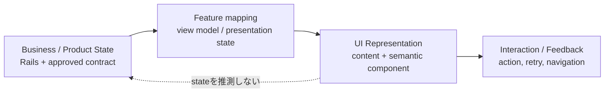
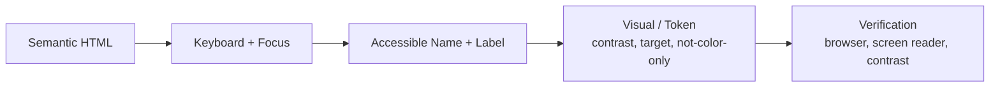

# Module 22: UI Regulation / Accessibility

Status: `COMPLETE / READY_FOR_M23`  
Phase: `TB-23`  
Difficulty: `INTERMEDIATE`  
Prerequisites: `M01`–`M21`（direct curriculum dependencies: `M03`–`M05`, `M18`–`M21`）

## 1. Learning goals

このModuleを終えたLearnerは、次を説明・判断できる。

1. UI RegulationをVisual Style Guideより広い共通Contractとして説明する。
2. 同じ意味・状態・操作へCanonical Component、Semantic Token、共通interactionを適用する。
3. Link/Button、Hover/Focus、Pressed/Selected、Disabled/Loadingを区別する。
4. Product stateを正しいUI stateへ写像し、Empty/Error/Partial等を潰さない。
5. Semantic HTML、keyboard、focus、accessible name/label、contrast、target size、reduced motionを評価する。
6. Form validation、Feedback channel、Destructive Actionを責務に沿って判断する。
7. Responsive、Token、Tailwind、Component責務とAccessibilityを接続する。
8. ExceptionとReview結果を追跡し、Documentationと実測Verificationを区別する。

## 2. UI Regulation fundamentals

UI Regulationは、UIの見た目、操作、状態、Accessibilityを一貫して扱う共通Contractである。

```text
UI Regulation != Visual Style Guide only
```

少なくとも次を統合する。

- visual consistency
- interaction semantics
- Product/UI state representation
- accessibility baseline
- Canonical Component usage
- Responsive/Token/Tailwind compliance
- exception handling and review

「綺麗に見えるか」だけでなく、「意味が正しく、操作でき、状態が伝わるか」を判断する。

## 3. Visual consistency

Canonical Principle:

```text
same meaning + same state + same operation
-> Canonical Component + Semantic Token + common interaction pattern
```

Color、Typography、Spacing、Sizing、Radius、Border、ShadowはDesign Token Contractを正本とする。見た目が近いだけで共通化せず、purpose、state、Product semantics、interaction lifecycleが同じかを確認する。

Featureはlocal compositionを所有できるが、shared visual foundationを再定義しない。

## 4. Canonical Component reuse

新しいComponentを作る前に、owning FeatureとShared UIから同じ責務のCanonical Componentを確認する。

Reuse判断:

- semantic meaning
- interaction contract
- state lifecycle
- accessibility contract
- responsibility/owner
- stable props/variant contract

見た目が同じでも、navigationとactionは別の意味を持つ。逆に見た目が多少違っても、同じcontractをvariantで表せる場合がある。

## 5. Visual and interaction model

| State / control    | Meaning                             | Required behavior                                  |
| ------------------ | ----------------------------------- | -------------------------------------------------- |
| Link               | 別location/resourceへのnavigation   | native `a`をdefault、destinationを持つ             |
| Button             | current contextでのaction           | native `button`をdefault、keyboard activation      |
| Hover              | pointer向け補助feedback             | 唯一の意味/操作手掛かりにしない                    |
| Focus              | keyboard/current interaction target | visible indicatorを保つ                            |
| Active / pressed   | 押下中等の一時state                 | selected/currentと混同しない                       |
| Selected / current | 持続的選択/現在地                   | patternに応じたprogrammatic state                  |
| Disabled           | 操作不能                            | native semantics、visual indication、必要なら理由  |
| Loading            | 処理進行中                          | 二重実行防止、progress/label、必要ならannouncement |

Visual stateとprogrammatic stateは両方必要である。

```text
gray appearance != disabled semantics
selected color  != aria-selected/current automatically
```

## 6. Link vs Button

- Link: navigation。
- Button: action。

見た目ではなくpurposeで選ぶ。`div onclick`はnative keyboard behavior、focus、role、disabled等を自動では持たないためdefaultにしない。Clickable containerを使う場合はnested interactive element、keyboard activation、focus orderを解決する。

## 7. Hover, focus, pressed, selected

Hoverはtouch/keyboard userに存在しない場合があるため補助に留める。

Focus indicatorは「design上邪魔」という理由で削除しない。`:focus-visible`等を使う場合もkeyboard focusが常に識別できることを確認する。

Pressedは一時的interaction、Selected/Currentは持続的stateである。Active Tabなら`aria-selected`等、そのwidget patternに合うprogrammatic stateを持たせる。

## 8. Disabled and loading

Disabled:

- native `disabled`等のsemanticを優先する。
- opacityだけで表現しない。
- keyboard behaviorを正しくする。
- 重要actionでは実行不能理由を理解できるようにする。

Loading:

- repeated submissionを防ぐ。
- 処理対象やbutton labelのcontextを保つ。
- progress/statusを伝える。
- 必要に応じて`aria-busy`またはstatus announcementを使う。

UIのLoadingはrequest/action presentation stateであり、M12のAnalysisJob lifecycle stateそのものではない。

## 9. State representation

| Canonical UI state     | Meaning                          | Representation principle                                    |
| ---------------------- | -------------------------------- | ----------------------------------------------------------- |
| Loading                | request/job/action進行中         | progress、重複防止、既存内容を無理由に消さない              |
| Empty / no data        | 正常取得したが対象0件            | 対象と次の可能行動、Error toneなし                          |
| No current analysis    | entityはあるがcurrent resultなし | start/create/select actionをContractに従い提示              |
| Success                | 明示action成功                   | resultと次state/action                                      |
| Warning                | 継続可能だが注意が必要           | impactと必要action                                          |
| Failed / Error         | operation/result成立せず         | scope、recovery、safe message                               |
| Unavailable            | resource/serviceを利用できない   | unavailable reasonとretry/alternative                       |
| Forbidden              | access denied                    | Empty/Not Foundへ無断変換しない                             |
| Disabled               | action不能                       | semantic stateと理由                                        |
| Partial                | 一部結果のみ成立                 | available/unavailable、coverage、limitation                 |
| Limited                | Product contract上の制約付き結果 | scope、allowed use、next action                             |
| Unsupported historical | 古いrecordを完全表示できない     | explicit historical limitation、silent current fallback禁止 |

これらをGeneric Emptyへ統合しない。

## 10. Product State to UI flow



AnalysisJob `failed`、Partial Result、Forbidden Resource、No AnalysisはProduct semanticsを持つ。UI mapperは意味をgeneric cardや0/emptyへ潰さない。

## 11. Accessibility fundamentals

Accessibilityは、障害の有無にかかわらず、できるだけ多くのUserが情報と操作へ到達できる設計である。

Panoptes v1 baseline:

- Semantic HTML
- Keyboard operation
- Logical focus order and focus management
- Visible focus
- Accessible name and Form label
- Contrast
- Target size
- Reduced motion
- Not color-only
- Appropriate live feedback

Accessibilityは完成後に上から追加する装飾ではなく、Component Contractの一部である。

## 12. Semantic HTML

意味に合うnative elementを優先する。

- `button`: action
- `a`: navigation
- `nav`: navigation region
- `main`: primary content
- heading: document structure
- `form` / `label` / native control
- table/list/dialog等のsemantic structure

Native semanticsをARIAで再実装しない。ARIAは不足する名前・state・relationshipを補うために使い、native behaviorの代替shortcutにしない。

### Heading structure

Headingはvisual sizeではなくdocument hierarchyを表す。`h1/h2/h3`を見た目都合だけで選ばない。Visual typographyはTokenで、document levelはHTML structureで管理する。

## 13. Keyboard and focus

Pointerで可能な操作は原則keyboardでも可能にする。

- Tab: focus移動
- Enter/Space: control patternに応じたactivation
- Escape: dismissible dialog/menu等で適切にclose
- Arrow keys: Tabs/menu等の標準widget patternで必要な場合

Custom widgetではnative patternまたは標準interaction modelを理解する。

Responsive visual reorder時もDOM/focus orderを不自然にしない。

Modal/Dialogではfocus entry、必要なcontainment、close後のtriggerへのfocus returnを考慮する。新しいUI frameworkは本Moduleで導入しない。

## 14. Accessibility responsibility flow



一つだけ満たしてもAccessibility完了ではない。

## 15. Accessible name and label

Interactive controlにはpurposeを表すaccessible nameが必要である。Icon-only close/menu buttonは、見た目のiconだけでなくscreen readerが理解できる名前を持つ。

同じ「詳細」だけではcontextを失う場合、対象を含むnameを検討する。`aria-label`は必要時に使い、visible text/native associationを置き換えるdefaultにしない。

Inputにはprogrammatically associated labelを持たせる。Placeholderは入力後に消え、constraint/error relationshipも表せないためlabelの代替にしない。

## 16. Contrast, color, target size

FS-08 v1 internal baseline:

- Normal text: `4.5:1`以上。
- Large text: `3:1`以上。
- Meaningful UI boundary/focus indicator: `3:1`以上を目標。
- Primary touch control: `44 × 44 CSS px`以上をdefault。
- Dense/inline control: `24 × 24 CSS px`以上、または同等target spacingと例外record。

Tokenが存在するだけでcontrast適合を証明しない。Actual valuesを実測する。

Error、Success、Warning、Selected、Score等を赤/緑/黄などの色だけで示さず、text、icon、label、pattern、positionを併用する。

## 17. Reduced motion

Motionはfeedback、hierarchy、transitionの理解を助ける場合だけ使用する。

- Motion Tokenを利用する。
- `prefers-reduced-motion`を尊重する。
- Nonessential parallax、loop、large transformを停止/短縮する。
- Essential state changeはinstant/fade等で理解可能に残す。
- Hover-only motionへ重要情報を置かない。
- GSAP/SVG timelineはlocal owner、cleanup、route transition behaviorを持つ。

## 18. Form and control rules

- Visible labelをdefaultにする。
- Required/optional、format、constraintを入力前または必要時に示す。
- Validation errorをfieldとprogrammatically関連付ける。
- Errorは問題と修正方法をsafe languageで示す。
- 入力値を無理由に消さない。
- Disabled reasonを必要に応じて示す。
- Loadingではprogressと二重submit防止を組み合わせる。
- Destructive Actionは動詞、対象、impactを明確にする。
- Irreversible/重大な場合だけproportional confirmationを使い、可能ならundo/recoveryを優先する。

Frontend validationはimmediate UX feedback、Rails validationはBusiness truthである。

```text
Frontend valid != Server validation unnecessary
```

## 19. Feedback and notification

| Channel             | Use                                                       | Persistence / action                                       |
| ------------------- | --------------------------------------------------------- | ---------------------------------------------------------- |
| Inline              | field/section/specific content                            | context内に保持、修正/retryを近接                          |
| Toast               | non-blocking success/info                                 | short-lived可、critical detail/唯一のrecoveryを置かない    |
| Banner / Page state | persistent warning、partial、unavailable、page-wide issue | condition解消まで残しimpact/actionを示す                   |
| Blocking dialog     | continuation不能、重大decision、destructive confirmation  | focus management、primary/secondary action、dismiss policy |

Urgency、persistence、recoverability、required actionでchannelを選ぶ。全ErrorをToastや同じred bannerにしない。

Live feedbackではurgent errorとpolite statusを使い分け、同じmessageを重複announcementしない。

## 20. Empty, Error, Partial, Historical

### Empty

No Analysis Yet、Search Result Empty、No Permission、Resource Missing、Failed Loadは意味が違う。正常な0件だけをEmptyとして扱い、ForbiddenやErrorを隠さない。

### Error

Recoverable、Blocking、Field-specific、Unavailable、Forbidden、System Failureを区別し、scopeとrecoveryを示す。Provider/raw errorや機密情報を露出しない。

### Partial / Limited

M18/PD-04に従い、limitation、available information、unavailable information、coverage、next actionを示す。Full Resultの見た目だけ流用して意味を隠さない。

### Unsupported Historical

M15に従い、古いSnapshotを完全表示できない場合はexplicit historical stateまたはview-only limitationを示す。Current dataへsilent fallbackしない。

## 21. Responsive and dense UI accessibility

M21のResponsive adaptationでは、content hide、alternative navigation、DOM/focus order、local scroll、label visibilityを確認する。MobileでError、Result limitation、唯一のaction/navigationを消さない。

Table/Chart/Radar等はvisual representationだけに依存せず、必要に応じてlabel、text summary、data table、keyboard reachability、semantic alternativeを検討する。

Local scrollはkeyboard/touchで到達でき、overflow cueとvisible focusを持つ。

## 22. Component responsibility

| Category          | Accessibility responsibility                                                     |
| ----------------- | -------------------------------------------------------------------------------- |
| Primitive         | minimal stable native/accessible contract                                        |
| UI / Presentation | rendering、name/label、keyboard/focus、presentation interaction                  |
| Composite         | accessible child composition、reading/focus order                                |
| Feature           | use-case orchestration、Product state mapping、loading/error/action coordination |
| Layout / Page     | landmarks、major reading order、navigation、responsive content priority          |

Accessibilityを「後から別layerが追加するもの」にしない。各ownerが自分のcontract内で担う。

## 23. Token / Tailwind compliance

M19/M20に従い、Semantic Token、semantic utility、state/responsive utilityを使う。Hardcoded colorだけでsemantic stateを表現しない。

Token/Tailwindはcontrast、focus style、target sizing等を支援できるが、native semantics、keyboard behavior、ARIA、state mappingを自動で提供しない。

```text
Token/Tailwind used != accessible
```

## 24. Exception process

UI Regulation例外には次を記録する。

```text
Exception ID
Rule being excepted
Reason and evidence
Owner
Scope / affected component or route
Temporary or permanent
Risk and user impact
Fallback / mitigation
Approval
Review date or trigger
Removal criteria where temporary
```

Temporary例外は期限/review triggerなしに承認しない。Permanent例外もToken、Product、Accessibility、Browser Contract変更時に再審査する。

```text
One-off exception != new standard
```

## 25. Review process

新規または大幅変更UIは次を確認する。

1. Taxonomy、owner、state/command boundary。
2. Canonical Component検索とreuse/non-reuse理由。
3. Loading/Empty/Error/Partial/Disabled等のstate contract。
4. Semantic Token、Tailwind、local CSS、exception。
5. FS-07 viewports、overflow、content priority、navigation reachability。
6. Semantic HTML、keyboard、focus、name/label、contrast、target、motion、announcement。
7. Riskに比例したunit/integration/browser/visual evidenceとexception record。

Review result:

- `PASS`
- `PASS_WITH_TRACKED_EXCEPTION`
- `BLOCKED`

Product state/meaningが不明ならUIで推測せずProduct/Backend ownerへ戻す。

## 26. Verification boundary

このModuleはConcept/Contract教材である。実際のconformanceには次が必要になる。

- keyboard test
- screen reader review
- contrast measurement
- target size check
- browser behavior
- reduced-motion behavior
- automated checker
- Responsive viewport and visual review

```text
Documentation complete != Accessibility verified
Source pattern exists   != Runtime behavior verified
```

## 27. Worked example: Submit Form

### Idle

- Associated visible labelとconstraintを示す。
- Buttonはnative action control。
- Focus orderがlogical。

### Client validation error

- Errorを該当fieldへ関連付ける。
- `aria-invalid`/description等のpatternを使う。
- Messageは問題と修正方法を示す。
- Multiple errorsではsummary/focus strategyを検討する。

### Loading

- 二重submitを防ぐ。
- Button label/contextとprogressを維持する。
- 必要ならpolite status announcement。

### Success

- Inline、Toast、navigation等をpersistence/actionに応じて選ぶ。
- 次のstateとactionを明確にする。

### Server error

- Business validationはRails responseを正本とする。
- Field errorならfieldへ、page-wide issueならBanner/Page stateへ配置する。
- Raw provider detailを露出せず、retry/recoveryを示す。

これはinteraction contractの説明であり、正式なUI redesignではない。

## 28. CURRENT / TARGET / DEFERRED

| Classification | Confirmed scope                                                                                                                                                 |
| -------------- | --------------------------------------------------------------------------------------------------------------------------------------------------------------- |
| CURRENT        | Sourceにはnative links/buttons/inputs、labels、`aria-*`、focus style、Toast、Tabs、state UI、SVG labels等の良いpatternとgapが混在する。                         |
| CURRENT caveat | Source reviewだけでkeyboard、screen reader、contrast、target size、reduced motion、Responsive viewportの実動作は証明できない。全UIのRegulation適合宣言はない。  |
| TARGET         | UI Regulation v1をnew/touched UIへ適用し、Canonical reuse、state representation、Accessibility baseline、Responsive/Token compliance、review evidenceを揃える。 |
| DEFERRED       | Full accessibility audit、screen reader/keyboard/browser testing、contrast/target measurement、visual regression、全Component remediation、exception closure。  |

## 29. Representative repository mapping

全UI監査ではなく、FS-08で限定確認済みの12 examplesを教材上で再利用した。

| Source                                    | Confirmed semantic/interaction strength                      | Accessibility concern / Target                                | Status                     |
| ----------------------------------------- | ------------------------------------------------------------ | ------------------------------------------------------------- | -------------------------- |
| `PanoptesSiteHeader.svelte`               | semantic nav/link/button、`aria-expanded`、focus-visible     | compact時の代替navigation未証明                               | CURRENT partial            |
| `LandingHeroPrimaryVisual.svelte`         | SVG title/descriptionとlabel association                     | fixed scale、motion/reduced-motion、contrast未検証            | verify later               |
| `SignUpFields.svelte`                     | associated labels、`aria-invalid/describedby`、native inputs | hidden label方針、contrast/target実測                         | CURRENT good pattern + gap |
| `SignUpBtn.svelte`                        | native button/disabled                                       | loading announcement、disabled reasonはForm統合               | owner coordination         |
| `SignUpFeedback.svelte`                   | field error IDs、`role=alert/status`                         | announcement重複、focus strategy実測                          | browser verification       |
| `PanoptesToastStack.svelte`               | `aria-live=polite`、level区別                                | close control name、Error urgency/persistence                 | remediation candidate      |
| `PanoptesTabNav.svelte`                   | nav label、native buttons                                    | activeがvisual classのみ、selected/current state不足          | remediation candidate      |
| `CompetitorAnalysisCompanyCard.svelte`    | contextual labels、actions、`aria-pressed`                   | truncated full-value access、target/contrast                  | verify later               |
| `CompetitorAnalysisRadarChart.svelte`     | SVG accessible label                                         | graphic role/title/description、numeric alternative、contrast | verify/remediate           |
| `PanoptesAnalysisSurface.svelte`          | empty/failed/loadingを分離                                   | unavailable/partial/limited/historical接続                    | Target state expansion     |
| `StrategyAnalysisRoadmapPhaseCard.svelte` | native button、`aria-pressed`                                | dense keyboard/target/contrast                                | verify later               |
| `SelfAnalysisDualRingGauge.svelte`        | scoreをaccessible labelへ含む                                | graphic role、detail alternative、color-only risk             | verify/remediate           |

これはSource上のpattern/gap確認であり、runtime accessibility conformanceではない。

## 30. Common misunderstandings

| Misunderstanding               | Correction                                |
| ------------------------------ | ----------------------------------------- |
| 見た目が同じ = 同じComponent   | meaning/interaction/lifecycle/ownerで判断 |
| ButtonとLinkはappearanceで選ぶ | action/navigationのpurposeで選ぶ          |
| Opacity = disabled             | native/programmatic stateが必要           |
| Hoverがあればaccessible        | keyboard/touch/focusが必要                |
| Placeholder = Label            | associated labelが必要                    |
| Focus ringを消すと綺麗         | keyboard current targetを失う             |
| Colorだけでstateを示せる       | text/icon/structure等を併用               |
| ToastですべてのErrorを出す     | persistence/scope/actionでchannelを選ぶ   |
| Empty = Error                  | normal zero resultとfailureは別           |
| Partial = Full                 | limitations/coverageを明示                |
| Responsiveでhideすればよい     | priorityと代替導線が必要                  |
| Token/Tailwind = accessibility | semantics、behavior、実測が別途必要       |
| Documentation = Verification   | Runtime conformanceは未証明               |

## 31. Decision heuristic

1. Native semantic elementが使えるか → native first。
2. Same meaningのCanonical Componentがあるか → reuseを検討。
3. Interaction stateはprogrammaticに正しいか → state確認。
4. Keyboardで到達/操作可能か → behavior確認。
5. Accessible name/labelがあるか → semantics確認。
6. Stateがcolor-onlyではないか → multimodal feedback。
7. Error/Empty/Partialを区別するか → correct representation。
8. Semantic Tokenを使うか → visual contract。
9. Responsiveでも意味とfocus orderを失わないか → M21 contract。
10. Exceptionなら追跡可能か → exception record。
11. Runtime verification evidenceがあるか → conformance claim範囲を限定。

## 32. Practice

### A. Knowledge check

1. UI RegulationとVisual Style Guideの違いを説明せよ。
2. Visual stateとprogrammatic stateの違いを説明せよ。
3. Documentation completionとAccessibility verificationの違いを説明せよ。

### B. Semantic element exercise

次をButton / Link / Native form control / generic containerへ分類せよ。

1. 別routeへ移動する「詳細」。
2. Modalを開く「詳細」。
3. Email入力。
4. 装飾用Card wrapper。

### C. State exercise

Hover、Focus、Pressed、Selected、Disabled、Loadingについてtemporary/persistent、programmatic state、required feedbackを説明せよ。

### D. Accessibility review

次の問題を検出せよ。

1. Icon-only buttonにnameがない。
2. Focus outlineを削除し代替がない。
3. Errorを赤いborderだけで示す。
4. `div onclick`だけでActionを実装する。
5. Inputがplaceholderだけを持つ。

### E. Form exercise

Submit FormのValidation Error、Loading、Success、Server Errorについて、button、field、focus、feedback、announcementを設計せよ。

### F. Empty/Error/Partial exercise

No Analysis、0 Search Results、Forbidden、Failed Load、Partial Result、Unsupported Historicalを適切なUI stateへ分類せよ。

### G. Responsive accessibility

Mobileでnavigation linkをhideし、Cardをvisual reorderし、Tabsをlocal scrollへ変える時に必要な確認を挙げよ。

### H. Violation detection

1. `div onclick`。
2. `outline: none`のみ。
3. Placeholder-only input。
4. Errorを赤色だけで表現。
5. Disabledをopacityのみで表現。
6. ForbiddenをEmpty表示。
7. PartialをFull表示。
8. Navigation hide + alternativeなし。
9. Critical failureをToastだけで通知。
10. Tailwind使用だけでaccessibleと判定。

### I. Architecture explanation

「なぜAccessibilityをUI完成後の追加作業ではなくComponent Contractの一部として扱うのか」を、semantics、interaction、reuse、remediation costの観点から説明せよ。

## 33. Answers / explanation guide

### A. Knowledge check

UI Regulationはvisualだけでなくinteraction、state、Accessibility、reuse、exception/reviewを含む。Visual stateは見た目、programmatic stateはbrowser/assistive technology/interactionが理解する意味。Documentationは期待Contractを示すが、runtime keyboard/screen reader/contrast/browser behaviorを証明しない。

### B. Semantic element exercise

1. Link。2. Button。3. Native input + label。4. Non-interactive generic container。

### C. State exercise

Hover/Pressedは主にtemporary、Focusはcurrent keyboard target、Selectedはpersistent choice、Disabledはoperation unavailable、Loadingはprocessing中である。Selected/Disabled/Loading等はappearanceだけでなくcontrol patternに合うstate/behaviorを持つ。

### D. Accessibility review

順にaccessible name欠落、visible focus欠落、color-only violation、native semantics/keyboard欠落、associated label欠落である。

### E. Form exercise

Validation Errorはfield associationとfocus strategy、Loadingは二重submit防止とstatus、Successはappropriate channelと次state、Server ErrorはRails responseをsafe mappingしfield/inline/bannerへscopeに応じ配置する。

### F. Empty/Error/Partial exercise

No Analysisは専用state、0 Resultsだけがnormal Empty、Forbiddenはaccess state、Failed LoadはError、Partialはlimitation付きResult、Unsupported Historicalはexplicit historical compatibility state。相互に潰さない。

### G. Responsive accessibility

同じdestinationへの代替navigation、DOM/focus/reading order、hidden content semantics、active Tab reachability、keyboard/touch local scroll、overflow cue、visible focusを確認する。

### H. Violation detection

順にnative semantics欠落、focus欠落、label欠落、color-only、disabled semantics欠落、Product state誤表現、limitation隠蔽、navigation到達不能、feedback channel不適切、verification不在である。

### I. Architecture explanation

Semantic element、keyboard behavior、name/stateはComponentの構造とinteractionへ組み込まれる。後付けではAPI/markup/state contractを壊して修正するcostが高く、同じ欠陥がreuse先へ拡散する。Accessible contractをPrimitive/UIの初期責務にすれば、一貫したbehaviorを共有しFeatureはProduct state mappingへ集中できる。

## 34. Completion criteria

|   # | Criterion                                       | Result |
| --: | ----------------------------------------------- | ------ |
|   1 | UI Regulation purpose explained                 | `PASS` |
|   2 | Visual/interaction consistency explained        | `PASS` |
|   3 | State representation explained                  | `PASS` |
|   4 | Accessibility fundamentals explained            | `PASS` |
|   5 | Semantic/keyboard/focus explained               | `PASS` |
|   6 | Form/feedback rules explained                   | `PASS` |
|   7 | Empty/Error/Partial distinction explained       | `PASS` |
|   8 | Responsive/Token/Component connection explained | `PASS` |
|   9 | Repository mapping + two diagrams included      | `PASS` |
|  10 | Exercises + answers included                    | `PASS` |

M22 authoring result: `10 / 10 PASS`。教材完成はAccessibility conformance、browser/keyboard/screen reader実測、contrast/target audit、UI remediationの完成を意味しない。

## 35. M23 handoff

Recommended next phase: `TB-24 — Module 23: Security Fundamentals`。

M23ではFrontend/BFF/Rails/Workerのtrust boundary、least privilege、secret、input/output validation、CSRF/XSS/SSRF、dependency/privacy/data handlingを扱う。Security auditやSource hardeningは教材作成と分離する。

## References

- [Module 18: Missing / Partial / Eligibility](./18-missing-partial-eligibility.md)
- [Module 19: Design Token](./19-design-token.md)
- [Module 20: Tailwind](./20-tailwind.md)
- [Module 21: Responsive](./21-responsive.md)
- [Frontend Structure Policy](../../architecture/frontend-structure-policy.md)
- [October Frontend Standardization Plan](../../architecture/frontend-standardization-plan.md)
- [FS-08 UI Regulation](../../audit/128-fs08-ui-regulation.md)
