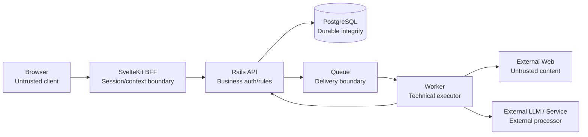
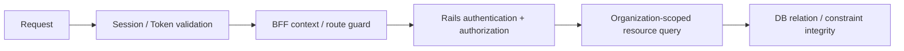

# Module 23: Security Fundamentals

Status: `COMPLETE / READY_FOR_M24`  
Phase: `TB-24`  
Difficulty: `INTERMEDIATE`  
Prerequisites: `M01`–`M22`（direct curriculum dependencies: `M07`–`M15`, `M22`）

## 1. 学習目標（Learning goals）

このModuleを終えた学習者は、次の内容を説明し、判断できます。

1. SecurityをLogin機能ではなくCIA（Confidentiality、Integrity、Availability）を守るArchitecture/Process/Controlとして説明する。
2. PanoptesのAsset、Threat、Trust Boundaryを特定する。
3. Browser、BFF、Rails、DB、Queue、Worker、External Web/LLMを跨ぐDataを再検証する。
4. AuthenticationとAuthorizationを区別し、RailsをApplication Authorization Authorityとして扱う。
5. Organization-scoped resource accessをresource-derived authorizationで判断する。
6. Session/API/Secret/Data/Worker/Artifact/QueueのSecurity境界を説明する。
7. Logging、Audit、Lineage、Dependency/Supply Chainを区別する。
8. CURRENT control、TARGET Architecture、DEFERRED hardeningを混同しない。

本教材はDefensive Securityの基礎であり、penetration test、exploit手順、Production hardeningを行うものではありません。

## 用語ガイド

- **Asset:** 攻撃や事故から守る対象。data、secret、account、service availabilityなどを含む。
- **Threat:** Assetを損なう可能性がある攻撃、誤操作、障害。
- **Trust boundary:** dataやrequestを受け取る側が、入力を再検証すべき境界。
- **Defense in Depth（多層防御）:** 一つの防御が破られても、別の防御で被害を止める設計。
- **Least privilege（最小権限）:** Userやserviceへ、必要な操作に限った最小限の権限だけを与える原則。

## 2. Security fundamentals

Securityは、次の性質を守るためのcontrolの組合せです。

| Property        | Meaning in Panoptes                                                        |
| --------------- | -------------------------------------------------------------------------- |
| Confidentiality | Organization data、Session、Evidence、Secret等を権限のない主体へ漏らさない |
| Integrity       | Job、Snapshot、Score、Membership、Audit等を不正・重複・改ざんから守る      |
| Availability    | API、Worker、Analysisをabuseやresource exhaustionから守り利用可能にする    |

```text
Security != Login only
Security != Backend only
Security != one middleware
```

Securityは各境界のownerが継続して担う。

## 3. Asset model

Panoptesで守る代表Asset:

- User identity and Authentication context
- Organization / Membership / Role
- Project and AnalysisJob
- Analysis Result and Formula/version metadata
- Snapshot / History / Lineage
- Evidence / HTML / Screenshot / Artifact
- Session cookie / access token
- API、LLM、Storage、Database credentials
- Billing-related data and Usage records
- Security/Business Audit trail

保護対象ごとに、機密性・完全性・可用性の重要度、管理責任、保持期間、利用を許可する主体が異なります。具体的なデータ分類や保持期間は、承認済みの範囲だけを使い、教材では新設しません。

## 4. Threat model

ThreatはAssetへ悪影響を与え得る事象です。

- unauthorized access
- cross-tenant data leakage
- privilege misuse
- malicious or malformed input
- session/token abuse
- data/result tampering
- duplicate side effects
- untrusted website behavior
- resource exhaustion
- secret leakage
- dependency/supply-chain compromise
- sensitive logging

Riskは「Threatがある」だけでなく、Asset、entry point、Trust Boundary、existing control、impact、likelihood、detection/recoveryから評価します。

## 5. Trust Boundary map



境界を越えて受け取るDataは、上流で検証済みでも、そのLayerの担当者が自分の契約に照らして再検証します。

## 6. Never trust the Browser

Browserから届く値はUser-controlled inputです。

- `organization_id`
- `project_id`
- role/plan/price/permission
- AnalysisJob status
- score/result metadata
- redirect destination
- hidden/disabled UI state

FrontendはUX validationとpresentationを担当できるが、Canonical Business TruthやAuthorization Proofにはなりません。

```text
button hidden != permission enforced
client role     != canonical role
selected org    != authorization proof
```

RailsがIdentity、Membership、Resource ownership、Operation、Resource stateを再検証します。

## 7. Defense in Depth

一つのcontrolだけへ依存しません。



各layerの役割:

- Frontend: impossible/unauthorized-looking actionを表示しないUX。
- BFF: Session context、route guard、explicit endpoint、safe transport。
- Rails: independent token verification、Business Authorization/Rule。
- DB: relation、constraint、transaction、durable integrity。

一つのLayerにbugや検証の迂回があっても、それだけで別Organizationへの情報漏えいにつながらないようにします。

## 8. Authentication

Authenticationは「誰か」を確認します。

CURRENT direction:

1. Supabase/Auth Providerがidentity/sessionを扱う。
2. SvelteKit serverがcookie/sessionからrequest contextを解決する。
3. BFFがaccess tokenをRailsへBearerとして転送する。
4. RailsがJWTを独立検証し、Canonical Userへmappingする。

RailsのJWT verifierは、tokenのsize、承認済みのalgorithm、`kid`の形式、署名、発行者、利用先、有効期限、利用開始時刻、必須claim、subjectの形式を検証します。BFFでSessionを確認していても、Railsでの検証を省略してよいわけではありません。

## 9. Authorization

Authorizationは「そのUserが、そのResourceへ、そのOperationを実行してよいか」を判断します。

RailsがApplication Authorization Authorityとして確認するもの:

- authenticated User
- active Organization Membership
- role
- Resource owning Organization
- requested operation
- Resource/Product state

```text
authenticated != authorized
```

Login済みでも、他OrganizationのProjectやSnapshotへアクセスできるわけではありません。

## 10. Multi-tenant isolation

OrganizationはTenant Boundaryです。Organization AのUserがOrganization BのProject、AnalysisJob、Snapshot、Evidenceへアクセスできないことを各layerで支えます。

必要なcontrol:

- request/auth context
- Rails authorization
- Organization-scoped query
- resource relation and integrity
- response/data isolation
- auditability

### Resource-derived authorization

URLやcookieのOrganization IDだけを信用しません。

```text
requested resource
-> owning Organization
-> active Membership and Role
-> permitted operation
```

Rails CURRENTのOrganization concernは`params[:organization_id]`に対し、active Membershipとactive Organizationをjoin/scoped queryで照合します。将来のnested resourceもresource ownershipからOrganizationを解決します。

## 11. Session and cookie security

Session/Cookieで考える基本:

- `HttpOnly`: Browser JSから不必要にcredentialを読ませない。
- `Secure`: HTTPS transportで送る。
- `SameSite`: cross-site送信範囲を制御する。
- expiry/refresh/rotation: 長期固定credentialを避ける。
- logout/revocation: local stateだけでなくprovider/session lifecycleを扱う。
- server-side handling: tokenをclient bundleへ埋め込まない。

Exact attributesはCURRENT implementation/configを優先し、未確認値を「設定済み」と断定しません。

### CSRF

Cookie-based authenticationではCross-Site Request Forgeryを考慮します。SameSite、Origin/Referer validation、architectureに応じたCSRF token等が候補になります。本教材では未決定controlを新しい正式Policyにしません。

## 12. XSS and output handling

Cross-Site Scriptingはuntrusted inputを実行可能contentとしてBrowserへ注入するriskです。

Panoptesで注意するもの:

- User-provided text
- External Web content
- HTML/DOM evidence
- LLM/provider output
- dynamic URL/attribute
- raw HTML rendering

Svelteのdefault escapingは重要なcontrolだが、FrameworkだけでXSSが完全解決するわけではありません。Raw HTML、unsafe URL、third-party script、DOM API、sanitization boundaryを個別に確認します。

## 13. Input validation by boundary

| 層（Layer） | 検証する責務                                                                    |
| ----------- | ------------------------------------------------------------------------------- |
| Frontend    | UX、required/format、immediate feedback。Security enforcementではない           |
| BFF         | method/path/context、Session presence、transport shape、explicit proxy boundary |
| Rails       | schema/application validation、Authorization、Business Rule、state transition   |
| PostgreSQL  | type、FK、unique/check、transaction等のdurable integrity                        |
| Worker      | URL/content/size/type/timeout、artifact/result shape、technical provenance      |

一度validateした値も、別Trust Boundaryでは受信側contractへ再検証します。

## 14. API security

M11と接続し、APIでは次を確認します。

- Authentication
- per-resource Authorization
- explicit endpoint/method
- input/schema validation
- safe status/error preservation
- sensitive response minimization
- request/correlation identity
- timeout/rate/resource limit concept
- no blind generic proxy

BFFはtransport boundaryであり、Rails Business Authorizationを代替しません。

### Mass assignment / over-posting

Clientから受け取った値を、無条件にModelへ適用しません。操作ごとに受け付けるfieldを限定し、Serverが管理するfield、Organization、role、status、billing/valueなどをClient入力から上書きさせません。

### ID enumeration / direct object access

Resource IDを知っていることはpermission proofではありません。Deep-link/API requestごとにRailsがUser、Membership、owning Organization、operationを照合します。

### Error security

User-safe errorとinternal diagnosticsを分離します。Stack trace、DB detail、Secret、raw provider response、tokenをresponseへ出さない。BFF CURRENT clientはupstream failureをsafe messageとrequest IDへmappingします。

## 15. Secret management

Secret例:

- API keys
- Database credentials
- JWT/signing-related configuration
- External LLM credentials
- Storage credentials
- webhook secrets

SecretをClient bundle、public environment variable、repository、logへ含めません。Server-only runtimeとapproved Secret Storeを使います。

Environment variableも名前やbuild exposureを誤るとFrontendへ出る。Server-only/privateとpublic/client-exposedを区別し、toolingの規則を優先します。Exact Cloud Secret solutionはInfrastructure Moduleへhandoffします。

## 16. Least privilege

User、Service、Worker、DB accountへ必要最小限のpermissionだけを与える。

例:

- Crawl WorkerにBilling DB全権限は不要。
- Read-only operationへwrite privilegeは不要。
- Artifact accessを全Organizationへ公開しない。
- CI jobへProduction Secretを常時渡さない。

Permissionを役割、resource、operation、environment、期間で狭める。

## 17. PostgreSQL and durable integrity

PostgreSQLはpersistent data、relation、constraint、transactionを担います。Application Authorization AuthorityはRailsであり、Foreign KeyだけではAuthorizationになりません。

```text
FK proves relation integrity
FK does not prove requester permission
```

DB account/schema privilegeもDefense in Depthの一部だが、Exact DB role architectureは未決定なら本教材で新設しません。

## 18. Data protection and minimization

### In transit

TLS等でnetwork上の盗聴・改ざんriskを下げる。

### At rest

Database/Storage encryption等で保存媒体riskを下げる。

```text
encryption != authorization
TLS        != access control
```

Dataを暗号化していても、権限のないユーザーへ正規APIが返してしまえば、情報漏えいは起きます。

必要のないSensitive Dataを収集・保存しません。External Web Evidenceではwhat/why/retention/accessを明確にします。Exact retention policyは未決定なら作りません。

## 19. Evidence and Artifact security

HTML、Screenshot、DOM、LLM output等は外部由来Dataであり、harmlessとは限りません。

Artifactで考えるもの:

- Organization/Job scope
- private access and authorization
- signed/short-lived access where applicable
- content type/size validation
- immutable identity and lineage
- retention/deletion policy
- response headers and rendering boundary

固定public URLへ無条件公開しません。Exact Object Storage designはTARGET/DEFERREDとして扱います。

## 20. Worker / External Web boundary

WorkerはUntrusted External Webへ接触する強いTrust Boundaryです。

代表risk:

- malicious HTML/JavaScript
- huge response/resource exhaustion
- redirect to unexpected destination
- private/internal network access
- malformed file/content type
- browser process abuse
- excessive CPU/memory/time
- poisoned Evidence passed downstream

```text
External URL != safe destination
Fetched content != trusted instruction
```

## 21. SSRF fundamentals

Worker/fetcherがURLへアクセスする場合、Server-Side Request Forgeryを考慮します。

Defensive concerns:

- private/internal addresses
- localhost
- cloud metadata endpoints
- DNS/redirect chain
- protocol/scheme restrictions
- response size/time limits
- network egress policy

具体的bypass techniqueやexploit手順は扱いません。URL validationだけでなくredirect後destinationとnetwork policyも重要です。

## 22. Worker and Chromium isolation

Defense candidates:

- process/container isolation
- restricted filesystem
- network/egress policy
- timeout
- CPU/memory/concurrency limits
- browser sandbox
- cleanup and artifact boundary

Chromiumではuntrusted JavaScript、browser process、sandbox、resource limits、cleanupを考えます。`--no-sandbox`を安易なProduction defaultにしません。Exact runtime command/topologyはInfrastructure/Security implementationへdeferします。

## 23. External LLM boundary

External LLMへ送る前に次を確認します。

- what data is sent
- Organization/tenant context
- data minimization/redaction
- API secret handling
- prompt/application instruction separation
- provider response validation
- provider logging/retention policy
- result provenance/version

### Prompt injection

外部Webの内容は信頼できないDataとして扱い、page内の指示をSystem/Applicationの命令として実行しません。Modelの出力も、候補や導出されたObservationとして扱い、検証なしで業務上の正しい事実として採用しません。

## 24. Queue security and integrity

Queue messageにもJob identity、Organization/context、attempt/sequence、integrity、authorized producer/consumerの論点があります。

```text
Queue delivery != trusted Business Truth
Worker event   != canonical state transition
```

RailsがJob、attempt、current state、Organization、allowed transition、Result shapeを再検証します。

Retry/duplicate deliveryへのIdempotencyはReliabilityだけでなくIntegrityも守る。Double Usage、duplicate Snapshot、duplicate mutationを防ぎます。

## 25. Logging, Audit, and Lineage

| 概念    | 確認する問い                   | 例                                                 |
| ------- | ------------------------------ | -------------------------------------------------- |
| Logging | Systemがどう動いたか           | request ID、error class、latency、technical event  |
| Audit   | 誰が何をいつどの対象へ行ったか | role change、important mutation、privileged action |
| Lineage | 何から何が作られたか           | Evidence→Observation→Result→Snapshot               |

Logへpassword、raw credential、access token、unnecessary personal/sensitive dataを出さない。Rails CURRENTではauthorization、cookie、password系、email、secret、token、JWT、key、OTP、SSN、card security code等をparameter filtering対象としています。

Debug usefulnessとsensitive leakage preventionを両立し、User-safe errorとinternal diagnosticsをcorrelation ID等で結ぶ。

Exact Audit event catalogは未決定なら作りません。

## 26. Dependency / Supply Chain

Panoptesはnpm package、Ruby gem、Python package、browser binary等へ依存します。

- trusted registry/source
- lockfile/version pinning
- vulnerability review
- update ownership/cadence
- build artifact provenance
- CI permissions/secrets
- browser/runtime update

Security updateは重要だが、無検証Production deployもしません。

```text
update -> test/compatibility review -> staged deploy -> monitor
```

具体的scanner/CI導入はM24 Testing / CI/CDへhandoffします。

## 27. Rate and resource abuse

API/Worker/External serviceはresource costを持ちます。

- request rate limits
- concurrent AnalysisJob limits
- Queue depth/backpressure
- Worker timeout/CPU/memory limits
- response/artifact size limits
- retry budget
- provider quota/cost control

Exact quotaはBilling/Infrastructure/Product policyと接続して決めます。本教材で数値を発明しません。

## 28. Fail closed vs fail open

安全な処理に必要な前提を確認できない場合は、推測で許可せず拒否するFail Closedが適切な場面があります。

例:

- Session/Tokenを検証できない → protected resourceを返さない。
- Active Membershipを確認できない → Organization resourceを返さない。
- Business API未実装 → mock successへsilent fallbackしない。

ただしAvailability、recovery、User-safe explanationとのtradeoffがあります。全failureを同じ403へするのではなく、401/403/404/503等のcontractを安全に使い分けます。

## 29. Security UX and Accessibility

Session expiration、Permission Denied、Reauthentication、Destructive Confirmation等をGeneric Errorへ潰しません。Userが何が起き、何をできるかを理解できるようにします。

Security UIもM22のAccessibility Contractへ従います。Keyboard/Screen Reader UserもAuth challenge、Error、Session expired、Forbidden stateを理解・操作できなければなりません。

## 30. Threat scenario: cross-tenant Project request

Scenario: Organization AのUserが、Organization B所有のProject IDをrequestします。

```text
Browser request with project_id
-> BFF validates session/context and forwards explicit request
-> Rails independently authenticates JWT
-> Rails loads Project and derives owning Organization
-> Rails checks active Membership/Role for that Organization
-> mismatch
-> deny without disclosing sensitive resource detail
-> security-relevant result is logged/audited safely
```

重要:

- BrowserのOrganization IDをpermission proofにしない。
- BFF checkだけで完了しない。
- IDが存在することをunauthorized Userへ過剰に漏らさない。
- DB FKだけでRequester permissionを判断しない。

## 31. CURRENT / TARGET / DEFERRED

| 分類           | Confirmed scope                                                                                                                                                                                                                                                                                                 |
| -------------- | --------------------------------------------------------------------------------------------------------------------------------------------------------------------------------------------------------------------------------------------------------------------------------------------------------------- |
| CURRENT        | Supabase server session context、SvelteKit route/BFF guard、safe return path policy、explicit BFF endpoints、Bearer forwarding、Rails JWT independent verification、User mapping、active Organization Membership/Role scope、safe BFF error、OpenAPI Bearer scheme、Rails sensitive parameter filteringがある。 |
| CURRENT caveat | CURRENT endpoints/controlは限定範囲で、Production AnalysisJob/Worker/Artifact/Queue全体のSecurity implementationやformal reviewを証明しない。BFF route guardはRails resource authorizationの代替ではない。                                                                                                      |
| TARGET         | Resource-derived authorization、Production Worker isolation/egress/resource limits、private Artifact access、Queue producer/consumer/integrity、central Secret management、redacted structured logging、Security Audit、rate/abuse control。                                                                    |
| DEFERRED       | SSO/Passkey、full threat modeling、penetration test、formal security review、Infrastructure-specific hardening、full retention/data classification、Production Worker/Queue/Artifact controls、dependency scanner policy。                                                                                      |

Security Moduleの完成はProduction Security Readinessを意味しません。

## 32. Representative repository mapping

Repo-wide Security auditではなく、12 representative sourcesを限定確認した。

| Source                                                                          | 信頼境界・保護対象                   | 確認済みの対策                                                                           | 担当・状態                                 |
| ------------------------------------------------------------------------------- | ------------------------------------ | ---------------------------------------------------------------------------------------- | ------------------------------------------ |
| `src/hooks.server.ts`                                                           | Browser→SvelteKit、Session/route     | auth context、route policy、401/403、private no-store                                    | BFF CURRENT                                |
| `src/lib/server/auth/policy.ts`                                                 | Route/Organization/System role       | public/protected policy、active-membership、fail-closed decision                         | BFF CURRENT                                |
| `src/lib/server/auth/session.ts`                                                | Session/logout                       | provider sign-out + local cookie cleanup boundary                                        | BFF CURRENT                                |
| `src/lib/auth/redirect.ts`                                                      | Browser redirect input               | safe return destination policy                                                           | Frontend/BFF CURRENT                       |
| `src/lib/server/rails/client.ts`                                                | BFF→Rails、access token/API errors   | Session identity match、Bearer forwarding、timeout、safe error、active-org mismatch deny | BFF CURRENT                                |
| `rails/app/controllers/concerns/authentication.rb`                              | Request→Rails identity               | strict Bearer extraction、JWT verifier、Current User mapping                             | Rails CURRENT                              |
| `rails/app/services/auth/supabase_jwt_verifier.rb`                              | External token→Rails                 | algorithm/kid/signature/issuer/audience/time/claim/subject validation                    | Rails CURRENT                              |
| `rails/app/controllers/concerns/organization_authorization.rb`                  | User→Organization resource           | active Membership/Organization scoped query、role check                                  | Rails CURRENT                              |
| `rails/config/initializers/filter_parameter_logging.rb`                         | Logs / Sensitive data                | credential/PII-related parameter filtering                                               | Rails CURRENT                              |
| `docs/api/openapi-draft.yaml`                                                   | API contract                         | global Bearer JWT scheme、public health exception                                        | Target/Current contract evidence           |
| [M14 Worker / Chromium / Collection](./14-python-worker-chromium-collection.md) | Worker→External Web                  | isolation/SSRF/resource/artifact boundaries documented                                   | TARGET; runtime not implemented            |
| [Product Decision Register](../../product/product-decision-register.md)         | Product authorization/data semantics | approved identity/Organization/Result decisions                                          | Canonical decisions; implementation varies |

## 33. Common misunderstandings

| Misunderstanding                | Correction                                           |
| ------------------------------- | ---------------------------------------------------- |
| Login = Authorization           | identityとresource permissionは別                    |
| Hidden button = Security        | Server-side enforcementが必要                        |
| BFFを通る = trusted             | Railsが独立検証する                                  |
| URL ID = permission proof       | resource-derived authorizationが必要                 |
| FK = Authorization              | relation integrityでありRequester permissionではない |
| TLS = Authorization             | transport protectionとaccess controlは別             |
| Encryption = Access Control     | encrypted dataでもauthorized response判定が必要      |
| Framework = XSS完全防止         | unsafe HTML/URL/third-party境界は残る                |
| Queue message = Business Truth  | Rails state/identity検証が必要                       |
| Worker環境はtrusted             | External Webへ接触する強いboundary                   |
| Screenshot/HTMLは無害           | untrusted content/artifactとして扱う                 |
| Loggingは多いほど安全           | Secret/PII leakageを避ける                           |
| SecurityはBackendだけ           | Browser/BFF/Rails/DB/Worker/Operations全体           |
| Client validation = enforcement | UXでありRails/DB validationを代替しない              |

## 34. Decision heuristic

1. Identityか → Auth Provider + Server verification。
2. Session/contextか → SvelteKit/BFF。
3. Resource permissionか → Rails。
4. Tenant relationか → Rails scoped query + DB relation。
5. Input semanticsか → Boundaryごとのvalidation。
6. Secretか → Server-side Secret Management。
7. External Web/LLMか → Worker isolation、validation、data minimization。
8. Durable integrityか → Rails transaction + PostgreSQL constraints。
9. Sensitive operation historyか → Audit。
10. Technical diagnosticsか → Redacted Logging + correlation。
11. Controlを確認できないか → riskに応じFail Closed。

## 35. Practice

### 0. Code Reading

代表mappingから`src/hooks.server.ts`、Rails Authentication concern、Organization Authorization concern、JWT verifier、parameter filterを辿り、「どのTrust Boundaryで、何を検証し、次のLayerへ何を渡すか」を表にしてください。

### A. Knowledge check

1. Confidentiality、Integrity、AvailabilityをPanoptes例で説明してください。
2. SecurityがLogin機能だけではない理由を説明してください。
3. Validationを各Boundaryで繰り返す理由を説明してください。

### B. Trust Boundary exercise

Browser→BFF→Rails→DB→Queue→Worker→External Web/LLMで、各Boundaryのuntrusted input、owner、validationを列挙してください。

### C. Authentication vs Authorization

次を分類してください。

1. JWT signature/issuer/audienceを検証する。
2. UserがProjectを更新できるか判定する。
3. Active Membershipを確認する。
4. SessionからUser identityを解決する。

### D. Tenant isolation

Organization AのUserがOrganization BのSnapshot IDをrequestした。Browser、BFF、Rails、DBの役割を説明してください。

### E. Validation exercise

Email format、API request shape、Project ownership、Foreign Key、External URL/response sizeをFrontend/BFF/Rails/DB/Workerへ分類してください。

### F. Secret exercise

Access token、LLM API key、public site URL、Database password、request IDのうち、Client/public env/logへ出してはいけないものと理由を述べてください。

### G. Worker security exercise

External URL collection時のSSRF、redirect、resource limit、Browser isolation、Artifact access、Prompt Injection boundaryを説明してください。

### H. Violation detection

1. Browser roleをそのままtrustする。
2. Hidden buttonだけでpermission制御する。
3. orgId cookieだけでresourceを許可する。
4. BFF AuthorizationだけでRails再検証しない。
5. Secretをpublic envへ置く。
6. Raw access tokenをlogへ出す。
7. External URLを無制限にWorker fetchする。
8. Artifactを固定public URLにする。
9. Queue messageだけでBusiness transitionを確定する。
10. Dependency updateを無検証deployする。

### I. Architecture explanation

「なぜPanoptesではSecurityを一箇所で守らずDefense in Depthで設計するのか」を、boundary、owner、failure containment、auditabilityの観点から説明してください。

## 36. Answers / explanation guide

### 0. Code Reading

`hooks.server.ts`はFrontend server boundaryでSession/route policyを扱い、Rails Authentication concernとJWT verifierはBusiness API boundaryでtoken/identityを再検証します。Organization Authorization concernはresourceとMembership/Roleを結び、parameter filterはdiagnostic logへのcredential/sensitive value露出を抑える。いずれも単独でSecurity全体の正本になるのではなく、自Layerのcontrolを担当します。

### A. Knowledge check

ConfidentialityはTenant data/Secretを守ること、IntegrityはJob/Snapshot/Membershipを正しく保つこと、AvailabilityはAPI/Workerをabuseやfailureから利用可能にすること。Loginはidentity確認に過ぎず、Authorization、validation、isolation、data/operation controlsが別途必要。Boundaryごとにownerとassumptionが変わり、上流controlのbug/bypassを封じるため再検証します。

### B. Trust Boundary exercise

Browser inputはBFFがSession/transportを、RailsがJWT/Business authを、DBがintegrityを、Queue/RailsがJob identity/transitionを、WorkerがURL/content/resourceを、External LLM boundaryがdata minimization/output provenanceを確認します。

### C. Authentication vs Authorization

1と4はAuthentication。2と3はAuthorization（3はpermission判断のinput）。

### D. Tenant isolation

Browser IDはuntrusted。BFFはSession/contextを確認してexplicit requestを送る。RailsはJWTを再検証し、Snapshotからowning Organizationを導出してMembership/Roleを確認します。DB relationはownership linkを保証するが、Authorization decisionはRailsが行います。不一致はsafe denyします。

### E. Validation exercise

Email formatはFrontend UX + Rails canonical validation、request shapeはBFF/Rails、Project ownershipはRails、FKはDB、External URL/redirect/content sizeはWorkerで検証します。

### F. Secret exercise

Access token、LLM API key、Database passwordはClient/public env/logへ出さない。Public site URLとrequest IDは通常Secretではないが、context/PII policyを確認します。

### G. Worker security exercise

Destination/redirectを検証しprivate networkを防ぎ、timeout/size/CPU/memoryを制限し、Browserを隔離・cleanupします。ArtifactはTenant-scoped private accessとlineageを持たせる。External contentをLLM instructionとして信用せず、送信Dataとprovider policyを制限します。

### H. Violation detection

順にClient trust、UI-only auth、selected context誤用、single-layer enforcement、Secret exposure、credential leakage、SSRF/resource abuse、Artifact leakage、Queue trust/state integrity violation、Supply Chain/compatibility riskです。

### I. Architecture explanation

各boundaryではfailure modeとownerが異なります。Browser/BFF/Rails/DB/Workerそれぞれが自分のcontractを検証すれば、一層のbugやbypassを次の層で封じ、cross-tenant leakやtamperingのimpactを限定できます。複数controlとcorrelation/auditにより、preventionだけでなくdetection、investigation、recoveryも可能になります。

## 37. Completion criteria

|   # | Criterion                                       | Result |
| --: | ----------------------------------------------- | ------ |
|   1 | Security fundamentals explained                 | `PASS` |
|   2 | Asset/Threat/Trust Boundary explained           | `PASS` |
|   3 | Defense in Depth explained                      | `PASS` |
|   4 | Authentication/Authorization boundary explained | `PASS` |
|   5 | Session/API/Tenant security explained           | `PASS` |
|   6 | Secret/Data protection explained                | `PASS` |
|   7 | Worker/External Web security explained          | `PASS` |
|   8 | Logging/Audit/Supply Chain explained            | `PASS` |
|   9 | Repository mapping + two diagrams included      | `PASS` |
|  10 | Exercises + answers included                    | `PASS` |

M23 authoring result: `10 / 10 PASS`。教材完成はProduction Security Readiness、formal threat model、penetration test、Infrastructure/Worker hardeningの完成を意味しません。

## 38. M24 handoff

Recommended next phase: `TB-25 — Module 24: Testing / CI/CD`。

M24ではunit/contract/integration/E2E/visual/accessibility/security-oriented test、quality gate、CI/CD、deployment verificationを扱います。Pipeline実装やDependency scanner導入は教材作成と分離します。

## References

- [M07 BFF](./07-bff.md)
- [M08 Rails Business Backend](./08-rails-business-backend.md)
- [M09 PostgreSQL / Source of Truth](./09-postgresql-source-of-truth.md)
- [M10 Auth / Authorization / Organization](./10-auth-authorization-organization.md)
- [M11 API / OpenAPI](./11-api-openapi.md)
- [M13 Async Job / Queue / Retry / Idempotency](./13-async-job-queue-retry-idempotency.md)
- [M14 Python Worker / Chromium / Collection](./14-python-worker-chromium-collection.md)
- [M15 Snapshot / History / Lineage](./15-snapshot-history-lineage.md)
- [M22 UI Regulation / Accessibility](./22-ui-regulation-accessibility.md)
- [Frontend Structure Policy](../../architecture/frontend-structure-policy.md)
- [Product Decision Register](../../product/product-decision-register.md)
