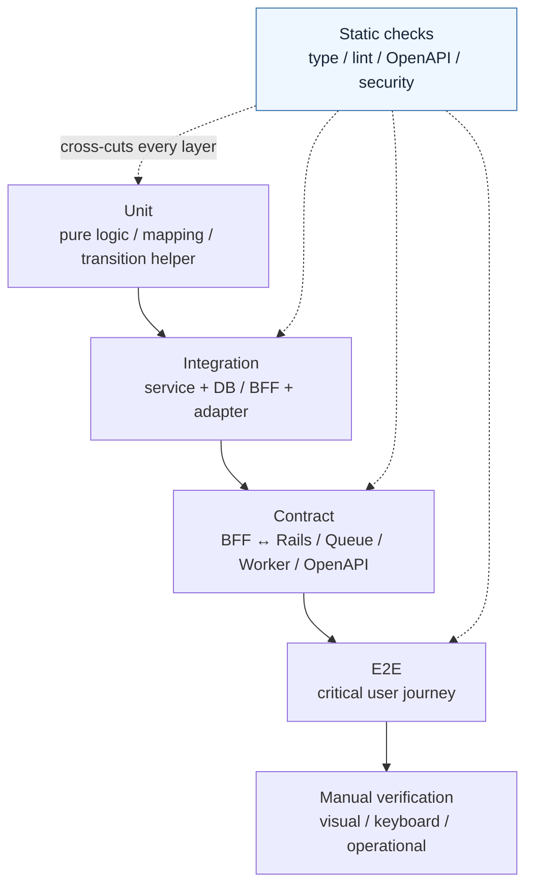
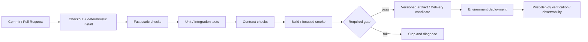

# Module 24: Testing / CI/CD

Status: `COMPLETE / READY_FOR_M25`  
Phase: `TB-25`  
Difficulty: `INTERMEDIATE`  
Prerequisites: `M01`–`M23`（direct curriculum dependencies: `M03`, `M04`, `M06`–`M18`, `M22`, `M23`）

## 1. Learning goals

このModuleを終えたLearnerは、次を説明・判断できる。

1. Testingを「期待するContractやBehaviorが壊れていないことを再現可能に検証する仕組み」として説明する。
2. Unit、Integration、Contract、Component、E2E、Static Checkを、速さではなく守る対象と境界で選ぶ。
3. Frontend、BFF、Rails、DB、Worker、Cross-layerの各ownerにTestを配置する。
4. Authorization、AnalysisJob、Retry/Idempotency、Formula、Missing/Partial、Snapshot/Lineageの重要invariantをTest設計へ変換する。
5. CI、Continuous Delivery、Continuous Deployment、Deploy、Releaseを区別する。
6. Build、Type、Lint、Coverage、ScannerのPASSが保証する範囲と、保証しない範囲を説明する。
7. Regression、Flaky Test、Test Isolation、Mock/Stub/Fakeのtrade-offを判断する。
8. CURRENT実装、TARGET portfolio、DEFERRED verificationを混同しない。

本教材はTesting/CI/CDの学習資料である。Test追加、workflow変更、Dependency追加、Build/Test/Quality/Security scan、Deploymentは行わない。

## 2. Testing fundamentals

Testingは、期待するContract、Behavior、Invariantを入力と観測可能な結果へ落とし、変更後も同じ期待を満たすか再現可能に確認する仕組みである。

```text
Test PASS != Bugが存在しない証明
Test PASS  = 記述された条件と観測範囲では期待を満たしたというEvidence
```

Testの価値は件数ではなく、次の問いへ答えられるかで決まる。

- 何を守るか。
- どのLayerがそのContractを所有するか。
- Failureをどの粒度で特定したいか。
- どの依存を実物で接続し、どこをcontrolled doubleへ置き換えるか。
- False confidenceを生まないか。

## 3. What tests protect

| Protected concern | Panoptes example | Primary test candidate |
| --- | --- | --- |
| Behavior | Button callback、polling停止 | Unit / Component |
| Business rule | 許可されたJob transition | Rails Unit / Integration |
| API contract | Request/response/status/operationId | Contract |
| State transition | terminal後の不正遷移拒否 | Unit + DB Integration |
| Data integrity | FK、uniqueness、transaction | DB Integration |
| UI behavior | Loading/Failed/Partial表示 | Component + focused E2E |
| Authorization | wrong organizationの拒否 | Rails Integration + critical E2E |
| Idempotency | duplicate requestで副作用1回 | Integration |
| Regression | 過去Bugの再発防止 | EscapeしたLayerに最も近いTest |

一つのTestが全Concernを守る必要はない。むしろ「何を守るTestか」を狭く説明できる方がfailureを診断しやすい。

## 4. Test portfolio, not a single pyramid

Test Pyramidは、一般に速く局所的なTestを広い土台にし、接続範囲が広く高価なTestを絞る考え方である。しかし実際には、Panoptesのriskに合わせたTest Portfolioとして扱う。



Static、Unit、Integration、Contract、Component、E2E、Security-oriented check、Manual verificationを組み合わせる。M23のDefense in Depthと同様、一種類のTestへ安全性を委ねない。

## 5. Unit Test

Unit Testは小さいlogicを外部依存からできるだけ切り離して検証する。

Panoptes候補:

- selector、formatter、view-model mapper
- AnalysisJob state mapping / terminal判定
- Eligibility、Missing/N/A/Unknown/Valid Zeroの判定helper
- Formula helper（exact formulaが承認・実装された後）
- safe redirect、error mapping、polling decision

速く、failure原因を限定しやすい。一方、DB constraint、HTTP serialization、routing、real adapter接続は保証しない。

## 6. Integration Test

Integration Testは複数の実装単位またはLayerの接続を検証する。

- Rails Model + PostgreSQL constraint/transaction
- Controller + Authentication/Authorization + Service
- BFF proxy + upstream response mapping
- Worker parser + normalization + artifact metadata
- Queue consumer + Job transition + idempotency store

すべてのUnitがPASSしても、route、schema、transaction、serialization、timeoutの接続は壊れ得る。逆に、Integrationだけでは細かな条件分岐の網羅とfailure diagnosisが重くなる。

## 7. Contract Test

Contract TestはLayer間Interfaceの双方が同じ約束を理解しているかを検証する。

Panoptesでは特に次が重要になる。

- OpenAPI endpoint / method / request / response / status / operationId
- SvelteKit BFF ↔ Rails
- Rails ↔ Queue / Worker event
- Formula input/output、formula version
- Snapshot projection / historical resource
- Frontend API type / canonical adapter

OpenAPI fileがparse可能でも、Rails routeとFrontend adapterが一致するとは限らない。Schema validation、implementation route、consumer expectationを段階的に結ぶ必要がある。

## 8. Component / UI Test

Component Testはrender、props、presentation state、callback、local interactionを検証する。Feature command/APIをComponentへ持ち込むのではなく、M04のBoundaryに従ってcallback contractをTestする。

重要なUI state:

- Loading
- Empty / No current analysis
- Failed
- Forbidden
- Partial / Limited
- Unsupported Historical
- Disabled / Unavailable

`Partial`をgeneric Emptyに潰さない、`Forbidden`をFailedに見せない、`Valid Zero`をMissingに変換しない、といったM18/M22の意味境界を守る。

Automated accessibility checkはaccessible name、label、role、ARIA misuseの一部を検出できる。しかしKeyboard操作、screen reader理解、focus order、contrast/visual contextの実測を完了させるものではない。

## 9. End-to-End Test

E2EはUser perspectiveで複数Layerを通るFlowを検証する。

価値が高い候補:

- Login → Organization selection → App entry
- Organization-scoped deep-link
- Analysis開始 → progress → terminal result
- Authorization denialを含むcritical route
- Historical Snapshot表示

E2Eは実環境に近い一方、遅く、failure原因が広く、setupも高価である。Pure formula計算をE2Eだけで守らず、最小のUnit/Contractとcritical journeyのE2Eを組み合わせる。

## 10. Static, build, type, and lint checks

| Check | Detects | Does not prove |
| --- | --- | --- |
| Type / Svelte check | shape mismatch、nullable misuse、template/type error | Runtime business correctness |
| Lint | suspicious pattern、code/policy consistency | Behavior correctness |
| Format check | deterministic formatting | Quality or security |
| OpenAPI validation | document shape、required metadata、local ref等 | Runtime implementationとの完全一致 |
| Build | Production bundle生成可能性 | User flow / business rule correctness |
| Secret boundary check | 定義されたclient exposure pattern | 全Secret漏洩が不存在 |
| Static security scan | 既知pattern / rule match | Security completion |

`Build PASS`、`Type PASS`、`Lint PASS`は有用なEvidenceだが、相互の代替ではない。

## 11. Database and business invariant tests

DB Testはconstraint、relation、transaction、uniqueness、persistenceを守る。UI TestでDB invariantを代替しない。

例:

- Membership role/statusの許可値
- Organization/Project/Snapshot relation
- Idempotency key uniqueness
- Transaction失敗時のpartial write防止
- terminal Jobへの不正transition拒否
- Snapshot immutability

RailsはBusiness Ruleの正本であり、Rails/DB boundaryのTestはFrontend fixtureだけのTestよりCanonical decisionに近い。

## 12. Authorization tests

Tenant isolationはHappy Pathだけでは守れない。最低限のtest design candidate:

1. Active allowed member
2. Non-member
3. Wrong Organization
4. Insufficient Role
5. Suspended User/Membership/Organization
6. Foreign Resource ID
7. Selected Organizationとresource ownerの不一致

Browserのhidden buttonやBFFだけの拒否は補助controlであり、Railsのresource-derived authorizationをTestする。Cross-tenant IDは404等のsafe responseで存在を漏らさないcontractも対象となる。

## 13. AnalysisJob and async tests

M12/M13から次をTestへ落とす。

- valid transition / invalid transition
- terminal immutability
- `partially_completed`と`failed`の区別
- RetryとReanalysisの区別
- eventual completion / timeout / cancellation
- duplicate delivery
- stale responseの無視
- progress pollingの停止条件

Retry Testは「再試行されるか」を守る。Idempotency Testは「同一Request/Messageが複数回処理されても、Snapshot、Usage、Billing、mutation等の副作用が重複しないか」を守る。両者は同じではない。

Async Testでarbitrary sleepや無限waitに依存するとFlakyになりやすい。Clock、event、polling boundaryを制御し、明示的timeoutとeventual assertionを使う設計が望ましい。

## 14. Worker tests

Worker候補:

- HTML parserとnormalization
- Screenshot/HTML artifact metadata
- timeout / technical failure classification
- content size / URL validation
- pipeline stage combination
- output envelope / provenance

外部Websiteは変更・停止・rate limit・地域差を持つ。Production external siteへ常時依存するTestを基本suiteの中心にせず、captured fixture、local fake server、narrow integration、別枠canary等に責務を分ける。

M14のWorkerは多くがTARGETである。runtime未実装部分は「既存Testがある」と書かず、Target Test Designとして扱う。

## 15. Formula, completeness, and eligibility tests

M17/M18の重要case:

- deterministic input/output
- formula/profile/versionの固定
- Missing、N/A、Unknown、Partial、Valid Zero
- layer/axis completeness
- eligibility decision
- no silent zero fill
- no silent current-version fallback

Exact Formula parameterやthresholdが未決定なら、数値expectedを発明しない。承認済みContractのstate separation、version preservation、failure behaviorを先にTest Designへする。

## 16. Snapshot / History / Lineage tests

Snapshotで守るもの:

- committed Snapshotのimmutability
- historical resource identity
- Evidence / Observation / Result lineage
- formula/axis/order version preservation
- unsupported historical state
- current stateへのsilent fallback禁止

単に画面がrenderできるTestでは、historical truthが現在値にすり替わっていないことを保証できない。

## 17. Regression workflow

Regression Testは一度修正したBugや重要Behaviorの再発を検出する。

```text
Bug reproduction
  -> Failing test
  -> Fix
  -> Passing test
  -> CI gate
```

先に再現できれば、修正が本当に対象Bugへ効いたかを確認できる。Test配置は「Bugが見えた場所」だけでなく「どのContractが欠けたか」で決める。

## 18. Test data and isolation

Test dataはdeterministic、minimal、representativeにする。Production Dataへ依存せず、Tenant testではOrganization A/BとMembershipを明示的に分ける。

各Testは可能な限り、次へ依存しない。

- 他Testの実行順
- 共有DB/global state
- current wall-clock
- uncontrolled randomness
- uncontrolled network
- 前回runのartifact

Isolationは現実をすべてMockする意味ではない。重要Integrationはreal boundaryで検証し、Test間の副作用を分離する。

## 19. Mock, Stub, Fake, and over-mocking

| Double | Main purpose |
| --- | --- |
| Mock | 呼出し回数・引数などinteraction expectation |
| Stub | controlled responseを返す |
| Fake | 簡略化したworking implementation |

Libraryごとの用語差はあるためRepositoryのAPIを優先する。Mockを増やすほど品質が高くなるわけではない。すべての境界をMockすると、Productionでは成立しないInterface同士がTest内だけで一致し得る。

原則は、外部・非決定的境界をcontrolled doubleへ置き換え、重要な内部integrationとshared contractは別Testで実物接続することである。

## 20. Flaky tests

Flaky Testは同じCode/期待でもPass/Failが不安定なTestである。

原因候補:

- timing / async race
- external network
- shared mutable state
- execution order
- uncontrolled time/randomness
- browser animation/layout
- resource shortage

Retryで緑にするだけでは根因を直さず、real regressionも隠す。再現条件を集め、ownerを持たせ、isolate/fixする。必要なquarantineは一時的・追跡可能にする。

## 21. CI fundamentals

Continuous Integrationは、変更を頻繁に統合し、変更ごとにautomated check/testを実行してintegration riskを早く検出する仕組みである。

```text
CI != Deploy
CI PASS != Production readiness
```

CURRENTのFrontend GitHub ActionsはPR、main push、manual dispatchでNode品質checksを実行する。Rails workflowはPR/main pushでPostgreSQL serviceとRails test/lint/security checksを実行する。これは確認済みpipelineの説明であり、branch protectionやrequired check設定そのものの確認ではない。

## 22. CI pipeline and fast feedback



速いCheckを先に置けばFail Fastになる。一般候補はlint/type → unit → integration/contract → build/E2Eだが、exact順序はcost、parallelism、riskと現行workflowに従う。

Required Gateはmerge/deploy前に必須とするcheckである。Formal gate setやbranch protectionは運用決定が必要であり、本教材から新設しない。

### CURRENT observation

- `package.json`の`quality`はcheck、lint、format、OpenAPI、frontend inventory、unit、auth smoke、build、secret、route smokeを連結する。
- `.github/workflows/quality.yml`は個別commandを実行し、限定確認時点では`check:frontend-inventory`を含まない。Local `quality`とCI workflowは同一commandではない。
- `.github/workflows/rails-quality.yml`はRails test、RuboCop、Brakeman、bundler-auditを実行する。

差異は「直ちに不正」と断定せず、意図したGate setかをM25以降の実装・運用判断で確認する。

## 23. CD, Deploy, and Release

Continuous Deliveryは、validated artifactをいつでもEnvironmentへ届けられる状態に保ち、Production反映にhuman approvalを残し得る。Continuous Deploymentは、合格変更を自動でProductionまで反映する方式である。

```text
CI          = integrate and verify
Delivery    = releasable artifact/stateを用意
Deployment  = Environmentへ配置
Release     = Userへ機能を有効化
```

Feature FlagはDeployとReleaseを分離できる一般概念だが、Panoptesでの採用を本教材では決定しない。

## 24. Deployment gate, environment, and rollback

Environmentは概念上local、development、staging、production等に分かれる。環境差を小さくしつつ、Secret、Data、permissionは分離する。

Deployment Gate候補:

- required CI checks
- artifact identity/version
- migration compatibility
- environment approval
- smoke/health check
- observability/rollback readiness

DB changeでは`expand → migrate/backfill → contract`のcompatibilityを考える。Destructive migrationはcode rollbackだけで元に戻らない場合があるため、rollback planはapplicationとdataの両方を扱う。

Panoptesの正式CD platform、environment topology、approval、rollback方式は確認範囲で確定していないためTARGET/DEFERREDとして扱う。

## 25. Security in CI

M23と接続するCandidate:

- dependency vulnerability check
- static security analysis
- secret exposure detection
- least-privilege CI credential
- protected environment secret
- artifact/dependency provenance

CURRENT Rails CIにはBrakemanとbundler-auditがあり、Frontend qualityにはclient secret boundary scriptがある。これらのPASSはSecurity完了、penetration test、runtime isolation、Zero vulnerabilityを意味しない。

CI Secretはlogへ出さず、最小permission、environment separation、短命credential/approved secret mechanismを検討する。Exact platform solutionはInfrastructure Moduleへhandoffする。

## 26. Coverage and what not to test

Coverageは「実行されたCode」のMetricであり、assertionの質、missing requirement、Production interactionを直接示さない。

```text
100% coverage != Bugなし
low-value assertion x many != protected contract
```

Exact coverage targetは新規決定しない。Riskの高いBusiness/Authorization/Contract/Invariantを優先する。

Private implementation detailだけを固定するTestはrefactor耐性が低い。可能ならBehavior、Contract、Invariantを検証し、内部構造の変更を不要に阻害しない。

## 27. Testing by layer

| Layer | Owns tests for | Must not claim |
| --- | --- | --- |
| Frontend UI | render、props、callback、UI state、a11yの自動検出可能部分 | Rails business authorization |
| Feature / Controller | state transition request、mapping、command coordination | DB durability |
| SvelteKit BFF | session/context、proxy、status/error、timeout | Canonical business decision |
| Rails | business rule、authorization、transaction、canonical transition | Browser visual behavior |
| PostgreSQL | constraint、relation、uniqueness、atomic persistence | User journey |
| Worker | technical collection/parser/artifact/failure behavior | Product business truth |
| Cross-layer | OpenAPI/queue/result contract、critical E2E | 全caseのexhaustive proof |

## 28. Change-to-test matrix

| Change | Minimum candidate | Why |
| --- | --- | --- |
| UI label/callback | Component/static | Presentation contractに近い |
| UI Product state mapping | Unit + Component | Meaningとrenderの両方を守る |
| Authorization rule | Rails auth Unit/Integration + critical E2E | Canonical denyとjourneyを確認 |
| OpenAPI response | Validator + Contract + frontend adapter | Producer/consumer driftを防ぐ |
| BFF timeout/error | BFF Integration | HTTP/session boundaryを守る |
| Formula logic | Formula Unit + version/eligibility | deterministic invariantを局所化 |
| Queue retry | Async Integration + Idempotency | duplicate deliveryの副作用を確認 |
| AnalysisJob transition | Rails Unit/DB Integration | Canonical lifecycleを守る |
| Snapshot schema/projection | Immutability/Lineage Contract | Historical truthを守る |
| DB migration | Migration/compatibility Integration | deploy前後のschema共存を確認 |
| Fixed escaped bug | Reproduction Regression + relevant layer | 再発防止を明示 |

## 29. Worked example: cross-tenant Snapshot deep-link

Bug: Organization AのUserが、URLへOrganization BのSnapshot IDを入れると閲覧できる。

1. Missing controlを特定する。Browser/BFFがIDを隠すことではなく、RailsがSnapshotからowning Organizationを導出してMembership/Roleを検証すべきである。
2. Rails authorization integration testを追加する設計にする。A member + B Snapshotでsafe deny、B memberでallow、foreign IDの存在を漏らさないresponseを確認する。
3. BFF testではstatus/errorを改変せず安全に伝播し、session/context mismatchを扱う。
4. Critical routeならE2E regressionでdeep-linkから表示されないことを確認する。
5. DB relation testはSnapshot→Organization lineageを守るが、Authorization decision自体の代替ではない。

一つのE2Eだけではfailure原因が広い。RailsのCanonical controlとcross-layer journeyの両方を、異なる目的で守る。

## 30. CURRENT / TARGET / DEFERRED

### CURRENT — representative inspectionで確認できたもの

- Frontend: Vitest `node` environment、`tests/unit/**/*.test.ts`
- `check`、ESLint、Prettier、Vitest、OpenAPI validation、inventory check、auth/route/secret smoke、buildを含むnpm scripts
- OpenAPI document shape/operationId/local refを確認するvalidator
- Auth guard、BFF proxy、Organization scope、API adapter、AnalysisJob mapping、Snapshot view-model等のVitest
- Rails: Minitest、PostgreSQL-backed CI、API/Auth/Organization/OpenAPI/identity/JWT tests
- GitHub ActionsのFrontend/Rails quality workflows
- Rails CIのRuboCop、Brakeman、bundler-audit

これらは2026-10-07の限定的な代表ファイル確認であり、Test全件監査や実行結果ではない。Historical quality baselineを現在のPASS件数・状態として扱わない。

### TARGET

- Layer ownershipとriskに沿ったautomated portfolio
- BFF↔Rails、Rails↔Worker、Queue、Formula、Snapshotのcontract coverage
- Canonical Authorization/Idempotency/State transitionのintegration coverage
- critical journeyのfocused E2E
- accessibility/security/dependency checkとmanual verificationの組合せ
- Local qualityとCI required gateの意図的な整合
- versioned artifact、environment gate、post-deploy verification

### DEFERRED

- full browser/device matrix
- full visual regression
- screen reader/keyboard/manual accessibility verification
- performance/load/chaos testing
- Worker/Queue runtimeに対するcomplete integration suite
- Production deployment automation、environment topology、advanced release strategy
- coverage threshold、formal required gate、branch protectionの新規決定
- security hardening、penetration test、runtime monitoring

## 31. Representative repository mapping

| Representative | Test/check type | Protected contract | Scope / status |
| --- | --- | --- | --- |
| `package.json` | Command composition | Local check/test/quality entry | `CURRENT` |
| `vitest.config.js` | Test configuration | Unit location、Node env、alias/stub | `CURRENT` |
| `.github/workflows/quality.yml` | CI | Frontend static/test/build/smoke sequence | `CURRENT` |
| `.github/workflows/rails-quality.yml` | CI / Security | Rails+PostgreSQL、lint、security/dependency check | `CURRENT` |
| `scripts/validate-openapi.mjs` | Static contract | OpenAPI 3.1、path、operationId、response、ref | `CURRENT` |
| `tests/unit/api-contract.test.ts` | Contract-oriented Unit | OpenAPI IDs、mock client surface/shape | `CURRENT` |
| `tests/unit/auth-guard.test.ts` | Unit | route policy、mock boundary、safe return URL | `CURRENT` |
| `tests/unit/rails-bff.test.ts` | BFF Integration-style Unit | token/context forwarding、status、timeout、scope | `CURRENT` |
| `tests/unit/organization-scoped-bff-client.test.ts` | Contract/Feature Unit | envelope、HTTP mapping、explicit Organization | `CURRENT` |
| `tests/unit/analysis-job-adapter.test.ts` | Unit | canonical state mapping、terminal/polling behavior | `CURRENT` |
| `rails/test/integration/api_v1_boundary_test.rb` | Rails Integration | auth、Membership/Role、Organization isolation | `CURRENT` |
| `rails/test/integration/openapi_contract_test.rb` | Contract | implemented Rails readsとOpenAPI route | `CURRENT` |

補助確認として、`rails/test/models/identity_boundary_test.rb`はSupabase subject identityとrole/status invariantを、`rails/test/services/auth/supabase_jwt_verifier_test.rb`はJWT/JWKS failure behaviorを守る。

## 32. Common misunderstandings

- Test PASS = Bugなし、ではない。
- Build PASS = Behaviorが正しい、ではない。
- Type Check PASS = Runtimeが正しい、ではない。
- E2EがあればUnit不要、ではない。
- Unitが多ければIntegration不要、ではない。
- Mockが多い = Test品質が高い、ではない。
- Coverage 100% = 完全、ではない。
- Flaky Testはretryで隠せばよい、ではない。
- CI = CD、ではない。
- Deploy = Release、ではない。
- Accessibility checker PASS = Accessibility完了、ではない。
- Security scanner PASS = Security完了、ではない。
- Historical quality baseline = current repository state、ではない。

## 33. Decision heuristic

1. Pure logicか。→ Unit。
2. DB/service接続か。→ Integration。
3. Layer Interfaceか。→ Contract。
4. UI render/interactionか。→ Component。
5. Critical user journeyか。→ Focused E2E。
6. Type/style/document shapeか。→ Static Check。
7. Tenant/Authorizationか。→ Rails canonical test + Integration + critical E2E。
8. Retry/duplicate deliveryか。→ Async + Idempotency Integration。
9. Historical invariantか。→ Snapshot/Lineage Contract。
10. 一度escapeしたBugか。→ Reproduction Regressionを最も近いownerへ置く。

## 34. Practice

### A. Knowledge Check

1. Test PASSが「Bugなし」を意味しない理由を述べよ。
2. Build、Type、Lintがそれぞれ守る範囲を述べよ。
3. CIとCD、DeployとReleaseを区別せよ。

### B. Test Type Classification

次をUnit、Integration、Contract、Component、E2E、Staticへ分類せよ。

1. `partially_completed`をterminalとして扱うpure mapper。
2. Rails transactionとPostgreSQL uniqueness。
3. OpenAPI responseとFrontend adapterの一致。
4. Partial Result cardのrenderとcallback。
5. LoginからOrganization選択、App entryまで。
6. Svelte template/type error。

### C. Change-to-Test Exercise

次の変更に必要な最小portfolioを選べ。

- Organization Role rule変更
- Formula version追加
- BFF error mapping変更
- Snapshot historical projection変更
- UI labelのみ変更

### D. Authorization Test

Organization A/B、owner/viewer/guest/non-member、A/BそれぞれのSnapshotを使い、allow/deny tableを作れ。Foreign resource IDで存在を漏らさない期待も含めよ。

### E. Async Test

同じQueue messageが2回deliveryされ、1回目はResult保存後にack前failureした。RetryとIdempotencyのassertionを分けて設計せよ。

### F. Formula Test

Missing、N/A、Unknown、Partial、Valid Zeroが混在するinputについて、state separation、eligibility、version preservationをTestせよ。未決定のexact thresholdは発明しないこと。

### G. CI Exercise

Checkout、install、static、unit、integration/contract、build、gate、artifact/deliveryをfail-fastの観点で並べ、並列化可能箇所を説明せよ。

### H. Flaky Test Exercise

次を原因categoryと対策へ分類せよ。

- 固定2秒sleep後にpolling結果をassert
- Production Websiteのtextを期待
- 前Testが作ったDB rowを利用
- current time境界で日付が変わる
- browser animation終了前にclick

### I. Violation Detection

1. E2EだけでFormulaを検証する。
2. Build PASSだけでmergeする。
3. AuthorizationのHappy PathしかTestしない。
4. Production external siteへ常時依存するUnit Test。
5. Flaky Testを無制限retryで隠す。
6. Coverageだけで品質を判断する。
7. CI Secretをdebug logへ出す。
8. OpenAPI変更後にconsumer contractを確認しない。

### J. Architecture Explanation

「なぜPanoptesではTestをLayerごとに分け、Contract TestとE2Eも併用するのか」を、owner、failure localization、integration drift、critical journeyの観点から説明せよ。

## 35. Answers / explanation guide

### A. Knowledge Check

Testは記述されたinput/expectationと観測範囲だけを確認する。未記述case、環境差、誤ったexpectationは残り得る。Buildはbundle生成、Typeはshape/nullability、Lintはstatic ruleを主に守り、Business behaviorを直接証明しない。CIは統合時の自動検証、CDはvalidated changeのdelivery、Deployは配置、ReleaseはUserへの有効化である。

### B. Test Type Classification

1 Unit、2 Integration、3 Contract、4 Component、5 E2E、6 Static。実Repositoryでは一つのfile名よりも実際の依存範囲で分類する。

### C. Change-to-Test Exercise

- Role rule: Rails authorization Unit/Integration、critical routeならE2E。
- Formula version: deterministic Unit + input/output/version Contract + eligibility regression。
- BFF error: BFF Integration-style test + consumer error mapping Contract。
- Historical projection: Snapshot/Lineage Contract + no-current-fallback Integration。
- UI label: Component/static。意味・accessible nameが変わるならa11y assertionも含む。

### D. Authorization Test

Resource owner Organizationを起点に、active permitted roleのみallowする。Guest/non-member/wrong Organization/suspendedをdenyし、foreign IDはsafe not-found等のapproved responseとする。Browser-selected orgだけで判断しない。

### E. Async Test

Retry assertionはfailure後にmessageが再処理されること。Idempotency assertionは同じidempotency identityでResult/Snapshot/Usage等が1件だけで、terminal transitionも重複しないこと。Delivery回数とBusiness side effect数を別々に観測する。

### F. Formula Test

各stateをzeroへ変換せず保持し、approved required-set/eligibility contractだけをassertする。formula/profile/axis/order versionをResult/Snapshotへ保存し、未決定thresholdのexpected numberは置かない。

### G. CI Exercise

基本順はCheckout → deterministic install → fast static → unit → integration/contract → build/smoke → gate → artifact/delivery。独立するlint/type/unitやFrontend/Rails jobはresourceとdependencyを考慮して並列化できる。Fail Fastと診断性を優先する。

### H. Flaky Test Exercise

順にtiming、external network/content、shared state/order、uncontrolled clock、browser timingである。Eventual assertion/clock control、fixture/fake server、per-test data cleanup、fixed clock、animation/control ready conditionへ置き換える。

### I. Violation Detection

順にwrong layer/slow diagnosis、insufficient gate、negative authorization gap、external nondeterminism、masked failure、metric gaming、secret leakage、producer/consumer driftである。

### J. Architecture Explanation

各Layerは異なるContractとfailure modeを持つため、ownerに近いTestほど速く正確に原因を特定できる。一方、単体のPASSだけではserializationやroute等の境界driftを捕まえられないためContract Testを置く。さらにcritical user journeyが実際につながることを限定的E2Eで確認する。複数Layerのportfolioにより、速度、診断性、現実性を両立する。

## 36. Completion criteria

| # | Criterion | Result |
| ---: | --- | --- |
| 1 | Testing fundamentals explained | `PASS` |
| 2 | Unit/Integration/Contract distinction explained | `PASS` |
| 3 | Component/E2E distinction explained | `PASS` |
| 4 | Static/build/type/lint explained | `PASS` |
| 5 | Auth/Async/Formula/Snapshot testing explained | `PASS` |
| 6 | Regression/Flaky/Isolation explained | `PASS` |
| 7 | CI explained | `PASS` |
| 8 | CD/Deployment gate explained | `PASS` |
| 9 | Repository mapping + diagrams included | `PASS` |
| 10 | Exercises + answers included | `PASS` |

M24 authoring result: `10 / 10 PASS`。教材完成はTest実行、CI/CD運用、Production readiness、Deployment automationの完成を意味しない。

## 37. M25 handoff

Recommended next phase: `TB-26 — Module 25: Logging / Monitoring / Audit`。

M25ではstructured logging、correlation、metrics、tracing、alert、incident investigation、Business/Security Audit、Lineageとの違いを扱う。Monitoring implementationやProduction tool導入は教材作成と分離する。

## References

- [M11 API / OpenAPI](./11-api-openapi.md)
- [M12 AnalysisJob Lifecycle](./12-analysis-job-lifecycle.md)
- [M13 Async Job / Queue / Retry / Idempotency](./13-async-job-queue-retry-idempotency.md)
- [M14 Python Worker / Chromium / Collection](./14-python-worker-chromium-collection.md)
- [M15 Snapshot / History / Lineage](./15-snapshot-history-lineage.md)
- [M17 Observation → Submetric → Formula](./17-observation-submetric-formula.md)
- [M18 Missing / Partial / Eligibility](./18-missing-partial-eligibility.md)
- [M22 UI Regulation / Accessibility](./22-ui-regulation-accessibility.md)
- [M23 Security Fundamentals](./23-security-fundamentals.md)
- [Panoptes Technical Bootcamp](../panoptes-technical-bootcamp.md)

