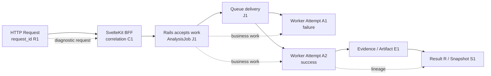
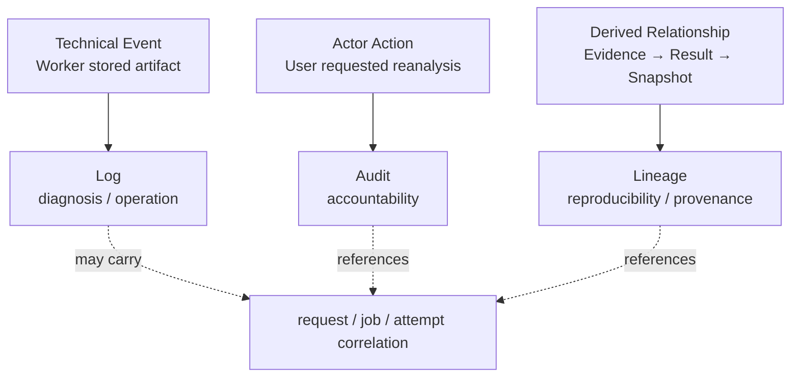

# Module 25: Logging / Monitoring / Audit

Status: `COMPLETE / READY_FOR_M26`  
Phase: `TB-26`  
Difficulty: `INTERMEDIATE`  
Prerequisites: `M01`–`M24`（direct curriculum dependencies: `M07`–`M15`, `M18`, `M23`, `M24`）

## 1. 学習目標（Learning goals）

このModuleを終えた学習者は、次の内容を説明し、判断できます。

1. ObservabilityをLoggingだけでなくLogs、Metrics、Correlation/Traces、Alertsを組み合わせる能力として説明する。
2. EventをLog、Metric、Alert、Audit、Lineage、Heartbeat、Canonical Business Stateへ正しく分類する。
3. Request ID、AnalysisJob ID、Attempt identityを区別し、非同期処理を関連付ける。
4. API、BFF、Rails、Queue、Worker、External Web/LLM、Artifactのsignalを組み合わせて診断する。
5. User-safe errorとinternal diagnostic detailを分離する。
6. Retry failure、final Job outcome、Partial、Missingを別signalとして扱う。
7. Secret、token、個人情報、外部contentをLogへ無条件保存しない。
8. CURRENTの部分実装、TARGET observability、DEFERRED運用設計を混同しない。

本教材はDocumentation-onlyです。Monitoring vendor選定、Logging/Tracing導入、Alert/SLO/Retention設定、Source変更、build/test/qualityは行いません。

## 用語ガイド

- **Logging:** 個々の処理で起きたtechnical eventを記録し、調査できるようにすること。
- **Monitoring:** metricやhealthを継続的に観測し、異常や傾向を把握すること。
- **Observability（可観測性）:** log、metric、traceなどから、System内部で何が起きているか説明できる性質。
- **Audit:** 誰が、いつ、何に対して、どの操作を行ったかを追跡する業務・security上の記録。
- **Lineage:** 結果がどのinput、Job、version、Evidenceから導かれたかを示す由来の記録。
- **Correlation ID:** 複数Systemをまたぐ同じ処理を、log上で結び付ける識別子。

## 2. Observability fundamentals

Observability（可観測性）は、log、metric、traceなどの出力から、System内部で何が起きているかを理解し、原因を調べられる性質です。

| Signal              | Main question                               |
| ------------------- | ------------------------------------------- |
| Log                 | この個別eventで何が起きたか                 |
| Metric              | System behaviorが時間とともにどう変化したか |
| Correlation / Trace | 複数service・stepがどの処理に属するか       |
| Alert               | Operator actionが必要なconditionか          |

```text
Observability != Loggingだけ
Telemetryを集めた量 != 診断できる能力
Dashboardの数 != Product healthの理解
```

何を知りたいかに応じて、収集する情報を設計します。「分析が遅いか」「どこで詰まったか」「誰が重要な操作を行ったか」には、それぞれ異なる情報が必要です。

## 3. Why Panoptes needs cross-system visibility

Panoptesの目標とする処理の流れは、HTTP request、SvelteKit BFF、Rails、PostgreSQL、Queue、Worker、外部Web、Chromium、外部LLM、Artifact、Result/Snapshotにまたがります。HTTP responseを返した後もAnalysisJobは続くため、一つのprocessのLogだけでは全体を追跡できません。

特に区別するidentity:

- Request ID: 一つのHTTP request
- Correlation ID: 複数hopを関連付けるtechnical context
- AnalysisJob ID: 非同期Business work
- Attempt identity: 一つのtechnical execution
- Artifact / Result / Snapshot ID: 生成物と履歴

`1 Request = 1 Job = 1 Attempt`とは限りません。

## 4. Logging model

Logは個別eventや処理状況を時系列で残すtechnical recordであり、diagnostics、debugging、incident investigationに使います。

Candidate events:

- request accepted / rejected
- job dispatched
- worker attempt started / ended
- external fetch timed out
- browser crashed
- artifact write failed
- upstream API returned an error
- invariant violation detected

LogはBusiness Stateの正本ではありません。`worker_started`というLogがあっても、RailsのCanonical Job Stateを置き換えません。

## 5. Structured logging

自由な文章に加えて、機械が読み取れるfieldを使うと、検索・集計や、別の処理記録との関連付けが容易になります。

Candidate fields（formal schemaの新規決定ではない）:

| 項目                     | 目的                 | 注意点                        |
| ------------------------ | -------------------- | ----------------------------- |
| `timestamp`              | event時刻            | clock/timezone consistency    |
| `level`                  | severity             | 何でもErrorにしない           |
| `service`                | emitting owner       | canonical namingが必要        |
| `event`                  | stable event meaning | message文字列と分離           |
| `request_id`             | HTTP request trace   | Job IDと混同しない            |
| `correlation_id`         | cross-hop relation   | trusted generation/validation |
| `analysis_job_id`        | Business work        | Organization accessに注意     |
| `attempt` / `attempt_id` | technical execution  | exact schemaは未決定          |
| `duration_ms`            | latency              | unitを明示                    |
| `result` / `error_code`  | outcome/category     | raw exception/payloadを避ける |

Organization contextが必要な場合も、privacy、data minimization、access restrictionを考慮します。

## 6. Log levels and error semantics

一般的なLevel:

- Debug: 開発・詳細診断。Productionでの量と機密性に注意。
- Info: 正常な主要event。
- Warn: degraded/retryable/attention-worthyだが直ちに失敗とは限らない。
- Error: 処理失敗やunexpected invariant violation。

最初のAttemptで再試行可能なtimeoutが起きた場合と、すべてのAttemptを使い切ってJobが最終的に失敗した場合は、意味が異なります。再試行可能なeventをすべてError通知へ直結すると、通知が多すぎて重要な異常を見落としたり、失敗件数を誤集計したりします。

Exact level policyは未決定のため、本教材では概念に留める。

## 7. User error vs internal diagnostics

User-facing responseは安全で理解可能にし、internal Logには診断に必要なtechnical contextを持たせる。

```text
User:    “The application service is unavailable.”
Internal: service, request_id, error_class, duration, dependency category
```

内部向けのLogであっても、生のaccess token、password、secret、Cookie、不要な個人情報、外部HTMLの全文を残してよいわけではありません。ユーザーへの応答と内部の調査情報は、request IDやcorrelation IDで関連付けます。

CURRENT Rails `ApplicationController`はunhandled errorを`event`、`error_class`、`request_id`で記録し、Userへはgeneric `INTERNAL_ERROR`を返します。この分離は確認できるが、centralized log platformや全error taxonomyの完成を意味しません。

## 8. Metrics model

Metricは時間経過に沿って集計・監視できる数値です。

| Type                     | 意味        | Panoptes candidate                      |
| ------------------------ | ----------- | --------------------------------------- |
| Counter                  | 累積event数 | accepted/completed/timed-out jobs total |
| Gauge                    | 現在値      | queue depth、active workers             |
| Histogram / Distribution | 値の分布    | request/analysis duration               |

Logは個別event、Metricは集約behaviorです。すべてのLogをMetricにする必要はなく、high-cardinality IDをMetric labelへ無制限に入れると運用負荷が増えます。

Candidate metrics:

- API request count / latency / status distribution
- AnalysisJob accepted / completion / failure / timeout / partial rate
- completion duration
- queue depth / oldest message age / redelivery
- worker concurrency / execution duration / browser crash
- external dependency latency/failure
- Artifact failure/size/count

## 9. Monitoring and Golden Signals

MonitoringはMetricやstatusを継続的に観測し、正常性や異常を把握する仕組みです。Dashboard作成そのものではなく、「何を正常とみなすか」「異常時に何を判断するか」が中心となります。

一般的なGolden Signals:

- Latency: API/Analysis completion時間
- Traffic: request/AnalysisJob volume
- Errors: failed/timed_out/dependency error等
- Saturation: queue backlog、worker CPU/memory/concurrency、DB connection等

これらは出発点であり、正式なPanoptes SLI/SLOではありません。

## 10. Product health is more than HTTP availability

HTTP 200だけでProductがhealthyとは限りません。Panoptesでは、少なくとも概念上:

```text
Analysisを受付できる
  + Jobが進行する
  + Evidence/Resultを生成できる
  + UserがResultを取得できる
```

がProduct healthに関係します。Health endpointはprocess availabilityのsignalであり、end-to-end Analysis successを単独では保証しません。

## 11. Alerting model

Alertは、Operator actionが必要なmeaningful conditionを適切なurgencyで通知する仕組みです。

良いAlertは:

- actionable
- relevant to impact/risk
- sufficiently specific
- appropriate urgency
- owner/runbookへつながる

```text
1件のretry後success -> 通常はpage不要
queue ageとcompletion latencyが継続悪化 -> Alert candidate
```

全Errorを通知するとalert fatigueになり、重要Alertが埋もれる。Exact threshold、severity、notification channelは本Moduleで決定しません。

## 12. Symptom and cause signals

User-visible symptomを示すAlertと、原因候補を示すMetricを区別します。

- Symptom: Analysis completion latency悪化、Result取得失敗率増加
- Cause candidate: queue age増加、worker saturation、external timeout増加、DB latency

Worker CPUだけでIncidentと断定せず、User impactと複数signalを関連付ける。Cause signalはdiagnosisに重要だが、必ずしもpage条件ではありません。

## 13. Correlation / tracing model

Full distributed tracingを導入しなくても、Request ID、Correlation ID、Job ID、Attemptを一貫して運べば処理を追跡できます。



Request IDは一つのHTTP requestを追跡します。AnalysisJob IDはrequest終了後も残るBusiness identityです。Attempt identityはretryごとのtechnical executionを区別します。

CURRENT BFFはincoming IDをpattern検証または生成し、Railsへ`x-request-id`と`x-correlation-id`を転送します。Railsはrequest IDをresponse metaへ含め、`Current.correlation_id`をresponseへ含める構造を持ちます。ただし限定確認では`request.env["panoptes.correlation_id"]`を設定するmiddlewareを確認できず、correlationのend-to-end完成は断定しません。M11に残るplacement/contract判断も本Moduleで解決しません。

## 14. AnalysisJob observability

M12のCanonical lifecycleと観測signalを分離します。

観測Candidate:

- created/accepted時刻
- current canonical state
- state滞在時間 / total duration
- terminal outcome
- retry/attempt count
- partial/cancelled/timed_out
- error category
- committed Snapshot identity

MetricはBusiness Stateから安全に集計できるが、Metric自体を正本にしません。`completed_jobs_total`の値から特定JobのCanonical stateを復元しません。

## 15. Progress, heartbeat, and canonical state

| 概念                | 意味                           | Not equivalent to           |
| ------------------- | ------------------------------ | --------------------------- |
| Progress            | technical step/percent/message | canonical business decision |
| Heartbeat           | Worker/Attemptのliveness       | progress or success         |
| Canonical Job State | Rails-owned lifecycle          | UI animation/Worker log     |

`Progress 60%`は特定Canonical stateや残時間を保証しません。Heartbeatがあっても処理が前進しているとは限らず、Heartbeatが一度欠けても即座にBusiness failureとは限りません。timeout/staleness contractと組み合わせる。

CURRENT Frontend runtimeはJob/Session identity、monotonic step/progress、`lastProgressEventAt`、terminal reasonを扱うが、これはFrontend state mappingであり、Worker heartbeat implementationやmonitoring backendではありません。

## 16. Retry-aware and partial-aware monitoring

Retry example:

```text
Attempt A1: dependency timeout -> technical failure log
Attempt A2: success            -> successful attempt log
Job J1: completed              -> final business outcome
```

このJobをfailed Jobとして数えない。Attempt error rateとJob failure rateを別Metricにする価値があります。

`partially_completed`も`completed`または`failed`へ押し込まない。Partial rate、missing component、reason category、downstream eligibilityを独立して観測できれば、degradationを失敗率だけでは見落としにくい。

## 17. Queue observability

Candidate signals:

- queue depth
- oldest message age
- enqueue-to-start latency
- processing duration
- redelivery / retry count
- dead-letter count
- consumer availability

Queueの件数だけでは、業務処理が正常かを判断できません。アクセスの急増で一時的に増える場合も、Consumerが停止して増える場合もあります。待ち時間、処理量、完了までの時間、Workerの処理能力と組み合わせて判断します。

Queue/Attempt runtimeはTARGET領域が含まれるため、既存実装済みとは表現しません。

## 18. Worker / External Web / Chromium observability

Worker candidate:

- active worker / browser process
- CPU/memory/concurrency
- stage duration
- timeout/cancellation
- browser crash
- fetch/render/parser/artifact failure category

External Web candidate:

- DNS/connection/TLS failure
- HTTP status distribution
- redirect denial/failure
- block/rate limit
- render timeout
- content/response size rejection

外部Website側の変化を即座にPanoptes bugと断定せず、dependency category、destination class、attempt、timingを組み合わせる。ただしURL、HTML、Screenshotにはtenant/sensitive contentがあり得るため、raw payloadを通常Logへ出さない。

## 19. External LLM and cost observability

External LLM candidate:

- request count / latency / failure
- retry
- model/version context
- token/usage where provider contract permits
- output validation/rejection category

Prompt、Evidence、Model output全文を無条件保存しません。diagnosisに必要なmetadataとcontent retentionを分けます。

Worker compute、Chromium、LLM、Storage、External serviceはcost driverになり得ます。Operational usageをCost diagnosisへ接続する価値はあるが:

```text
Usage Metric != Customer Charge
```

Customer chargeはBilling contractの正本に従い、Worker counterだけで確定しません。

## 20. API / BFF / Rails observability

Candidate signals:

- request count / latency
- status distribution
- authentication / authorization / validation failure
- upstream timeout/unavailable
- response size where useful
- route/operation context（high-cardinalityに注意）

4xxと5xxを同じSystem Errorにしません。401/403の増加はmisconfiguration、expired session、legitimate deny、attack attemptなど複数解釈があります。Logだけで攻撃と即断せず、rate、source、route、tenant-safe context、time patternと関連付ける。

CURRENT BFFはRails timeoutを制御し、safe `UPSTREAM_UNAVAILABLE`とrequest IDを返します。CURRENT RailsはApiError category、response meta、unhandled error eventを持ちます。専用Metric/Alert backendは確認していません。

## 21. Database and Artifact observability

Database candidate:

- query latency
- connection saturation
- transaction failure/deadlock
- storage growth
- migration/replication health where applicable

Artifact candidate:

- artifact count/size
- storage write/read failure
- missing expected artifact
- lineage link failure
- retention/deletion outcome

Artifact existenceはSnapshot completionやBusiness validityと同じではありません。DB/Storageのexact monitoring implementationはInfrastructure Moduleへhandoffします。

## 22. Audit fundamentals

Auditは、ユーザーやSystemの実行主体が行った重要な操作を、誰が何をしたか後から説明・追跡できるように残す記録です。

Candidate actions（formal event catalogではない）:

- Membership/Role change
- privileged settings change
- Analysis cancellation/reanalysis request
- Snapshot commit/create
- Strategy selection等の重要Business mutation

Candidate fields:

- actor
- action
- resource
- organization
- time
- result
- approved reason/context where relevant

AuditはDebug Logではありません。Retention、immutability、access restriction、queryability等の要求が異なり得ます。RailsがBusiness mutationとAuthorizationを所有するため、Canonical Auditの主要ownerもRails側になります。

## 23. Logging, Audit, and Lineage separation



| 記録    | 中心となる問い       | 例                                        |
| ------- | -------------------- | ----------------------------------------- |
| Logging | Systemがどう動いたか | WorkerがArtifact保存に失敗                |
| Audit   | 誰が何をしたか       | UserがReanalysisを要求                    |
| Lineage | 何から何が作られたか | Snapshot SはJob J/Result R/Evidence E由来 |

Audit record数をMetricへ集計することは可能だが、概念は別です。Repositoryの`docs/audit/`はengineering review/decision documentationであり、runtime Business Audit trailではありません。

## 24. Monitoring vs Audit

MonitoringはSystem healthとoperationを理解します。Auditはactor actionとaccountabilityを追跡します。

- Monitoring: failed Job rateが上昇しているか。
- Audit: 誰がどのJobをcancelしたか。

同じIDを参照してもpurpose、retention、access、integrity requirementが異なります。Debug LogをそのままAudit正本にしません。

## 25. Error taxonomy and diagnosis

診断では少なくとも概念上、次を区別する価値があります。

- validation
- authentication / authorization
- dependency
- timeout
- infrastructure/resource
- invariant violation
- cancellation
- partial/missing evidence

Exact enumは本Moduleで新設しません。Existing safe error codeを尊重し、user message、retryability、technical category、final outcomeを別fieldとして考えます。

## 26. Missing-aware monitoring

M18のMissingはLow Scoreではありません。Missing Evidence増加はExternal Website、Chromium、Worker/parser、Artifact storage、contract drift等の兆候になり得ます。

観測時も:

- valid zero
- missing
- N/A
- unknown
- partial

を混ぜません。Score低下AlertへMissingを含めると、Product meaningとtechnical failureを誤認します。

## 27. SLI, SLO, SLA concepts

- SLI: 実際に測るservice indicator。
- SLO: SLIに対するinternal objective。
- SLA: Customerとの契約上のcommitmentとconsequenceを含み得る。

Panoptes candidate SLIとしてAnalysis successful completion latency等は考えられるが、正式definition、対象母集団、success criteria、window、目標値は決めません。Metricを取得しただけでSLOが確定するわけではありません。

## 28. Dashboard, runbook, and incident

Dashboardは問いへ答える表示手段です。

```text
Question: 分析が遅くなっているか？
Signals: completion latency + queue age + worker saturation + external latency
```

RunbookはAlert時の確認先、immediate check、safe action、escalationを整理します。IncidentはUser/Business impactを伴うmeaningful operational problemであり、単発Errorと同義ではありません。

Exact dashboard、runbook、severity、on-call processは未決定のため新設しません。

## 29. Retention, privacy, and access

Debug Log、Metric、Audit、Evidence/Artifact、Historical Snapshotはpurposeが異なり、同じRetentionを適用しません。保持期間は法務・Product・Security・運用要件を確認して決めます。

Log/Audit accessもAuthorization対象です。Tenant contextを含むrecordを全Organizationへ公開しません。削除・retentionがLineage/Audit要件と衝突する場合は、明示的なpolicy decisionが必要になります。

Exact retention durationは本Moduleで決定しません。

## 30. Redaction and untrusted content

Logへ残さないCandidate:

- password / Secret / private key
- raw access/refresh token
- Cookie / Authorization header
- unnecessary personal data
- unnecessary prompt/Evidence/HTML/Screenshot content
- card security code等のsensitive value

CURRENT Rails parameter filterはauthorization、cookie、password系、email、secret、token、JWT、key、crypt、salt、certificate、OTP、SSN、CVV/CVC等を対象にします。これは有効なcontrolだが、nested/raw body/custom loggerなど全経路の漏洩不存在を保証しません。

External contentにはcontrol character、巨大payload、misleading stringが含まれ得る。サイズ制限、encoding、structured field、sanitization/redactionを考え、raw HTML全文をInfo Logへ無条件出力しません。

## 31. Observability failure and reliability

Telemetry pipeline自体も失敗します。通常のBusiness Transactionを、best-effort Log送信失敗だけで失敗扱いにするとAvailabilityを損なう場合があります。一方、法的・security上必要なAudit persistenceではfail behaviorが異なり得ます。

```text
Debug telemetry reliability != Mandatory audit durability
```

用途ごとのdelivery、buffering、backpressure、loss tolerance、failure behaviorが必要だが、exact contractは本Moduleで決めません。

## 32. Ownership map

| 層（Layer）    | 観測に関する責任                                              | 混同してはいけない役割                        |
| -------------- | ------------------------------------------------------------- | --------------------------------------------- |
| Frontend       | client-visible failure context、approved client telemetry     | Secret/payload dump、Business audit authority |
| SvelteKit BFF  | request/session/proxy/timeout diagnostics、ID forwarding      | Canonical Job/Audit owner                     |
| Rails          | Business lifecycle、authz、mutation、safe error、Audit owner  | Worker resource monitor                       |
| PostgreSQL     | persistence/resource signals、durable audit storage candidate | User-facing diagnosis owner                   |
| Queue          | delivery/age/redelivery/DLQ signals                           | Business state authority                      |
| Worker         | stage/attempt/browser/fetch/artifact diagnostics              | Business decision authority                   |
| Infrastructure | resource/platform/service availability                        | Product semantics owner                       |

## 33. Worked example: AnalysisJob is unusually slow

Situation: Userから「分析が終わらない」と報告された。

1. API受付: Request R1は202でJob J1を返したか。受付error/latencyは正常か。
2. Canonical state: RailsでJ1は何stateか。`failed`や`timed_out`ではないか。
3. Queue: depthだけでなくoldest ageとJ1のenqueue/start時刻を見る。
4. Worker: Attempt A1が開始し、heartbeatがあるか。stage duration、browser/resource saturationを見る。
5. Dependency: External Web/Chromium/LLM timeout/error分布を見る。
6. Progress: crawlingのままでもheartbeatがあれば「Worker dead」と即断しない。staleness thresholdは正式contractに従う。
7. Outcome: Attempt failure後retry中ならfinal Job failureとして数えない。
8. User impact: result未取得時間と同種Jobへの影響範囲を確認する。

Signalsを組み合わせることで、「API failure」「Worker dead」「Business failed」を一つのLogだけから誤断しません。

## 34. CURRENT / TARGET / DEFERRED

### CURRENT — representative inspectionで確認できたもの

- BFFで`x-request-id`/`x-correlation-id`をvalidation/generationしRailsへ転送
- Rails response metaの`request_id`とoptional `correlation_id`
- Rails unhandled errorのstructured key/value logとsafe User error
- Rails parameter logging filter
- Frontendのsafe error code/retryable mapping
- Analysis runtimeのJob/Session identity、monotonic progress、last progress time、terminal reason
- OpenAPIのerror envelopeとAnalysisJob/Snapshot identity contract
- GitHub Actions logsとして残るFrontend/Rails CI execution
- Development Logと`docs/audit/`のengineering history（runtime Auditではない）

限定確認ではcentral log/metric/tracing vendor、Alert、Dashboard、persistent Business Audit trail、Worker/Queue runtime observabilityを確認していません。Correlation header forwardingはあるが、Railsの`panoptes.correlation_id`設定経路は確認できず、end-to-end実装済みとはしません。

### TARGET

- consistent structured loggingとsafe error taxonomy
- Request→Job→Attempt→Artifact/Result/Snapshot correlation
- Queue/Worker/External dependency monitoring
- technical attemptとBusiness outcomeのMetric分離
- Partial/Missing-aware metrics
- Rails-owned durable Business Audit
- searchable Lineageとのcross-reference
- actionable alert、dashboard、runbook、central operational visibility
- privacy/access/retentionを含むtelemetry governance

### DEFERRED

- monitoring/log/tracing vendor
- exact telemetry schema/event catalog
- SLI/SLO/SLA value
- alert threshold/severity/channel
- retention duration
- on-call/escalation/full incident process
- Worker/Queue/Chromium/LLM production instrumentation
- Business Audit persistence implementation
- full distributed tracingとcost/billing reconciliation

## 35. Representative repository mapping

| Representative                                                 | Observable concern                                  | Owner/category                      | 状態                                        |
| -------------------------------------------------------------- | --------------------------------------------------- | ----------------------------------- | ------------------------------------------- |
| `src/lib/server/rails/client.ts`                               | request/correlation ID、timeout、upstream status    | BFF / correlation+diagnostic        | `CURRENT`                                   |
| `rails/app/controllers/application_controller.rb`              | request context、safe error、response meta          | Rails / log+correlation             | `CURRENT`                                   |
| `rails/app/controllers/concerns/authentication.rb`             | authenticated request boundary                      | Rails / security event source       | `CURRENT` source; metric/audit `TARGET`     |
| `rails/app/controllers/concerns/organization_authorization.rb` | Organization/Role decision                          | Rails / authz event source          | `CURRENT` source; audit/monitoring `TARGET` |
| `rails/config/initializers/filter_parameter_logging.rb`        | sensitive parameter redaction                       | Rails / security logging            | `CURRENT`                                   |
| `src/lib/panoptes/domain/runtime-progress.ts`                  | Job/Session/progress/terminal mapping               | Frontend / state diagnostic         | `CURRENT`                                   |
| `src/lib/panoptes/utils/errors.ts`                             | safe error code/message/retryable                   | Frontend / error representation     | `CURRENT`                                   |
| `docs/api/openapi-draft.yaml`                                  | error meta、Job/Snapshot identifiers                | Contract / correlation input        | Mixed `CURRENT/TARGET` contract             |
| `tests/unit/analysis-job-adapter.test.ts`                      | unknown status diagnostic、partial/terminal mapping | Test evidence / diagnostic contract | `CURRENT`                                   |
| `.github/workflows/quality.yml`                                | Frontend CI step output                             | CI / operational build log          | `CURRENT`                                   |
| `.github/workflows/rails-quality.yml`                          | Rails test/lint/security output                     | CI / operational build log          | `CURRENT`                                   |
| `docs/DEVELOPMENT_LOG.md`                                      | engineering phase history                           | Documentation record                | `CURRENT`; not runtime Audit                |

## 36. Common misunderstandings

- Observability = Logging、ではない。
- Log = Audit、ではない。
- Audit = Lineage、ではない。
- Request ID = Job ID、ではない。
- Job ID = Attempt ID、ではない。
- Heartbeat = Progress、ではない。
- Progress = Canonical Job State、ではない。
- Error Log = Failed Job、ではない。
- Retry Error = Final Failure、ではない。
- 1 Error = Incident、ではない。
- Dashboard = Observability、ではない。
- Metric取得 = SLO決定、ではない。
- Usage Metric = Customer Charge、ではない。
- HTTP 200 = Product healthy、ではない。
- 全PayloadをLog = 良いdiagnostics、ではない。
- Monitoring tool導入 = 運用設計完了、ではない。

## 37. Decision heuristic

1. 個別technical eventか。→ Log。
2. 集約されたsystem behaviorか。→ Metric。
3. Operator actionが必要か。→ Alert candidate。
4. Cross-serviceの同一処理か。→ Correlation / Trace。
5. Actorによる重要Actionか。→ Audit。
6. Derived artifact relationshipか。→ Lineage。
7. Worker/Attemptの現在のlivenessか。→ Heartbeat。
8. Business lifecycleか。→ Rails-owned Canonical AnalysisJob State。

## 38. Practice

### A. Knowledge Check

1. ObservabilityがLoggingだけではない理由を説明してください。
2. LogとMetric、Alertの目的を区別してください。
3. Request ID、Job ID、Attempt identityを区別してください。

### B. Classification

次をLog、Metric、Alert candidate、Audit、Lineage、Heartbeatへ分類してください。

1. Worker Attempt A1がbrowser crashで終了。
2. 過去15分のAnalysis completion latency分布。
3. Queue ageが継続悪化しUser impactが発生。
4. Organization AdminがMembership roleを変更。
5. Snapshot S1がResult R1/Evidence E1から生成。
6. Worker A2が現在生存しているsignal。

### C. Correlation Exercise

Request R1からJob J1を作り、Attempt A1が失敗、A2が成功しSnapshot S1をcommitした。各Log/Audit/Lineage recordにどのidentityを持たせるか表にしてください。

### D. Retry Exercise

A1 timeout後にA2が成功した場合、Attempt error counter、retry counter、Job completion counter、failed Job counterをどう更新するか説明してください。

### E. Monitoring Exercise

Analysis completion latencyが増加した。API latency、queue age、worker utilization、external dependency latency、DB latency、Job state/heartbeatのどれを、なぜ組み合わせるか説明してください。

### F. Audit Exercise

Login failure、Membership change、Snapshot view、Reanalysis request、Worker retry、Strategy selectionをAudit候補・technical log・access log等へ分類し、Product/Compliance決定が必要な箇所を示してください。

### G. Security Exercise

次のうちLogへ出してよいもの、redact/maskすべきもの、通常保存しないものを分類せよ: request ID、raw access token、error code、email、HTML全文、LLM prompt、duration、Organization ID。

### H. Partial Exercise

`partially_completed`が増加したとき、Job final outcome、missing Evidence category、Worker stage failure、External dependency、downstream eligibilityをどう観測するか説明してください。

### I. Violation Detection

1. raw access tokenをLogへ出す。
2. Request IDをJob IDとして扱う。
3. Retryの1回失敗でJob failure Alertを出す。
4. AuditとDebug Logを同じRetention/用途にする。
5. Snapshot LineageをAuditだけで代用する。
6. Queue depthだけでIncident判定する。
7. External HTML全文をInfo Logへ出す。
8. Customer ChargeをWorker usage metricだけで確定する。

### J. Architecture Explanation

「なぜPanoptesではLogging、Monitoring、Audit、Lineageを分け、IDで関連付けるのか」を、diagnostics、health、accountability、reproducibility、privacyの観点から説明してください。

## 39. Answers / explanation guide

### A. Knowledge Check

Logは個別event、Metricは集約behavior、Correlationはcross-system relation、Alertはaction requirementを扱うため、Logだけではtrendやimpactを十分判断できません。Request IDは一つのHTTP request、Job IDは非同期Business work、Attempt identityはretryごとのtechnical executionです。

### B. Classification

1 Log、2 Metric、3 Alert candidate、4 Audit、5 Lineage、6 Heartbeat。実装では同じeventからMetricを派生できるが、元のpurposeを混同しません。

### C. Correlation Exercise

R1は受付request、J1はRails/Queue/Worker/Resultを跨ぐBusiness work、A1/A2はattempt log、S1はLineageに持ちます。User request actionをAudit対象とする場合はactor/org/resource/J1を参照し、LineageはJ1/A2/Evidence/Result/S1のderived relationを持ちます。

### D. Retry Exercise

Attempt errorとretryは1増える。Job completionは最終success時に1増え、failed Jobは増やしません。最終outcome集計とattempt event集計を分離します。

### E. Monitoring Exercise

API正常でもQueue wait、Worker saturation、External latency、DB bottleneckでend-to-endは遅くなる。Queue ageとJob state、heartbeatでwaiting/executing/stuckを区別し、resource/dependency signalで原因候補を絞る。

### F. Audit Exercise

Membership change、Reanalysis request、Strategy selectionは重要Business mutationとしてAudit候補。Worker retryはtechnical Log/Metric。Login failureはsecurity/access signalであり、formal Audit採否はpolicy次第。Snapshot viewもsensitivity/compliance requirementによりaccess Audit判断が必要で、教材では確定しません。

### G. Security Exercise

Request ID、approved error code、durationは通常安全なmetadata候補。Access tokenは保存禁止、email/Organization IDは必要性・access・redactionを判断します。HTML全文とLLM promptはsensitive/untrusted contentを含み得るため通常Logへ無条件保存しません。

### H. Partial Exercise

Partialをcompleted/failedへ統合せずfinal outcomeとして数え、missing type、failed stage、dependency category、attempt、eligibilityを関連付ける。MissingをLow Scoreへ変換しません。

### I. Violation Detection

順にcredential leak、identity conflation、retry-aware aggregation欠如、purpose/retention conflation、provenance loss、single-signal diagnosis、privacy/log injection/volume risk、Billing authority violationです。

### J. Architecture Explanation

Loggingは個別diagnosis、Monitoringはsystem/product health、Auditはactor accountability、Lineageはderived resultの再現性を守ります。それぞれretention、access、durabilityが異なります。Request/Job/Attempt/Artifact identityで関連付ければ、同一recordへ全責務を詰め込まず、必要な範囲でend-to-end investigationできます。

## 40. Completion criteria

|   # | Criterion                                  | Result |
| --: | ------------------------------------------ | ------ |
|   1 | Observability fundamentals explained       | `PASS` |
|   2 | Logging explained                          | `PASS` |
|   3 | Metrics/Monitoring explained               | `PASS` |
|   4 | Alerting explained                         | `PASS` |
|   5 | Correlation/Tracing explained              | `PASS` |
|   6 | Job/Worker/API observability explained     | `PASS` |
|   7 | Audit explained                            | `PASS` |
|   8 | Logging/Audit/Lineage separation explained | `PASS` |
|   9 | Repository mapping + diagrams included     | `PASS` |
|  10 | Exercises + answers included               | `PASS` |

M25 authoring result: `10 / 10 PASS`。教材完成はMonitoring/Logging/Tracing導入、SLO/Alert/Retention決定、Production observability readinessの完了を意味しません。

## 41. M26 handoff

Recommended next phase: `TB-27 — Module 26: Infrastructure / Cloud Boundary`。

M26ではruntime/service/network/storage/environment/secret/deployment boundary、managed serviceとapplication ownership、availability/scaling/backup等を扱います。Cloud vendor選定やInfrastructure変更は教材作成と分離します。

## References

- [M12 AnalysisJob Lifecycle](./12-analysis-job-lifecycle.md)
- [M13 Async Job / Queue / Retry / Idempotency](./13-async-job-queue-retry-idempotency.md)
- [M14 Python Worker / Chromium / Collection](./14-python-worker-chromium-collection.md)
- [M15 Snapshot / History / Lineage](./15-snapshot-history-lineage.md)
- [M18 Missing / Partial / Eligibility](./18-missing-partial-eligibility.md)
- [M23 Security Fundamentals](./23-security-fundamentals.md)
- [M24 Testing / CI/CD](./24-testing-cicd.md)
- [Panoptes Technical Bootcamp](../panoptes-technical-bootcamp.md)
