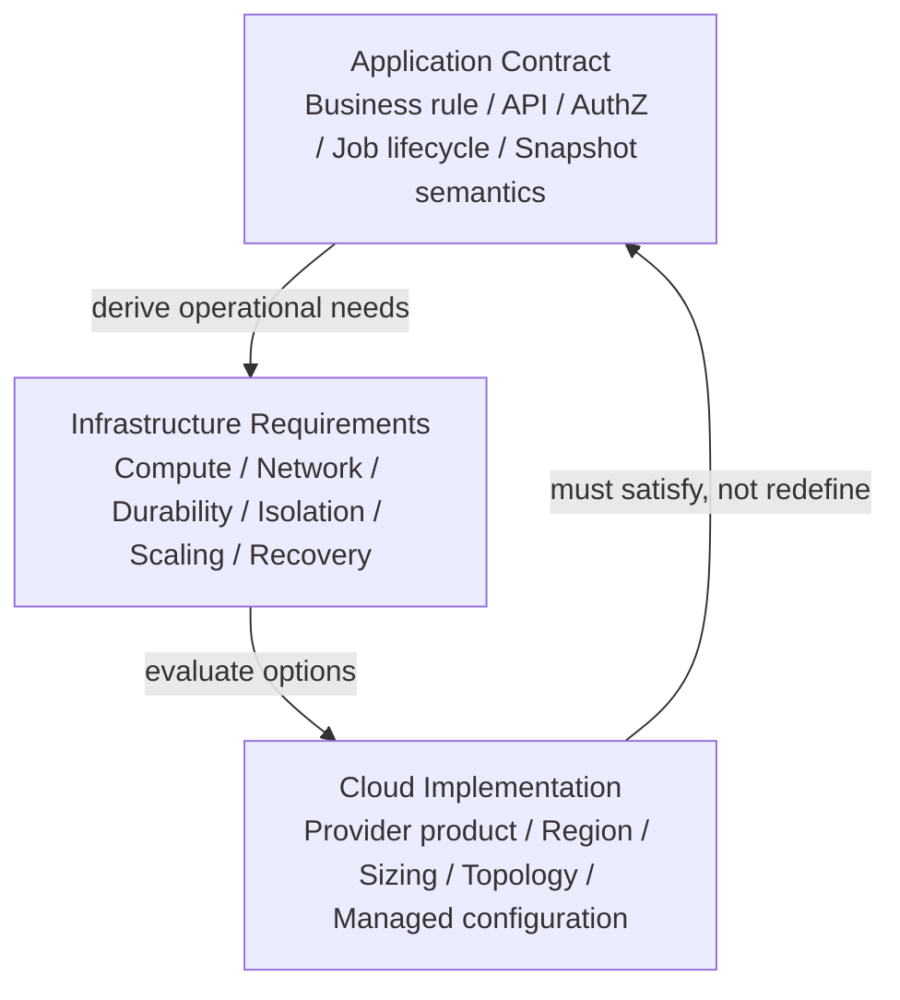
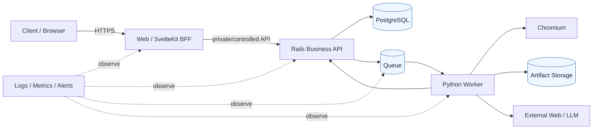

# Module 26: Infrastructure / Cloud Boundary

Status: `COMPLETE / READY_FOR_M27`  
Phase: `TB-27`  
Difficulty: `INTERMEDIATE`  
Prerequisites: `M01`–`M25`（direct curriculum dependencies: `M01`, `M07`–`M15`, `M23`–`M25`）

## 1. Learning goals

このModuleを終えたLearnerは、次を説明・判断できる。

1. InfrastructureをApplicationを実行・接続・保存・監視するruntime foundationとして説明する。
2. Application Contract、Infrastructure Requirement、Cloud Implementationを分離する。
3. Web/BFF、Rails、PostgreSQL、Queue、Worker/Chromium、Artifact Storageのruntime特性を比較する。
4. Public/private、ingress/egress、service identity、Secret境界を説明する。
5. WebとWorkerで異なるscaling、failure、deployment requirementを判断する。
6. Availability、High Availability、Backup、Restore、Disaster Recovery、RPO/RTOを区別する。
7. Environment、Deployment Unit、version/schema compatibilityを説明する。
8. Portability、vendor lock-in、Security、Costのtrade-offを根拠から評価する。
9. CURRENT repository、TARGET architecture、DEFERRED Cloud decisionを混同しない。

本教材はDocumentation-onlyである。Provider/service選定、Infrastructure/IaC/container追加、Deployment、Network/DB変更、Cost model、RTO/RPO決定、Source変更、build/test/qualityは行わない。

## 2. Infrastructure fundamentals

Infrastructureは、Application codeを実行し、component同士を接続し、dataを保存し、運用可能にするruntime foundationである。

```text
Application Contract: Rails owns canonical business decisions
Infrastructure:       Rails processをどこで、どうrun/connect/scaleするか
Cloud Implementation: その要件を具体的なprovider serviceでどう実現するか
```

InfrastructureはApplication Architectureそのものではない。Cloud productを変更しても、Organization authorization、AnalysisJob lifecycle、Formula、Snapshot semanticsが勝手に変わらない方向を目指す。

## 3. Three decision layers

| Layer | Decides | Panoptes example |
| --- | --- | --- |
| Application Contract | Business meaning、API、authorization、state/invariant | `partially_completed`の意味、Rails-owned authorization |
| Infrastructure Requirement | Runtime、durability、network、capacity、recovery requirement | durable queue、private DB、long-running Worker |
| Cloud Implementation | Product、region、instance/service configuration | 特定managed DB/queue/compute product |

Queue productが変わっても`AnalysisJob != Queue Message`である。Queueがat-least-once deliveryを持つ必要性はArchitecture requirementになり得るが、どのqueue serviceを選ぶかはInfrastructure/Cloud selectionである。

## 4. Application vs Infrastructure responsibilities



ApplicationからInfrastructure requirementを導き、Cloud optionがrequirementを満たすか評価する。Provider featureから逆にBusiness Contractを歪めない。一方、移植性のために全Provider固有機能を禁止する必要もない。

## 5. Panoptes runtime units

| Runtime unit | Primary responsibility | Runtime character |
| --- | --- | --- |
| Browser / Client | UI、local interaction | untrusted public client |
| SvelteKit Web/BFF | rendering、session、proxy/orchestration | request-driven compute |
| Rails API | canonical business/authz/state transition | request-driven business service |
| PostgreSQL | persistent business data/invariant | stateful durable service |
| Queue | delivery、buffering、redelivery | durable async transport |
| Python Worker | collection/technical analysis | long-running background compute |
| Chromium | untrusted page rendering | resource-heavy isolated process |
| Artifact Storage | HTML/Screenshot/large artifact | durable object/blob storage |
| External Web/LLM | external dependency | outside trust/control boundary |
| Observability platform | log/metric/alert/tracing backend | operational support plane |

## 6. Infrastructure boundary map



矢印はTarget responsibility boundaryであり、全runtimeがCURRENT repositoryで稼働済みという意味ではない。

## 7. Compute fundamentals

ComputeはApplication codeを実行するresourceである。一般categoryにはserverless、container、VM、managed application runtime、background worker runtimeがある。

選択軸:

- request duration / lifecycle
- CPU・memory・concurrency
- runtime/system dependency
- startup latency
- process isolation
- autoscaling model
- network/storage requirement
- cost/operational ownership

特定categoryを常に正解とせず、workload requirementから選ぶ。

## 8. Request-driven Web/Rails compute

Web/BFF/Railsは主に`Request → Processing → Response`を扱う。

適性:

- web serving / SSR
- short API request
- session/auth context
- command受付と短いorchestration

Durable business stateをprocess memoryだけに持たず、restartしてもPostgreSQL等から回復できるstateless方向がhorizontal scalingを助ける。Memory cacheやin-flight requestは存在しても、Canonical stateの代替にしない。

## 9. Long-running Worker / Chromium compute

Python/Chromium Workerには異なるrequirementがある。

- long-running execution
- CPU/memory and browser processes
- Python/browser/system libraries
- timeout/cancellation/retry
- temporary storage and cleanup
- network egress
- sandbox/isolation
- independent concurrency/scaling

Web request timeout内へ長いcrawl/analysisを同期実行させると、availability、retry、failure isolationを損なう。Web ApplicationとCollection/Analysis Workerを分離するのがCanonical directionである。

## 10. Container concept

ContainerはApplicationとruntime dependencyをportable unitとしてpackageする方法である。Python、Chromium、OS library、font等を揃えるWorkerでは有用な候補であり、Railsでもrepeatable runtimeを作りやすい。

ただし:

```text
Container != Microservice
Container adoption != Cloud Architecture completion
```

CURRENT Railsにはproduction-oriented Dockerfileがある。これはRails imageをbuildできる方向のevidenceであり、registry、production orchestration、autoscaling、deployment pipelineの完成を示さない。Worker container/image/flagsは未決定である。

## 11. Network fundamentals

Networkはcomponent間communication boundaryを担う。

- Public endpoint: Internetから到達可能な入口
- Private service: internal componentだけから到達
- Ingress: Systemへ入るtraffic
- Egress: Systemから外部へ出るtraffic
- DNS/TLS: name resolutionとtransport protection
- Firewall/policy: 許可されたdirection/identity/port

Network controlはApplication authorizationを代替しない。RailsはNetwork内にあってもJWT、Membership、resource ownershipを検証する。

## 12. Public/private, ingress, and egress

Public candidate:

- Web entry
- controlled API entry（architectureに応じてBFF経由または明示公開）

Private candidate:

- PostgreSQL
- internal Queue
- Worker control path
- private Artifact access

IngressではHTTPS、domain/routing、rate/resource protectionを考える。Worker egressではExternal Web/LLMが必要でも、SSRF、private network、metadata endpoint、protocol、redirect、size/timeを制御する。Exact VPC/VNet/firewall topologyは決めない。

## 13. PostgreSQL infrastructure boundary

Application Contractは「PostgreSQLがpersistent business dataとinvariantの正本」である。Infrastructureは次を担当する。

- managed/self-managed operation
- connection/TLS
- storage/durability
- backup/restore
- failover/replication
- encryption/access policy
- monitoring/capacity

CURRENT RailsはPostgreSQL adapter、environment-based host/port/user/password、production `DATABASE_URL`、thread由来のconnection上限を持つ。Supabase Auth利用が確認できても、Rails production DBがSupabase PostgreSQLへ確定したとは限らない。

## 14. Connection management

Web/Worker instanceが増えるとDB connectionも増える。Application concurrencyとpool、managed DB connection limit、burstを一緒に考える。

```text
instances × per-process pool <= usable connection capacity
```

これは概念式であり、exact pool sizeではない。Serverless burstやlong-lived Worker connectionなどruntime patternも影響する。DB connection exhaustionをinstance追加で悪化させない。

## 15. Queue infrastructure boundary

Queue productを選ぶ前に必要semanticsを定める。

- durability
- at-least-once等のdelivery model
- visibility/lease timeout
- redelivery/retry
- throughput/concurrency
- ordering capability
- dead-letter handling
- message retention/size
- observability and access policy

Queueはdelivery mechanismであり、Business Source of Truthではない。Message重複を前提にRails/Worker側でIdempotencyを守る。Queue product名をJob stateへ埋め込まない。

CURRENT Rails production configはPhase R-1でdistributed queueを導入していないと明記する。したがってQueue runtimeはTARGETであり、特定serviceはDEFERREDである。

## 16. Worker runtime details

Worker runtimeではPython、browser binary、OS library、CPU、memory、temporary disk、network、timeout、cleanupを一体として検証する。

Chromium固有candidate:

- sandbox and process isolation
- shared memory/process limit
- fonts/locale/timezone
- viewport/render consistency
- browser crash/restart
- downloaded/cache/temp artifact cleanup

Exact image、flags、sandbox mechanismはSecurity/Infrastructure implementationで決める。`--no-sandbox`等を便宜的Production defaultにしない。

## 17. Artifact storage boundary

Artifact candidateはHTML、Screenshot、extracted JSON、technical analysis output等である。

Infrastructure concern:

- durability/availability
- object size/throughput
- private access/signed delivery
- lifecycle/retention
- encryption/region/cost
- integrity and metadata

大きなblobをPostgreSQLへ置くか、Object Storageへ置きDBにmetadata/referenceを持つかにはtransaction、backup、query、cost、sizeのtrade-offがある。正式schemaは既存Decisionを超えて新設しない。

```text
Artifact Store != Snapshot Database
Storage key != Business Identity
```

Job、Artifact type/version、Evidence、Result、SnapshotのLineageをDB側のcanonical identityと結ぶ。

## 18. Secret and service identity

InfrastructureのSecret concern:

- server-side storage
- access permission
- rotation/revocation
- environment separation
- audit/usage visibility
- deployment injection

Client-facing `PUBLIC_*`とserver-only Secretを分離する。CURRENT `.env.example`はpublic Supabase URL/key、server-only Rails BFF URL、mock-auth development boundaryを示し、FrontendでSupabase service-role keyを使わない意図を明記する。実`.env`の内容は本調査対象外である。

Human以外にもWeb、Rails、Worker、CIごとのservice identityとLeast Privilegeが必要になる。WorkerへBilling/全Tenant DB権限を無条件付与しない。Static long-lived credentialを全serviceで共有しない方向を優先する。

## 19. Observability infrastructure

M25のApplication signalを収集・保存・検索・通知するplatformが必要になり得る。

- log aggregation
- metric collection
- alert delivery
- tracing/correlation backend
- host/container/DB/network resource monitoring

Application MonitoringはJob state、Business failure、API behaviorを扱い、Platform MonitoringはCPU、memory、restart、DB connection、disk/network等を扱う。片方だけではdiagnosisが不足する。Vendorは選定しない。

## 20. Scaling fundamentals

- Vertical scaling: 一つのinstanceを大きくする。
- Horizontal scaling: instance数を増やす。

Web/BFF/Railsはrequest rate、latency、CPU、connection等でscaleする。Workerはqueue age/backlog、Job concurrency、CPU/memory、Chromium concurrency等でscaleする。同じsignalを使うとは限らない。

Stateless computeはhorizontal scaleしやすいが、DB/Queue/External service capacityも同時に考える。Bottleneckを下流へ移すだけのscaleは避ける。

## 21. Queue backpressure and concurrency

QueueはProducer/Consumerの速度差を吸収するが、backlogが無限に増えてよいわけではない。必要に応じてadmission control、usage limit、concurrency cap、priority等を検討する。

Worker concurrencyを上げるtrade-off:

- throughput上昇
- CPU/memory/browser process増加
- DB/API/Storage pressure増加
- External Website/LLM pressureとrate limit増加
- cost上昇

Autoscaling thresholdやconcurrency値は容量/Cost Modelなしに決めない。

## 22. Availability and failure domains

Availabilityは必要なProduct機能を利用可能な度合いである。Web、Rails、DB、Queue、Worker、Storageごとにfailure impactが異なる。

例:

- Web failure: UI/API entryに影響
- Rails failure: command/read/business transitionに影響
- DB failure: canonical state accessに影響
- Queue failure: async delivery/acceptanceに影響
- Worker failure: new analysis completionに影響
- Storage failure: Artifact generation/readに影響

Failure isolationにより、一つのWorker crashがWeb全体を落とさない構造を目指す。SPOFを特定しても、すべてを即多重化するかはAvailability RequirementとCost次第である。

## 23. Redundancy, managed services, and trade-offs

Redundancyはreplica/instanceを増やしfailure toleranceを上げるが、Cost、operational complexity、consistency、deploy coordinationを増やす。

```text
Managed service != 運用責任ゼロ
Managed service != 自動的にSPOFなし
```

Managed DBでもbackup policy、restore test、region/failover、connection、access、costは利用側が理解する必要がある。MVPと成熟Productionで必要levelが異なり得る。

## 24. Backup, Restore, HA, and DR

| Concept | Purpose |
| --- | --- |
| Backup | Data lossに備えたcopy |
| Restore | Backupから実際に復元するability/procedure |
| High Availability | 通常障害中もservice継続を高める |
| Disaster Recovery | 大規模障害後にservice/dataを復旧する |

BackupはHAではなく、HAはDRでもない。Backupが存在してもrestoreできなければrecovery guaranteeにならない。

対象candidateはPostgreSQL、Artifact metadata/object、critical configuration。Derived artifactを再生成できる場合でも、Evidence availability、cost、lineage、retentionを考える。

## 25. RPO and RTO

- RPO: どれだけ過去までのData lossを許容するか。
- RTO: どれだけの復旧時間を許容するか。

これらはbackup frequency、replication、restore automation、cost、incident processを左右する。正式なPanoptes値はProduct/Business requirementなしに設定しない。Productionだから必ずmulti-regionという結論にも飛ばない。

## 26. Environments and parity

概念上のenvironment:

- local
- development
- staging
- production

Environmentごとにdata、Secret、endpoint、permission、resourceを分離する。完全に同じ規模でなくても、重要Runtime Contract—DB version/semantics、Queue delivery、Worker dependency、API—を近づける。

Production-like DevelopmentとはDay 1から最大redundancy/scaleを持つことではなく、Web/Worker分離、async contract、Secret boundary、repeatable deployment等の構造を早く揃えることである。

## 27. Deployment boundaries

Frontend/BFF、Rails、Workerは独立deployment unitになり得る。独立deployにはcontract compatibilityが必要である。

```text
Frontend v2 ↔ Rails v1
Rails v2    ↔ Worker v1 message/result
Old Job     ↔ New Formula/Snapshot reader
```

OpenAPI、Queue message、Formula/Axis version、Snapshot projectionをversion-awareにし、同時deploy前提へ過度に依存しない。Exact release compatibility windowは新設しない。

CURRENT GitHub ActionsはFrontend/Rails quality検証であり、限定確認ではdeployment workflowを含まない。CI PASSをCD/Production deploymentとみなさない。

## 28. Database migration boundary

Schema migrationはApplicationとInfrastructure/Deploymentの両方へ影響する。M24の:

```text
expand -> migrate/backfill -> contract
```

により、old/new codeが一時共存できる方向を検討する。Destructive migrationはcode rollbackだけで戻せない場合がある。Zero-downtime要件、backfill volume、lock、rollbackは決定済みrequirementに従う。

## 29. Infrastructure as Code and repeatability

IaCはInfrastructure configurationをversion controlし、review、reproducibility、environment consistency、change historyを高める考え方である。

Immutable/reproducible artifactやcontainer imageは手作業server変更を減らす。ただしTerraform/Bicep/CDK等のtoolは選ばず、IaCを生成しない。CURRENT repositoryでProduction IaCは確認していない。

## 30. Cloud portability

Cloud portabilityは「どのCloudでも完全に同じ」ではなく、Application ContractをProvider productの固有語から分離し、migration impactを把握可能にすることである。

Candidate seams:

- queue producer/consumer contract
- object storage adapter
- Secret/config access boundary
- deployment artifact/runtime contract
- observability event schema

過剰なabstractionは複雑性と最低共通機能への制約を生む。Concrete providerを使いつつApplication semanticsを隔離する方が合理的な場合もある。

## 31. Vendor lock-in evaluation

Vendor lock-inを単純な悪としない。評価軸:

- migration cost and data egress
- unique proprietary dependency
- operational benefit/reliability
- development speed
- team capability
- total cost
- compliance/region requirement
- exit strategy and contract isolation

Benefitがmigration costを上回る場合、意図的lock-inは合理的になり得る。逆に、core Business Stateがprovider固有eventだけに存在するとmigration/recovery riskが高い。

## 32. AWS / Azure / Vercel + Supabase boundary

与えられたarchitecture contextではAWS/Azureはlong-term candidate、Vercel + SupabaseはMVP/speed candidateであり、final providerは未決定である。

- AWS/Azure: broad infrastructure optionとして評価対象。
- Vercel + Supabase: Web/Auth/Dataのspeed candidate。

本Moduleはwinnerを決めない。CURRENT repositoryで確認できるのはSupabase SSR/Auth client dependencyとenvironment例、SvelteKit `adapter-auto`である。`adapter-auto`はhosting providerの最終決定ではない。限定確認ではVercel configを確認しておらず、Vercel production deployment済みとは扱わない。

## 33. Security boundary

Infrastructure controls:

- private network/access policy
- service identity/least privilege
- Secret storage/rotation
- TLS/encryption at rest
- worker/browser sandbox
- egress control
- resource/concurrency limit
- backup access and audit

Application controls:

- Authentication/Authorization
- Organization/resource ownership
- API/input validation
- Business transition/invariant

Infrastructure SecurityだけでApplication Authorizationを代替しない。Private Rails endpointでもtenant isolationは必要である。

## 34. Cost boundary

Cost driver:

- Web/Rails/Worker compute
- PostgreSQL
- Queue
- Artifact Storage and lifecycle
- network/egress
- logging/monitoring retention
- External LLM/service
- redundancy/backup

Cost optimizationは安価なservice選定だけでなく、utilization、concurrency、cache、retention、reprocessing、architectureを含む。Reliability/Securityを無条件に削るのではなくrequirement-driven trade-offにする。Exact cost modelは別Phaseへhandoffする。

## 35. Region and capacity planning

Regionはlatency、availability、legal/customer requirement、data residency、service availability、costへ影響する。正式region policyは未決定である。

Capacity PlanningではLow/Base/High scenarioに対しcustomer数、analyses/month、average/percentile execution time、Worker CPU/memory、Chromium concurrency、artifact size、DB/queue throughputを使う。具体値はCloud Cost Modelなしに発明しない。

## 36. Worked example: one AnalysisJob, two views

### Application view

1. Railsがauthorization/idempotencyを検証しAnalysisJobを作成する。
2. Queueへdelivery intentを出す。
3. Workerがtechnical executionを行う。
4. Evidence/Artifact/Resultを生成する。
5. Railsがcanonical transitionとSnapshot commitを決定する。

### Infrastructure view

1. Rails request computeがPostgreSQLへtransactionする。
2. Durable queue serviceがmessageを保持・lease/redeliveryする。
3. Worker runtimeがPython/Chromium、CPU/memory/temp disk/egressを使う。
4. Object storageがArtifactをprivate/durableに保持する。
5. Logs/Metricsがrequest/job/attemptをcorrelateする。

Application viewは「意味とowner」、Infrastructure viewは「どこでどう実行・保存・回復するか」を説明する。同じFlowだが責務は異なる。

## 37. CURRENT / TARGET / DEFERRED

### CURRENT — repositoryで限定確認できたもの

- SvelteKit `adapter-auto`; hosting/providerは未固定
- Supabase SSR/Auth client dependencyとpublic environment example
- Server-only Rails BFF URL/timeout environment boundary
- Rails PostgreSQL adapter、environment config、production `DATABASE_URL`
- Rails production Dockerfile、non-root runtime user、Puma entry
- Rails development composeのPostgreSQL/API/health checks/volume
- Rails production SSL、STDOUT logging、request ID tag、memory cache設定
- Frontend/Rails GitHub Actions quality workflows
- CI test用PostgreSQL service

CURRENT evidenceはlocal/development/build/test configurationを含む。Production deployment済み、backup/failover設定済み、Queue/Worker/Artifact runtime稼働済みという意味ではない。限定確認ではVercel config、top-level Worker runtime、Production IaC/deployment workflowを確認していない。

### TARGET

- independently deployable SvelteKit/BFF、Rails、Worker boundaries
- PostgreSQL as durable business source of truth
- durable Queue with explicit delivery/idempotency contract
- isolated long-running Python/Chromium runtime
- private, durable Artifact Storage with DB metadata/Lineage
- service identity、Secret、ingress/egress、least privilege
- application + platform observability
- version-compatible deploy/migration path
- backup/restore and availability requirementsに沿うruntime
- providerを変えてもBusiness semanticsを維持するseams

### DEFERRED

- AWS vs Azure vs Vercel/Supabase final decision
- exact compute/DB/queue/storage/secret/monitoring products
- network/VPC/VNet/topology/firewall design
- Worker container/image/runtime flags
- autoscaling/concurrency/admission thresholds
- instance/database sizing and Cost Model
- RPO/RTO、backup frequency、restore/DR plan
- region/data residency/multi-region strategy
- production redundancy/HA level
- IaC tool、CD platform、release topology

## 38. Representative repository mapping

| Representative | Application responsibility | Infrastructure dependency | Status / portability implication |
| --- | --- | --- | --- |
| `svelte.config.js` | SvelteKit Web/BFF | Runtime adapter | `CURRENT` adapter-auto; provider未固定 |
| `.env.example` | Frontend/Auth/BFF configuration boundary | Environment/Secret injection | `CURRENT`; public/server separation |
| `package.json` | Web build/runtime scripts | Node/build environment | `CURRENT`; deploy platform非規定 |
| `rails/config/database.yml` | Rails persistence access | PostgreSQL/connection/env | `CURRENT`; DB product host非固定 |
| `rails/config/environments/production.rb` | Rails production behavior | TLS proxy/log/cache/runtime | `CURRENT`; topology未固定 |
| `rails/Dockerfile` | Rails deployable process | OCI/container-capable runtime | `CURRENT`; orchestrator非規定 |
| `rails/compose.yaml` | Local Rails/PostgreSQL composition | Docker network/volume/health | `CURRENT` development evidence only |
| `rails/.env.example` | Rails DB/JWT/log config | Secret/config injection | `CURRENT`; secret store非規定 |
| `.github/workflows/quality.yml` | Frontend quality verification | CI runner | `CURRENT`; CDではない |
| `.github/workflows/rails-quality.yml` | Rails/PostgreSQL quality verification | CI service/container | `CURRENT`; Production topologyではない |
| `docs/learning/modules/14-python-worker-chromium-collection.md` | Worker technical contract | Python/Chromium runtime | Architecture `TARGET` |
| `docs/learning/modules/25-logging-monitoring-audit.md` | Observability signal semantics | telemetry platform | Contract `TARGET`; vendor `DEFERRED` |

## 39. Common misunderstandings

- Cloud = Architecture、ではない。
- AWS/Azure service名 = Business Contract、ではない。
- Serverless = すべてのworkloadに適する、ではない。
- Queue = Database、ではない。
- Container = Microservice、ではない。
- Managed DB = Backup不要、ではない。
- Backup = High Availability、ではない。
- High Availability = Disaster Recovery、ではない。
- Scale up = Scale out、ではない。
- Web scaling = Worker scaling、ではない。
- Production-like = Day 1から最大構成、ではない。
- Cloud portability = Provider featureを一切使わない、ではない。
- Vendor lock-in = 常に悪、ではない。
- Infrastructure Security = Application Authorization、ではない。

## 40. Decision heuristic

1. Business ruleか。→ Application。
2. API semanticsか。→ Application。
3. Job/Snapshot meaningか。→ Application。
4. Processをどこでrunするか。→ Infrastructure。
5. Instance数/size/concurrencyか。→ Infrastructure/Capacity。
6. Managed DB productは何か。→ Cloud implementation。
7. Required queue delivery semanticsか。→ Application/Architecture requirement。
8. Which queue serviceか。→ Infrastructure/Cloud selection。
9. Artifact identity/Lineageか。→ Application Contract。
10. Artifact storage technology/lifecycleか。→ Infrastructure。

## 41. Practice

### A. Knowledge Check

1. InfrastructureとApplication Architectureの違いを説明せよ。
2. Cloud Provider変更で維持すべきものを三つ挙げよ。
3. Managed serviceを使っても残る利用側責務を説明せよ。

### B. Responsibility Classification

次をApplication、Infrastructure Requirement、Cloud Provider Implementationへ分類せよ。

1. `partially_completed`の意味
2. Queueのredelivery/idempotency requirement
3. Queue製品名
4. Snapshot immutability
5. DB failover configuration
6. Organization authorization
7. Worker CPU/memory size
8. Artifact lineage

### C. Runtime Mapping

Browser、BFF、Rails、PostgreSQL、Queue、Worker、Chromium、Artifact Storage、LLMをCompute/Storage/Network/External dependencyへ分類し、public/private candidateを示せ。

### D. Web vs Worker Exercise

30分かかるChromium collectionをWeb request runtimeへ同期配置する案を、timeout、resource、retry、failure isolation、scalingの観点から評価せよ。

### E. Scaling Exercise

API request latency増加とQueue backlog/oldest age増加について、Web、Rails、DB、Workerのどこを調査・scaleするかを分けよ。単一signalだけでinstance追加を決めないこと。

### F. Availability Exercise

DB、Queue、Worker、Artifact Storageが停止した場合、new request acceptance、existing Job、current Snapshot read、new Artifact作成へのimpactを表にせよ。

### G. Backup / Recovery Exercise

Backup、Restore、HA、DR、RPO、RTOを分類し、「backupがあるからservice継続できる」という主張の誤りを説明せよ。

### H. Portability Exercise

Providerを変更するとき維持すべきAPI、Job lifecycle、Queue message、Idempotency、Artifact metadata、Snapshot/Lineage contractと、置換可能なruntime productを分けよ。

### I. Violation Detection

1. Queue product名をAnalysisJob stateへ埋め込む。
2. Rails memoryだけでCanonical Jobを保存する。
3. Web serverでChromium long jobを同期実行する。
4. Public DB exposureを前提にする。
5. BackupがあるのでHA不要と断定する。
6. Portabilityのため全Provider featureを禁止する。
7. WorkerへBilling DB全権限を与える。
8. 現行`adapter-auto`をFinal Vercel Architectureと扱う。
9. TARGET Queue/Workerを現在稼働済みと記載する。

### J. Architecture Explanation

「なぜPanoptesではApplication ArchitectureとCloud Infrastructureを分離して考えるのか」を、Business semantics、workload fit、portability、failure isolation、costの観点から説明せよ。

## 42. Answers / explanation guide

### A. Knowledge Check

Application ArchitectureはBusiness meaning/owner/interfaceを決め、Infrastructureはそのcode/dataを実行・接続・保存・回復する。Provider変更時もAuthorization、API、AnalysisJob lifecycle、Snapshot semantics等を維持する。Managed serviceでもcapacity、access、backup/restore、monitoring、configuration/cost責任は残る。

### B. Responsibility Classification

1 Application、2 Architecture requirement、3 Cloud implementation、4 Application、5 Infrastructure、6 Application、7 Infrastructure、8 Application。Requirementと製品選択を分ける。

### C. Runtime Mapping

Browser/BFF/Rails/Worker/ChromiumはCompute、PostgreSQL/Queue/Artifactはdurable state/transport、全矢印はNetwork、External Web/LLMは外部dependency。通常Web entryはpublic、DB/Queue/Worker control/Artifact originはprivate candidateである。

### D. Web vs Worker Exercise

Long requestはhosting timeout、browser resource占有、client disconnect、retry ambiguity、Web scalingとのcouplingを生む。JobをRailsで作りQueue経由のisolated Workerへ渡し、poll/readで結果を取得する方が責務に合う。

### E. Scaling Exercise

API latencyはWeb/Rails CPU、DB connection/query、dependencyを確認する。Queue ageはWorker capacity、Job duration、failure/retry、external bottleneckを確認する。下流capacityなしにWeb/Workerだけ増やすとDB/External pressureを悪化させ得る。

### F. Availability Exercise

DB停止はCanonical read/write全般、Queue停止はasync delivery、Worker停止はnew analysis completion、Artifact Storage停止はnew/read artifactへ影響する。Current committed Snapshot metadata/read pathがArtifact依存かによりimpactが変わるため、正式data pathで判断する。

### G. Backup / Recovery Exercise

Backupはcopy、Restoreは復元能力、HAは通常障害時の継続、DRは大規模障害からの復旧。RPOは許容Data loss、RTOは許容復旧時間。Backupだけではfailoverや即時継続を提供しない。

### H. Portability Exercise

Business/API/Job/Idempotency/Artifact metadata/Lineage contractを維持し、compute、queue、object storage、Secret、observability productsを適合性確認の上で置換する。Provider固有機能はadapter/boundary内へ隔離する。

### I. Violation Detection

順にprovider leakage、state loss、workload mismatch、security exposure、HA/Backup混同、lowest-common-denominator overdesign、least-privilege違反、CURRENT evidenceの過大解釈、TARGET/CURRENT混同である。

### J. Architecture Explanation

Business semanticsをApplication Contractへ固定し、runtime requirementとProvider実装を別層にすれば、Web/Workerそれぞれに適したcomputeを選び、failureを隔離し、Cloud変更の影響を限定できる。同時にProvider capability、運用負荷、Costを現実的に比較できる。

## 43. Completion criteria

| # | Criterion | Result |
| ---: | --- | --- |
| 1 | Infrastructure fundamentals explained | `PASS` |
| 2 | Application/Infrastructure/Cloud boundary explained | `PASS` |
| 3 | Compute/network/runtime explained | `PASS` |
| 4 | DB/Queue/Worker/Storage boundary explained | `PASS` |
| 5 | Scaling explained | `PASS` |
| 6 | Availability/backup/recovery explained | `PASS` |
| 7 | Environment/deployment boundary explained | `PASS` |
| 8 | Portability/security/cost trade-offs explained | `PASS` |
| 9 | Repository mapping + diagrams included | `PASS` |
| 10 | Exercises + answers included | `PASS` |

M26 authoring result: `10 / 10 PASS`。教材完成はCloud選定、Infrastructure/Deployment構築、Production readiness、Cost/Capacity/Recovery設計の完了を意味しない。

## 44. M27 handoff

Recommended next phase: `TB-28 — Module 27: Stripe / Billing / CRM / Webhook`。

M27ではPayment/Billing/Entitlement、Webhook authenticity/idempotency、CRM boundary、UsageとChargeの正本を扱う。Provider契約・Integration実装・価格決定は教材作成と分離する。

## References

- [M01 Panoptes Overall Architecture](./01-panoptes-overall-architecture.md)
- [M07 BFF](./07-bff.md)
- [M08 Rails Business Backend](./08-rails-business-backend.md)
- [M09 PostgreSQL / Source of Truth](./09-postgresql-source-of-truth.md)
- [M13 Async Job / Queue / Retry / Idempotency](./13-async-job-queue-retry-idempotency.md)
- [M14 Python Worker / Chromium / Collection](./14-python-worker-chromium-collection.md)
- [M15 Snapshot / History / Lineage](./15-snapshot-history-lineage.md)
- [M23 Security Fundamentals](./23-security-fundamentals.md)
- [M24 Testing / CI/CD](./24-testing-cicd.md)
- [M25 Logging / Monitoring / Audit](./25-logging-monitoring-audit.md)
- [Panoptes Technical Bootcamp](../panoptes-technical-bootcamp.md)

