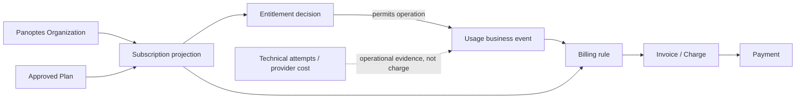
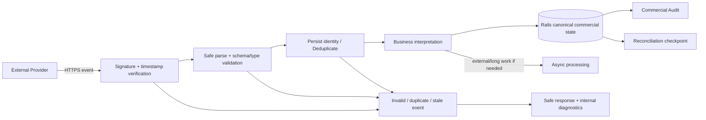

# Module 27: Stripe / Billing / CRM / Webhook

Status: `COMPLETE / READY_FOR_M28`  
Phase: `TB-28`  
Difficulty: `ADVANCED`  
Prerequisites: `M01`–`M26`（direct curriculum dependencies: `M08`–`M18`, `M23`–`M26`）

## 1. 学習目標（Learning goals）

このModuleを終えた学習者は、次の内容を説明し、判断できます。

1. Plan、Subscription、Entitlement、Usage、Charge、Invoice、Paymentを別のCommercial conceptとして説明する。
2. Technical Cost、Customer Usage、Billing Chargeを分離する。
3. Rails-owned Commercial DomainとBilling/CRM Providerの責務境界を説明する。
4. AuthorizationとEntitlement、OrganizationとProvider Customer/CRM Companyを区別する。
5. Webhookをuntrusted external eventとしてverify、validate、deduplicate、interpretする。
6. Retry、out-of-order、eventual consistency、reconciliationを説明する。
7. Usage/Entitlement enforcementとQuota raceをRails Business Ruleとして扱う。
8. Audit、Security、Testing、MonitoringをCommercial flowへ接続する。
9. CURRENT evidence、TARGET integration、DEFERRED Pricing/Provider policyを混同しない。

本教材はDocumentation-onlyです。Stripe/CRM導入、API key設定、Product/Price/Checkout/Webhook実装、Billing schema、Pricing/Charge/Quota policy、External API call、Source変更、build/test/qualityは行いません。

## 用語ガイド

- **Plan:** Productが提供する機能・上限・価格体系の定義。
- **Subscription:** CustomerがどのPlanを、どの期間・状態で契約しているかを表す関係。
- **Entitlement:** そのCustomerやOrganizationが現在利用できる機能・上限。
- **Usage:** Product上で実際に利用した量。内部のTechnical Costや請求額とは同じではない。
- **Webhook:** 外部Providerが状態変化をHTTP eventとして通知する仕組み。受信しただけでは信頼済みcommandにならない。
- **CRM:** 営業・顧客対応の情報を管理するSystem。PanoptesのOrganization正本とは区別する。

## 2. Billing fundamentals

Billingは、Customerへ提供したProduct/Serviceと契約条件に基づき、請求・支払状態を管理するBusiness Domainです。

```text
Billing != Usage counting
Usage != Charge != Subscription State
Technical Cost != Customer Usage
```

Analysisを1回実行したという事実はUsage候補であり、それだけで請求額やSubscription状態を確定しません。

## 3. Commercial state separation

| 概念         | 中心となる問い                               | Example candidate                  |
| ------------ | -------------------------------------------- | ---------------------------------- |
| Plan         | どの商用Offer/Tierか                         | feature set、quota、price model    |
| Subscription | CustomerがどのPlanをどの契約状態で利用するか | active/trial/cancelled等           |
| Entitlement  | 現在何を利用してよいか                       | feature access、analysis allowance |
| Usage        | Productをどの単位で利用したか                | eligible Analysis execution        |
| Charge       | Rule適用後に何を請求対象とするか             | metered/periodic charge            |
| Invoice      | 請求内容をまとめたCommercial record          | billing period内のline items       |
| Payment      | 金銭移動の状態                               | paid/failed/pending等              |

Exact Plan、state enum、price、billing intervalは承認済みProduct Contractを超えて決めません。

## 4. Commercial domain flow



矢印はconceptual relationであり、現在のphysical schemaではありません。Plan UIやProvider enumをBusiness Stateの代替にしません。

## 5. Plan and Subscription

Planは、商用の提供条件やProductの段階を表し、機能、利用上限、価格体系、請求間隔などを持つ場合があります。Subscriptionは、OrganizationやCustomerが、どのPlanをどの契約状態で利用しているかを表します。

Providerが`active`、`past_due`などの状態を持っていても、そのenumをFrontend全体へ直接広げません。Railsの連携層で、Product上の意味、猶予、手動の上書き、同期待ちなどを解釈し、Panoptesの正式な商用状態の表現としてAPIへ返します。

CURRENT `/plan` routeは`MarketingLandingPage`を描画するroute aliasで、pricing/plan contractを持ちません。Route名だけからPricing pageやPlan正本と推測しません。

## 6. Entitlement

Entitlementは「そのCustomer/Organizationが何を利用してよいか」というBusiness Permissionです。

Candidate:

- feature access
- analysis allowance/quota
- competitor count
- model availability
- history/retention access

SubscriptionとEntitlementは同じではありません。販促、個別の上書き、猶予期間、試用、旧契約条件の維持などによって、同じSubscriptionでも利用できる機能や上限が異なる可能性があります。具体的なpolicyは新設しません。

## 7. Authorization vs Entitlement

Authorizationは「ActorがそのResourceへ操作権限を持つか」。Entitlementは「Organizationが契約上そのFeatureを利用できるか」。

```text
Organization Role != Plan Entitlement
```

Ownerでも未契約Featureは使えず、契約済みでも他OrganizationのResourceは操作できません。

Canonical enforcement:

```text
Frontend UX hint
  -> BFF session/context
  -> Rails Authorization + Entitlement decision
```

FrontendでFeatureを隠すだけではenforcementになりません。

## 8. Usage and Usage Event

UsageはProduct利用実績です。Usage EventはCommercial decisionのEvidenceになり得ます。

Candidate fields（formal schemaではない）:

- Organization/Commercial Customer relation
- usage type and quantity where applicable
- occurred/decided time
- related operation/AnalysisJob
- idempotency identity
- result/outcome context
- applied Plan/policy version

PD-04はPlan-specific Usage Policyとusable-result baselineのlogical direction、およびUsage EntitlementとStripe chargeの分離を承認済みと記録します。一方、exact unit、threshold、price、schema、implementationはDeferredです。

## 9. Technical Cost vs Customer Usage vs Charge

| 層（Layer）              | 意味                                                | 担当の候補                                  |
| ------------------------ | --------------------------------------------------- | ------------------------------------------- |
| Technical execution/cost | Worker attempt、LLM token、CPU、Storage等の原価事実 | Worker/Infrastructure telemetry             |
| Customer Usage           | Product Contract上の利用単位                        | Rails Business Domain                       |
| Charge                   | Plan/price/billing rule適用後の請求結果             | Rails commercial rule + Provider processing |

Example:

```text
AnalysisJob J1
  Attempt A1 -> external timeout
  Attempt A2 -> success

Technical attempts = 2
Customer Usage      = policyにより1候補
Charge              = Plan/Billing ruleで別途決定
```

RetryでProvider costが増えてもCustomer Usageを自動2倍にしません。逆にInternal costが低くてもSubscription feeがゼロになるとは限りません。

## 10. Billing Rule and Rails ownership

Billing RuleはUsage、Subscription、Price、period、discount/override等から請求を決めるBusiness Logicです。WorkerやFrontendでChargeを確定しません。

Rails ownership candidate:

- Organization/Commercial Customer relation
- Subscription projection
- Entitlement decision
- Usage business decision
- Commercial state and provider mapping
- Webhook verification後のbusiness handling
- commercial Audit/reconciliation state

External Providerはpayment/subscription infrastructureを担えるが、PanoptesのOrganization、Feature meaning、Authorization、Usage semanticsのAuthorityではありません。

## 11. External billing provider boundary

Billing Provider candidate responsibilities:

- hosted checkout/customer portal
- payment method handling
- invoice/payment processing
- provider subscription infrastructure
- signed event delivery

Panoptes responsibilities:

- 誰がどのOrganizationについてflowを開始できるか
- approved Plan/Price mapping
- return/redirect安全性
- Provider Customer/Subscription ID mapping
- event authenticity/idempotency/business interpretation
- Entitlement/Usage/API projection

```text
External Provider != Panoptes Business Authority
Provider state     != Frontend Business Stateそのもの
```

## 12. Identity mapping

次は別Identityです。

- Panoptes User
- Panoptes Organization
- Billing Customer
- Provider Subscription/Invoice/Event
- CRM Company
- CRM Contact

Provider IDは外部連携先での識別子であり、Panoptes Organization IDの代わりにはなりません。CRM Company IDをOrganization IDとして使わず、emailが同じという理由だけでUser、Contact、Customerを同一視しません。それぞれの対応関係と、その管理元を明示します。

PanoptesがB2BでOrganization単位Billingになる可能性は高いが、正式billing subjectはProduct Contractで決めます。本教材でUser/Organization responsibilityを新規確定しません。

## 13. Provider state projection

Conceptual flow:

```text
Provider state/event
  -> Rails Integration Layer
  -> validation + mapping
  -> Business interpretation
  -> Canonical commercial projection
  -> Organization-scoped API
  -> Frontend display
```

Provider enum、Price ID、raw payloadをUIのdomain modelにしません。Provider変更時もFrontendとBusiness Contractが安定するseamを持ちます。

Paymentが成功していても、Entitlementの更新まで必ず完了しているとは限りません。Webhookの配送・処理やReconciliationには、時間差が生じる可能性があります。

## 14. Invoice and Payment

Invoiceは請求内容をまとめたCommercial recordで、Usage Eventと1:1とは限りません。複数Usageをperiod内で集約する場合も、固定Subscription lineとUsage lineを組み合わせる場合もある。

PaymentはInvoice/Chargeに対する金銭移動状態です。Invoice作成、Payment成功、Panoptes state反映、Entitlement変更は異なるstepとして扱います。

Exact billing period、invoice aggregation、failure/grace/dunning policyは決めません。

## 15. Webhook fundamentals

WebhookはExternal ProviderからInternet経由で届く非同期Event通知です。

```text
Webhook != Trusted Command
HTTPS    != Sender authenticity proof
Duplicate delivery != New Commercial Event
```

受信しただけで無条件にSubscription/Entitlement/Usage/Payment stateを変更しません。

## 16. Webhook security boundary

最低限のcontrol:

- signature/authenticity verification
- raw body/required format handling per provider contract
- timestamp/replay consideration
- event/payload/type validation
- secret management/rotation
- size/rate/resource limits
- safe error response/logging
- Organization/provider mapping verification

Client-provided`price = 9800`や`plan = sovereign`を信用せず、Railsがapproved Plan/Price mappingを解決します。Webhook errorへSecret、signature detail、internal stack、payment-sensitive detailを返さない。

## 17. Webhook boundary flow



Exact persistence/async response strategyはProvider retry contractとapproved Architectureに従います。

## 18. Webhook idempotency

Provider Event ID等のstable identityがあれば、same eventを複数回処理してもBusiness Effectを重複させない。

Example: `invoice paid`相当eventが2回届く。

- Entitlement renewalを二重適用しない。
- Usage correctionを二重作成しない。
- Audit上はduplicate deliveryを観測しても、Business mutationは1回にする。

Providerのidempotency mechanismとPanoptes operation identityは関連するが同一ではありません。Checkout double click、network retry、Webhook duplicateそれぞれのidentity/boundaryを設計します。

## 19. Ordering and eventual consistency

Webhookは、遅延したり、重複したり、発生順とは異なる順序で届いたりする可能性があります。`updated`が`created`より先に見える、古いeventが後から届く、といった場合を前提に設計します。

判断材料candidate:

- Provider event identity/timestamp/version
- locally applied state/version
- current provider object lookup
- allowed state transition
- processing/audit history

UserがProvider UIでsuccessを見てもPanoptes Canonical State反映まで時間差があり得ます。UI stateを新設する場合はProduct Contractで決め、本教材では勝手に`pending` enumを追加しません。

## 20. Reconciliation

Webhookだけに依存すると、配送の失敗、eventの遅延、受信後の処理失敗によって、ProviderとPanoptesの状態がずれる可能性があります。Reconciliationは、両方の状態を再確認し、差分を検出して安全に修復する処理です。

```text
External consistency = transactionだけではなく
idempotency + retry + reconciliation + audit
```

Exact schedule、lookup strategy、automatic/manual correction、provider authority範囲はDeferredです。

## 21. Distributed transaction boundary

Rails DB transactionとExternal Provider/CRM APIを完全なsingle transactionにすることは一般に難しい。

例:

1. Local Subscription intentを保存。
2. Provider API call。
3. Local projection更新。
4. CRM sync。

途中failureに備え、idempotency、state machine、retry、reconciliation、Auditを組み合わせる。Outbox等は一般candidateとして理解してよいが、新規Architecture Decisionとして採用しません。

CRM sync failureでAnalysis/Snapshotのcore transactionまで必ずrollbackさせるべきとは限りません。Failure criticalityをdomainごとに分離します。

## 22. Checkout and portal boundary

Hosted Checkout/Customer Portalを使う場合も、Applicationは次を検証します。

- authenticated actor
- Organization membership/role
- approved Plan/Price mapping
- return destination safety
- correlation/idempotency
- resulting Provider object mapping
- canonical stateはWebhook/reconciliation等で確認

Browserが送るPrice IDやOrganization mappingをそのまま信用しません。Provider hosted UIを使う価値の一つはSensitive Payment DataをPanoptesが不必要に保持しないことです。PCI詳細は本Module範囲外。

## 23. Entitlement and quota enforcement

Quotaは一定period/contract内で使える量で、Usage/Reservation等と比較して利用可否を決めます。

Concurrency race example:

```text
remaining quota = 1
Request A checks -> available
Request B checks -> available
A and B both start
```

Business-critical enforcementにはRails/DB transaction、atomic reservation/decision等が必要になり得ます。ただし、開始時consume、完了時commit、failure時release、Partial課金等はCommercial Policyであり、本教材で決めません。

## 24. Failed, cancelled, timed-out, and partial outcomes

Technical Job outcomeからCustomer Usage/Chargeを自動決定しません。

| Outcome             | Product meaning             | Commercial decision                            |
| ------------------- | --------------------------- | ---------------------------------------------- |
| completed           | usable validated result候補 | approved Usage policyを適用                    |
| partially_completed | limitations付きresult       | policy未確定部分を発明しない                   |
| failed              | valid Product Result不成立  | charge/usage policyは別判断                    |
| cancelled/timed_out | distinct terminal reason    | technical attemptsとCommercial treatmentを分離 |

PD-04はusable-result baselineとPlan-specific Usage directionを承認したが、exact threshold/price/unitはDeferredです。Snapshot creationもHistorical Product RecordでありBilling Eventと同一ではありません。

## 25. CRM fundamentals

CRMはProspect/CustomerとのSales、Marketing、Customer Success relationshipを扱うexternal/system domainです。

Candidate entities:

- Lead
- Company
- Contact
- Opportunity
- lifecycle stage/account owner/notes

```text
CRM Company != Panoptes Organization
CRM Contact != Panoptes User
```

Product DBはProduct operation、Authorization、Subscription/Entitlement/Usage semanticsを持ちます。CRMはsales/customer-success contextを持ちます。両者を同じSource of Truthにしません。

## 26. CRM field ownership and sync

Conceptual ownership candidate:

- Panoptes: Product Organization identity、Entitlement/Usage、canonical Product operation
- CRM: sales stage、account owner、opportunity/engagement note

正式CRM schemaではありません。重要なのはfieldごとにowner、mapping、direction、conflict ruleを持つこと。

一方向同期は、更新元から同期先へ値を反映する方式です。双方向同期では、更新の競合、循環、削除、一部だけ失敗した場合の扱いが難しくなります。すべてのfieldを双方向同期することを標準にはしません。CRM Webhookにも、送信元の真正性の検証、冪等性、識別子の対応付け、Retry、Reconciliationを適用します。

## 27. Internal event vs external webhook

Internal Domain EventはPanoptes内部で成立したBusiness Eventです。External Webhookは外部Providerから届くuntrusted integration eventです。

Providerの`invoice paid`相当eventをverify/interpretした後、Panoptes内部で`Commercial State Updated`相当のDomain Eventを発生させることはあり得ます。同じ“Event”でもTrust Boundary、schema owner、retry semanticsが異なります。

## 28. Provider outage and failure policy

Providerが一時Unavailableでも既存Entitlementを即すべて無効化するかはBusiness Policyです。

- Fail closed: unauthorized usageを抑えるがCustomer impactが大きい。
- Fail open/cache last known: continuityは高いがcommercial riskがある。
- Grace/limited operation: 中間policy候補。

正式policyは決めません。Provider failure、sync lag、local stale stateをUI/Errorで区別する場合もProduct Contractが必要です。

CRM failureは通常Product Core Transactionとcriticalityが異なる場合があります。CRM停止を理由にAnalysis Result creationを必ず失敗させない方向を評価します。

## 29. Commercial audit

Audit candidate:

- Subscription/Plan change
- Entitlement override/grace
- Usage correction
- Provider Customer/Invoice mapping change
- Webhook-applied state transition
- reconciliation/manual repair
- privileged refund/cancel operation

Candidate fieldsはactor/system source、Organization/resource、action、before/after、provider event/reference、time/result/reasonです。Exact Event CatalogやRetentionは新設しません。

Debug LogはAudit正本ではありません。Duplicate Webhook Logが2件あってもBusiness Audit mutationは1件になるべきcaseがあります。

## 30. Security and privacy

最低限:

- Provider credential/Webhook secretはserver-side Secret。
- Webhook signature/timestampをverify。
- Client price/plan/customer mappingをtrustしない。
- RailsでAuthorization + Entitlementをenforce。
- Least PrivilegeでProvider/CRM permissionを分離。
- Safe redirect/return destination。
- Payment method full detail、secret、raw signature、不要なPIIをLogしない。
- Tenant-scoped commercial data access。

Hosted payment providerを使う場合も、Panoptesが不必要なcard dataを受け取らない設計を優先します。

## 31. Testing connection

M24へ接続するTest candidate:

- entitled/denied Organization
- permitted role but non-entitled Feature
- wrong Organization commercial mutation
- valid/invalid signature
- duplicate Webhook Event ID
- out-of-order/stale event
- Usage operation idempotency
- quota concurrency
- provider mapping mismatch
- CRM field ownership/mapping
- reconciliation mismatch/repair

External Provider sandboxを使うintegration testと、controlled fixture/fakeを使うUnit/Contractを分けます。実Testは追加しません。

## 32. Monitoring connection

M25へ接続するMetric/Alert candidate:

- Webhook verification/processing failure rate
- duplicate/stale/out-of-order events
- reconciliation mismatch count/age
- Provider latency/unavailability
- Subscription projection lag
- Entitlement decision failures
- Usage decision/idempotency conflicts
- CRM sync backlog/failure

Exact Alert thresholdは決めません。Payment/Commercial dataをLog/Metric labelへ過剰露出しません。

## 33. CURRENT / TARGET / DEFERRED

### CURRENT — repository/Product Decisionで限定確認できたもの

- PD-04 logical decision: Plan-specific Usage + usable-result baseline、Usage EntitlementとStripe chargeの分離
- PD-04 implementation boundary: exact threshold/unit/price/schema/Stripeは`NOT_IMPLEMENTED`/Deferred
- Frontend `PanoptesUsageState` typeとmock `getUsageState()`
- mock Usageは`tokenUsageRate`、project day count/max、display labelsを返す
- canonical business clientのUsage pathはunavailable fallbackを持つ
- `/plan`はPricing実装ではなくMarketingLandingPage alias
- RailsにはUser/Organization/Membership modelとidentity/authz boundary
- Rails routesはhealth/me/Organization readのみ
- OpenAPIにBilling/Usage/Subscription/Webhook surfaceを確認できない
- `package.json`にStripe/CRM SDK dependencyを確認できない

現行Frontend mock/display UsageをCustomer Charge、Billing ledger、canonical entitlementとして扱いません。限定確認ではStripe/CRM/Webhook/Billing schema/provider credentialsをCURRENT実装として確認していません。

### TARGET

- Rails-owned Organization-scoped Commercial Domain
- Plan/Subscription projection/Entitlement/Usage/Charge separation
- approved Plan/Price and Provider ID mapping
- server-side Authorization + Entitlement enforcement
- verified/idempotent/out-of-order-aware Webhook processing
- reconciliation and eventual consistency state
- CRM field ownership/mapping/sync boundary
- Commercial Audit、safe Logging、Testing、Monitoring
- Provider-specific enum/payloadをIntegration Layerに閉じ込めるAPI projection

### DEFERRED

- Stripe final adoption/integration
- exact Product/Price IDs and Pricing
- exact Plan/Subscription/Entitlement schema/state enum
- Usage unit/threshold/period and quota reset
- failed/cancelled/timed-out/partial charging policy
- reservation/commit/release policy
- exact Webhook event catalog、retry/response timing、storage strategy
- reconciliation cadence/authority/repair workflow
- CRM provider、field schema、sync direction/conflict rule
- financial/commercial retention、audit catalog、operational alert threshold

## 34. Representative repository mapping

| Representative                                                  | Domain role                              | Source of truth / mapping                | 状態                                       |
| --------------------------------------------------------------- | ---------------------------------------- | ---------------------------------------- | ------------------------------------------ |
| `docs/product/product-decision-register.md`                     | PD-04 Usage decision                     | Product decision record                  | Logical `CURRENT`; implementation Deferred |
| `src/lib/panoptes/types.ts`                                     | `PanoptesUsageState` display/client type | Frontend contract, not Billing authority | `CURRENT`                                  |
| `src/lib/panoptes/api/mock-backend.ts`                          | mock Usage response                      | Development fixture                      | `CURRENT` mock only                        |
| `src/lib/panoptes/api/mock/snapshot-factory.ts`                 | seeded token usage display data          | Fixture generation                       | `CURRENT` mock only                        |
| `src/lib/panoptes/api/unavailable-canonical-business-client.ts` | canonical Usage unavailable behavior     | Frontend failure boundary                | `CURRENT`; real provider absent            |
| `src/routes/plan/+page.svelte`                                  | Marketing route alias                    | No Pricing/Plan authority                | `CURRENT`                                  |
| `rails/app/models/organization.rb`                              | Product Organization identity            | Rails/PostgreSQL                         | `CURRENT` identity basis                   |
| `rails/app/models/organization_membership.rb`                   | Organization Role/Authorization          | Rails/PostgreSQL                         | `CURRENT`; not Entitlement                 |
| `rails/config/routes.rb`                                        | Implemented Rails API surface            | Rails routes                             | `CURRENT`; Billing/Webhook absent          |
| `docs/api/openapi-draft.yaml`                                   | Business API contract draft              | API contract                             | `CURRENT/TARGET`; Billing surface absent   |
| `package.json`                                                  | Frontend/runtime dependencies            | Dependency manifest                      | `CURRENT`; Stripe/CRM SDK absent           |
| `docs/learning/modules/13-async-job-queue-retry-idempotency.md` | Retry/Idempotency principles             | Architecture learning contract           | Input to `TARGET` Commercial flow          |

## 35. Worked example: Organization starts Analysis

1. User Authentication: identityを確認。
2. Authorization: UserがOrganization/Projectへ操作権限を持つかRailsが確認。
3. Entitlement: OrganizationがAnalysis Featureを利用可能か確認。
4. Usage eligibility/quota: approved policyとatomic/reservation requirementを適用。
5. AnalysisJob: idempotentにCanonical Jobを作成。
6. Worker: Attempt A1 failure、A2 success。Technical attempts/costは2候補。
7. Job outcome: Railsがcompleted/partial等をCanonicalに決定。
8. Usage decision: PD-04/Plan-specific policyに従いBusiness Usage Eventを一意に決定。
9. Billing rule: Subscription/Price/period等を適用しCharge/Invoiceへ接続。
10. Provider: Payment/Invoice infrastructureを処理し、WebhookをRailsがverify/interpret。
11. Reconciliation/Audit: duplicate/lag/mismatchを追跡・修復。

核心は`Worker Attempt数 != Customer Usage数 != Charge数`です。

## 36. Common misunderstandings

- Usage = Charge、ではない。
- Technical Cost = Customer Usage、ではない。
- Subscription = Entitlement、ではない。
- Role = Entitlement、ではない。
- Payment success = Application state sync完了、ではない。
- Provider state = Panoptes Business Truth、ではない。
- Webhook = trusted command、ではない。
- HTTPS = Webhook authenticity proof、ではない。
- Duplicate Webhook = new Business Event、ではない。
- CRM Company = Panoptes Organization、ではない。
- Same email = same identity、ではない。
- Snapshot = Billing Record、ではない。
- Worker retry = Customer Usage追加、ではない。
- External Provider = Authorization Authority、ではない。
- Frontend hidden feature = Entitlement enforcement、ではない。

## 37. Decision heuristic

1. User may access Resource? → Authorization / Rails。
2. Organization may use Feature? → Entitlement / Rails。
3. Product was used? → Usage Business Logic。
4. What should Customer pay? → Billing Rule。
5. Payment actually processed? → Provider fact + Rails projection。
6. External event authentic? → Webhook verification。
7. Duplicate event/operation? → Idempotency。
8. Provider/Panoptes disagreement? → Reconciliation。
9. Sales lifecycle? → CRM owner/mapping。
10. Product identity/semantics? → Panoptes Domain。

## 38. Practice

### A. Knowledge Check

1. BillingとUsage countingの違いを説明してください。
2. SubscriptionとEntitlementを区別してください。
3. Provider stateをPanoptes Business Truthへ直接しない理由を説明してください。

### B. Domain Classification

次をPlan、Subscription、Entitlement、Usage、Charge、Invoice、Payment、CRMへ分類してください。

1. OrganizationがPro Planを契約中。
2. Competitor analysisを利用可能。
3. Analysisをeligible unitとして1回利用。
4. 月次請求の金額line。
5. 複数lineをまとめた請求書。
6. Card payment成功。
7. Sales opportunity stage。

### C. Usage Exercise

初回Analysis、Worker retry、UserによるReanalysis、failed、cancelled、timed_out、partialを、Technical attempt、Product outcome、Usage candidateへ分離してください。Formal Charge policyは発明しません。

### D. Entitlement Exercise

Owner/viewer、Organization A/B、契約済み/未契約Featureを組み合わせ、AuthorizationとEntitlementの両方が必要なcase tableを作ってください。

### E. Webhook Exercise

Valid event、invalid signature、duplicate Event ID、old/stale event、out-of-order event、unknown typeを、reject/no-op/apply/reconcile candidateへ分類してください。

### F. Identity Exercise

User、Organization、Billing Customer、Provider Subscription、CRM Company、CRM Contactのmappingを描き、email一致だけでjoinしない理由を説明してください。

### G. Reconciliation Exercise

ProviderではPayment succeededだがWebhookを受信できなかった。Panoptes stateとの差をどう検出し、idempotently修復し、Auditするか概念説明してください。

### H. Security Exercise

Clientから送られたPlan/Price/Organization/return URLをそのままtrustできない理由と、Railsで再解決・検証する項目を述べてください。

### I. Violation Detection

1. Worker attemptごとにCustomer Charge。
2. Client priceをそのままProviderへ送る。
3. Webhook signatureを検証しない。
4. 同じWebhook Event IDを再適用する。
5. CRM Company IDをOrganization IDとして使う。
6. Subscription activeだけでResource accessを許可する。
7. Failed Paymentで即全Product Dataを削除する。
8. Provider enumをFrontend全体へ直接露出する。
9. CRM API failureでAnalysis transactionを必ずrollbackする。

### J. Architecture Explanation

「なぜPanoptesではUsage、Billing、Entitlement、External Provider Stateを分離するのか」を、Product semantics、Authorization、retry/idempotency、provider portability、Auditの観点から説明してください。

## 39. Answers / explanation guide

### A. Knowledge Check

UsageはProduct利用実績、Billingは契約/price/ruleに基づく請求Domainです。Subscriptionは契約関係、Entitlementは現在利用できるFeature/量でありoverride/grace等で一致しない場合があります。Provider stateは外部enum/availability/eventual consistencyを持つため、RailsでPanoptes semanticsへ解釈します。

### B. Domain Classification

1 Subscription、2 Entitlement、3 Usage、4 Charge、5 Invoice、6 Payment、7 CRM。Planはこれらの契約条件を定義するOfferです。

### C. Usage Exercise

RetryはTechnical attemptを増やすが同一Job/operationのCustomer Usageを自動増加させない。Reanalysisは新JobだがCharge treatmentはPlan policy次第。Failed/cancelled/timed_out/partialはdistinct Product outcomeで、exact Usage/ChargeはDeferred policyに従います。

### D. Entitlement Exercise

同じOrganizationのpermitted roleかつFeature Entitlementありの場合だけallow候補。他Organization、insufficient role、非Entitledはいずれもdenyします。RoleとPlan判定を互いの代替にしません。

### E. Webhook Exercise

Invalid signatureはreject。DuplicateはBusiness no-op + diagnostic/Audit candidate。Stale/out-of-orderはlocal version/current Provider stateに基づきignore/reconcile。Unknown typeはsafe no-op/diagnosticをProvider contractに従って扱い、無条件applyしません。

### F. Identity Exercise

Panoptes User/OrganizationをProduct identityとし、Provider/CRM IDをmapping table/relationで結ぶ。Emailは変更・共有・大文字小文字・複数Contact等がありstable unique identityではありません。

### G. Reconciliation Exercise

Scheduled/manual reconciliationでProvider objectをauthenticated server-sideに取得し、mapping/versionを確認します。同じbusiness operation identityでapplyし、before/after、provider reference、resultをAuditします。Webhook再処理と二重mutationを避ける。

### H. Security Exercise

Client値は改ざん可能です。Railsはauthenticated actor、Organization membership/role、approved Plan/Price mapping、Entitlement、safe return destination、operation idempotencyを再検証し、Provider credentialをserver-sideに保持します。

### I. Violation Detection

順にTechnical/Commercial混同、client trust、authenticity欠如、idempotency違反、identity conflation、Authorization/Entitlement混同、未承認destructive policy、provider leakage/coupling、failure criticality/distributed transaction誤設計です。

### J. Architecture Explanation

Usage、Charge、Entitlement、Provider stateはownerと意味が異なります。分離によりWorker retryを二重課金せず、Roleと契約を両方enforceし、Provider eventをverify/idempotently解釈できます。Provider変更やeventual consistencyがあってもPanoptesのBusiness semanticsとAuditを維持できます。

## 40. Completion criteria

|   # | Criterion                                              | Result |
| --: | ------------------------------------------------------ | ------ |
|   1 | Billing fundamentals explained                         | `PASS` |
|   2 | Plan/Subscription/Entitlement distinction explained    | `PASS` |
|   3 | Usage/Charge/Technical Cost distinction explained      | `PASS` |
|   4 | Provider boundary explained                            | `PASS` |
|   5 | Webhook security/idempotency explained                 | `PASS` |
|   6 | Reconciliation/eventual consistency explained          | `PASS` |
|   7 | CRM boundary explained                                 | `PASS` |
|   8 | Audit/Security/Testing/Monitoring connection explained | `PASS` |
|   9 | Repository mapping + diagrams included                 | `PASS` |
|  10 | Exercises + answers included                           | `PASS` |

M27 authoring result: `10 / 10 PASS`。教材完成はStripe/CRM導入、Pricing/Charge/Quota policy、Billing schema、Webhook/Checkout implementation、Commercial production readinessの完了を意味しません。

## 41. M28 handoff

Recommended next phase: `TB-29 — Module 28: Performance / Scalability`。

M28ではlatency、throughput、capacity、bottleneck、cache、DB/query、Frontend、Worker/Chromium、load/backpressure、measurementを扱います。Optimization実装やload test実行は教材作成と分離します。

## References

- [M08 Rails Business Backend](./08-rails-business-backend.md)
- [M09 PostgreSQL / Source of Truth](./09-postgresql-source-of-truth.md)
- [M10 Auth / Authorization / Organization](./10-auth-authorization-organization.md)
- [M12 AnalysisJob Lifecycle](./12-analysis-job-lifecycle.md)
- [M13 Async Job / Queue / Retry / Idempotency](./13-async-job-queue-retry-idempotency.md)
- [M15 Snapshot / History / Lineage](./15-snapshot-history-lineage.md)
- [M18 Missing / Partial / Eligibility](./18-missing-partial-eligibility.md)
- [M23 Security Fundamentals](./23-security-fundamentals.md)
- [M24 Testing / CI/CD](./24-testing-cicd.md)
- [M25 Logging / Monitoring / Audit](./25-logging-monitoring-audit.md)
- [M26 Infrastructure / Cloud Boundary](./26-infrastructure-cloud-boundary.md)
- [Product Decision Register](../../product/product-decision-register.md)
- [Panoptes Technical Bootcamp](../panoptes-technical-bootcamp.md)
