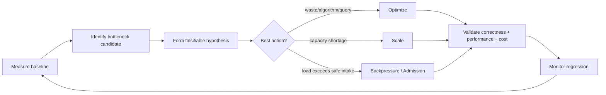
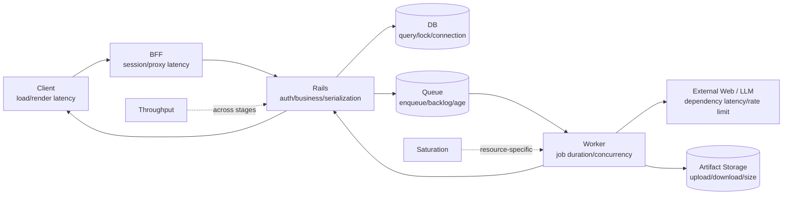

# Module 28: Performance / Scalability

Status: `COMPLETE / READY_FOR_BOOTCAMP_CLOSURE_REVIEW`  
Phase: `TB-29`  
Difficulty: `ADVANCED`  
Prerequisites: `M01`–`M27`（direct curriculum dependencies: `M01`, `M06`–`M18`, `M24`–`M27`）

## 1. 学習目標（Learning goals）

このModuleを終えた学習者は、次の内容を説明し、判断できます。

1. PerformanceとScalabilityを区別する。
2. Latency、Throughput、Concurrency、Saturation、Backlogを正しく使い分ける。
3. End-to-end Flowを区間へ分解し、Bottleneck候補をsignalから絞る。
4. Frontend、BFF/Rails、PostgreSQL、Queue、Worker/Chromium、External LLM、Artifactの性能責務を説明する。
5. CacheをSource of Truthにせず、freshness、version、Authorizationを守る。
6. Backpressure、Admission Control、Retry amplificationを説明する。
7. OptimizationとScalingを区別し、変更前後を測定する。
8. Capacity、Headroom、Reliability、Security、Correctness、Costのtrade-offを評価する。
9. CURRENT設定、TARGET instrumentation、DEFERRED tuningを混同しない。

本教材はDocumentation-onlyです。Performance tuning、Cache/Index/Query/Concurrency/Autoscaling変更、Load/Benchmark/Traffic simulation、Infrastructure/Source変更、build/test/qualityは行いません。

## 用語ガイド

- **Performance（性能）:** 現在の条件で、処理がどれだけ速く・安定して完了するか。
- **Scalability（拡張性）:** 利用量が増えたとき、resourceや構成を増減して処理能力を維持・拡張できる性質。
- **Latency（待ち時間）:** 一つのrequestやJobが開始してから結果を返すまでの時間。
- **Throughput（処理量）:** 単位時間あたりに処理できるrequestやJobの数。
- **Concurrency（同時実行数）:** 同じ時間帯に進行している処理の数。
- **Saturation（飽和）:** CPU、connection、Worker slotなどが限界に近づき、待ちや失敗が増える状態。

## 2. Performance fundamentals

Performanceは、Systemが要求された処理をどれだけ速く、効率よく完了できるかを表します。Response時間に加え、resource使用量、操作への応答性、処理完了までの時間、処理量も含みます。

```text
Fast once != Efficient
Low average != Good tail latency
Performance != Scalability
```

Panoptesでは短いAPI responseと長いAnalysis completionを同じLatencyとして扱いません。

## 3. Scalability fundamentals

Scalabilityは、loadが増えたときにacceptable performanceを維持できる能力です。

- 1 Userでは高速、1000 concurrent usersで急激に遅い: baseline performanceは良くてもscalabilityに問題がある。
- 1 Analysisが常に遅い: scaleよりsingle-operation bottleneck/algorithm/dependencyを疑う。
- Loadに応じてresourceを増やしてもDB connectionが枯渇する: horizontal scaleの前提が崩れている。

## 4. Core performance terms

| 概念        | 意味                             | Panoptesでの例                            |
| ----------- | -------------------------------- | ----------------------------------------- |
| Latency     | 一つのoperation完了時間          | API response、Job completion、LLM call    |
| Throughput  | 一定時間内の処理量               | requests/sec、jobs/hour、pages/min        |
| Concurrency | 同時進行中の処理数               | active requests/jobs/browser processes    |
| Saturation  | resourceがcapacity限界へ近い状態 | CPU、memory、DB connections、Worker slots |
| Backlog     | 到着済みだが未処理の仕事         | queue depth/oldest message age            |
| Bottleneck  | 全体性能を最も制限する箇所       | DB、Chromium、LLM、Storage等              |

同時実行数を増やすと処理量が増える場合があります。ただし、resourceが飽和した後は待ち時間が急増し、処理量が頭打ちになったり、かえって減ったりします。

## 5. Percentiles and tail latency

Averageだけでは少数の非常に遅いrequestを隠す。

- p50: 中央のUser experience
- p95: 遅い側5%境界
- p99: tail behavior

Average 200msでもp99が数秒なら重要User flowに影響する可能性があります。正式SLO/percentile targetは決めません。測定window、sample count、operation typeを揃えて比較します。

## 6. Measure before optimize



「測定→処理を制限している箇所の特定→仮説→変更→再測定」の順で進めます。「遅そうだからCacheを入れる」「CPUが高いからinstanceを増やす」といった、原因を確かめる前の最適化は避けます。

## 7. End-to-end performance flow



処理全体の完了時間は、各区間の実行時間と待ち時間に依存します。APIの応答が速くてもQueueで長く待つなら、ユーザーは分析の完了が遅いと感じます。

## 8. Little's Law intuition

安定した系では概念的に:

```text
Concurrency ≈ Throughput × Time in system
```

例えばJob到着率が同じでもdurationが伸びればactive Job数が増えます。これは厳密なCapacity計算を置き換えず、Latency・Throughput・Concurrencyの関連を理解する補助です。

## 9. Frontend performance

Candidate concerns:

- initial HTML/data load
- JavaScript bundle/download/parse
- hydration
- component render/reactive computation
- large table/chart/list DOM
- image/SVG/artifact size
- duplicate request/polling
- route transition

Code splitting、lazy loading、virtualization、memoizationは候補であり、測定せず導入しません。Heavy UI libraryを見つけてもbundle contributionとactual route usageを確認します。

## 10. Perceived performance

Actual durationが同じでもloading feedback、skeleton、progressive rendering、deferred detailでUser perceptionは変わります。ただし:

- Optimistic UIでCanonical Business successを偽装しない。
- Fake progressをJob stateとして扱わない。
- Loading stateをaccessibilityと一致させる。
- Partial/Limitedをcompleted表示へ潰さない。

Perceived performanceはTruth/State Contractを守る範囲で改善します。

## 11. Polling performance boundary

現行Frontendのpolling controllerは、処理中のrequestを一度に一つへ制限し、offline時は次回の取得を再scheduleします。既定のrequest timeoutは30秒です。Runtimeの対応付けでは、通常は2.5秒、確認待ちは6秒の間隔で状態を取得し、終端状態になると停止します。

これはcurrent configuration evidenceであり、Production trafficに最適な値という実測結論ではありません。

Polling loadは概念上:

```text
active polling clients / interval
```

に比例します。同時Jobが増えればBFF/Rails/DBへのread trafficも増える。Adaptive interval、server push等は候補だが採用を決めません。

## 12. API / BFF performance

BFFのLatency component:

- session/auth context resolution
- route guard
- request construction/proxy
- upstream wait
- response parse/serialization

CURRENT Canonical BFF clientはdefault 15秒timeoutを持ち、BFF→Rails clientはenvironment timeoutを100ms〜30秒に制限します。Timeoutはresource占有とfalse failureのtrade-offで、値だけ見て良否を断定しません。

BFFに重いFormula、collection、Business computationを置くとrequest runtimeを長くし、Web scalingとWorker workloadをcoupleします。BFFはtransport/session/orchestration境界を維持します。

## 13. Rails performance

Rails request latencyにはAuthentication、Authorization、DB query、Business service、transaction、serializationが含まれる。

Representative Organization indexはactive membershipをOrganizationとjoinし、active scopeをmergeし、Organizationをincludeしてname順に並べてください。`includes`はN+1抑制の意図を持ち得るが、実行計画・row数・index・実測なしに「最適」と断定しません。

Candidate issues:

- N+1
- excessive rows/columns/serialization
- missing/unused index
- slow authorization lookup
- lock/contention
- long transaction

## 14. Database performance

PostgreSQLの観測Candidate:

- query latency/distribution
- execution plan and rows scanned
- index usage
- connection usage/wait
- transaction duration
- lock/deadlock
- storage/cache hit where available
- data growth/skew

Query shapeでは必要以上のrows、columns、joinsを取得せず、pagination/filtering/projectionを使います。ただしpagination contractはAPI semanticsと一致させる。

## 15. Index and query trade-offs

Indexはreadを高速化できる一方、write amplification、storage、maintenance、planner complexityを増やす。

```text
Slow query -> measure plan/selectivity/workload -> choose change
Slow query != add every possible index
```

N+1はparent records取得後に各recordごとに追加queryするpatternです。Eager loadingやquery redesignは候補だが、Repo-wide tuningやgem導入はしません。

## 16. Connection pool and Web scaling

CURRENT Rails DB configは`RAILS_MAX_THREADS`由来のconnection上限を持ち、Pumaも同environmentからthread数を読みます。Puma config自体が、thread増加はThroughputを高め得る一方Latencyを悪化させ、resource poolをthread数以上にする必要を説明しています。

概念上:

```text
Web processes × threads/pool <= usable DB connection capacity
```

Web replicaだけ増やすとDB connection saturationを悪化させ得る。Exact worker/thread/pool値はLoad/DB capacityなしに決めません。

## 17. Transaction duration

長いtransactionはlock、contention、connection occupationを増やす。External Web/LLM/Provider callを長時間DB transaction内で待つと、dependency latencyがDB capacityを消費する可能性があります。

Canonical state changeのatomicityを守りつつ、external workとtransaction boundaryを分離します。Exact implementationはBusiness/Idempotency Contractを優先します。

## 18. Queue performance

Queueで見るsignal:

- enqueue rate
- dequeue/complete rate
- depth
- oldest message age
- enqueue-to-start latency
- processing duration
- redelivery/retry/DLQ

Queue depth増加だけで障害と断定しません。Traffic burstなら一時増加し、consumer capacity不足ならoldest ageも継続悪化します。Producer rate、consumer rate、Job duration、retryと組み合わせる。

## 19. Worker throughput

Worker Throughputは次に依存します。

- pages/competitors per Job
- HTTP fetch vs Chromium path
- parse/normalization/analysis complexity
- External Web/LLM latency/rate limit
- CPU/memory/temp storage
- concurrency
- artifact upload
- retry/failure rate

Web request Throughputと同じscale signalではありません。Queue ageが増えてもRails instance追加が解決しない場合があります。

## 20. Chromium cost and performance

Chromiumはstartup、memory、CPU、render、JavaScript execution、Screenshotで比較的重い。M14の「HTTP fetchで十分な処理まで全てChromiumにしない」という判断はPerformance、Capacity、Cost、Securityに効く。

Browser/context reuseはstartup costを減らし得るが:

- tenant/session state leakage
- crash blast radius
- memory leak
- cleanup complexity
- determinism

とのtrade-offがあります。正式採用しません。

## 21. Worker concurrency and external pressure

Concurrency増加はThroughputを上げ得るが、CPU/memory、DB/Storage、External Website/LLM pressure、rate limit、costを増やす。

```text
More workers != infinite throughput
CPU 100% != always wrong, but sustained saturation + latency/queue impact requires diagnosis
```

Worker slots、per-host concurrency、External rate、DB connectionsを一緒に考えます。Noisy neighbor対策としてtenant quota/fair scheduling/concurrency isolationは候補だが、exact policyは決めません。

## 22. LLM and Formula performance

LLM callはLatency、token volume、concurrency、rate limit、retryがPerformance/Costへ影響します。Model quality、speed、priceにはtrade-offがあるが、exact modelを選定しません。

FormulaはChromium/LLMより軽い可能性があっても、Competitor×Submetric×History、versioned recalculation等で量が増え得る。実測せず「絶対に問題ない」と断定しません。Correctnessとversion preservationを速度のために崩さない。

## 23. Artifact/storage performance

HTML/Screenshot等ではobject size/count、upload/download latency、metadata query、region/networkが影響します。

UI requestで巨大Artifactを毎回同期取得しない方向を評価し、summary/thumbnail/metadataを分離できます。ただしArtifact access、Lineage、historical identity、Authorizationを維持します。

Storage optimizationでcurrent/historical resourceを取り違えない。

## 24. Caching fundamentals

Cacheは計算/取得結果を一時保存し再利用してLatency/Loadを減らす。

```text
Cache != Source of Truth
Cache hit != Data is semantically valid
```

Candidate:

- static metadata
- immutable historical Snapshot projection
- version-keyed derived presentation
- expensive read where freshness/security contractが明確

Cache miss時のorigin cost、hit rate、object size、invalidation、cold startも測る。

## 25. Cache correctness

Panoptes固有のrisk:

- `current`と`latest`の混同
- Historical Snapshotをcurrent dataで上書き
- Formula/Axis version違いのreuse
- Tenant responseのcross-Organization sharing
- Entitlement/Role変更後のstale access

内容が変わらないSnapshotはCacheしやすい一方、Current resourceは最新状態への追従方法を別に考える必要があります。Cache keyには、resourceの識別子、version、Organizationやaccess権限の文脈が必要になる場合があります。

多数requestが同時missしoriginへ集中するCache Stampedeも考えます。Exact locking/cache architectureは決めません。

## 26. Backpressure and admission control

仕事を登録する速さが処理能力を超えると、Queueの未処理件数と待ち時間が増えます。Backpressureは、後続の処理能力に合わせて、Systemへ受け入れる仕事量を調整する考え方です。

Admission candidate:

- rate/concurrency limit
- scheduling/fairness
- quota/entitlement
- temporary reject/defer
- bounded queue

Commercial Quota、Security Rate Limit、Infrastructure Capacity Limitは目的が違う。表示上まとめても内部contractを分けます。

## 27. Retry amplification and timeout

失敗時に各Layerが独立してRetryすると、既に負荷の高い接続先へrequestが集中し、再試行がさらに負荷を増やすRetry Stormが起きるおそれがあります。

- retryable errorだけを対象にする
- max attempts/budget
- exponential backoff/jitter
- idempotency
- circuit/open behavior candidate
- deadline propagation

Exact値/algorithmは決めません。

Timeoutが長すぎるとresourceを占有し、短すぎると正常処理をfail扱いにします。Client/BFF/Rails/Worker/Job/External dependencyでscopeが違う。Nested timeoutは上位deadlineとの整合が必要です。

## 28. Async, batching, and parallelism

```text
Async != Parallel
```

Asyncは待ち時間中に他処理へ進める構造、Parallelは同時実行です。Parallelismを増やすとrate limit、resource contention、ordering/idempotency問題が生じます。

Batchingはoverheadを減らせる一方、single-item latency、memory、failure isolation、retry granularityを悪化させ得る。必要なmeasurementなしに採用しません。

## 29. Capacity planning

Capacity input candidate:

- customers/Organizations
- analyses per customer/month
- peak arrival pattern
- competitors/pages per Analysis
- average/p95 stage duration
- Worker/Chromium concurrency/resource
- Artifact size/count/retention
- DB/Queue throughput/connection
- LLM token/request/rate limit
- retry/partial rate

Low/Base/High scenarioが承認されていれば`Scenario → Estimated Load → Required Capacity → Cost`へ接続します。数値がなければ新規値を作りません。

## 30. Headroom and hotspots

平均Loadぴったりのcapacityではspike、retry、deploy/maintenance、failureに弱い。Headroomを持つがexact percentageは決めません。

Averageのほかskew/hotspotを見ます。

- 特定Organization/Project
- 大規模site/competitor set
- 特定Job type/stage
- time-of-day campaign burst
- shared DB/partition/resource

Multi-tenant noisy neighborが他Tenantへ影響する場合、fair scheduling、quota、concurrency isolationを検討します。

## 31. Cost-performance boundary

Performance改善にはCostが伴う。

- more/larger workers
- larger DB/more connections
- more cache/storage/egress
- higher LLM concurrency/model cost
- more telemetry retention
- redundancy/headroom

最速が最適とは限りません。Optimizationは同じresourceで効率を上げ、Scalingはcapacityを増やす。

```text
Slow SQL fix -> Optimization
DB instance increase -> Scaling
Queue admission limit -> Load control
```

1 AnalysisあたりTechnical CostはUnit Economicsに重要だが、M27どおり`Technical Cost != Customer Usage != Charge`です。

## 32. Performance, correctness, and security

高速化しても次を壊さない。

- Organization authorization
- freshness/current/history semantics
- idempotency and side-effect uniqueness
- Formula/Axis version
- Snapshot/Artifact Lineage
- Missing/Partial distinction
- Secret/private artifact boundary

Public CDN、shared cache、batch、parallel、reuseはSecurity/Tenant isolationへ影響します。`Fast != Correct != Safe`であり、Correctness/Security constraintを先に守る。

## 33. Observability connection

M25のsignalでPerformance hypothesisを検証します。

| 層（Layer）      | 代表的な指標                                              |
| ---------------- | --------------------------------------------------------- |
| Frontend         | initial load、route/render duration、bundle/resource size |
| BFF/API          | request latency/status/timeout、upstream duration         |
| Rails            | controller/service/query/serialization duration           |
| DB               | query latency、connections、lock/contention               |
| Queue            | depth、oldest age、enqueue-to-start                       |
| Worker           | Job/stage duration、concurrency、CPU/memory/browser crash |
| External Web/LLM | latency、failure/rate limit、usage                        |
| Artifact         | size/count、upload/download duration/failure              |

Instrumentationがない箇所を推測だけで最適化しません。Correlation ID/Job ID/Attempt IDでend-to-end timingを結ぶ。

## 34. Performance testing

M24と接続します。

- Benchmark: 特定処理/implementationを比較。
- Load Test: Expected load付近でbehaviorを確認。
- Stress Test: Capacity limit/degradationを探る。
- Soak Test: 長時間のleak/resource degradationを見る。

Testはrepresentative workload、warm/cold state、data volume、concurrency、dependency behaviorを明記します。一回のlocal benchmarkをProduction capacityの根拠にしません。本Moduleでは実行しません。

## 35. Worked example: Analysis completion slows down

Observed signals:

- API latency: normal
- DB query/connection: normal range
- Queue oldest age: increasing
- Worker CPU/memory: high/saturated candidate
- Chromium stage duration: increasing
- External dependency: no confirmed increase

Reasoning:

1. User-visible symptomをend-to-end completion latencyで確認する。
2. API/DBが正常ならRails scaleを第一解にしない。
3. Queue age増加はconsumer processing rateがarrival rateを下回る候補。
4. Worker saturationとChromium durationをJob/Attemptでcorrelateする。
5. Page complexity、browser process count、memory pressure、crash/retryを追加確認する。
6. Hypothesisを作り、Worker optimization、Chromium path削減、safe concurrency/capacityのどれかを小さく検証する。
7. Completion latency、throughput、failure、cost、correctnessを再測定する。

SignalsはBottleneck候補を支持するが、この例だけで原因を確定しません。

## 36. CURRENT / TARGET / DEFERRED

### CURRENT — repositoryで限定確認できたもの

- SvelteKit/Vite build/runtime configuration（性能計測値ではない）
- Canonical BFF clientのabort/15秒default timeout
- BFF→Rails proxyのenvironment timeoutと100ms〜30秒clamp
- Analysis polling controllerのsingle in-flight、offline handling、30秒request timeout
- Runtimeの通常2.5秒/confirmation 6秒polling interval、terminal停止、stale/monotonic guard
- Rails Organization readのjoin/include/order query shape
- Rails/Puma `RAILS_MAX_THREADS`とDB connection上限の関連
- PostgreSQL adapter/environment configuration
- mock Analysis runtime/timing（Production benchmarkではない）
- M25/M26で定義したobservability/infrastructure target

これらはSource/config evidenceであり、Latency、Throughput、Capacity、SLOの実測結果ではありません。限定確認ではProduction APM、load-test result、cache architecture、autoscaling、Worker runtime metricsを確認していません。

### TARGET

- Request→Job→Attempt→Resultのmeasurable end-to-end latency
- Frontend/API/DB/Queue/Worker/External/Artifact別timing/resource signals
- Web/RailsとWorkerのindependent scaling
- Queue backpressure/admission control
- DB query/connection/lock observability
- safe cache/freshness/version/tenant contract
- retry budget/timeout/deadline coordination
- representative Performance/Load/Soak test strategy
- Low/Base/High capacity and Cost-per-Analysis planning
- performance regression monitoring

### DEFERRED

- exact SLO/percentile target
- expected/peak load and dataset
- autoscaling/concurrency/admission thresholds
- Cache/CDN architecture
- Index/query optimization
- Worker/Chromium reuse/concurrency values
- DB instance/pool/replica sizing
- LLM model/rate/concurrency optimization
- load-test/benchmark/APM tooling
- production tuning、capacity/cost numbers

## 37. Representative repository mapping

| Representative                                                  | Potential performance concern        | Relevant metric                   | Owner / status             |
| --------------------------------------------------------------- | ------------------------------------ | --------------------------------- | -------------------------- |
| `src/lib/panoptes/polling/analysis-polling-controller.ts`       | poll frequency/in-flight/timeout     | requests/client、timeout、overlap | Frontend `CURRENT`         |
| `src/lib/panoptes/domain/runtime-progress.ts`                   | interval/state/stale update          | polling rate、progress age        | Frontend `CURRENT`         |
| `src/lib/panoptes/api/canonical-bff-client.ts`                  | fetch/parse/timeout                  | BFF request latency/timeout       | Frontend client `CURRENT`  |
| `src/lib/server/rails/client.ts`                                | session/proxy/upstream timeout       | proxy/upstream latency/status     | BFF `CURRENT`              |
| `rails/app/controllers/api/v1/organizations_controller.rb`      | join/include/order/serialization     | query count/latency/rows          | Rails `CURRENT`            |
| `rails/config/database.yml`                                     | connection pool/capacity             | used/waiting connections          | DB config `CURRENT`        |
| `rails/config/puma.rb`                                          | threads/throughput/latency trade-off | request concurrency/latency       | Rails runtime `CURRENT`    |
| `svelte.config.js` / `vite.config.js`                           | bundle/runtime target                | bundle/load/render metrics        | Web config `CURRENT`       |
| `src/lib/panoptes/api/mock-backend.ts`                          | mock Job timing/storage              | not Production evidence           | Development mock `CURRENT` |
| `docs/learning/modules/14-python-worker-chromium-collection.md` | fetch/Chromium/LLM stages            | stage duration/resource           | Worker `TARGET`            |
| `docs/learning/modules/25-logging-monitoring-audit.md`          | timing/saturation visibility         | cross-layer metrics               | Observability `TARGET`     |
| `docs/learning/modules/26-infrastructure-cloud-boundary.md`     | scaling/backpressure/capacity        | resource/load/cost                | Infrastructure `TARGET`    |

## 38. Common misunderstandings

- Performance = Scalability、ではない。
- Average latencyだけ見ればよい、ではない。
- Throughput = Concurrency、ではない。
- CPU 100% = 必ず悪い、ではない。
- Queue depth増加 = 即障害、ではない。
- Cache = Source of Truth、ではない。
- Cache追加 = 必ず高速化、ではない。
- Worker数増加 = 無限にThroughput増加、ではない。
- Index追加 = 常に良い、ではない。
- Serverless = 自動的にscalable、ではない。
- Horizontal scaling = state問題が消える、ではない。
- Async = Parallel、ではない。
- Retry = 無料、ではない。
- Fast = Correct/Safe、ではない。
- Technical Cost = Customer Charge、ではない。
- Production最適化を実測なしで始めない。

## 39. Decision heuristic

1. User-facing latency? → End-to-end measurement。
2. API latency? → BFF/Rails/DB区間。
3. Queue backlog/age? → Producer vs Consumer rate。
4. Worker duration? → Python/Chromium/LLM/Artifact stages。
5. DB latency? → Query/index/connection/lock。
6. High concurrency? → Saturationとdependency capacity。
7. Repeated deterministic work? → Cache candidate、freshness/security確認。
8. External dependency slow? → Timeout/retry/rate/dependency observation。
9. Load増加でのみ悪化? → Scaling/Backpressure。
10. Same loadでregression? → Optimization/Code/Data/Dependency investigation。

## 40. Practice

### A. Knowledge Check

1. PerformanceとScalabilityの違いを説明してください。
2. Averageとp95/p99の違いを説明してください。
3. Optimization、Scaling、Backpressureを区別してください。

### B. Metric Classification

次をLatency、Throughput、Concurrency、Saturation、Backlogへ分類してください。

1. Analysis 1件のcompletion time
2. 1時間のcompleted Jobs
3. Active Chromium processes
4. DB connection usageがlimit付近
5. Queue oldest message age/depth

### C. Bottleneck Exercise

API正常、DB正常、Queue age増加、Worker CPU高、Chromium duration増加というsignalから、候補・追加measurement・避けるべき早計な結論を示してください。

### D. Web vs Worker Scaling

API request traffic増加とAnalysis backlog増加について、BFF/Rails/DB/Workerのどこを測り、どこをscaleするか分けよ。

### E. Database Exercise

Slow query、connection saturation、lock contention、N+1を、確認すべきmetric/planとcandidate actionへ分類してください。実測なしにIndexを提案しないこと。

### F. Cache Exercise

Immutable historical Snapshot、current Project summary、Organization-scoped response、Formula-versioned projection、Authorization decisionについて、cache suitabilityとkey/invalidation riskを説明してください。

### G. Retry Exercise

External LLM timeout時にClient、BFF、Rails、Workerが各3回retryする設計のamplification riskを説明し、retry owner/budget/idempotency/deadlineの考え方を示してください。

### H. Capacity Exercise

Low/Base/High scenarioの入力として必要なcustomer数、arrival peak、pages/job、duration、resource、Artifact、LLM、retryを列挙してください。数値は発明しません。

### I. Cost Exercise

Worker数を増やす案について、completion latency、Throughput、DB/External pressure、failure rate、Technical Cost/Analysisを比較してください。Customer Chargeと混同しません。

### J. Violation Detection

1. 全処理をChromium化する。
2. CacheをCanonical Truthとして扱う。
3. Historical version不足をcurrent cacheで上書きする。
4. Queue backlog対策にRailsだけscaleする。
5. Retryを無制限化する。
6. DB connection limitを無視してWeb replicaを増やす。
7. External LLMが遅いのにDB Indexを追加する。
8. 一回のlocal benchmarkでProduction capacityを決める。
9. Costを無視して最速Architectureを採用する。

### K. Architecture Explanation

「なぜPanoptesではPerformance問題を測定してから、Optimization、Scaling、Backpressureを分けて判断するのか」を、cross-layer bottleneck、correctness、capacity、costの観点から説明してください。

## 41. Answers / explanation guide

### A. Knowledge Check

Performanceは現在の処理速度/効率、Scalabilityはload増加時にacceptable performanceを維持する能力です。Averageはtailを隠すためp95/p99も見ます。Optimizationは効率改善、Scalingはresource capacity追加、Backpressureは安全な流入量制御です。

### B. Metric Classification

1 Latency、2 Throughput、3 Concurrency、4 Saturation、5 Backlog。Queue oldest ageはwaiting latencyでもあり、depthと組み合わせる。

### C. Bottleneck Exercise

Worker/Chromium側がBottleneck候補。Job/Attemptごとのstage duration、browser count/memory/crash/retry、page complexityを追加測定します。Rails増設や原因断定をsignalなしに行いません。

### D. Web vs Worker Scaling

API trafficではBFF/Rails latency/CPUとDB query/connectionを確認します。Analysis backlogではarrival/completion rate、queue age、Worker stage/resource/external dependencyを確認します。異なるloadを同じautoscaling signalにしません。

### E. Database Exercise

Slow queryはexecution plan/rows/index、connection saturationはpool/process/thread/wait、lockはtransaction duration/blocker、N+1はquery count/association accessを見ます。Actionはevidenceに応じquery shape/eager load/index/pool/transaction/scaleから選びます。

### F. Cache Exercise

Immutable Snapshotとversion-keyed projectionは比較的適します。Current summaryはfreshness/invalidation、Organization responseはtenant/auth key、Authorization decisionはrevocation/staleness riskが高い。CacheはSource of Truthになりません。

### G. Retry Exercise

各Layer3回なら一つの失敗が最大多数のdependency callへ増幅する可能性があります。Retry ownerとbudgetを限定し、deadline/backoff/jitter、retryable category、Idempotencyを統一します。

### H. Capacity Exercise

Customer/Analysis arrival、peak/skew、competitor/pages、stage p50/p95、CPU/memory/concurrency、DB/Queue、Artifact size/retention、LLM token/rate、retry/partialを入力にします。既存evidenceのない値はUnknownとして残します。

### I. Cost Exercise

Worker追加でQueue wait/Throughputは改善し得るが、DB/Storage/External rate、failure、Costが悪化する可能性があります。completion and cost per Analysisを再測定し、Technical CostとCommercial Chargeを分けます。

### J. Violation Detection

順にworkload overuse、truth violation、historical corruption、wrong-layer scaling、retry storm、DB saturation、wrong bottleneck、unrepresentative evidence、Cost/reliability imbalanceです。

### K. Architecture Explanation

PanoptesのLatencyはClient、BFF、Rails、DB、Queue、Worker、Chromium、External service、Storageを跨ぐ。測定で制限区間を特定しなければ、別LayerをscaleしてCost/pressureだけ増やする可能性があります。WasteならOptimization、capacity shortageならScaling、unsafe intakeならBackpressureを選び、Correctness/Security/Costを含め再検証します。

## 42. Completion criteria

|   # | Criterion                                              | Result |
| --: | ------------------------------------------------------ | ------ |
|   1 | Performance fundamentals explained                     | `PASS` |
|   2 | Scalability fundamentals explained                     | `PASS` |
|   3 | Latency/Throughput/Concurrency/Saturation explained    | `PASS` |
|   4 | Frontend/API/DB performance explained                  | `PASS` |
|   5 | Queue/Worker/Chromium performance explained            | `PASS` |
|   6 | Caching/Backpressure explained                         | `PASS` |
|   7 | Capacity/Cost trade-off explained                      | `PASS` |
|   8 | Performance Testing/Observability connection explained | `PASS` |
|   9 | Repository mapping + diagrams included                 | `PASS` |
|  10 | Exercises + answers included                           | `PASS` |

M28 authoring result: `10 / 10 PASS`。教材完成はPerformance実測、SLO/Capacity確定、Production optimization、Load/Benchmark、Autoscaling readinessの完了を意味しません。

## 43. Final Bootcamp closure handoff

Recommended next phase: `TB-30 — Panoptes Technical Bootcamp Parent Closure Review`。

Closure ReviewではM01〜M28のartifact/status/dependency/completion、Deferred implementation、Current/Target distinction、Bootcamp completion criteriaを確認します。新規教材、Source変更、Production readiness認定は行いません。

## References

- [M01 Panoptes Overall Architecture](./01-panoptes-overall-architecture.md)
- [M12 AnalysisJob Lifecycle](./12-analysis-job-lifecycle.md)
- [M13 Async Job / Queue / Retry / Idempotency](./13-async-job-queue-retry-idempotency.md)
- [M14 Python Worker / Chromium / Collection](./14-python-worker-chromium-collection.md)
- [M17 Observation → Submetric → Formula](./17-observation-submetric-formula.md)
- [M18 Missing / Partial / Eligibility](./18-missing-partial-eligibility.md)
- [M24 Testing / CI/CD](./24-testing-cicd.md)
- [M25 Logging / Monitoring / Audit](./25-logging-monitoring-audit.md)
- [M26 Infrastructure / Cloud Boundary](./26-infrastructure-cloud-boundary.md)
- [M27 Stripe / Billing / CRM / Webhook](./27-stripe-billing-crm-webhook.md)
- [Panoptes Technical Bootcamp](../panoptes-technical-bootcamp.md)
